# DeepSeek V4.1 Flash on Trainium 3: Toward High Interactivity with Lower Cost Than GPUs 

### Executive Summary

We built and optimized DeepSeek V4.1 Flash inference for high interactivity on AWS Trainium 3 within **two weeks** (Oct 22 to Nov 5). Using NKI kernels, we achieved a **3.1x** end-to-end speedup over the PyTorch baseline. Further optimizations made decoding another **29x** faster and the response **7x** faster. The per user token serving can reach up to **343 - 445 tokens/user/s** in various tasks. Besides fully exploiting the Trainium 3 architectural merits, the performance improvement comes from:
- **Progressive Megakernel Fusion and Optimization.** We find the right number of blocks to fuse to eliminate kernel launch overheads from host and the overhead of loading large graph for huge megakernel. Megakernel also brings room of further optimization, including weight prefetching and on-chip activation transfer across blocks.
- **Optimize vLLM Engine for Trainium.** This includes fewer RPC calls from the serving engine to the workers on each rank, direct launches of cached NEFFs, and async scheduling with an on-device prologue step. The last one reduces the device's idle time from 4.4–5.1 ms to 0.7 ms per speculative step.
- **Temporal Disaggregation to Customize Different Computations** We designed specialized megakernels for prefill and decode, and adopt different parallelization scheme for decode MoE, shared expert and Engram projection. The final deployment fits on 8 of the 16 devices of a trn3.48xlarge. One instance can therefore serve two high-interactivity sessions.

Compared to GPU, we achieved similar TTFT at 1K input compared to SoTA B300 deployment. Based on the estimated instance prices of Trainium 3, our deployment can achieve up to 1.74–1.88x more output tokens per dollar TCO than B300. This indicates a non-trivial cost efficiency of Trainium 3 compared to GPUs.

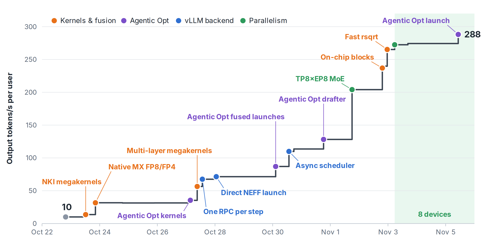

*Figure 1. Concurrency-1 output speed per user (1000 / median TPOT; 512-token prompts, 128 output tokens) after each validated optimization round, Oct 22 to Nov 5. The shaded region is the same model on 8 of the 16 Trainium 3 devices.*
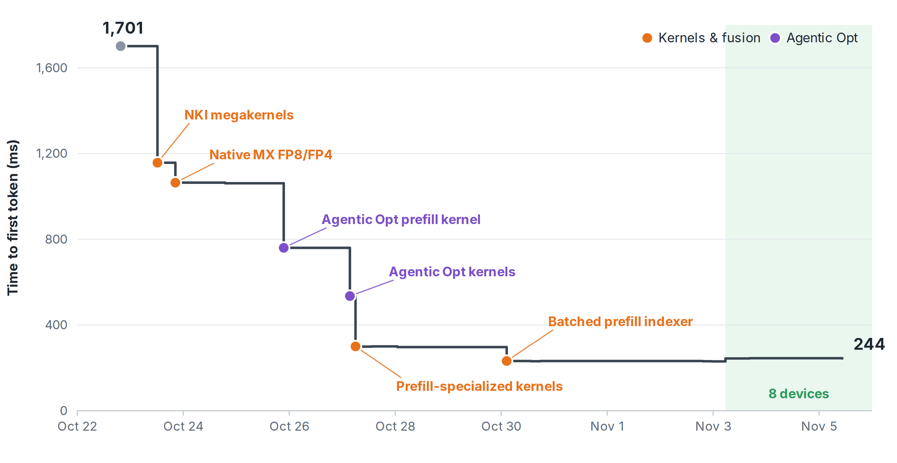

*Figure 2. Batch-1 time to first token (median TTFT; 1,024-token prompts) for the same runs. It falls from 1,701 ms to 230 ms on 16 devices and is 244 ms on 8 devices. All of the gain comes from prefill kernels.*

### Table of Content

- [DeepSeek V4.1 Flash Architecture](#deepseek-v41-flash-architecture)
- [AWS Trainium 3 vs. NVIDIA B300](#aws-trainium-3-vs-nvidia-b300)
- [Inference Optimization: Reaching 60x Speedup Over 12 days](#inference-optimization-reaching-60x-speedup-over-12-days)
  - [Exploit new hardware features in Trainium 3](#exploit-new-hardware-features-in-trainium-3)
  - [Kernel and MegaKernel Fusion](#kernel-and-megakernel-fusion)
  - [Optimize vLLM Backend for Trainium](#optimize-vllm-backend-for-trainium)
  - [Temporal Disaggregation: Specialized Kernels/Parallelization for Different Computations](#temporal-disaggregation-specialized-kernelsparallelization-for-different-computations)
  - [Serving Two High Interactivity Sessions at a Time](#serving-two-high-interactivity-sessions-at-a-time)
  
- [Experiment Results](#experiment-results)
- [Profile Analysis](#profile-analysis)
- [What if Trainium 3 were organized like four GPUs?](#what-if-trainium-3-were-organized-like-four-gpus)
- [Composing RSI with Expert Knowledge: Agent-Expert Disaggregated Optimization](#composing-rsi-with-expert-knowledge-agent-expert-disaggregated-optimization)
- [References](#references)

## DeepSeek V4.1 Flash Architecture

DeepSeek V4.1 Flash [1] is a mixture-of-experts (MoE) model with 552B backbone parameters and another 196B parameters in **Engram** conditional-memory modules, which are hashed n-gram embedding tables. Figure 3 shows the architecture. Its 40 layers form a **causal encoder-decoder (CED)**: a 20-layer causal encoder followed by a 20-layer decoder. The decoder's global KV cache is projected from the hidden states of the last encoder layer instead of from each decoder layer's own hidden states.

Apart from two layers that use only sliding-window attention (SWA), every layer replaces DeepSeek V4's hybrid of compressed sparse attention (CSA) and heavily compressed attention (HCA) with **Compressed Sparse Attention 2 (CSA2)**. In CSA2, a lightweight indexer scores the compressed global KV entries, and each query attends to the top 512 selected entries together with the layer's own 128-token SWA window. Each CSA2 layer is statically assigned one of three modes, which differ in how the layer obtains its global KV, indexer keys and top-k indices:

- **Full:** the layer computes its own global KV and indexer keys and selects its own top-k entries.
- **Reindex:** the layer reuses the global KV and indexer keys of the most recent Full layer, but scores them with its own indexer query and selects fresh top-k entries.
- **Reuse:** the layer reuses both the global KV and the latest top-k indices and runs no indexer at all.

The layers are arranged in groups that each start with a Full or Reindex layer followed by Reuse layers. The encoder compresses every 2 tokens into one KV entry, while the decoder keeps one entry per token. The decoder also uses a **Hierarchical Sparse Indexer**. The first full indexer layer in the decoder selects the best blocks of positions as a candidate pool, based on its top-k results. The Reindex layers then score only these candidates instead of the whole context. The residual stream is split into four streams by **Single-Pass mHC** (manifold-constrained hyper-connections), which mixes them between blocks with 4×4 matrices normalized by 20 Sinkhorn iterations. Every layer has an MoE with 384 routed experts, top-6 routing and one shared expert. Finally, DeepSeek V4.1 Flash ships with **DSpark**, a speculative-decoding module that drafts five tokens in one forward pass.

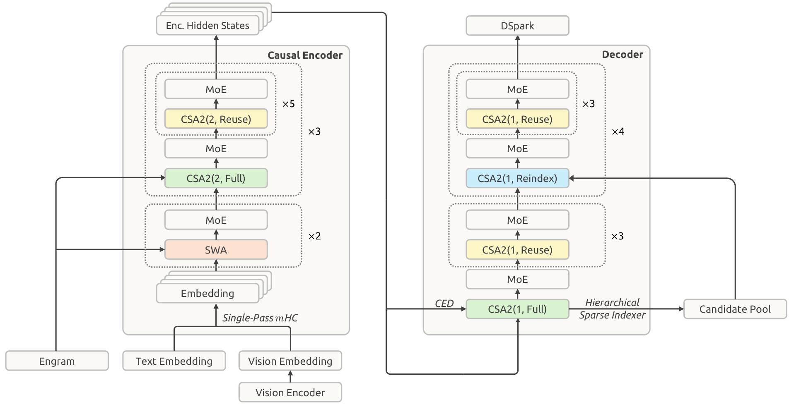

*Figure 3. The 40-layer causal encoder-decoder architecture of DeepSeek V4.1 Flash. Source: [2].*

## AWS Trainium 3 vs. NVIDIA B300

A Trainium 3 device has eight compute cores (NeuronCore-v4) and 4 HBM stacks, where every pair of cores share the same HBM stack. A NeuronCore is a heterogeneous processor with several specialized engines. The **Tensor Engine** is a systolic array for matrix multiplications. The **Vector Engine** and **Scalar Engine** run vector operations such as reductions and activation functions. The **GPSIMD Engine** runs general-purpose code. They share a software-managed on-chip scratchpad, **SBUF**, while the Tensor Engine accumulates into a separate buffer, **PSUM**. The DMA engines move data between HBM and SBUF. Although there are 8 cores in one device, the architecture is organized as 4 ranks connected through NeuronLink-v4. Interconnects between ranks in the same device and across devices are the same. One can therefore treat a Trainium 3 device as "4 devices".

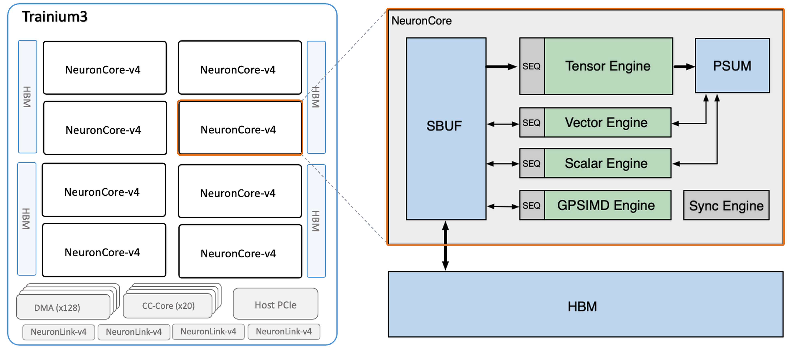

*Figure 4. Left: a Trainium 3 device, eight NeuronCore-v4 cores around four HBM stacks. Right: the programming model of one NeuronCore. DMA moves data between HBM and the on-chip SBUF. The tensor, vector, scalar and GPSIMD engines read from and write to SBUF, and the tensor engine accumulates into PSUM [3] [4].*

Compared with Trainium 2, Trainium 3 has 1.5x the HBM capacity (144 GiB against 96 GiB) and 1.7x the HBM bandwidth (4.9 TB/s against 2.9 TB/s) per device. The devices are also connected differently. Trainium 2 links its devices in a 2D torus. Traffic between distant devices passes through the devices in between. A trn3.48xlarge instance has 16 Trainium 3 devices connected through switches instead (Figure 5). Each device has a direct link to one partner, device 2k to device 2k+1. Beyond that, the instance is split into two halves: the eight even-numbered devices are connected all-to-all through one switch, and the eight odd-numbered devices through a second switch. A device therefore reaches its partner and every device of its own half in one hop, and any other device in two hops, through its partner or through the switch.

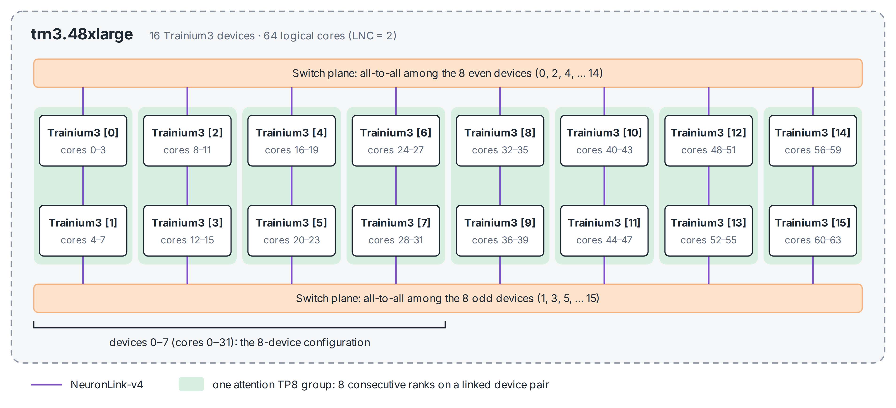

*Figure 5. Interconnect topology of trn3.48xlarge. Devices 2k and 2k+1 share a direct link. The 8 even devices are connected all-to-all through one switch, and the 8 odd devices through another. With 4 ranks in each device, the 16-device configuration runs 64 ranks on cores 0–63. Each attention TP8 group (8 consecutive ranks) sits on one linked device pair.*

One question is, compared to B300 which is the current state-of-the-art serving device, what's the competence of Trainium 3? The table below compares a Trainium 3 device with an NVIDIA B300 GPU. B300 has 2x the FP8 throughput, 6x the FP4 throughput, 3.7x the BF16 throughput, 1.6x the HBM bandwidth, about twice the memory and 7x the intra-server interconnect bandwidth than Trainium. 

| Per chip | Trainium 3 | B300 | B300 / Trainium 3 |
|---|---|---|---|
| Dense FP8 | 2.5 PFLOPS (MXFP8) | 5 PFLOPS | 2x |
| Dense FP4 | 2.5 PFLOPS (MXFP4) | 15 PFLOPS | 6x |
| Dense BF16 | 0.67 PFLOPS | 2.5 PFLOPS | 3.7x |
| FP32 | 0.18 PFLOPS | 0.08 PFLOPS | 0.45x |
| HBM | 144 GiB at 4.9 TB/s | up to 288 GB at 8 TB/s | 1.6x bandwidth |
| Intra-server interconnect | 256 GB/s (NeuronLink-v4) | 1,800 GB/s (NVLink 5) | 7x |

*B300 values are NVIDIA's GB300 NVL72 rack figures divided by its 72 GPUs, with sparse figures halved to dense  [3] [5].*

Looking at the FLOPs of DeepSeek V4.1 Flash by data type, we found that 47.6% are FP4 (the routed experts), 30.8% FP8, 17.2% BF16 and 4.5% FP32:

| Data type | Share of FLOPs | B300 / Trainium 3 |
|---|---|---|
| FP4 | 47.6% | 6x |
| FP8 | 30.8% | 2x |
| BF16 | 17.2% | 3.7x |
| FP32 | 4.5% | 0.45x |

Therefore, 1 B300 is equivalent to 4 Trainium 3 in terms of the FLOPs performance for DeepSeek V4.1 Flash, about 2 Trainium 3 in terms of the HBM bandwidth, and 7 Trainium 3 for interconnect bandwidth. Decoding of LLMs is highly memory-bound. In production deployments, however, large collective overheads and dependency chains between compute, collectives and DMA accesses are often the culprits of overall slowdown. Furthermore, Trainium 3 needs to perform collectives across more ranks, which makes the interconnect bandwidth a more severe bottleneck. Therefore, we believe more than 2 Trainium 3 is needed to catch up a single B300 GPU.

## Inference Optimization: Reaching 60x Speedup Over 12 days

Our deployment is built on the vLLM Neuron plugin [8], which adds a Neuron backend to vLLM [9]. All of its kernels are written in the Neuron Kernel Interface (NKI) [10] on Neuron SDK 2.33.0. Many components of DeepSeek V4.1 Flash, such as CSA2, mHC, Engram and DSpark, are not yet supported by vLLM Neuron. We therefore first brought the model up on a trn2.48xlarge, where we implemented the missing operations and validated correctness. We then moved it to a trn3.48xlarge on Oct 22, where it decoded at 99.4 ms per token. Over the following two weeks, we optimized it in four directions: using Trainium 3's new hardware features, fusing kernels into megakernels, removing host overhead in vLLM's Neuron backend, and specializing kernels and parallelization for each phase.

### Exploit new hardware features in Trainium 3

Apart from larger and faster components, the NeuronCore-v4 on Trainium 3 adds new instructions and execution modes [4]. We exploit these new features and found that they contribute to the speedup non-trivially.

#### Native MXFP8/FP4 Matrix Multiplication in Tensor Engine

DeepSeek V4.1 Flash uses OCP microscaling (MX) format: FP8 and FP4 values with one E8M0 scale per 32 elements, which are not supported on Trainium 2. The NeuronCore-v4 Tensor Engine multiplies such operands natively with `nc_matmul_mx`. The operands are packed four to a word (`float8_e4m3fn_x4`, `float4_e2m1fn_x4`). One instruction therefore contracts 512 elements instead of 128, which gives 4x the throughput of a BF16 matmul. We load each weight once into this packed layout, with its scales alongside. The FP8 and FP4 weights then stream into the Tensor Engine exactly as the checkpoint stores them. The activations are quantized on chip on the fly with `quantize_mx` running on the vector engine.

#### Tensor indirection on chip

On the NeuronCore-v4, the compute engines can read and write SBUF through an index tensor. One instruction gathers or scatters along the free dimension, where Trainium 2 needs a separate instruction for each irregular access. We use this for CSA2's sparse attention, where each query attends to its own selection of up to 512 KV entries plus the sliding window. At the start of a step, the kernel gathers the step's window and compressed KV rows from the paged caches into a slot table with indirect DMA. It transposes the table once with a DMA transpose and keeps it resident in SBUF. Each token's QK matmul then reads its own columns of this table directly, through tensor indirection on the matmul's moving operand. 

The native MX matmuls and the on-chip key selection landed in the same round, together with an MoE loop over only the experts that were picked. The three changes cut TPOT from 73.1 ms to 31.6 ms, the largest single step of this work.

#### Exact rsqrt on the GPSIMD Engine

The GPSIMD Engine can now run activation functions (`nisa.activation` on the GPSIMD Engine). Its reciprocal square root is within 1 FP32 ulp of the exact result, rather than a polynomial approximation. This avoids further refinement with Newton's method to improve the accuracy. This is especially useful for `rsqrt` operator, which is widely used in normalization on mHC. It shipped with the last 16-device fusion round, which took TPOT from 4.17 ms to 3.77 ms.

#### Balancing work with the Scalar Engine's performance mode

The Scalar Engine can now run `tensor_copy` and `tensor_scalar` natively, at up to 2x the throughput for BF16 data. The final decode kernels place part of these copies and scalings on the Scalar Engine, such as a share of the PSUM-to-SBUF copies of the transposed keys. This balances the load between the two engines and keeps the Vector Engine free for the operations on the critical path.

#### DMA priorities

Each DMA access can carry one of four priority levels. The DMA engines serve higher-priority transfers first. A decode block issues many transfers at once, but only some of them are on the critical path. We give priority 0 to three kinds of transfer: the attention and all-rank all-reduces, the scale gathers that the first expert matmul waits for, and the first routed expert's weights. Later experts' weights get lower priorities in the order they are used. The down-projection weights get the lowest. With these levels, the kernels can prefetch aggressively without delaying the transfers the engines are waiting for. This matters most during the all-reduce collectives.

### Kernel and MegaKernel Fusion

Kernel and megakernel fusion is a common strategy of optimizing end-to-end LLM inference by eliminating kernel launch overhead, overlapping operations across kernels, and avoiding excessive HBM accesses. We progressively fuse kernels from operations inside each layer to across layers, as well as applying additional tricks to reduce latency. The procedure of progressive fusion is shown in Figure 6.

#### Step 1: One kernel per operation

At the beginning, we bootstrapped the deployment in NKI kernels with one operation per kernel.

#### Step 2: One megakernel per transformer block

We first wrote one NKI kernel per transformer block and one for the drafter. Inside a block, activations stay in SBUF from one operation to the next instead of going through HBM. Collectives run inside these kernels. Each block issues its all-reduces over the 8-rank attention group and over all ranks from NKI. The two physical cores of a rank split the work and exchange partial results directly with `sendrecv`. This first step cut TPOT from 99.4 ms to 73.1 ms. Many layers are identical in terms of the architecture. We found 9 distinct archetypes of transformer blocks (including the DSpark drafter) and optimize/reuse these 9 fused kernels across the 40 layers.

#### Step 3: Eight blocks per launch

Fusing eight consecutive blocks into one launch leaves five layer launches per step and cuts TPOT from 28.3 ms to 17.7 ms. At this stage, eight blocks per megakernel is the best size, because each launch still has a significant host cost. The host overhead to submit a launch grows with its number of input and output tensors: about 1.5 ms for one block (70 tensors) and about 5 ms for eight blocks (about 505 tensors). Larger launches therefore save per-launch overhead, but the device waits longer for the first launch to be submitted. Launches of 20 blocks gave a TPOT of 17.2 ms against 16.3 ms for launches of 8. Further kernel fusion requires changing the backend to reduce the host overhead.

#### Step 4: Optimize each fused launch as a whole

Once we finished optimizing the vLLM backend for Trainium as noted in the next section, we optimized each of the five megakernels:
- **Shared index tables.** Blocks that read the same top-k selection share one copy of the slot and index tables instead of each loading its own.
- **Outputs kept on chip.** A block leaves its output tiles in SBUF for the next block instead of writing them to HBM.
- **Weight prefetch.** A block loads the next block's projection weights while its own all-reduce at the end of the transformer layer is in flight.
- **Both physical cores in a rank.** Part of the computation in mHC, the MoE and the indexer in CSA2 is split over the two physical cores of a rank.

Two of the megakernels went from 6.5 ms to 4.6–4.7 ms each, and TPOT went from 14.0 ms to 11.5 ms.

#### Step 5: On-chip blocks and merged launches

After Step 4, a block still passed much of its intermediate data through HBM. The Step 4 changes had freed SBUF space, which let us keep more of each block on chip. The four residual streams of the hyper-connections now stay in SBUF from one block to the next, and the all-reduce results load directly into them. The hyper-connection maps run on the Tensor Engine. The indexer, compressor, Engram gate and MoE keep their activations in SBUF. With activations no longer leaving the chip, the launch boundaries became the bottleneck. At the start of each launch, every rank waits at an entry barrier until all ranks have started it, because the collectives inside the launch need all of them. Each entry barrier took 95 to 165 µs, about 0.65 ms per step. We therefore merged the layers into three launches: layers 0–7, layers 8–23, and layers 24–39 with the head.

In this step, megakernel fusion can slow down inference for two reasons:
- **Spills to HBM.** A merged launch holds more tiles in SBUF at once: each part's persistent buffers, constants and index tables, plus one weight buffer per MoE expert slot. SBUF ran out, and the compiler spilled 564 MB per step to HBM and read it back.
- **Weight loads compete with the all-reduce.** The compiler scheduled the next block's weight loads inside the current block's MoE all-reduce, which then took about twice its minimum time.

We fixed these with four changes:
- **Double-buffered expert weights.** The expert slots share two buffers for the gate and up-projection weights instead of one each, freeing about 35 KB per partition.
- **Shared launch-level tiles.** Each part of a merged launch reuses the previous part's persistent buffers, constants and index tables.
- **Attention prefetch during the MoE.** Each block issues the next block's attention weights during its MoE. The next block's other loads wait until the all-reduce finishes.

With double buffering, the merged launch took 4,148 µs against 4,310 µs for its parts. This step took TPOT from 4.90 ms to 3.77 ms.

We stopped at three launches. Fusing the whole step into one launch has a large preparation cost to build all necessary tensors at the host. The number of tensors to prepare grows with the size of the megakernel. Excessive fusion also removes the chance to overlap the host's preparation of the next launch with the device's execution of the previous one, which worsens performance.

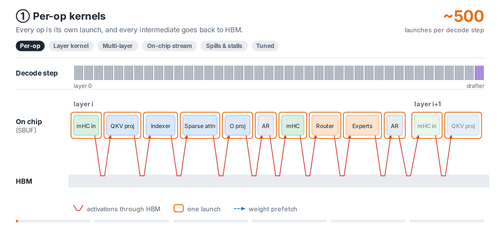

*Figure 6. Illustration of progressive kernel and megakernel fusion in DeepSeek V4.1 Flash, with the optimization to reduce memory access overhead.*

### Optimize vLLM Backend for Trainium

vLLM Neuron is a relatively new plugin for LLM inference on Trainium. Many designs of the LLM backend, though suitable for GPU serving, are no longer optimal for Trainium. As mentioned in the last section, we need several backend updates to minimize vLLM's host-side overheads. These include scheduling, recompilation and RPCs between the engine and the workers. This can unblock the host-side bottleneck and facilitate mapping megakernel optimizations to end-to-end speedup. 

#### Step 1: One RPC per step

vLLM's engine core drives the workers with three RPCs per decode step: one to execute the model, one to sample tokens, and one to collect the draft tokens. We moved sampling into `execute_model` and returned the drafts in the step's output. A decoding step now needs only one RPC. Together with other changes in the same round, such as cached launch plans, this took TPOT from 17.7 ms to 14.8 ms.

#### Step 2: Direct launch of cached NEFFs

The worker used to launch each fused NEFF through its compiled entry point. Every call went through Dynamo's guards and AOT runtime wrapper, and it allocated fresh output tensors. We now call the NEFF executor directly. The step's inputs and outputs live in persistent buffers, and every I/O tensor keeps its address from one step to the next. The runtime therefore reuses each launch's DMA ring instead of rebuilding it. This improved TPOT by 6% at batch size 1 and by up to 26% at batch size 10.

#### Step 3: Async scheduling with an on-device step prologue

Async scheduling prepares step N+1 while step N runs on the device. However, the next decoding step's input is partially determined by the number of accepted tokens of DSpark drafter from the previous step. In our design, a small NKI kernel, the step prologue, builds these inputs. It runs on the device at the start of each step and reads the previous step's acceptance result. The host never waits for the device. The device's idle time per step fell from 4.4–5.1 ms to 0.7 ms.

#### Step 4: Overlap collectives with the next layer

Inside a megakernel, the device mostly waits while an all-reduce is in flight. We therefore prefetch the next block's weights during the all-reduce. The final kernels therefore hold weight DMAs until the previous all-reduce result has arrived, and prefetch only the query down-projection, right after the attention all-reduce.

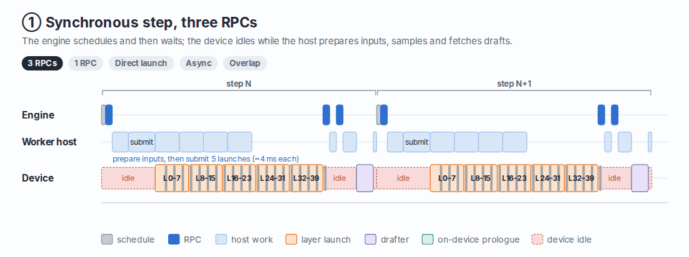

*Figure 7. How we update the vLLM backend to reduce the host-side overhead and overlap executions between decoding steps.*

### Temporal Disaggregation: Specialized Kernels/Parallelization for Different Computations

LLMs are getting more diverse and complex. Disaggregated inference has become a standard way to serve them. Prefill/decode (PD) disaggregation [11] [12] runs the compute-bound prefill and the memory-bound decode on separate groups of devices. Attention/FFN disaggregation (AFD) [13] [14] further separates attention from the MoE experts. Each group then uses the kernels and parallelization scheme that fit its work.

Similarly, different parts of DeepSeek V4.1 Flash need different kernels and parallelization schemes. New modules such as Engram add more choices. For high interactivity, however, splitting the model across groups of devices would add latency to every decoding step. We therefore use temporal disaggregation. Each module and each stage has its own kernels and parallelization scheme, and they run one after another on the same devices (Figure 8).

#### TP8 × EP8 for the decode MoE

In prefill, the routed experts use expert parallelism (EP64), where each rank holds 6 whole experts. This works well when many tokens spread their expert choices over all ranks. A batch-1 decoding step, however, has only 6 rows: one token and five draft tokens. Its 36 expert choices land on a few ranks. Every all-reduce then waits for the busiest rank, while most ranks have nothing to do.

For decoding, we therefore switch the MoE to TP8 × EP8. The experts are divided into 8 groups, and each group's experts are split by column across the 8 ranks of an attention group. Every rank then does the same amount of work in every step. We also split the shared expert and the Engram value projection across ranks instead of replicating them as in prefill. This layout costs memory. Prefill still uses EP64, and the expert weights are stored twice. On 8 devices, the second copy takes about a quarter of each rank's HBM. In return, batch-1 TPOT fell by 27 to 37%.

#### Separate prefill and decode kernels

Each of the 9 kinds of transformer block has its own prefill kernel and decode kernel. A prefill block processes hundreds of tokens, while a decode block processes only six rows. All of the TTFT gain in Figure 2 comes from the prefill kernels. In these kernels, we stack tokens on SBUF partitions to keep the engines busy. After the blocks became fast, the indexer took 62% of a long prefill chunk. We then batched its scoring to 32 tokens per matmul, which cut TTFT by another 16 to 48%.

Unlike decode, prefill keeps one launch per block. A prefill block runs for about 5 ms, and the launch overhead is small in comparison. In a profile of a 1,024-token prefill, host gaps take only 17 of the 244 ms.

#### The drafter

The DSpark drafter runs once per decoding step, after the 40 layers. It took 19% of a batch-1 decoding step. We optimized its decode kernels, which became 2.7x faster. We also split its input projection by column across ranks instead of replicating it. Together, these changes cut TPOT from 8.8 ms to 7.8 ms.

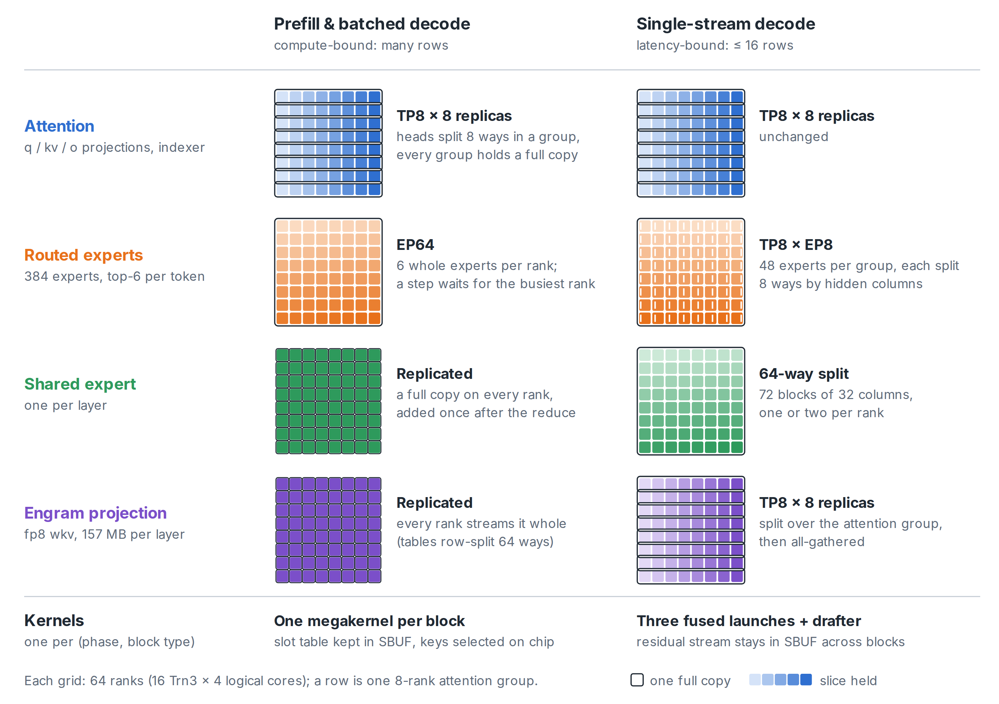

*Figure 8. Parallelization scheme of different modules in a transformer block for prefill and decode stages. Each operation's color says how its weight is split over the 64 ranks. The routed experts change from EP64 in prefill to TP8 × EP8 in decode. The shared expert is split by column over all 64 ranks, and the Engram projection is split over the attention group and all-gathered.*

### Serving Two High Interactivity Sessions at a Time

At batch size 1, 64 ranks are more parallelism than the model needs. We therefore moved the model to 8 of the 16 devices, with 32 ranks and a TP8 × EP4 decode MoE. The other half of the instance can then serve a second user (Figure 9).

The main challenge was memory. Each rank now holds twice as many experts and Engram rows, and our first 32-rank run ran out of HBM. Two changes made the model fit. We keep the Engram tables in FP8 instead of BF16. We also free each FP8 weight once its MX copy is built. The KV cache is small next to the weights, even for long contexts.

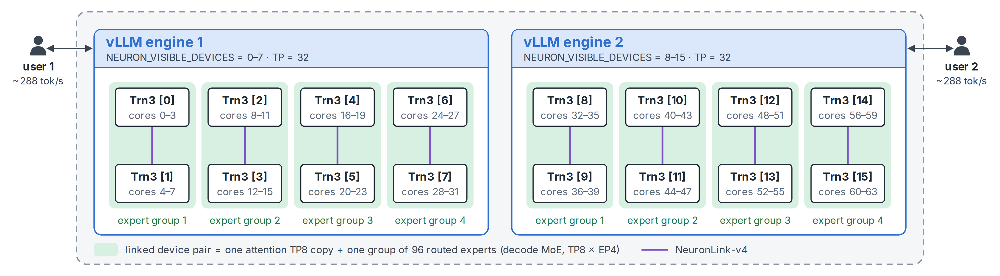

*Figure 9. One trn3.48xlarge split into two independent 8-device engines, each serving one user. Each engine runs TP = 32 on its own devices. Each linked device pair (green) holds one attention TP8 copy and one group of 96 routed experts of the TP8 × EP4 decode MoE.*

Each rank also does more MoE and Engram work per step. We therefore optimized the 8-device decoding step further. The decode MoE uses a fixed set of expert slots instead of a loop whose length is known only at run time. The step prologue now runs inside the first launch, and the draft verification runs inside the drafter launch. A batch-1 step is therefore 4 launches instead of 6. Together with a faster drafter and scheduling fixes in the megakernels, these changes saved about 0.5 ms per step.

As a result, the decoding step on 8 devices is 3 to 5% shorter than on 16 devices. Both were measured on the same day:

| Cell | 8 devices: TPOT / step / TTFT | 16 devices: TPOT / step / TTFT |
|---|---|---|
| 512 tokens, batch 1 | 3.47 / 12.10 / 147 ms | 3.74 / 12.67 / 134 ms |
| 1,024 tokens, batch 1 | 3.95 / 12.14 / 244 ms | 3.72 / 12.63 / 231 ms |
| 8,192 tokens, batch 1 | 4.06 / 12.77 / 1,715 ms | 4.00 / 13.21 / 1,659 ms |

TPOT does not always follow the step. At 1,024 tokens, TPOT is 3.95 ms on 8 devices against 3.72 ms on 16, because fewer drafts were accepted (43.5% against 51.2%). The two deployments add up partial results over a different number of ranks. Their floating-point sums therefore differ in the last bits. When two candidate tokens are almost tied, the two deployments can pick different ones. The generated texts then diverge, and the drafter does better on some texts than on others. With only 8 requests per input length, this changes TPOT by several percent. We therefore use the step time to compare speed.

One trn3.48xlarge can therefore serve two users at about 288 tokens/s each. To check this, we started two servers at the same time, one on devices 0–7 and one on devices 8–15. We ran the 512-token benchmark on each engine, first with the other engine idle and then with the other engine serving the same requests without a break.

The two engines do not slow each other down. The step time changes by less than 0.3%, and both halves of the instance are equally fast. The engines share no cores and no HBM, and their collectives stay within their own 8 devices. The host also has enough CPU cores and memory for both.

## Experiment Results

We measured the final 8-device deployment with 128 output tokens and greedy decoding. Unless noted otherwise, each server handles one sequence at a time.

### Batch-1 TTFT, TPOT and token speed

| Prompt (mean tokens) | TTFT | Prefill rate | TPOT | Per user token speed | Decoding step |
|---|---|---|---|---|---|
| 503 | 147 ms | 3,400 tokens/s | 3.47 ms | 288 tokens/s | 12.10 ms |
| 1,009 | 244 ms | 4,100 tokens/s | 3.95 ms | 253 tokens/s | 12.14 ms |
| 2,027 | 427 ms | 4,700 tokens/s | 3.89 ms | 257 tokens/s | 12.19 ms |
| 8,146 | 1,715 ms | 4,750 tokens/s | 4.06 ms | 246 tokens/s | 12.77 ms |

TTFT grows almost linearly with the prompt length. Long prompts are prefilled at about 4,700 tokens/s. The decoding step barely changes with the prompt length: it grows from 12.10 ms at 512 tokens to 12.77 ms at 8,192 tokens. The reason is the sparse attention of the model. Each query reads the top 512 KV entries and a 128-token window, however long the context is. TPOT varies more than the step, because it also depends on how well the drafter does on each set of prompts.

### Token speed across tasks

The step time does not depend on the text, but the number of accepted draft tokens does. We sent 16 chat prompts of different kinds to one server, with no thinking mode and up to 256 output tokens:

| Kind of answer | Drafts accepted | Tokens per step | Output speed |
|---|---|---|---|
| JSON data; exact copy of a given paragraph | 93–94% | 5.6–5.7 | 432–445 tokens/s |
| Math, worked step by step | 68–81% | 4.4–5.0 | 346–397 tokens/s |
| Code (Python, C, SQL) | 63–81% | 4.1–5.1 | 322–397 tokens/s |
| Markdown table of facts | 67% | 4.3 | 343 tokens/s |
| Translation into French / into Chinese | 49% / 28% | 3.4 / 2.3 | 260 / 178 tokens/s |
| Explanation of a concept | 35–39% | 2.7–3.0 | 217–233 tokens/s |
| Open chat (greeting, travel advice) | 30–37% | 2.5–2.9 | 193–225 tokens/s |
| Short story / poem | 23% / 14% | 2.1 / 1.7 | 168 / 133 tokens/s |

All answers ran at about the same step time. The token speed therefore follows the draft acceptance, from 133 tokens/s for a poem to 445 tokens/s for JSON. Text with a fixed form, such as code, structured data and math, is drafted well. Free prose and poems are not. Our benchmark prompts lie in the middle of this range.

The token speed also holds for long answers. We asked for two answers of 2,000 tokens each, an essay and a long piece of code. In both, the step stayed between 12.2 and 12.6 ms from the first token to the last.

### TTFT and Cost per Token against GPU Serving

For the first token, Trainium 3 is already on par with GPU serving. The table below compares our TTFT for a 1,024-token prompt with two published GPU measurements from Oct 20.

| Deployment | TTFT, 1K-token prompt | Source |
|---|---|---|
| Dynamo vLLM, concurrency 1 | 0.2 s | [6] |
| Together AI | 0.3 s | [7] |
| Trainium 3, 8 devices (ours) | 0.24 s | median at batch size 1 |

Our TTFT is close to Dynamo vLLM and lower than Together AI. The published numbers are rounded to a tenth of a second, and Artificial Analysis measures from the client, including the network.

Serving one user on half of the instance also makes Trainium 3 cheaper per token than B300. The table below counts only output tokens, at each deployment's per user token speed. It charges the 8-device deployment for half of the instance. For Trainium 3, we use three token speeds from above: the benchmark, code and JSON data.

| Deployment | Text | Chips | Per-user output tok/s | $/hr | Output tokens per $1 | vs. B300 |
|---|---|---|---|---|---|---|
| GB300 NVL72, Dynamo vLLM, P90 interactivity | InferenceX benchmark | 4 B300 | 653.6 | 65.00 | 36,199 | 1.00x |
| Trainium 3, 8 devices, $47/hr instance | Benchmark | 8 Trn3 | 288.3 | 23.50 | 44,160 | 1.22x |
| Trainium 3, 8 devices, $51/hr instance | Benchmark | 8 Trn3 | 288.3 | 25.50 | 40,697 | 1.12x |
| Trainium 3, 8 devices, $47/hr instance | Code | 8 Trn3 | 322–397 | 23.50 | 49,328–60,817 | 1.36–1.68x |
| Trainium 3, 8 devices, $51/hr instance | Code | 8 Trn3 | 322–397 | 25.50 | 45,459–56,047 | 1.26–1.55x |
| Trainium 3, 8 devices, $47/hr instance | JSON data, exact copy | 8 Trn3 | 432–445 | 23.50 | 66,179–68,170 | 1.83–1.88x |
| Trainium 3, 8 devices, $51/hr instance | JSON data, exact copy | 8 Trn3 | 432–445 | 25.50 | 60,988–62,824 | 1.68–1.74x |

The B300 cost is AWS's 8-GPU B300 instance at $130 per hour, divided by two for 4 GPUs. The trn3.48xlarge price is our estimate: $47 per hour based on H100 pricing, or $51 per hour based on the performance ratio to B300. The B300 token speed is the P90 interactivity measured by SemiAnalysis InferenceX [6] on Oct 20. Neither side counts input tokens or prefill time. We have no B300 measurement on code or JSON data. If B300 also runs faster on such text, the code and JSON rows overstate the advantage of Trainium 3.

### Batch 1 vs. batch 10

A server is started either for one sequence or for up to ten sequences. The two settings use different decode kernels. All rows below use 512-token prompts. The total token speed divides all output tokens by the total time of the run, including prefill.

| Engine | Users at the same time | Per user token speed | Decoding step | TTFT | Total token speed |
|---|---|---|---|---|---|
| One sequence | 1 | 288 tokens/s | 12.1 ms | 147 ms | 215 tokens/s |
| Ten sequences | 1 | 75 tokens/s | 44.6 ms | 152 ms | 69 tokens/s |
| Ten sequences | 10 | 56 tokens/s | 40.7 ms | 531 ms | 405 tokens/s |

With ten sequences, a decoding step takes about 41 to 45 ms, whether one user or ten users are active. Ten users together get 405 tokens/s, 1.9x the total token speed of the single-sequence server. Each of them, however, gets only 56 tokens/s, about a fifth of the single-sequence speed. Our optimizations target the single-sequence server, and the batched path has not been optimized as much.

## Profile Analysis

Trainium 3 matches GPU serving on TTFT, but not on decoding speed. The B300 deployment serves 653.6 tokens/s per user [6], 2.27x more than our 8-device deployment. This is expected from the [hardware comparison](#aws-trainium-3-vs-nvidia-b300). Our deployment uses 2 Trainium 3 devices for each B300. This gives slightly more HBM bandwidth than B300, but about half of the FLOPs for this model and less than a third of the interconnect bandwidth. To match B300 at our draft acceptance of about 3.5 tokens per step, our decoding step would need to take 5.3 ms instead of 12.1 ms.

To find where the time goes, we profiled a batch-1 decoding step on the 8-device deployment. The device is busy for 97% of the 12.04 ms step. The MoE takes 3.94 ms, attention 3.38 ms, collectives 2.25 ms and the drafter 1.12 ms. The host gaps between the four launches take only 0.34 ms.

The step is not limited by memory bandwidth or compute. A rank moves 3.24 GB per step, mostly the weights of the 40 layers. This would take about 3.1 ms at the highest DMA rate we observed. Over the whole step, the DMA rate is only about 23% of the HBM peak. The step is instead limited by a long chain of small operations that depend on each other. Figure 10 shows a decoding step on one rank.

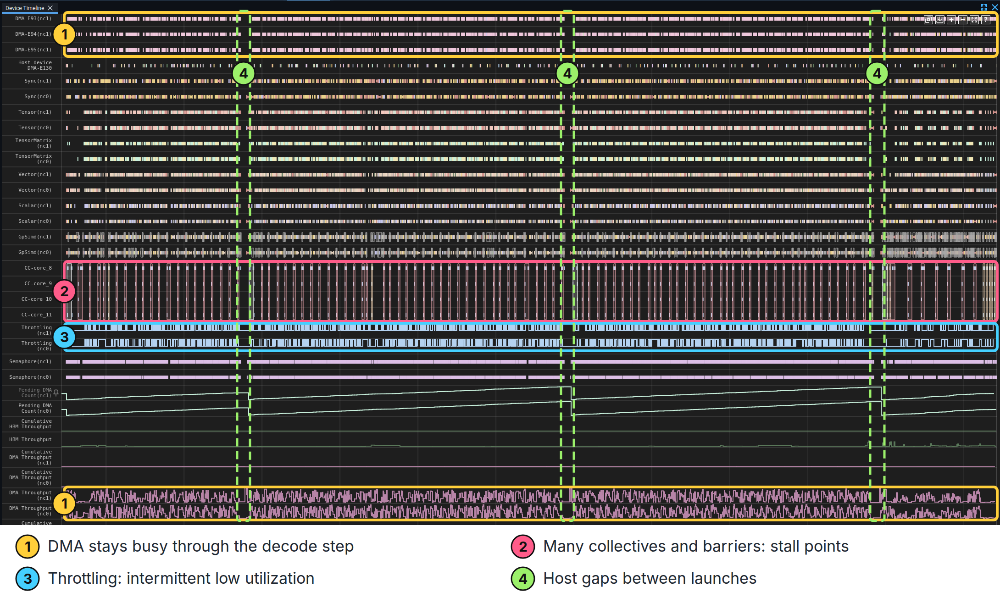

*Figure 10. Device timeline of batch-1 decode step on one rank. (1) DMA throughput is high; (2) collectives and barriers stall the engines; (3) throttling leaves the engines intermittently underused; (4) host gaps between launches.*

DMA is in flight for 93% of the step (1), but it rarely runs at full speed. Each physical core has 16 DMA engines, and on average only about a third of them are busy. Only about a fifth of the idle engine time falls inside collectives. Most of it happens while the core runs its own layers:

| Outside collectives (9.68 ms per step) | Core 0 | Core 1 | Share of idle engine time |
|---|---|---|---|
| Computing, no DMA in flight | 3.17 ms | 3.52 ms | 55% |
| Data moving on only some engines (6.6 of 16 on average) | 2.85 ms | 2.81 ms | 26–29% |
| Whole core stalled on a semaphore | 0.55 ms | 0.59 ms | 9–10% |
| Between launches | 0.24 ms | 0.24 ms | 4% |
| Nothing running | 0.14 ms | 0.35 ms | 3–6% |
| All 16 engines busy | 2.73 ms | 2.18 ms | – |

The main reason is the dependencies between operations. A core often cannot start its next load before the current computation finishes, because the result decides what to load. For example, the expert weights wait for the routing, and the KV gather waits for the indexer's top-k. Prefetching more weights during these waits did not help. The extra loads share the DMA queues with the all-reduces and slow them down ([Step 4](#step-4-overlap-collectives-with-the-next-layer)). SBUF also has limited space for more weights. Most of the other transfers are small, such as index tables and the rows of a six-row batch. These transfers use only a few of the 16 engines and cannot fill the DMA bandwidth.

Collectives and barriers take 2.25 ms per step (2). Most of them are small all-reduces after attention and after the MoE. Although each all-reduce carries only about 120 KB, there are more ranks to perform the collectives than standard GPU node. Some ranks also wait for others, because the Engram gather and the expert load are not evenly distributed across ranks.

## What if Trainium 3 were organized like four GPUs?

The profile shows that the decoding step is limited by many small, dependent operations and by small collectives, not by bandwidth or FLOPs. Part of this comes from how the model is split. The B300 deployment runs the model on 4 GPUs, while ours runs it on 32 ranks. With 32 ranks, attention is copied four times, every rank repeats the same small operations, and every layer needs collectives over many ranks. We therefore ask how fast Trainium 3 could decode if it were organized like the B300 deployment.

To answer this, we built an analytical model of the decoding step from the profile. We applied it to a hypothetical system, where the same 8 Trainium 3 devices form 4 ranks. Each rank has the compute and HBM bandwidth of 2 devices, and the ranks are connected by NVLink 5. Attention, the indexer and the MoE then all run TP4.

The model scales every compute piece and every collective of the measured step to the new layout. Work split across all ranks, such as the experts, keeps its time per rank, because each rank does 8x the work with 8x the resources. Attention work drops to a quarter. Work that every rank repeats, such as mHC and normalization, drops to an eighth. We assume that the time of each instruction shrinks with its data, and that each collective takes 5 µs on NVLink. Without any change, the model gives the measured 12.04 ms step.

| Change, applied in order | Decoding step |
|---|---|
| Today: 32 ranks on NeuronLink | 12.04 ms |
| 4 ranks on NVLink 5 | 10.85 ms |
| + attention and indexer not copied | 8.97 ms |
| + repeated work on 8x resources per rank | 7.00 ms |
| + one device per rank, no core-to-core sync | 6.60 ms |
| + balanced MoE | 6.48 ms |
| + 15 PFLOPS FP4 and 2.5 PFLOPS BF16 per rank, as on a B300 | 5.55 ms |
| Per user token speed | 629 tokens/s |

The result is 5.55 ms, within 4% of the 5.34 ms step that matches B300. Most of the gain comes from how the ranks are organized, not from the interconnect or the FLOPs. Removing the copies of attention and running repeated work on bigger ranks saves 3.9 ms. Faster collectives save 1.2 ms. The FP4 and BF16 FLOPs of a B300 save only 0.9 ms. At batch size 1, the Tensor Engine works on only six rows, and most of its time overlaps with other engines. For batch-1 decoding, how the chips are organized matters more than their peak FLOPs.

## Composing RSI with Expert Knowledge: Agent-Expert Disaggregated Optimization

We did not start with the flow in Figure 12. In our first attempts, during the Trainium 2 development, we ran the AutoHelix loop directly on the whole model. In each iteration, an agent changed the port. The loop then compiled the model, served the full benchmark matrix and kept the change only if every constraint still held and no metric regressed by more than 5%. This gave only small improvements (Figure 11). On a trn2.48xlarge with 64 ranks, eight iterations over about 34 hours brought batch-1 TPOT at 512 tokens from 103.5 ms to 90.7 ms (12%) and TTFT from 860 ms to 729 ms (15%). Five of the eight iterations were rejected. Four of them failed on the TTFT of 8,192-token prompts at batch 4, a median over eight requests that flips between two values from run to run. One of those four had cut TTFT at 512 and 1,024 tokens by 18 to 23%. An iteration took up to four hours. The loop therefore tried only a handful of ideas a day and judged each one by a noisy end-to-end number. Run on the whole model, the loop lacked most of the five properties in the table below. The flow is built to restore them.

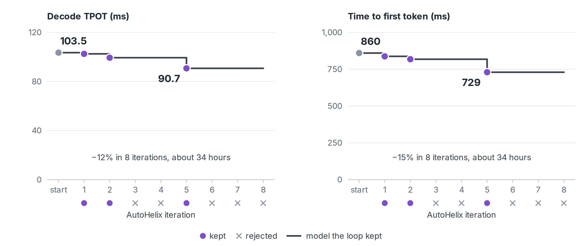

*Figure 11. The whole-model AutoHelix loop during our Trainium 2 development (trn2.48xlarge, 64 ranks, Oct 22–23): batch-1 TPOT (left) and TTFT (right) for 512-token prompts after each iteration, on axes that start at zero. The line is the model the loop kept. Iterations 3, 4 and 6–8 were rejected.*

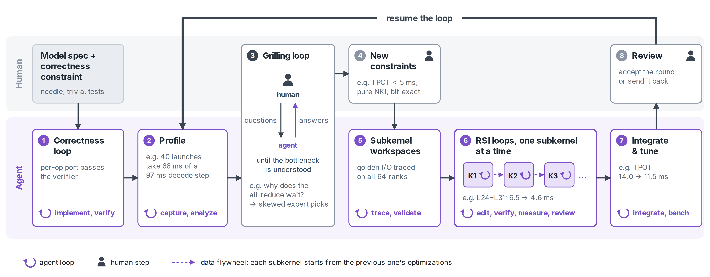

*Figure 12. Our agentic optimization flow. ① An agent ports the model until it meets the correctness constraint. ② We profile it, ③ the agent and a human grill the profile until the bottleneck is understood, and ④ the human sets new constraints. ⑤ The agent builds one workspace per subkernel with golden inputs and outputs traced from the live server. ⑥ It runs a recursive self-improvement (RSI) loop on each subkernel in turn, starting each from the previous kernel's optimizations. ⑦ It integrates and tunes the kernels in the model. ⑧ A human reviews the round before the loop resumes at ②.*

Figure 12 divides the work by the kind of task. The agent runs the loops whose task has five properties, and the human takes the steps that lack one of them (table below). A subkernel workspace (⑤) is built to have all five. The golden inputs and outputs give a clear constraint and a fast check. The kernel's latency on those inputs is the objective, and the agent may edit only the kernel file.

| Property | Good fit for the agent self-improvement | Agents evolve slowly, needs a human expert |
|---|---|---|
| **Clear constraint** | The constraint can be checked: the kernel's output matches the golden output within tolerance, or bit for bit. | Correctness needs judgment: what counts as correct for the whole model, which tolerance to allow, and whether a summation-order difference is acceptable when the generated text is still right. |
| **Quick verification and measurement** | A check takes minutes: a fused launch compiles and runs on its recorded inputs in about a minute. A loop can therefore try many variants. | A check is slow: an end-to-end check recompiles the whole model and serves real requests (the integration test alone takes about 11 minutes). A profile must be captured and ingested before anyone can read it. The human picks the few experiments worth running. |
| **Clear objective** | There is one number to improve: the kernel's latency on its recorded inputs. | The goal is a trade-off: what to optimize next, whether a second copy of the expert weights (9.4 GiB of HBM per rank) is worth a 27–37% lower TPOT, or how far the scheduler may run ahead before it costs TTFT. |
| **Restricted editable scope** | The agent edits only the kernel file; its inputs, its outputs and the rest of the system stay fixed. | The change cuts across layers: async scheduling changed vLLM's scheduler and worker and added the on-device step prologue. TP8 × EP8 changed weight loading, the MoE kernels and their collectives. |
| **Consistent incremental improvement** | Small edits pay: changing a few lines, such as a tile size, a buffer or the order of DMAs, gives a measurable speedup. Each accepted edit therefore moves forward. | The change is worse before it is better: the first merged launch spilled 564 MB per step to HBM and was no faster than its parts until we tuned it. A loop that keeps only improving edits would have rejected it. |

This is why the human's steps in Figure 12 sit where the loop turns: understanding the profile (③), setting the next constraints (④) and reviewing the round (⑧). Each of these turns an open problem into tasks that have all five properties, which the agent then runs on its own.

Taken together, we treat optimization as a heterogeneous system of two unlike processors (Figure 13). The self-improving agent hill-climbs on a clear objective, much as an accelerator runs a well-defined kernel at high throughput. The human expert takes the work that needs a holistic view, a decision or the analysis of a complex task, and uses expert knowledge to shortcut the exploration. Three links connect them. Grilling (①) runs in both directions until the agent and the human share the same picture of the problem. Constraints (②) go from the human to the agent and turn an open goal into a constrained optimization problem. Feedback (③) returns the results of the optimization to the human, who decides what comes next. In Figure 12, these links are steps ③, ④ and ⑧. As in any heterogeneous system, the gain comes from giving each side the work it does best.

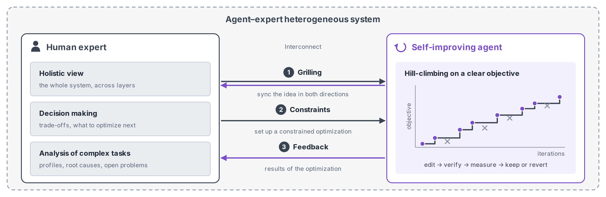

*Figure 13. Optimization as an agent–expert heterogeneous system. The human expert brings a holistic view, expert knowledge that shortcuts the exploration, decision making and the analysis of complex tasks. The self-improving agent hill-climbs on a clear objective, keeping an edit only when it verifies and measures better. ① Grilling syncs the idea in both directions, ② the human sends constraints for a constrained optimization, and ③ the agent feeds the results back. Arrow colours show the sender.*

### Acknowledgement

This work is supported by the AWS Build on Trainium program at UCLA. We used AutoHelix as the agentic loop harness to optimize the kernel, with special modifications to add constraints based on human experts. We would like to thank Ellen Hermansen from the Amazon Research Initiative team for providing AWS access and promotional credits, Amit Kachroo for providing technical insights in the Amazon Science Hub program, and James Hamilton for the continuous support on providing latest Trainium instances. 

---

## References

[1] DeepSeek-AI. DeepSeek-V4.1-Flash model card. Hugging Face. https://huggingface.co/deepseek-ai/DeepSeek-V4.1-Flash  
[2] DeepSeek-AI. DeepSeek-V4.1-Flash Technical Report. https://huggingface.co/deepseek-ai/DeepSeek-V4.1-Flash/blob/main/DeepSeek_V41_Tech_Report.pdf  
[3] AWS Neuron Documentation. Trainium3 Architecture. https://awsdocs-neuron.readthedocs-hosted.com/en/latest/about-neuron/arch/neuron-hardware/trainium3.html  
[4] AWS Neuron Documentation. NKI Trainium3 Architecture Guide. https://awsdocs-neuron.readthedocs-hosted.com/en/latest/nki/guides/architecture/trainium3_arch.html  
[5] NVIDIA. GB300 NVL72. https://www.nvidia.com/en-us/data-center/gb300-nvl72/  
[6] SemiAnalysis. InferenceX. https://inferencex.semianalysis.com/  
[7] Artificial Analysis. https://artificialanalysis.ai/  
[8] vLLM Neuron plugin. https://github.com/vllm-project/vllm-neuron  
[9] W. Kwon, Z. Li, S. Zhuang, Y. Sheng, L. Zheng, C. H. Yu, J. E. Gonzalez, H. Zhang and I. Stoica. Efficient Memory Management for Large Language Model Serving with PagedAttention. SOSP 2023. https://github.com/vllm-project/vllm  
[10] AWS Neuron Documentation. Neuron Kernel Interface (NKI). https://awsdocs-neuron.readthedocs-hosted.com/en/latest/nki/index.html  
[11] Y. Zhong et al. DistServe: Disaggregating Prefill and Decoding for Goodput-optimized Large Language Model Serving. OSDI 2024. https://arxiv.org/abs/2401.09670  
[12] P. Patel et al. Splitwise: Efficient Generative LLM Inference Using Phase Splitting. ISCA 2024. https://arxiv.org/abs/2311.18677  
[13] R. Zhu et al. MegaScale-Infer: Serving Mixture-of-Experts at Scale with Disaggregated Expert Parallelism. 2025. https://arxiv.org/abs/2504.02263  
[14] StepFun. Step-3 is Large yet Affordable: Model-system Co-design for Cost-effective Decoding. 2025. https://arxiv.org/abs/2507.19427  
