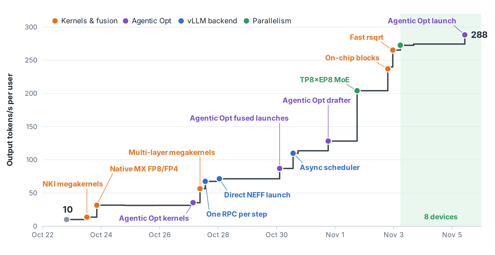
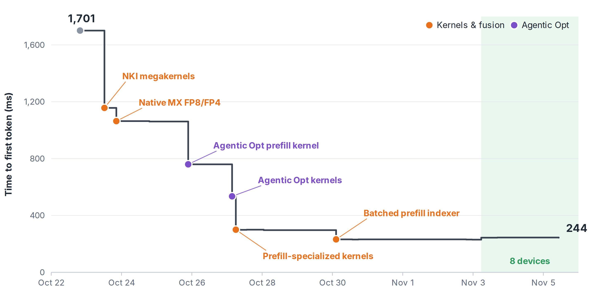
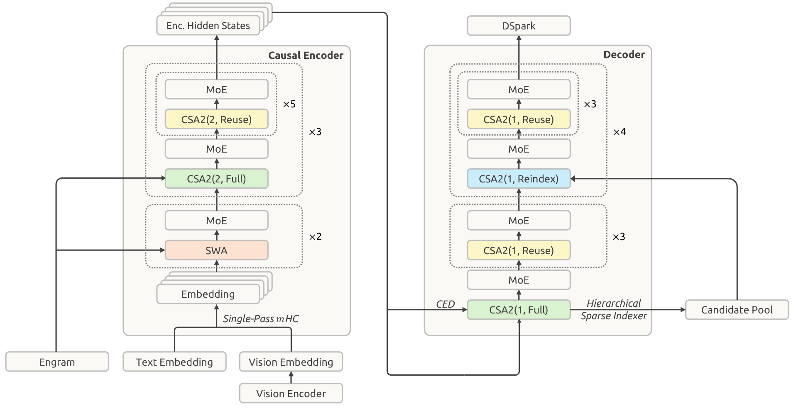
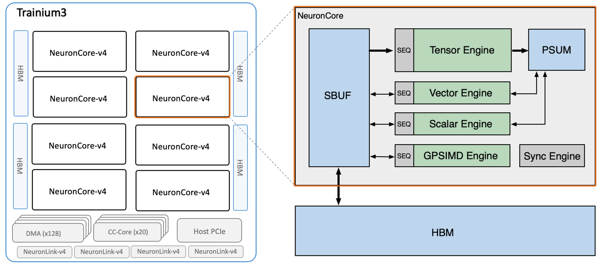
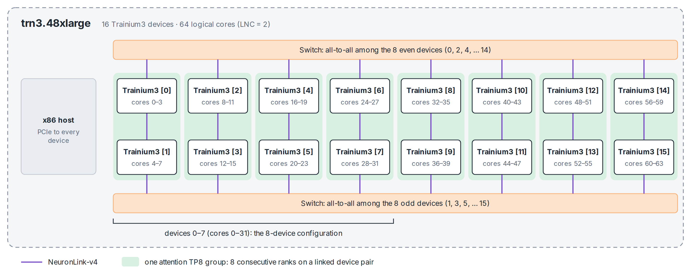
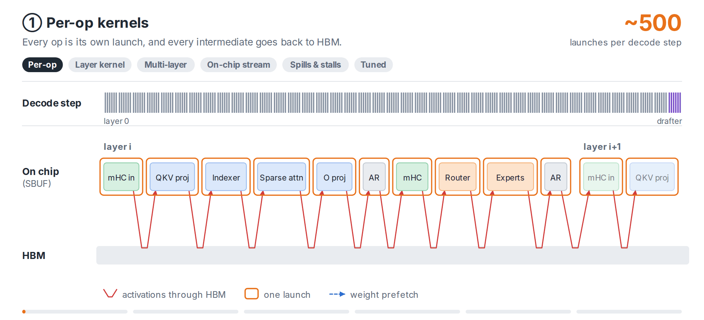
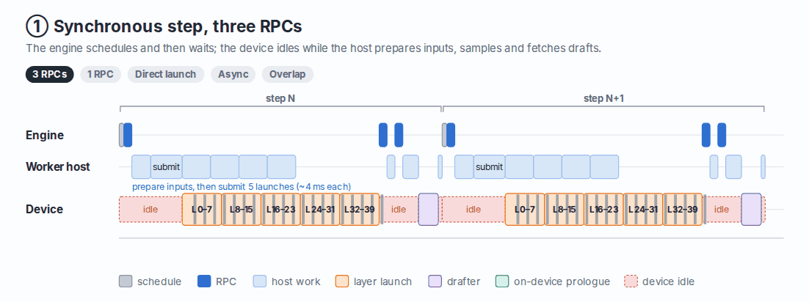
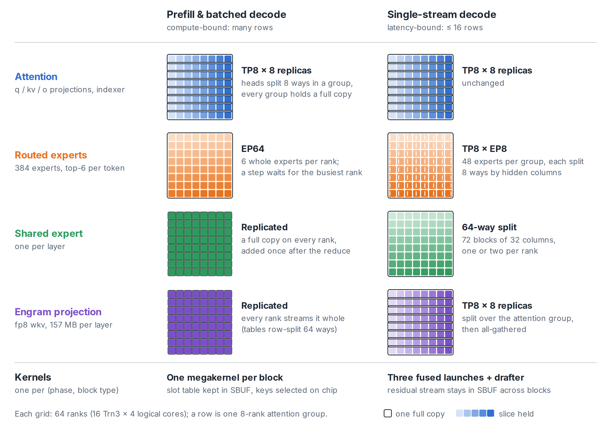
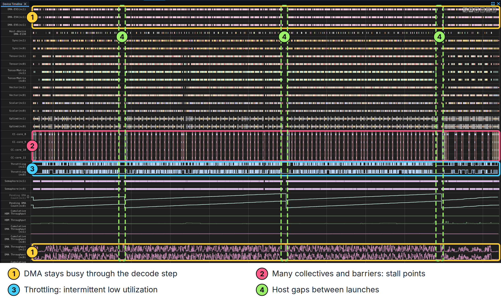
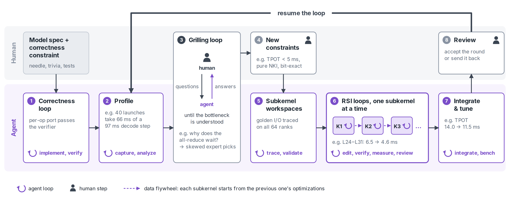

# DeepSeek V4.1 Flash on Trainium 3: Toward High Interactivity with Lower Cost Than GPUs 

### Executive Summary

We built and optimized DeepSeek V4.1 Flash inference for high interactivity on AWS Trainium 3 within **12 days**, achieving **3.1x** faster prefill and decode from PyTorch baseline using NKI kernels, and an additional **29x** faster decoding speed and **7x** faster response. The performance improvement comes from:
- **Progressive Megakernel Fusion.** Each transformer block became one NKI kernel that runs its FP8 and FP4 matmuls natively on the MX Tensor Engine and keeps its working set in SBUF. We then fused layers until a batch-1 decode step needed 4 NEFF executions instead of hundreds of kernel launches. Agentic optimization loops tuned many of these kernels on launches recorded from the live server.
- **Optimize vLLM Engine for Trainium.** One RPC per step, direct launches of cached NEFFs, and async scheduling with an on-device step prologue cut the device's idle time from 4.4–5.1 ms to 0.7 ms per step.
- **Temporal Disaggregation to Customize Different Computations** Prefill and decode run separate kernels, and the decode MoE, shared expert and Engram projection switch to their own sharding (TP8 × EP8 for the MoE). The final deployment fits on 8 of the 16 devices of a trn3.48xlarge, so one instance can serve two high-interactivity sessions.

Compared to GPU, our time to first token is on par with published GPU serving: 0.24 s for a 1,024-token prompt, against 0.2 s for Dynamo vLLM and 0.3 s for Together AI. Decoding is still 2.3x slower per user than a GB300 NVL72 deployment on 4 B300 GPUs (288 against 653.6 tokens/s). But at estimated instance prices, an 8-device Trainium 3 replica produces 1.12–1.22x more output tokens per dollar. The decode gap is not raw hardware, since 8 Trainium 3 devices match 4 B300 GPUs in FP8 throughput and exceed them in HBM bandwidth. It comes from latency in a long chain of small operations, collectives and launches, which we analyze in the last section.

*Figure 1. Batch-1 output speed per user (1000 / median TPOT; 512-token prompts, 128 output tokens) after each validated optimization round, Oct 22 to Nov 5. The shaded region is the same model on 8 of the 16 Trainium 3 devices.*

*Figure 2. Batch-1 time to first token (median TTFT; 1,024-token prompts) for the same runs. It falls from 1,701 ms to 230 ms on 16 devices and is 244 ms on 8 devices; all of the gain comes from prefill kernels.*

### Table of Content

- [Overview of DeepSeek V4.1 Flash](#overview-of-deepseek-v41-flash)
- [AWS Trainium 3 vs. NVIDIA B300](#aws-trainium-3-vs-nvidia-b300)
- [Inference Optimization: Reaching 60x Speedup Over 12 days](#inference-optimization-reaching-60x-speedup-over-12-days)
  - [Exploit new hardware features in Trainium 3](#exploit-new-hardware-features-in-trainium-3)
  - [Kernel and MegaKernel Fusion](#kernel-and-megakernel-fusion)
  - [Optimize vLLM Backend for Trainium](#optimize-vllm-backend-for-trainium)
  - [Temporal PD/AFD: Specialized Kernels/Parallelization for Different Computations](#temporal-pdafd-specialized-kernelsparallelization-for-different-computations)
  - [Serving Two High Interactivity Sessions at a Time](#serving-two-high-interactivity-sessions-at-a-time)
- [Comparison with GPU: What does the gap comes from?](#comparison-with-gpu-what-does-the-gap-comes-from)
  - [What if Trainium 3 were organized like four GPUs?](#what-if-trainium-3-were-organized-like-four-gpus)
- [Agentic Optimization: Composition of RSI and Expert Knowledge](#agentic-optimization-composition-of-rsi-and-expert-knowledge)

---

## Overview of DeepSeek V4.1 Flash

[DeepSeek V4.1 Flash](https://huggingface.co/deepseek-ai/DeepSeek-V4.1-Flash) is a sparse mixture-of-experts (MoE) model with 552B backbone parameters and another 196B parameters in **Engram** memory tables. With the speculative drafter and the vision tower, the released checkpoint holds about 763B parameters in 475 GiB, but only about 16B of them are active for each decoded token. The weights ship in block-scaled low precision: the routed experts in MXFP4 (FP4 values with one E8M0 scale per 32 values), and attention and the shared expert in FP8 with 32×32 block scales.

Figure 3 shows the architecture. The model has 40 causal layers with a hidden size of 5,120, which the technical report organizes as a 20-layer causal encoder followed by a 20-layer decoder whose global KV cache is projected from the encoder's output. Compared with a standard transformer, every layer adds pieces that are new or uncommon. Attention is **compressed sparse attention (CSA2)**: 64 query heads of dimension 512 attend over a single shared 512-dimensional KV latent, and a lightweight indexer (32 heads of dimension 128) selects the top 512 compressed KV blocks for each query, next to a 128-token sliding window. To save work, most layers reuse the KV cache and the top-k selection of an earlier layer instead of computing their own. The residual stream is split into four streams by **hyper-connections (mHC)**, which mix them around every sublayer with 4×4 matrices normalized by 20 Sinkhorn iterations. Every layer has an MoE with 384 routed experts, top-6 routing and one shared expert. Layers 1 and 14 also look up hashed n-gram embeddings in two Engram tables of 384M rows each. Finally, **DSpark**, three extra blocks that read the hidden states of layers 37 to 39, drafts five tokens per pass for speculative decoding, and the target model verifies them in its next step.

*Figure 3. The 40-layer causal encoder-decoder of DeepSeek V4.1 Flash. Figure 3 of the [DeepSeek-V4.1-Flash technical report](https://huggingface.co/deepseek-ai/DeepSeek-V4.1-Flash/blob/main/DeepSeek_V41_Tech_Report.pdf).*

At batch size 1, none of this is expensive in FLOPs. What makes high interactivity hard is the length of the dependency chain in one decode step. Each of the 40 layers runs Sinkhorn mixing on 4×4 matrices, a top-k over the index scores, gathers from paged compressed caches, block-scaled FP8 and FP4 matmuls over only six rows (one token plus five drafts), and, once the model is sharded, two all-reduces. Each of these operations is small, and each one waits for the previous one. Most of this blog is about shortening this chain on Trainium 3. Our port serves the text model and runs all 40 layers for every prompt token.

---

## AWS Trainium 3 vs. NVIDIA B300

**AWS Trainium 3** is the fourth generation of AWS's machine-learning chips. A Trainium 3 device has eight compute cores, called **NeuronCore-v4**, around four HBM stacks with 144 GiB in total (Figure 4, left). Like earlier generations, a NeuronCore is a heterogeneous processor rather than a SIMT core (Figure 4, right). The **Tensor Engine** is a systolic array for matrix multiplications; the **Vector Engine** and **Scalar Engine** run vector operations such as reductions and activation functions; and the **GPSIMD Engine** runs general-purpose code. Each engine executes its own instruction stream, and the engines synchronize through semaphores. They share a software-managed on-chip SRAM, **SBUF** (256 MiB per device), while the Tensor Engine accumulates into a separate buffer, **PSUM**, and DMA engines move data between HBM and SBUF. We program all of this through the **Neuron Kernel Interface (NKI)**, a Python kernel language comparable to Triton on GPUs; every kernel in this work is written in NKI. We run with logical NeuronCore configuration 2 (LNC = 2), which pairs two physical cores into one logical core. A device then exposes four logical cores, and each vLLM rank runs on one of them.

*Figure 4. Left: a Trainium 3 device, eight NeuronCore-v4 cores around four HBM stacks. Right: the programming model of one NeuronCore. DMA moves data between HBM and the on-chip SBUF; the tensor, vector, scalar and GPSIMD engines read from and write to SBUF; the tensor engine accumulates into PSUM. Sources: [AWS Neuron documentation, Trainium3 architecture](https://awsdocs-neuron.readthedocs-hosted.com/en/latest/about-neuron/arch/neuron-hardware/trainium3.html) and [NKI Trainium3 architecture guide](https://awsdocs-neuron.readthedocs-hosted.com/en/latest/nki/guides/architecture/trainium3_arch.html).*

Trainium 3 adds three features that matter for this model. Its Tensor Engine multiplies block-scaled MX FP8 and FP4 operands natively, its SBUF is larger than Trainium 2's (256 MiB against 224 MiB per device), and its devices are connected through switches instead of Trainium 2's 2D torus. A trn3.48xlarge instance has 16 devices (Figure 5). On our instance, `neuron-ls` reports a direct link between devices 2k and 2k+1, all-to-all connectivity among the eight even devices through one switch, and the same among the eight odd devices through a second switch. We place each 8-rank tensor-parallel group on one linked pair of devices.

*Figure 5. One trn3.48xlarge server, as reported by `neuron-ls --topology`. Devices 2k and 2k+1 share a direct link. The 8 even devices are connected all-to-all through one switch, and the 8 odd devices through another. With LNC = 2 each device exposes 4 logical cores, so the 16-device configuration runs 64 ranks on cores 0–63. Each attention TP8 group (8 consecutive ranks) sits on one linked device pair. The 8-device configuration uses devices 0–7.*

The table below compares a Trainium 3 device with an NVIDIA B300 GPU. Per chip, B300 is the bigger part: it has 2x the FP8 throughput, 6x the FP4 throughput, 1.6x the HBM bandwidth and twice the memory, while Trainium 3 has more scale-up interconnect bandwidth.

| Per chip | Trainium 3 | B300 |
|---|---|---|
| Dense FP8 | 2.5 PFLOPS (MXFP8) | 5 PFLOPS |
| Dense FP4 | 2.5 PFLOPS (MXFP4) | 15 PFLOPS |
| Dense BF16 | 0.67 PFLOPS | 2.5 PFLOPS |
| HBM | 144 GiB at 4.9 TB/s | up to 288 GB at 8 TB/s |
| Scale-up interconnect | 2.56 TB/s (NeuronLink-v4) | 1.8 TB/s (NVLink 5) |

*Sources: [AWS Trainium3 architecture](https://awsdocs-neuron.readthedocs-hosted.com/en/latest/about-neuron/arch/neuron-hardware/trainium3.html). B300 values are NVIDIA's [GB300 NVL72](https://www.nvidia.com/en-us/data-center/gb300-nvl72/) rack figures divided by its 72 GPUs, with sparse figures halved to dense.*

The deployments we compare, however, are an 8-device Trainium 3 replica and 4 B300 GPUs, and at that scale the hardware is close. Both have about 20 PFLOPS of FP8 throughput and about the same HBM capacity (1.24 TB against 1.15 TB), and the Trainium 3 replica has 22% more HBM bandwidth (39 TB/s against 32 TB/s). At batch size 1, the model uses a small fraction of either compute budget, so the per-user gap we measure is not a gap in raw hardware. We come back to it in the [last section](#comparison-with-gpu-what-does-the-gap-comes-from).

---

## Inference Optimization: Reaching 60x Speedup Over 12 days

We started from the Trainium 2 port of DeepSeek V4.1 Flash, which runs one NKI kernel per operation, and brought it up on a trn3.48xlarge on Oct 22. It decoded at 99.4 ms per token. Over the next two weeks, we optimized it in four directions: using Trainium 3's new hardware features, fusing kernels into megakernels, removing host overhead in vLLM's Neuron backend, and specializing kernels and parallelization for each phase. The table below lists every validated round, and Figure 1 plots them. Per user, decoding became 28.6x faster. Because the final deployment uses half of the devices, output per device grew about 57x.

| Date | Change | TPOT (ms) | Tokens/s per user |
|---|---|---|---|
| Oct 22 | Per-op NKI kernels on 16 devices (first working port) | 99.4 | 10 |
| Oct 23 | One NKI megakernel per transformer block | 73.1 | 14 |
| Oct 23 | Native MX FP8/FP4 matmul, on-chip key selection, token-grouped experts | 31.6 | 32 |
| Oct 27 | Agentic-optimized block kernels | 28.2 | 35 |
| Oct 27 | Eight blocks per launch | 17.7 | 56 |
| Oct 27 | One RPC per step | 14.8 | 68 |
| Oct 28 | Direct launch of cached NEFFs | 14.0 | 71 |
| Oct 30 | Agentic-optimized multi-layer launches | 11.5 | 87 |
| Oct 30 | Async scheduling with an on-device step prologue | 9.1 | 110 |
| Oct 31 | Optimized drafter | 7.8 | 128 |
| Nov 1 | TP8 × EP8 decode MoE | 4.90 | 204 |
| Nov 2 | On-chip blocks, merged launches, exact rsqrt | 3.77 | 265 |
| Nov 5 | 8 devices, launches re-tuned on 32 ranks | 3.47 | 288 |

### Exploit new hardware features in Trainium 3

Running the Trainium 2 kernels on Trainium 3 gave us a working baseline, but it left most of the new hardware unused. Three features changed how we wrote the kernels, and two others needed care.

#### Native MX matmul and on-chip key selection (73.1 ms to 31.6 ms, 2.31x)

DeepSeek V4.1 Flash ships its weights as FP8 and FP4 values with one E8M0 scale per 32 elements, which is the MX format. Trainium 3's Tensor Engine multiplies such operands natively with `nc_matmul_mx`: one instruction contracts 512 elements, applies the scales inside the systolic array, and runs at 4x the BF16 rate. We therefore re-lay the weights once at load time and quantize the activations on chip with `quantize_mx` right before each matmul, so the FP8 and FP4 weights enter the Tensor Engine as they are stored. Trainium 2 has no MX matmul; the closest option there, its FP8 double-row mode, flushed a quarter of the weight codes and was still slower.

In the same round, two more changes kept data on chip. The sparse attention selects 512 compressed KV blocks for each query. Instead of first gathering these keys into a dense buffer in HBM, the kernel keeps a transposed slot table resident in SBUF (up to 96 KiB per partition) and reads each token's keys with indirect DMA straight into the QK matmul. The MoE runs a loop bounded at run time over only the experts that were picked, instead of over every expert on the rank. Together, the three changes cut TPOT from 73.1 ms to 31.6 ms.

#### A larger SBUF and an exact rsqrt

The larger SBUF lets the final decode kernels keep the four residual streams of the six rows in flight in SBUF through a whole block and hand them to the next block on chip, as we describe in the next section. Trainium 3's hardware reciprocal square root is within 1 ulp of the exact result, so we dropped the Newton refinement step that had followed every normalization. It shipped together with the last 16-device fusion round, which took TPOT from 4.17 ms to 3.77 ms.

#### What needed care

Two features cost more than we expected. Dynamic control flow works but is not free: each iteration of a loop bounded at run time cost about 10 µs, and when the two physical cores of a logical core ran different trip counts, the kernel hung. The batch-1 decode MoE therefore later moved from the dynamic expert loop to static expert slots. In addition, int64 arithmetic in compiled graphs runs at 32-bit width on Trainium 3. This broke the Engram n-gram hash until we rewrote it with exact int32 operations on the GPSIMD Engine.

### Kernel and MegaKernel Fusion

The Trainium 2 port launches one kernel per operation, hundreds of them per decode step. Each launch costs host time, a device-side entry, and a round trip through HBM for its outputs. We removed these costs in four stages (Figure 6). Each stage taught us the same lesson: a fused kernel is a new program with its own bottlenecks, and it needs its own tuning before it becomes faster.

#### Stage 1: One megakernel per transformer block (99.4 ms to 73.1 ms, 1.36x)

We first wrote one NKI kernel per transformer block, for prefill and for decode, plus one for the drafter. Collectives run inside these kernels: each block issues its all-reduces over the 8-rank attention group and over all ranks from NKI, and the two physical cores of a logical core split the work and exchange partial results directly with `sendrecv`. By Oct 27, agentic optimization loops had given each of the model's 9 block archetypes its own tuned prefill and decode kernel, 18 packages in total, all bit-exact with the reference (31.6 ms to 28.2 ms). But a decode step still launched 40 kernels, and the launches, not the kernels, now set the pace: the 40 launches took about 66 ms of a 97 ms decode step, while each block needed only 0.6 to 0.9 ms of device time.

#### Stage 2: Eight blocks per launch (28.3 ms to 17.7 ms, 1.60x)

Fusing eight consecutive blocks into one launch reduced a decode step to five layer launches and cut TPOT from 28.3 ms to 17.7 ms. Larger launches were not better: launches of 20 blocks were slower than launches of 8.

#### Stage 3: Optimize each fused launch as a whole (14.0 ms to 11.5 ms, 1.22x)

After the backend changes of the next section, we optimized each of the five fused launches as one program, with agentic optimization loops running on the inputs and outputs recorded from the live server. The loops shared the index tables across the eight blocks of a launch, kept outputs in SBUF instead of writing them to HBM, prefetched the next block's weights during the all-reduce, and split the few-row work across both physical cores. Two of the launches, measured standalone, went from 6.5 ms to 4.6–4.7 ms each, and TPOT went from 14.0 ms to 11.5 ms.

#### Stage 4: On-chip blocks and merged launches (4.90 ms to 3.77 ms, 1.30x)

In the last 16-device round, a six-row decode block runs entirely on chip. The four residual streams stay in SBUF, the hyper-connection maps run on the Tensor Engine, and the indexer, compressor, Engram gate and MoE keep their activations on chip. With activations no longer leaving the chip, the launch boundaries became the next cost: each launch's entry barrier took 95 to 165 µs, about 0.65 ms per step. We therefore merged the layers into three launches: layers 0–7, layers 8–23, and layers 24–39 with the head.

Again, fusion did not pay off by itself. The first merged launch spilled 564 MB per step to HBM. Double-buffering the tiles of the MoE gate and up-projection weights brought the merged launch to 4,148 µs, against 4,310 µs for its parts, and handing the block state across the launch's internal boundaries on chip saved another 28 to 42 µs per boundary. With the exact rsqrt, TPOT reached 3.77 ms.

Over the four stages, a batch-1 decode step went from hundreds of kernel launches to 40 block launches, then to 8 NEFF executions (a step prologue, five fused layer launches, a sampling tail and the drafter), 6 after the last 16-device round, and 4 on the 8-device deployment.

*Figure 6. One batch-1 decode step, from per-op kernels to tuned multi-layer megakernels. Top row: the launches of a step. Bottom: one layer zoomed in, with the activations that round-trip through HBM. Schematic widths.*

### Optimize vLLM Backend for Trainium

Once the kernels were fused, the host became the bottleneck. A NEFF launch with collectives cost at least 1.5 ms of host time, and a launch with about 500 input and output tensors cost about 5 ms, because the runtime rebuilt its I/O ring on every call. Meanwhile, the device sat idle between steps while the host prepared the next one. We removed these costs in four steps (Figure 7).

#### Step 1: One RPC per step (17.7 ms to 14.8 ms, 1.20x)

vLLM's engine core drives the workers with three RPCs per decode step: one to execute the model, one to sample, and one to collect the draft tokens. We moved sampling into `execute_model` and returned the drafts in the step's output, so a step needs only one RPC. In the same round, the token embedding moved into the first fused launch, the greedy head and the argmax over the full vocabulary moved into the last one, and launch plans are cached. The single RPC alone shortened a decode step from 16.3 ms to 15.1 ms.

#### Step 2: Direct launch of cached NEFFs (14.8 ms to 14.0 ms, 1.06x)

The worker used to launch each NEFF through the compiled graph's entry point. We now call the NEFF executor directly, with step buffers whose addresses stay the same from step to step. Because the I/O tensors keep their addresses, the runtime reuses each launch's DMA ring instead of rebuilding it. Entering the five launches of a step took 3.6 ms of host time instead of 18.7 ms. TPOT improved by 6% at batch size 1, and by up to 26% at batch size 10.

#### Step 3: Async scheduling with an on-device step prologue (11.5 ms to 9.1 ms, 1.26x)

vLLM's async scheduling prepares step N+1 while step N runs on the device. Speculative decoding makes this hard: the inputs of step N+1, namely the positions, the KV-cache slots, the slot tables and the n-gram ids for the Engram lookup, depend on how many drafts step N accepted, which the host does not know until step N finishes. We moved the construction of these inputs into a small NKI kernel, the step prologue, which runs on the device at the start of each step and reads the previous step's acceptance result. The host never waits for the device, and the device's idle time per step fell from 4.4–5.1 ms to 0.7 ms.

Running ahead has a cost for the first token, so the scheduler holds back in two cases. When a lone request's step might be its last, the scheduler does not queue a speculative step behind it; that step used to run in front of the next request's prefill and added 17 to 22 ms to the TTFT of half the requests. A request's first decode step also waits for its prefill to finish.

#### Step 4: Overlap collectives with the next layer

Inside a fused launch, the engines mostly wait while an all-reduce is in flight, so we prefetch the next block's weights during the all-reduce. Done naively, the prefetch competed with the all-reduce and doubled the all-rank all-reduce from about 18 µs to about 40 µs. The final kernels therefore hold weight DMAs until the previous all-reduce result has arrived, and prefetch only the query down-projection, right after the attention all-reduce. Prefetching one more projection was a net loss.

*Figure 7. Two batch-1 decode steps on the engine core, a worker's host thread and the device, as each backend change landed. Durations are schematic; the numbers in the frame text are measured.*

### Temporal PD/AFD: Specialized Kernels/Parallelization for Different Computations

Prefill/decode (PD) disaggregation and attention/FFN disaggregation (AFD) usually run each phase or each computation on its own pool of machines with its own parallelization. At batch size 1, we apply the same idea in time instead of in space. The same 64 ranks run every phase, but each phase, and each computation within it, uses its own kernels and its own weight layout (Figure 8).

#### TP8 × EP8 for the decode MoE (7.8 ms to 4.90 ms, 1.59x)

For prefill and batched decode, the deployment layout works well: attention is TP8 and replicated eight times, each rank holds 6 of the 384 routed experts (EP64), the shared expert is replicated, and the Engram tables are split by row across all ranks. A batch-1 decode step, however, has only 6 rows, one token plus five drafts. Its 36 expert picks landed on a few ranks, and every all-reduce waited for the busiest one.

For steps of up to 16 rows, we therefore switch the MoE to a TP8 × EP8 layout. The 384 experts form eight groups of 48, and each group's experts are split by hidden column across the 8 ranks of an attention group (288 of the 2,304 columns per rank), so every rank does the same amount of work. The shared expert is split into 72 blocks of 32 columns spread over the ranks, and the Engram value projection (about 157 MB, replicated in prefill) is split across the attention group, which saves about 180 µs in each Engram layer. The second copy of the expert weights costs 9.4 GiB of HBM per rank on the 8-device deployment, and it was worth it: batch-1 TPOT fell by 27 to 37%, from 7.8 ms to 4.9 ms at 512 tokens. Batched decode, with 60 rows at batch size 10, keeps the deployment layout.

#### Separate prefill and decode kernels (TTFT 1,064 ms to 232 ms at 1,024 tokens)

Each of the 9 block archetypes has a prefill kernel and a decode kernel, tuned separately, because a prefill block processes hundreds of tokens while a decode block processes six rows. The prefill kernels are what moved TTFT (Figure 2). An agentic optimization loop rewrote one archetype's prefill kernel from 25.3 ms to 5.2 ms per block; its two largest gains came from stacking tokens on SBUF partitions, and from letting empty attention slots read 128 distinct zero rows instead of one hot row. The per-archetype prefill kernels that followed cut TTFT at 1,024 tokens from 1,064 ms to 300 ms. At that point the indexer took 62% of an 8K-token prefill chunk. Batching its scoring to 32 tokens per matmul, with a top-k built from Tensor Engine transposes, took another 16 to 48% off TTFT, to 232 ms at 1,024 tokens.

#### The drafter (8.8 ms to 7.8 ms, 1.13x)

The DSpark drafter took 19% of a batch-1 decode step. We optimized its kernels the same way, making them 2.7x faster and bit-exact, and column-sharded its input projection (`main_proj`), which cut its weights from 79 MB to 1.2 MB per rank.

*Figure 8. How each computation's weights are laid out over the 64 ranks in each phase. An outlined box is one full copy of the weight; the shade says which slice a rank holds.*

### Serving Two High Interactivity Sessions at a Time

At batch size 1, 64 ranks turned out to be more parallelism than the model needs. We therefore ported the model to 8 of the 16 devices: 32 ranks on devices 0–7, with TP = 32 and a TP8 × EP4 decode MoE. This leaves the other half of the instance free for a second replica.

The first challenge was memory. A logical core has 36 GiB of HBM, and the first 32-rank run ran out of memory at 28.7 GiB in use, while it built the decode MoE's TP × EP copy. Two changes made it fit. The Engram tables stay in FP8 instead of BF16 (2 × 2.95 GiB per rank instead of 2 × 5.72 GiB), and the per-op FP8 weights are freed once their MX copy exists. Memory use dropped to 20.4 GiB before the TP × EP copy and to about 30 GiB after it.

With half of the ranks, each rank holds twice as many routed experts and Engram rows, so we also had to make the 8-device step faster. The batch-1 decode MoE uses five packed static expert slots per core instead of a loop bounded at run time. The step prologue is fused into the first launch and the verification into the drafter launch, so a batch-1 step is 4 NEFF executions instead of 6. Finally, we optimized the decode launches again on their recorded 32-rank launches: the head GEMM is column-tiled on K-major head rows, and the on-chip blocks got scheduling fixes. Together with a faster drafter, these changes saved about 0.5 ms of device time per step, bit-exact.

As a result, the 8-device deployment decodes faster per step than the 16-device one. Measured on the same day, a batch-1 decode step (the median inter-token latency) is 3 to 5% shorter on 8 devices:

| Cell | 8 devices: TPOT / step / TTFT | 16 devices: TPOT / step / TTFT |
|---|---|---|
| 512 tokens, batch 1 | 3.47 / 12.10 / 147 ms | 3.74 / 12.67 / 134 ms |
| 1,024 tokens, batch 1 | 3.95 / 12.14 / 244 ms | 3.72 / 12.63 / 231 ms |
| 8,192 tokens, batch 1 | 4.06 / 12.77 / 1,715 ms | 4.00 / 13.21 / 1,659 ms |

The batch-1 TPOT differences follow the draft acceptance: at 1,024 tokens, 43.5% of the drafts were accepted on 8 devices against 51.2% on 16. Batch-10 decode steps are 3 to 12% slower on 8 devices, and prefill is 2 to 10% slower.

One trn3.48xlarge can therefore host two independent 8-device engines, each serving one user at about 288 tokens/s. So far, we have measured one engine on devices 0–7; running the second one on devices 8–15 at the same time is our next measurement. `NEURON_VISIBLE_DEVICES` selects those devices, and the plugin gives each co-located engine its own collectives port.

This is also what makes Trainium 3 cheaper per token than B300. The table below counts output tokens only, at each deployment's per-user decode rate, and charges the 8-device deployment half of the instance.

| Deployment | Chips | Per-user output tok/s | $/hr | Output tokens per $1 | vs. B300 |
|---|---|---|---|---|---|
| GB300 NVL72, Dynamo vLLM, P90 interactivity | 4 B300 | 653.6 | 65.00 | 36,199 | 1.00x |
| Trainium 3, 8 devices, $47/hr instance | 8 Trn3 | 288.3 | 23.50 | 44,160 | 1.22x |
| Trainium 3, 8 devices, $51/hr instance | 8 Trn3 | 288.3 | 25.50 | 40,697 | 1.12x |

The B300 cost is AWS's 8-GPU B300 instance at $130 per hour, pro-rated to 4 GPUs. The trn3.48xlarge price is an estimate: $47 per hour based on H100 pricing, or $51 per hour based on the performance ratio to B300. The B300 rate is a P90 interactivity figure, the Trainium 3 rate is the median TPOT of our best cell, and neither counts input tokens or prefill time.

---

## Comparison with GPU: What does the gap comes from?

For the first token, Trainium 3 is already on par with GPU serving. The table below compares TTFT for a 1,024-token prompt with two published GPU measurements from Oct 20.

| Deployment | TTFT, 1K-token prompt | Source |
|---|---|---|
| Dynamo vLLM, concurrency 1 | 0.2 s | [SemiAnalysis InferenceX](https://inferencex.semianalysis.com/) |
| Together AI | 0.3 s | [Artificial Analysis](https://artificialanalysis.ai/) |
| Trainium 3, 16 devices (ours) | 0.23 s | median at batch size 1 |
| Trainium 3, 8 devices (ours) | 0.24 s | median at batch size 1 |

Our TTFT is close to Dynamo vLLM's and below Together AI's. The measurements are not identical: the published numbers are rounded to a tenth of a second, and an API benchmark such as Artificial Analysis measures from the client, network included. Still, prefill is no longer where Trainium 3 falls behind.

Decode is. The B300 deployment serves 653.6 tokens/s per user, 2.27x more than Trainium 3. At our draft acceptance, about 3.5 tokens per decode step, matching it would require a 5.3 ms decode step instead of the current 12.1 ms. As we showed in the [hardware comparison](#aws-trainium-3-vs-nvidia-b300), the hardware itself is not the reason: 8 Trainium 3 devices have as much FP8 throughput as 4 B300 GPUs and 22% more HBM bandwidth. To find where the time goes, we profiled batch-1 decode on the 8-device deployment with 512-token prompts.

The profile accounts for the whole 12.04 ms step. The device is busy for 11.70 ms (97%): 3.94 ms in the MoE, 3.38 ms in attention, 2.25 ms in collectives, 1.12 ms in the drafter, 0.54 ms in the indexer's top-k and 0.47 ms elsewhere. The host time between the four launches is only 0.34 ms. One layer takes about 216 µs: about 85 µs of attention, a 15 µs TP8 all-reduce, 96 µs of MoE and a 20 µs all-rank all-reduce.

Neither memory bandwidth nor compute sets this time. A rank moves 3.24 GB per step, which would take about 3.1 ms at the DMA peak, and its mean rate over the step is 271 GB/s, about 23% of the HBM peak. On 16 devices, the same analysis puts the floors at about 3.0 ms for HBM traffic, 1.0 ms for compute and 1.2 ms for collectives, against a 12.6 ms step. Instead, the step is set by a long chain of small, dependent operations. Figure 9 shows a decode step on one rank, with the four costs that dominate it.

*Figure 9. Device timeline of batch-1 decode on one rank in Neuron Explorer. (1) DMA throughput is high; (2) collectives and barriers stall the engines; (3) throttling leaves the engines intermittently underused; (4) host gaps between launches.*

The DMA queues look busy throughout the step (1): DMA is in flight in 93% of 10-µs windows. However, only 19% of those windows move data faster than 300 GB/s, and the median is 93 GB/s. Only the expert-weight bursts in the MoE reach about 340 GB/s per core. (Neuron Explorer's HBM throughput track looks almost empty next to the DMA track. It counts only transfers whose source and destination the profiler can resolve, and 98.5% of our DMA bytes use descriptors generated on the device at run time, so the track shows about 1% of the traffic. We therefore count HBM traffic from the DMA packets.)

Looking at the 16 DMA engines of each physical core makes the picture clearer. An engine has a packet in flight for only 37% of the step on core 0 and 33% on core 1. Collectives explain little of this: only 21–23% of the idle engine time falls inside them. The rest happens while the core runs its own layers:

| Outside collectives (9.68 ms per step) | Core 0 | Core 1 | Share of idle engine time |
|---|---|---|---|
| Computing, no DMA in flight | 3.17 ms | 3.52 ms | 55% |
| Data moving on only some engines (6.6 of 16 on average) | 2.85 ms | 2.81 ms | 26–29% |
| Whole core stalled on a semaphore | 0.55 ms | 0.59 ms | 9–10% |
| Between launches | 0.24 ms | 0.24 ms | 4% |
| Nothing running | 0.14 ms | 0.35 ms | 3–6% |
| All 16 engines busy | 2.73 ms | 2.18 ms | – |

Most of the idle time is the dependency chain at work. While a core computes, it often cannot issue its next load, because the load's address depends on the result: the expert weights wait for the routing (`route_group`), the KV gather waits for the indexer's top-k (`topk_tables`), and the MoE waits for attention. The core does not prefetch the next block's weights at these times either. The kernels prefetch mainly during the all-rank all-reduces, because a wider prefetch competed with the all-reduces and was a net loss ([Step 4](#step-4-overlap-collectives-with-the-next-layer)), and SBUF limits how much more they can hold. When data does move, it often moves on few engines. The median DMA packet is 384 B (the rows of a six-row batch, index and slot tables, small weight slices), too small to spread across 16 engines. Only the large weight loads, the expert burst and the next-layer prefetch, keep all 16 engines busy.

When the whole core stalls on a semaphore, it waits for one of three things. Most often (0.30–0.38 ms per step), it waits at a barrier that the compiler inserts at about 280 section boundaries per step inside the fused launches, such as the end of a block's MoE. Every engine drains its outstanding instructions and DMAs, resets its semaphores and waits until all engines arrive, so no load can stay in flight across the boundary. Next (0.14–0.16 ms), one physical core waits for the other, because the two cores of a logical core split each block and exchange partial results. Least (0.06–0.08 ms), an engine waits for a DMA it issued to start moving data. Engines also wait on each other constantly, but almost always while another engine is working, so these waits do not stall the core.

Collectives and barriers (2) take 2.25 ms per step. A step runs 111 collectives: 51 TP8 all-reduces with a median of 14.8 µs, 47 all-rank all-reduces with a median of 20.0 µs, 9 all-gathers and 4 entry barriers. Each all-reduce carries about 120 KB, so its cost is latency rather than bandwidth. Rank 0 also spends 553 µs per step waiting for other ranks to arrive, because the Engram gather is done only by the rank that owns the token's vocabulary shard, and because the expert-parallel load is uneven. The two kinds of all-reduce use the DMA engines differently. The all-rank all-reduces carry the next block's weight prefetch and keep 31–36% of the engines busy. Nothing is queued behind the TP8 all-reduces, so for their 0.78 ms per step only 10–11% of the engines are busy. Even if collectives took no time at all, engine utilization would only rise to that of the rest of the step, about 40% on core 0.

Throttling (3) leaves the engines intermittently underused. The profile's throttle records show an activity throttle with a 50% utilization limit engaged for about two thirds of the step on every rank, switching on and off about 700 times per step with a median interval of 5 µs. We have not yet measured how much time it costs.

The host gaps (4) are small. Thanks to async scheduling, the host has 4 to 5 ms of slack in each 12 ms step, and the gaps between the four launches are 75 to 99 µs. Each launch boundary still costs 150 to 200 µs of device time, about 0.67 ms per step: the runtime notices the end of a launch, switches models in 50 to 73 µs, runs a preamble and about 100 small loads before the weights, and waits 63 µs at the next launch's entry barrier.

The same profile sizes what is left to gain: up to about 0.8 ms from folding or hiding the small all-reduces, 0.45 to 0.6 ms from fewer NEFF executions per step, about 0.9 ms from the drafter's latency-bound phases, up to about 1.2 ms from filling the all-reduce and routing windows with other work, and 0.2 to 0.55 ms from balancing the ranks. Wider small loads and fewer section boundaries inside the launches would help as well, but we have not sized them yet. These overlap, and even together they do not reach a 5.3 ms step. Closing the rest of the gap requires shortening the dependency chain itself, not more bandwidth or FLOPs.

### What if Trainium 3 were organized like four GPUs?

The B300 deployment runs the model on 4 GPUs; ours runs it on 32 ranks. To see how much of the decode gap comes from this difference in shape rather than from the chip, we built an analytical model of the decode step from the profile above. We then applied it to a hypothetical system: the same 8 Trainium 3 devices regrouped into 4 ranks, each with the compute and HBM bandwidth of 2 devices (5 PFLOPS FP8 and 9.8 TB/s), and connected by NVLink 5 at 1.8 TB/s per rank. Attention and the indexer then run TP4 instead of TP8 copied 4 times, and the MoE runs TP4, so every rank holds a quarter of every expert.

The model takes every compute piece and every collective of the measured step as input. It sorts each function's engine time by how it scales on the new layout. Work split across all ranks, such as the experts and the LM head, keeps its time per rank, because a rank does 8x the work with 8x the resources. Attention work drops to a quarter, and work that every rank repeats (hyper-connections, Sinkhorn, norms, routing) drops to an eighth. The model scales the bytes the same way, and it sorts every stall by what the core waits for. The wait for the other physical core of a rank disappears, section barriers and waits on other engines shrink with the compute, and DMA start-up, drains and runtime waits stay as they are. Each collective costs 5 µs on NVLink, which is our assumption (3–8 µs moves the step by about ±0.25 ms). With balanced experts, no rank waits for the busiest expert group, and the remaining waits for late ranks shrink with the compute. Host gaps stay as measured. With every factor set to 1, the model reproduces today's 12.04 ms step.

| Change, applied in order | Step, ideal scaling | Step, fixed per-instruction cost |
|---|---|---|
| Today: 32 ranks on NeuronLink | 12.04 ms | 12.04 ms |
| 4 ranks on NVLink 5 | 10.85 ms | 10.85 ms |
| + attention and indexer not copied | 8.97 ms | 9.56 ms |
| + repeated work on 8x resources per rank | 7.00 ms | 8.08 ms |
| + one device per rank, no core-to-core sync | 6.60 ms | 7.74 ms |
| + balanced MoE | 6.48 ms | 7.61 ms |
| + 15 PFLOPS FP4 and 2.5 PFLOPS BF16 per rank, as on a B300 | 5.55 ms | 7.01 ms |
| Output speed per user | 629 tokens/s | 498 tokens/s |

The two columns bound the result. With ideal scaling, every instruction's time shrinks with the data it handles. With fixed per-instruction cost, every instruction keeps the fixed part of its time (the 10th-percentile duration on its engine, about a third of engine time today), because the small repeated operations still issue as many instructions on a bigger rank.

Organized like the GPU deployment, the same silicon would come within 4% of the B300's 5.34 ms step with ideal scaling, and would reach 498 tokens/s per user with the per-instruction cost. Most of the gain comes from the shape, not from the interconnect or the FLOPs. Removing the copies of attention and running repeated work on bigger ranks saves 2.8 to 3.9 ms, faster collectives save 1.2 ms, and dropping the core-to-core sync and balancing the experts save another 0.5 ms. The FP4 and BF16 FLOPs of a B300 add only 0.6 to 0.9 ms. At batch size 1, the Tensor Engine streams the expert weights past only six activation rows, and most of its time overlaps work on the other engines. What is left at 5.55 ms is mostly the MoE (2.4 ms), whose expert work keeps its time per rank, about 0.9 ms of drains and runtime waits, 0.7 ms of collectives and the 0.34 ms of host gaps. The step stays bound by the compute chain: moving its bytes at full DMA speed would take only 1.1 ms.

The model is a first-order estimate. It splits the bytes of each layer between expert weights, attention-head weights and repeated reads using the model's configuration rather than measurements. It assumes that a bigger rank spreads its work without new overhead, and it keeps the number of collectives unchanged.

## Composing RSI with Expert Knowledge: Agent-Expert Disaggregated Optimization

*Figure 10. Our agentic optimization flow. ① An agent ports the model until it meets the correctness constraint. ② We profile it, ③ the agent and a human grill the profile until the bottleneck is understood, and ④ the human sets new constraints. ⑤ The agent builds one workspace per subkernel with golden inputs and outputs traced from the live server, ⑥ runs a recursive self-improvement (RSI) loop on each subkernel in turn, starting each from the previous kernel's optimizations, and ⑦ integrates and tunes the kernels in the model. ⑧ A human reviews the round before the loop resumes at ②.*

Figure 10 divides the work by the kind of task. The agent runs the loops whose task has five properties, and the human takes the steps that lack one of them (table below). A subkernel workspace (⑤) is built to have all five. The golden inputs and outputs give a clear constraint and a fast check, the kernel's latency on those inputs is the objective, and the agent may edit only the kernel file.

| Property | Good fit for the agent self-improvement | Agents evolve slowly, needs a human expert |
|---|---|---|
| **Clear constraint** | The constraint can be checked: the kernel's output matches the golden output within tolerance, or bit for bit. | Correctness needs judgment: what counts as correct for the whole model, which tolerance to allow, and whether a summation-order difference is acceptable when the generated text is still right. |
| **Quick verification and measurement** | A check takes minutes: a fused launch compiles and runs on its recorded inputs in about a minute, so a loop can try many variants. | A check is slow: an end-to-end check recompiles the whole model and serves real requests (the integration test alone takes about 11 minutes), and a profile must be captured and ingested before anyone can read it. The human picks the few experiments worth running. |
| **Clear objective** | There is one number to improve: the kernel's latency on its recorded inputs. | The goal is a trade-off: what to optimize next, whether a second copy of the expert weights (9.4 GiB of HBM per rank) is worth a 27–37% lower TPOT, or how far the scheduler may run ahead before it costs TTFT. |
| **Restricted editable scope** | The agent edits only the kernel file; its inputs, its outputs and the rest of the system stay fixed. | The change cuts across layers: async scheduling changed vLLM's scheduler and worker and added the on-device step prologue; TP8 × EP8 changed weight loading, the MoE kernels and their collectives. |
| **Consistent incremental improvement** | Small edits pay: changing a few lines, such as a tile size, a buffer or the order of DMAs, gives a measurable speedup, so each accepted edit moves forward. | The change is worse before it is better: the first merged launch spilled 564 MB per step to HBM and was no faster than its parts until we tuned it. A loop that keeps only improving edits would have rejected it. |

This is why the human's steps in Figure 10 sit where the loop turns: understanding the profile (③), setting the next constraints (④) and reviewing the round (⑧). Each of these turns an open problem into tasks that have all five properties, which the agent then runs on its own.

