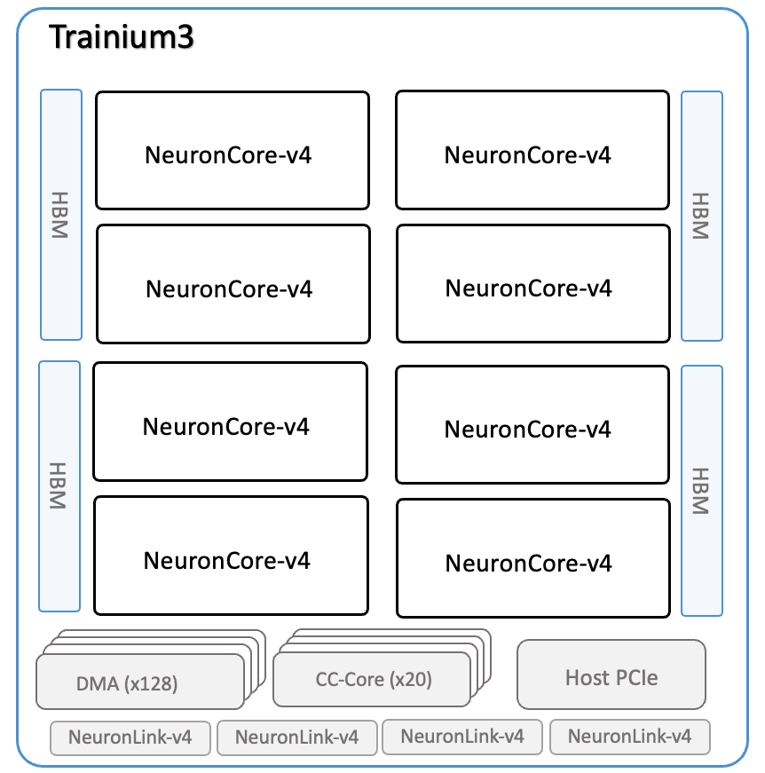
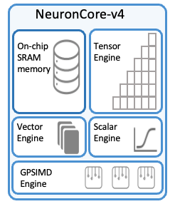
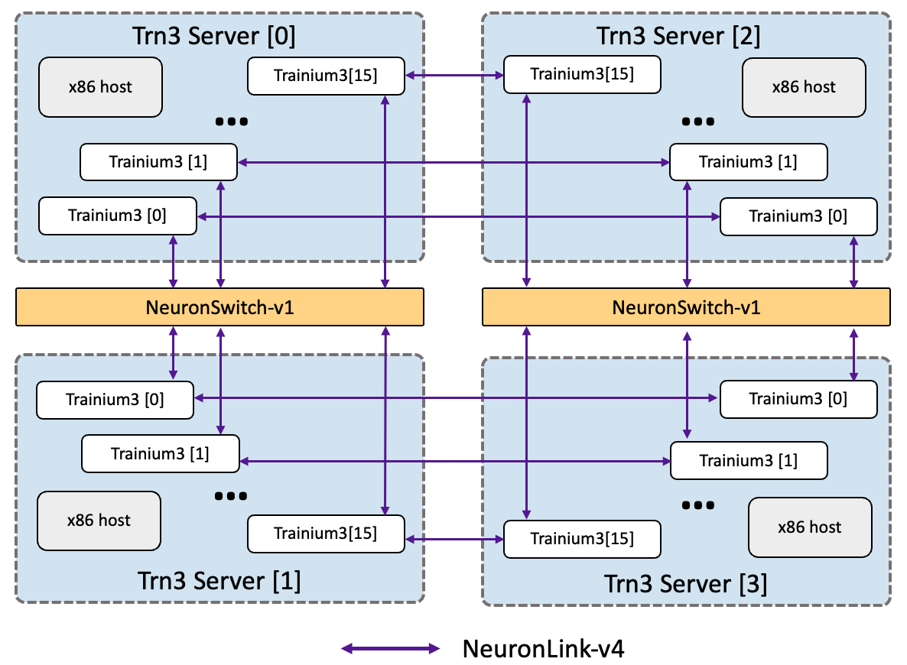

# DeepSeek V4.1 Flash on Trainium 3: Toward High Interactivity with Lower Cost Than GPUs 

### Executive Summary

*Batch-1 output speed per user (1000 / median TPOT; 512-token prompts, 128 output tokens) after each validated optimization round, Oct 22 to Nov 5. The shaded region is the same model on 8 of the 16 Trainium 3 devices.*

### Table of Content

---

## Overview of DeepSeek V4.1 Flash

*The 40-layer causal encoder-decoder of DeepSeek V4.1 Flash. Figure 3 of the [DeepSeek-V4.1-Flash technical report](https://huggingface.co/deepseek-ai/DeepSeek-V4.1-Flash/blob/main/DeepSeek_V41_Tech_Report.pdf).*

## AWS Trainium 3 vs. NVIDIA B300

  
  

*Left: a Trainium 3 device, eight NeuronCore-v4 cores around four HBM stacks. Right: one NeuronCore-v4 with its tensor, vector, scalar and GPSIMD engines and 32 MiB of software-managed SRAM. Source: [AWS Neuron documentation, Trainium3 architecture](https://awsdocs-neuron.readthedocs-hosted.com/en/latest/about-neuron/arch/neuron-hardware/trainium3.html) and [NeuronCore-v4 architecture](https://awsdocs-neuron.readthedocs-hosted.com/en/latest/about-neuron/arch/neuron-hardware/neuron-core-v4.html).*

*Trn3 Gen1 UltraServer: four servers of 16 Trainium 3 devices each, connected by NeuronLink-v4 through NeuronSwitch-v1. This work runs on the 16 devices of one trn3.48xlarge server (and on 8 of them). Source: [AWS Neuron documentation, Trn3 architecture](https://awsdocs-neuron.readthedocs-hosted.com/en/latest/about-neuron/arch/neuron-hardware/trn3-arch.html).*

## Inference Optimization: Reaching 60x Speedup Over 12 days

### Exploit new hardware features in Trainium 3

### Kernel and MegaKernel Fusion

(also discuss what optimization we did after fusing the kernel)

*One batch-1 decode step, from per-op kernels to tuned multi-layer megakernels. Top row: the launches of a step. Bottom: one layer zoomed in, with the activations that round-trip through HBM. Schematic widths.*

### Optimize vLLM Backend for Trainium

(one RPC, direct launch cached NEFF, Async scheduler, overlapping collective with next layer)

*Two batch-1 decode steps on the engine core, a worker's host thread and the device, as each backend change landed. Durations are schematic; the numbers in the frame text are measured.*

### Temporal PD/AFD: Specialized Kernels/Parallelization for Different Computations

(This is for TP8EP8 of MoE, sharding shared expert and Engram, and specialized kernels for decode and prefill)

*How each computation's weights are laid out over the 64 ranks in each phase. An outlined box is one full copy of the weight; the shade says which slice a rank holds.*

### Serving Two High Interactivity Sessions at a Time

## Comparison with GPU: What does the gap comes from?

*Device timeline of batch-1 decode on one rank (neuron-explorer).*

## Agentic Optimization: Composition of RSI and Expert Knowledge

