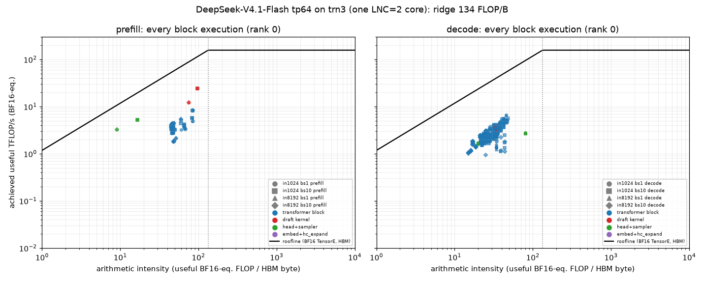

# DeepSeek-V4.1-Flash on trn3 — tp64 profile: prefill and decode

*2026-10-25 · branch `deepseek_v41_trn3` @ `eef3283` · trn3.48xlarge, 64 logical cores (LNC=2) · scheme `tp64`
(one tensor-parallel group of 64; attention split 8-way, routed experts spread over all 64 ranks) · NKI megakernel
per transformer block and one for the DSpark drafter · MXFP4 routed experts, FP8 dense weights.*

Four configurations, each profiled in a **prefill** window and a **decode** window on a live vLLM server:
`in1024_bs1`, `in1024_bs10` (`max_num_seqs=10`), `in8192_bs1`, `in8192_bs10` (`max_num_seqs=10`, which fits in
memory). Each configuration has three tables per phase: (1) the overall latency breakdown, (2) the latency of every
block / layer / the drafter, (3) the roofline of every block: MFU, MBU, DMA utilisation and engine bottleneck. All
latency breakdowns are in descending order.

## Summary

| Config · phase | Total | Transformer blocks | Drafter | Device idle (host) | Rest | Per block | Block MFU / MBU |
|---|---:|---:|---:|---:|---:|---:|---:|
| in1024 bs1 · prefill (TTFT) | 1.08 s | 96.5 % | 0.2 % | 1.4 % (+1.5 % outside window) | 0.5 % | 26.1 ms | 2.4 % / 6.3 % |
| in1024 bs10 · prefill (10 prompts) | 10.62 s | 97.8 % | 0.2 % | 1.5 % | 0.5 % | 26.0 ms | 2.4 % / 6.4 % |
| in8192 bs1 · prefill (TTFT) | 8.55 s | 98.2 % | 0.3 % | 1.0 % (+0.2 %) | 0.3 % | 52.5 ms / chunk | 2.3 % / 6.3 % |
| in8192 bs10 · prefill (10 prompts) | 86.2 s | 98.4 % | 0.3 % | 0.9 % | 0.4 % | 53.0 ms / chunk | 2.3 % / 6.2 % |
| in1024 bs1 · decode (per step) | 100.5 ms | 77.1 % | 5.4 % | 14.2 % | 3.3 % | 1.94 ms | 1.8 % / 8.0 % |
| in1024 bs10 · decode (per step) | 222.5 ms | 63.2 % | 24.6 % | 10.0 % | 2.2 % | 3.52 ms | 1.8 % / 7.0 % |
| in8192 bs1 · decode (per step) | 101.9 ms | 79.6 % | 5.4 % | 11.3 % | 3.7 % | 2.03 ms | 1.7 % / 8.1 % |
| in8192 bs10 · decode (per step) | 254.6 ms | 67.9 % | 21.5 % | 8.2 % | 2.4 % | 4.32 ms | 1.5 % / 8.0 % |

A decode step verifies 1 + 5 drafted tokens per sequence and emits ≈ 3.2 tokens per sequence at this prompt set's
~47 % acceptance (bs1: 100.5 ms / 3.2 ≈ 31 ms TPOT, the bench's 31.4 ms).

**Key findings**

1. **Prefill is 96–98 % transformer blocks, and they run far from both roofs.** Every block's arithmetic intensity
   (15–85 FLOP/B) is under the 133.5 FLOP/B ridge, i.e. on the memory side of the roofline, yet blocks reach only
   **6–8 % of HBM bandwidth** and **2–3 % of TensorE** (BF16-equivalent; MXFP4/FP8 matmuls are credited at their own
   throughput). No engine is saturated — the busiest (usually VectorE) is 43–60 % busy, DMA queues are active 27–41 %
   of the time — so prefill is bound by **dependency latency inside the kernels**, not by any unit's throughput.
2. **The prefill hotspot is the per-token sparse attention** (`mk_common.py:attn_token_body`): every token gathers
   its ~640 KV rows (128-token window + top-512) from HBM with an indirect DMA and transposes them on the PE before
   QK and PV. It occupies **52 % of an in1024 block** (13.3 of 25.6 ms), moves ~0.7 GB (1k) / 1.4 GB (2k-token chunk)
   of HBM per block, and PE transposes are more than half of all TensorE FLOPs in prefill (HFU ≈ 5–6.5 % vs
   MFU ≈ 2.2–2.8 %).
3. **At 8k context the 8 index-source blocks (L2, 8, 14, 20, 24, 28, 32, 36) take 36 % of prefill**: 77–104 ms per
   2048-token chunk vs ~42 ms for the other blocks. The indexer's per-token scoring loop
   (`mk_compress.py:index_scores_span`) is TensorE/VectorE-bound (≈ 42 ms footprint per chunk) plus ≈ 14 ms of top-k,
   and it scores the **full padded context** — chunk 1 (positions 0–2047) costs the same as chunk 4 (6144–8191).
4. **Decode blocks are collective-bound**: 26–38 % of every block is collectives, chiefly one 64-rank fp32
   all-reduce per block (0.54 ms at bs1, 0.86 ms at bs10 ⇒ **21–34 ms per decode step**). Its payload is a fixed
   128-row × 5120 fp32 tile (2.6 MB) although a step has only 6 (bs1) or 60 (bs10) live rows. On average no compute
   engine is busy for more than ~40 % of a decode block.
5. **The drafter is a quarter of a bs10 decode step**: tp64 launches it once per sequence, 10 × 5.5 ms = 55 ms a
   step (each launch ~30 % collectives, mostly nine bf16 64-rank all-reduces of 2.6 MB). At bs1 it is 5.5 ms (5 %).
6. **Host time is 8–14 % of a decode step**: 8.5–11 ms of device idle at every step boundary (vLLM scheduling,
   output processing, input preparation) plus 3–11 ms of dispatch gaps inside the forward (more at bs10, where the
   host issues 10 drafter launches). In prefill it is ≤ 2 %.
7. **Batching**: bs10 prefill is serial — the engine prefills one prompt per iteration (the token budget is 1280 at
   context 1280 and one 2048-token chunk at 8448), so TTFT grows linearly with queue position (1.07 → 10.62 s;
   8.7 → 86.2 s). bs10 decode costs 2.2–2.5× a bs1 step for 10× the sequences.
8. **37–49 % of all block HBM traffic is kernel-internal scratch round trips** (what the profiler classes as
   spill/reload: intermediates written to and re-read from HBM inside the megakernel).

## How this was measured

**Serving setup (the one the bench uses).** `performance._serve_main` (`vllm serve` with the port imported first),
`DEEPSEEK_V41_SCHEME=tp64`, tensor-parallel 64, LNC=2 (64 logical NeuronCores on one trn3.48xlarge, 36 GiB HBM
each), `--max-model-len` = input + 256 (1280 / 8448), prefix caching off. `max_num_seqs` = 1 for the bs1 cells and
10 for the bs10 cells (`DEEPSEEK_V41_MAX_NUM_SEQS=10`; in8192 at bs10 fits, so the bs4 fallback was not needed).
Code: branch `deepseek_v41_trn3` at `eef3283` (clean tree). Requests are greedy, `ignore_eos`, with token-exact prompts:
whole lines of `sonnet.txt`, tokenized and cut to exactly 1024 / 8192 tokens, a different random line order per request.

**Capture (Method 1 of `neuron-framework-profiling-vllm-neuron`).** The plugin's Neuron profiler
(`--profiler-config '{"profiler":"cuda",...}'` + `--additional-config '{"neuron_profiler": {...}}'`) records a device
profile (NTFF) and the live system trace on **rank 0** (`neuron_cores: [0]`; all 64 ranks run the same kernels, the
routed experts are spread evenly, so rank 0 is representative). Each server is warmed up with the exact workload first.

* **Prefill window**: server idle → `/start_profile` → the *bs* requests with `max_tokens=1` → all answered →
  `/stop_profile`. The window holds exactly the prefill iterations (including the drafter's prefill launch), nothing else.
* **Decode window**: *bs* streaming requests; once every stream has produced ≥ 3 chunks (all prefills done) →
  `/start_profile`, ~0.8–1.5 s, `/stop_profile`. The first step after the start (the profiler's start perturbs host
  timing) and the last, incomplete step are dropped; the tables are the mean / median of the 3–6 steady steps between.
* **Long prefills**: the device-trace buffers hold ~2–6 GB of trace, i.e. one 2048-token chunk. The live system trace
  is not limited, so **latency is complete for every iteration**; device metrics come from the first iteration (and the
  last few executions of a window may be missing). For in8192 a second server with `delay_iterations=4,
  max_iterations=1` captured the **4th chunk** (positions 6144–8191, the full context) as well; the per-block tables of
  the in8192 prefills show the 4th chunk's metrics; chunk 1 vs chunk 4 is compared in *Cross-configuration analysis*.
* Profile buffers: `NEURON_RT_PROFILE_BUF_INSTRUCTION_MB=512`, `NEURON_RT_PROFILE_BUF_EVENT_MB=256` (the defaults
  dropped instruction notifications after ~25 of the 46 executions of an in1024 prefill; a 1 GiB DMA buffer did not
  allocate). DGE notifications (`NEURON_RT_ENABLE_DGE_NOTIFICATIONS=1`) overflowed the notification queue on every rank
  and crashed the engine during warm-up, so they are **off**: DMA *bytes and timing* of the descriptor-generated
  (DGE) transfers are recorded, their per-tensor metadata is not.
* **Profiler overhead is negligible**: profiled in1024 bs1 prefill request 1.08 s vs bench TTFT 1.06 s; profiled
  in8192 bs1 prefill 8.55 s vs bench 8.55 s; profiled bs1 decode step 100.5 ms vs bench 31.4 ms TPOT × ~3.2 tokens a
  step.

Ingested with `neuron-explorer view --ingest-only` (2.33); every number below is computed from the parquet tables
by the scripts in `/mnt/nvme/ds41_profiling/scripts/` (see *Artifacts*).

## What the numbers mean

**Units of work.** One prefill/decode **iteration** is 46 NEFF executions on a core (73 at bs10 decode):
`embedding + hc_expand` (one compiled graph) → **40 block megakernels** (`layer_<phase>_<archetype>_tp64`, one NKI
kernel per transformer block, attention + MoE + hyper-connections + every collective inside) → `final norm + lm_head +
sampler` (one compiled graph, incl. rejection sampling) → the **DSpark drafter** megakernel (`draft_<phase>_tp64`, one
launch per sequence on tp64) with three tiny glue graphs around it. A block's *archetype* names what it carries:
`r0/r1/r2` = compress ratio of its attention, `src` = writes the compressed-KV / index caches, `idx` = index-source
(computes the sparse top-k for the layers after it), `e` = engram lookup, `tap` = DSpark tap (layers 37–39).

**Latency** is the device time of each execution from the live `nc_exec_running` trace (rank 0); *device idle* is the
gap between consecutive executions (host dispatch / synchronisation inside the forward; scheduler, output processing
and input preparation between iterations). For prefill, *host time outside the device window* = client-measured
time to the last first token − device window (HTTP, tokenisation, first scheduling, response).

**Roofline columns** (per execution, averaged over the executions of a block). Hardware constants are those the
profiler reports for a trn3 logical core (2 physical cores):

| Constant | Value |
|---|---|
| TensorE peak (BF16) | 128 × 128 PE × 2 FLOP × 2.4 GHz × 2 cores = **157.3 TFLOP/s** (FP8 2×, MXFP8/MXFP4 4×) |
| HBM bandwidth | **1178 GB/s** per logical core (one HBM stack's share) |
| DMA bandwidth | 614 GB/s per physical core, 1228 GB/s per logical core |
| Ridge point | 157.3 T / 1.178 T = **133.5 FLOP/B** (BF16-equivalent) |

* **MFU** = useful TensorE FLOPs / (block time × 157.3 TFLOP/s). FLOPs are the profiler's *BF16-equivalent*
  `adjusted_flops` (MXFP8 / MXFP4 matmuls count ×0.25, FP8 ×0.5, FP32 ×4), so MFU is the TensorE's utilisation at
  whatever precision it actually ran. *Useful* excludes the PE transposes; **HFU** includes them.
* **MBU** = (HBM bytes read + written by DMA) / (block time × 1178 GB/s). Includes KV-cache gathers, expert weight
  streaming and compiler spill/reload traffic.
* **DMA active %** = share of the block's time during which at least one DMA queue of the core had a packet in flight
  (interval-merged over both physical cores). **DMA BW %** = all DMA bytes (HBM, SBUF↔SBUF, collectives) / (time ×
  1228 GB/s).
* **AI** = useful FLOPs / HBM bytes. Every block's AI is below the 133.5 FLOP/B ridge, so on the roofline every block
  is in the **memory-bound region** and its roofline-attainable throughput is AI × HBM BW: *% of roofline = MBU*.
  Since no block exceeds ~12 % MBU, none is near either roof — they are latency/serialisation bound, which is what
  the engine columns show.
* **Engine busy %** = interval-merged active time of each engine across both physical cores / block time.
  *Collectives* = the CC-op time inside the block (kernel-entry barrier + all-reduces/all-gathers; it includes waiting
  for the slowest peer rank). The **bottleneck engine** is the busiest one; when no engine exceeds ~50 % the block is
  dominated by dependency stalls between engines, not by a saturated unit.


## Results per configuration

Reading the sections below: **(1)** sums every execution of the phase (prefill: the whole window, arrival → first
token of the last request; decode: one step, the mean of the steady steps), largest first. **(2–3)** is one row per
block in descending latency: the latency columns are complete (live system trace); the roofline columns are the
device profile of the executions listed in the section note. For the bs10 decode rows the drafter row aggregates
its 10 launches per step (latency summed, roofline averaged). The roofline plot below puts every block execution of
every configuration on one chart.




### in1024_bs1 · prefill — 1 request × 1024 tokens (`max_num_seqs=1`, context 1280)

One prefill iteration of 1024 rows (TTFT 1.08 s measured by the client in this run; bench 1.06 s).

**1. Overall latency breakdown** (descending)

| Component | ms | % |
|---|---:|---:|
| 40 transformer blocks (megakernels) | 1,042.02 | 96.5 |
| host time outside the device window (HTTP, tokenizer, first schedule, response) | 15.83 | 1.5 |
| device idle inside the forward (host dispatch / sync) | 14.88 | 1.4 |
| embedding + hc_expand | 4.32 | 0.4 |
| DSpark drafter (megakernel) | 1.93 | 0.2 |
| final norm + lm_head + sampler | 0.98 | 0.1 |
| drafter glue graphs | 0.05 | 0.0 |
| **Total** | **1,080.00** | 100 |

Transformer blocks by archetype (descending):

| Block archetype | blocks | ms (all blocks of this type) | ms per block | % of block time |
|---|---:|---:|---:|---:|
| `r2` | 15 | 383.29 | 25.553 | 36.8 |
| `r1` | 12 | 278.44 | 23.204 | 26.7 |
| `r1_idx` | 4 | 130.43 | 32.607 | 12.5 |
| `r1_tap` | 3 | 68.62 | 22.874 | 6.6 |
| `r2_src_idx` | 2 | 65.77 | 32.884 | 6.3 |
| `r2_src_idx_e` | 1 | 36.54 | 36.539 | 3.5 |
| `r1_src_idx` | 1 | 32.83 | 32.830 | 3.2 |
| `r0` | 1 | 26.05 | 26.049 | 2.5 |
| `r0_e` | 1 | 20.05 | 20.047 | 1.9 |

**2–3. Per-block latency and roofline** (descending by latency)

| Block | launches | ms (whole phase) | % of total | MFU % | HFU % | MBU % | DMA active % | DMA BW % | AI (FLOP/B) | Bottleneck engine (busy %) | Collectives % | TensorE % | VectorE % | GpSimd % |
|---|---:|---:|---:|---:|---:|---:|---:|---:|---:|---|---:|---:|---:|---:|
| L14 r2_src_idx_e | 1 | 36.539 | 3.4 | 3.6 | 5.8 | 5.9 | 40.2 | 5.9 | 82 | VectorE (40) | 13.1 | 35.0 | 40.3 | 34.7 |
| L08 r2_src_idx | 1 | 33.979 | 3.1 | 2.5 | 4.8 | 5.1 | 40.1 | 4.9 | 66 | DMA (40) | 8.8 | 36.0 | 39.2 | 37.2 |
| L24 r1_idx | 1 | 33.094 | 3.1 | 1.8 | 4.0 | 5.0 | 34.2 | 4.9 | 47 | VectorE (44) | 9.5 | 40.8 | 43.8 | 38.1 |
| L36 r1_idx | 1 | 32.866 | 3.0 | 1.8 | 4.1 | 5.1 | 34.3 | 4.9 | 47 | VectorE (44) | 8.9 | 41.0 | 44.1 | 38.2 |
| L20 r1_src_idx | 1 | 32.830 | 3.0 | 1.8 | 4.1 | 5.1 | 33.7 | 4.9 | 48 | VectorE (44) | 10.2 | 40.0 | 44.1 | 36.7 |
| L28 r1_idx | 1 | 32.535 | 3.0 | 2.1 | 4.4 | 5.5 | 37.9 | 5.4 | 50 | VectorE (46) | 2.2 | 43.6 | 45.5 | 44.2 |
| L32 r1_idx | 1 | 31.933 | 3.0 | 1.7 | 4.1 | 5.1 | 34.3 | 4.9 | 46 | VectorE (45) | 8.1 | 41.3 | 44.9 | 37.5 |
| L02 r2_src_idx | 1 | 31.788 | 2.9 | 2.6 | 5.0 | 5.3 | 41.5 | 5.2 | 65 | VectorE (42) | 4.7 | 37.8 | 41.8 | 38.2 |
| L18 r2 | 1 | 27.369 | 2.5 | 2.0 | 4.7 | 5.9 | 41.2 | 5.7 | 46 | DMA (41) | 17.3 | 32.7 | 38.9 | 33.2 |
| L05 r2 | 1 | 26.124 | 2.4 | 2.1 | 5.0 | 6.2 | 43.1 | 6.0 | 46 | DMA (43) | 13.5 | 34.2 | 40.8 | 34.9 |
| L17 r2 | 1 | 26.112 | 2.4 | 2.1 | 5.0 | 6.2 | 43.1 | 6.0 | 46 | DMA (43) | 13.5 | 34.2 | 40.8 | 34.9 |
| L00 r0 | 1 | 26.049 | 2.4 | 2.0 | 3.2 | 4.6 | 18.0 | 4.4 | 60 | Collectives (83) | 83.1 | 21.6 | 28.0 | 23.7 |
| L04 r2 | 1 | 25.816 | 2.4 | 2.3 | 5.1 | 6.4 | 45.0 | 6.2 | 48 | DMA (45) | 10.1 | 35.4 | 41.6 | 37.6 |
| L03 r2 | 1 | 25.529 | 2.4 | 2.2 | 5.1 | 6.4 | 45.1 | 6.2 | 47 | DMA (45) | 10.2 | 35.5 | 41.9 | 36.8 |
| L11 r2 | 1 | 25.511 | 2.4 | 2.2 | 5.1 | 6.3 | 44.4 | 6.1 | 46 | DMA (44) | 11.4 | 35.2 | 41.8 | 35.7 |
| L12 r2 | 1 | 25.508 | 2.4 | 2.2 | 5.1 | 6.3 | 44.3 | 6.1 | 46 | DMA (44) | 11.4 | 35.3 | 42.0 | 35.6 |
| L10 r2 | 1 | 25.505 | 2.4 | 2.1 | 4.9 | 6.1 | 43.1 | 6.0 | 45 | DMA (43) | 13.8 | 34.4 | 41.5 | 33.4 |
| L16 r2 | 1 | 25.220 | 2.3 | 2.2 | 5.1 | 6.4 | 44.8 | 6.2 | 46 | DMA (45) | 10.4 | 35.6 | 42.3 | 36.1 |
| L13 r2 | 1 | 25.212 | 2.3 | 2.2 | 5.1 | 6.4 | 44.9 | 6.2 | 46 | DMA (45) | 10.4 | 35.6 | 42.3 | 36.1 |
| L07 r2 | 1 | 25.212 | 2.3 | 2.2 | 5.1 | 6.4 | 45.0 | 6.2 | 46 | DMA (45) | 10.3 | 35.7 | 42.3 | 36.1 |
| L19 r2 | 1 | 25.200 | 2.3 | 2.3 | 5.3 | 6.6 | 46.1 | 6.4 | 48 | DMA (46) | 7.9 | 36.4 | 42.7 | 38.4 |
| L06 r2 | 1 | 25.190 | 2.3 | 2.3 | 5.3 | 6.6 | 46.2 | 6.4 | 48 | DMA (46) | 7.8 | 36.4 | 42.8 | 38.5 |
| L15 r2 | 1 | 25.183 | 2.3 | 2.2 | 5.1 | 6.4 | 44.9 | 6.2 | 46 | DMA (45) | 10.4 | 35.6 | 42.3 | 36.1 |
| L09 r2 | 1 | 24.599 | 2.3 | 2.4 | 5.4 | 6.7 | 47.3 | 6.5 | 48 | DMA (47) | 5.7 | 37.2 | 43.6 | 39.4 |
| L23 r1 | 1 | 23.712 | 2.2 | 2.5 | 5.6 | 7.0 | 38.6 | 6.8 | 47 | VectorE (46) | 11.1 | 39.0 | 45.8 | 41.1 |
| L26 r1 | 1 | 23.691 | 2.2 | 2.4 | 5.5 | 6.8 | 37.1 | 6.6 | 46 | VectorE (45) | 13.6 | 38.1 | 45.4 | 38.7 |
| L29 r1 | 1 | 23.437 | 2.2 | 2.6 | 5.7 | 7.1 | 39.8 | 6.9 | 48 | VectorE (46) | 8.7 | 40.1 | 46.4 | 42.8 |
| L22 r1 | 1 | 23.414 | 2.2 | 2.6 | 5.7 | 7.2 | 40.1 | 7.0 | 48 | VectorE (47) | 8.6 | 40.1 | 46.6 | 42.9 |
| L21 r1 | 1 | 23.409 | 2.2 | 2.3 | 5.4 | 6.8 | 36.7 | 6.6 | 46 | VectorE (46) | 13.9 | 38.1 | 45.5 | 37.8 |
| L34 r1 | 1 | 23.383 | 2.2 | 2.5 | 5.6 | 7.0 | 38.3 | 6.8 | 47 | VectorE (46) | 11.1 | 39.0 | 46.2 | 40.3 |
| L25 r1 | 1 | 23.116 | 2.1 | 2.4 | 5.6 | 7.0 | 37.9 | 6.7 | 46 | VectorE (46) | 11.5 | 39.1 | 46.4 | 39.5 |
| L31 r1 | 1 | 23.106 | 2.1 | 2.5 | 5.7 | 7.1 | 39.1 | 6.9 | 47 | VectorE (47) | 10.1 | 39.7 | 46.9 | 41.0 |
| L37 r1_tap | 1 | 23.096 | 2.1 | 2.5 | 5.7 | 7.3 | 38.8 | 7.2 | 45 | VectorE (46) | 10.1 | 38.6 | 46.4 | 40.8 |
| L27 r1 | 1 | 23.093 | 2.1 | 2.4 | 5.6 | 7.0 | 38.0 | 6.8 | 46 | VectorE (47) | 11.3 | 39.2 | 46.5 | 39.6 |
| L35 r1 | 1 | 23.092 | 2.1 | 2.6 | 5.8 | 7.2 | 39.7 | 7.0 | 47 | VectorE (47) | 8.7 | 40.1 | 47.1 | 42.1 |
| L33 r1 | 1 | 22.821 | 2.1 | 2.5 | 5.7 | 7.1 | 39.3 | 6.9 | 47 | VectorE (47) | 9.0 | 40.0 | 47.1 | 41.3 |
| L39 r1_tap | 1 | 22.767 | 2.1 | 2.7 | 5.9 | 7.6 | 40.8 | 7.5 | 47 | VectorE (48) | 6.1 | 40.3 | 47.5 | 44.0 |
| L38 r1_tap | 1 | 22.759 | 2.1 | 2.5 | 5.7 | 7.3 | 38.4 | 7.2 | 45 | VectorE (47) | 10.1 | 38.9 | 46.9 | 40.1 |
| L30 r1 | 1 | 22.167 | 2.1 | 2.7 | 6.0 | 7.5 | 41.3 | 7.2 | 47 | VectorE (49) | 4.8 | 41.9 | 49.1 | 44.0 |
| L01 r0_e | 1 | 20.047 | 1.9 | 5.2 | 6.8 | 8.3 | 31.8 | 8.5 | 84 | VectorE (44) | 16.3 | 31.1 | 43.5 | 35.2 |
| embedding + hc_expand | 1 | 4.317 | 0.4 | 0.0 | 0.0 | 3.7 | 5.4 | 1.5 | 0 | Collectives (96) | 96.2 | 0.1 | 0.8 | 0.8 |
| DSpark drafter (megakernel) | 1 | 1.925 | 0.2 | 15.5 | 20.8 | 21.3 | 53.0 | 19.2 | 97 | VectorE (64) | 16.6 | 58.9 | 64.2 | 32.3 |
| final norm + lm_head + sampler | 1 | 0.982 | 0.1 | 3.4 | 3.4 | 26.9 | 57.1 | 27.6 | 17 | VectorE (68) | 13.4 | 8.8 | 68.1 | 32.3 |
| drafter glue graphs | 3 | 0.049 | 0.0 | 0.0 | 0.0 | 0.0 | 13.3 | 0.2 | 0 | GpSimd (17) | 0.0 | 0.0 | 1.2 | 16.7 |

**Where the time goes inside the dominant blocks** (NKI source attribution)

*r2* — 15 executions, mean 25.560 ms. *Footprint* = time during which any engine of either core executes the function (functions overlap, so footprints do not add up to the block); the engine columns are each engine's busy time on that function, per physical core.

| Kernel function | footprint ms | Tensor ms | Vector ms | Scalar ms | GpSimd ms | Sync ms | HBM MB | GFLOP (BF16-eq.) |
|---|---:|---:|---:|---:|---:|---:|---:|---:|
| `mk_common.py:attn_token_body` | 13.292 | 3.852 | 4.402 | 0.746 | 4.897 | 0.000 | 693.1 | 96.79 |
| `mk_mx.py:load_w_group` | 1.354 | 0.000 | 0.046 | 0.000 | 1.189 | 0.000 | 183.7 | 0.00 |
| `mk_common.py:hc_in_tile` | 1.167 | 0.632 | 0.493 | 0.233 | 0.018 | 0.002 | 105.1 | 18.78 |
| `mk_mx.py:interleave_rows` | 0.831 | 0.623 | 0.694 | 0.000 | 0.000 | 0.000 | 0.0 | 16.12 |
| `mk_common.py:hc_out_tile` | 0.759 | 0.000 | 0.643 | 0.168 | 0.113 | 0.011 | 188.9 | 0.00 |
| `mk_common.py:bcast_row` | 0.389 | 0.000 | 0.231 | 0.000 | 0.018 | 0.000 | 0.1 | 0.00 |
| `mk_mx.py:gemm` | 0.384 | 0.282 | 0.073 | 0.055 | 0.000 | 0.003 | 86.5 | 30.33 |
| `(no source location)` | 0.381 | 0.050 | 0.047 | 0.049 | 0.055 | 0.047 | 0.0 | 0.00 |

*r1_idx* — 4 executions, mean 32.658 ms. *Footprint* = time during which any engine of either core executes the function (functions overlap, so footprints do not add up to the block); the engine columns are each engine's busy time on that function, per physical core.

| Kernel function | footprint ms | Tensor ms | Vector ms | Scalar ms | GpSimd ms | Sync ms | HBM MB | GFLOP (BF16-eq.) |
|---|---:|---:|---:|---:|---:|---:|---:|---:|
| `mk_common.py:attn_token_body` | 12.692 | 3.852 | 4.405 | 0.746 | 4.907 | 0.000 | 693.1 | 96.79 |
| `mk_compress.py:index_scores_span.body` | 5.006 | 3.086 | 2.173 | 0.000 | 1.000 | 0.000 | 6.3 | 1.39 |
| `mk_compress.py:index_topk` | 1.796 | 0.000 | 0.030 | 0.004 | 0.502 | 1.540 | 16.8 | 0.00 |
| `mk_mx.py:load_w_group` | 1.764 | 0.000 | 0.056 | 0.000 | 1.628 | 0.000 | 213.8 | 0.00 |
| `mk_common.py:hc_in_tile` | 1.303 | 0.628 | 0.506 | 0.233 | 0.018 | 0.001 | 105.1 | 18.77 |
| `mk_mx.py:interleave_rows` | 0.893 | 0.672 | 0.753 | 0.000 | 0.000 | 0.000 | 0.0 | 17.42 |
| `mk_common.py:hc_out_tile` | 0.758 | 0.000 | 0.643 | 0.169 | 0.113 | 0.010 | 188.9 | 0.00 |
| `(no source location)` | 0.719 | 0.097 | 0.090 | 0.094 | 0.105 | 0.090 | 0.0 | 0.00 |


### in1024_bs1 · decode — 1 sequence (a step verifies 1 + 5 drafted tokens)

Per decode step (mean of 3 steady steps). A step emits 1 + accepted drafts ≈ 3.2 tokens at the ~47 % acceptance of this prompt set, so TPOT ≈ step / 3.2.

**1. Overall latency breakdown** (descending)

| Component | ms | % |
|---|---:|---:|
| 40 transformer blocks (megakernels) | 77.45 | 77.1 |
| device idle between iterations (vLLM scheduler, sampling output, input prep) | 10.54 | 10.5 |
| DSpark drafter (megakernel) | 5.47 | 5.4 |
| device idle inside the forward (host dispatch / sync) | 3.69 | 3.7 |
| final norm + lm_head + sampler | 1.93 | 1.9 |
| embedding + hc_expand | 1.32 | 1.3 |
| drafter glue graphs | 0.05 | 0.1 |
| **Total** | **100.46** | 100 |

Transformer blocks by archetype (descending):

| Block archetype | blocks | ms (all blocks of this type) | ms per block | % of block time |
|---|---:|---:|---:|---:|
| `r2` | 15 | 26.93 | 1.795 | 34.8 |
| `r1` | 12 | 21.53 | 1.794 | 27.8 |
| `r1_idx` | 4 | 8.38 | 2.094 | 10.8 |
| `r1_tap` | 3 | 5.77 | 1.925 | 7.5 |
| `r2_src_idx` | 2 | 4.18 | 2.091 | 5.4 |
| `r0` | 1 | 3.70 | 3.702 | 4.8 |
| `r2_src_idx_e` | 1 | 2.67 | 2.674 | 3.5 |
| `r0_e` | 1 | 2.43 | 2.432 | 3.1 |
| `r1_src_idx` | 1 | 1.86 | 1.859 | 2.4 |

**2–3. Per-block latency and roofline** (descending by latency)

| Block | launches | ms per decode step | % of total | MFU % | HFU % | MBU % | DMA active % | DMA BW % | AI (FLOP/B) | Bottleneck engine (busy %) | Collectives % | TensorE % | VectorE % | GpSimd % |
|---|---:|---:|---:|---:|---:|---:|---:|---:|---:|---|---:|---:|---:|---:|
| DSpark drafter (megakernel) | 1 | 5.474 | 5.4 | 2.3 | 3.2 | 9.1 | 32.3 | 9.1 | 34 | VectorE (38) | 31.0 | 16.9 | 38.0 | 18.2 |
| L00 r0 | 1 | 3.702 | 3.7 | 1.2 | 1.7 | 4.9 | 19.7 | 4.9 | 34 | Collectives (66) | 66.4 | 11.7 | 20.5 | 16.7 |
| L14 r2_src_idx_e | 1 | 2.674 | 2.7 | 3.4 | 4.0 | 11.2 | 35.0 | 11.1 | 40 | VectorE (37) | 26.6 | 20.7 | 37.0 | 23.7 |
| L01 r0_e | 1 | 2.432 | 2.4 | 3.8 | 4.4 | 11.6 | 36.9 | 11.5 | 43 | DMA (37) | 28.5 | 19.2 | 36.4 | 27.7 |
| L28 r1_idx | 1 | 2.201 | 2.2 | 1.8 | 2.6 | 7.4 | 31.9 | 7.3 | 33 | VectorE (32) | 31.8 | 19.4 | 32.3 | 26.9 |
| L08 r2_src_idx | 1 | 2.136 | 2.1 | 1.7 | 2.5 | 8.0 | 32.1 | 7.9 | 29 | VectorE (34) | 28.2 | 21.2 | 34.0 | 24.2 |
| L36 r1_idx | 1 | 2.104 | 2.1 | 1.9 | 2.8 | 7.8 | 33.8 | 7.7 | 32 | VectorE (34) | 28.0 | 20.6 | 34.2 | 29.0 |
| L24 r1_idx | 1 | 2.096 | 2.1 | 1.9 | 2.8 | 7.8 | 33.4 | 7.7 | 33 | VectorE (34) | 28.5 | 20.3 | 34.1 | 28.4 |
| L38 r1_tap | 1 | 2.052 | 2.0 | 1.5 | 2.3 | 7.3 | 26.7 | 7.2 | 28 | Collectives (42) | 41.8 | 15.4 | 31.8 | 17.2 |
| L33 r1 | 1 | 2.047 | 2.0 | 1.2 | 1.9 | 6.5 | 23.8 | 6.5 | 25 | Collectives (46) | 45.9 | 13.1 | 28.5 | 12.2 |
| L02 r2_src_idx | 1 | 2.045 | 2.0 | 1.3 | 2.1 | 7.6 | 27.0 | 7.6 | 24 | Collectives (39) | 38.5 | 18.3 | 34.2 | 16.0 |
| L32 r1_idx | 1 | 1.974 | 2.0 | 1.8 | 2.6 | 7.8 | 32.5 | 7.8 | 30 | VectorE (35) | 30.2 | 20.1 | 34.8 | 25.0 |
| final norm + lm_head + sampler | 1 | 1.932 | 1.9 | 1.8 | 1.8 | 2.9 | 22.3 | 3.1 | 81 | GpSimd (71) | 8.4 | 6.4 | 32.0 | 71.0 |
| L11 r2 | 1 | 1.909 | 1.9 | 1.4 | 2.2 | 7.3 | 25.0 | 7.3 | 25 | Collectives (45) | 44.8 | 14.6 | 32.1 | 13.6 |
| L12 r2 | 1 | 1.908 | 1.9 | 1.4 | 2.2 | 7.3 | 24.7 | 7.3 | 25 | Collectives (45) | 45.2 | 14.8 | 32.4 | 13.8 |
| L04 r2 | 1 | 1.906 | 1.9 | 1.6 | 2.4 | 7.7 | 27.6 | 7.6 | 28 | Collectives (40) | 40.1 | 16.6 | 32.9 | 18.6 |
| L15 r2 | 1 | 1.887 | 1.9 | 1.3 | 2.1 | 7.1 | 24.5 | 7.1 | 25 | Collectives (43) | 43.4 | 14.2 | 31.5 | 13.6 |
| L37 r1_tap | 1 | 1.866 | 1.9 | 1.4 | 2.2 | 7.5 | 26.9 | 7.5 | 25 | Collectives (41) | 40.6 | 15.1 | 33.7 | 14.3 |
| L20 r1_src_idx | 1 | 1.859 | 1.9 | 1.6 | 2.4 | 7.9 | 30.4 | 7.9 | 27 | VectorE (37) | 32.5 | 17.8 | 37.3 | 17.3 |
| L39 r1_tap | 1 | 1.855 | 1.8 | 2.7 | 3.7 | 9.6 | 41.9 | 9.5 | 37 | DMA (42) | 14.0 | 25.9 | 38.7 | 41.1 |
| L25 r1 | 1 | 1.829 | 1.8 | 2.2 | 3.1 | 8.7 | 35.9 | 8.6 | 32 | DMA (36) | 26.4 | 21.3 | 35.6 | 30.1 |
| L31 r1 | 1 | 1.828 | 1.8 | 1.4 | 2.2 | 7.7 | 25.9 | 7.6 | 25 | Collectives (42) | 42.3 | 15.3 | 33.6 | 14.8 |
| L21 r1 | 1 | 1.827 | 1.8 | 1.4 | 2.2 | 7.5 | 26.6 | 7.5 | 25 | Collectives (43) | 42.7 | 15.0 | 32.9 | 14.2 |
| L09 r2 | 1 | 1.823 | 1.8 | 2.4 | 3.4 | 9.0 | 38.8 | 8.9 | 35 | DMA (39) | 20.8 | 23.5 | 36.4 | 35.1 |
| L19 r2 | 1 | 1.816 | 1.8 | 1.4 | 2.3 | 7.6 | 25.8 | 7.6 | 25 | Collectives (42) | 41.8 | 15.4 | 34.0 | 14.5 |
| L30 r1 | 1 | 1.813 | 1.8 | 2.2 | 3.2 | 9.0 | 36.1 | 8.9 | 33 | VectorE (37) | 24.9 | 22.1 | 36.9 | 30.9 |
| L07 r2 | 1 | 1.812 | 1.8 | 1.4 | 2.3 | 7.7 | 26.1 | 7.6 | 25 | Collectives (42) | 42.3 | 15.3 | 33.5 | 14.5 |
| L23 r1 | 1 | 1.808 | 1.8 | 1.7 | 2.6 | 8.2 | 29.8 | 8.1 | 28 | Collectives (36) | 36.3 | 17.6 | 34.7 | 20.1 |
| L10 r2 | 1 | 1.807 | 1.8 | 1.4 | 2.3 | 7.7 | 26.2 | 7.6 | 25 | Collectives (42) | 42.1 | 15.5 | 33.7 | 14.5 |
| L05 r2 | 1 | 1.807 | 1.8 | 1.4 | 2.3 | 7.7 | 26.2 | 7.7 | 25 | Collectives (42) | 42.1 | 15.3 | 33.6 | 14.4 |
| L27 r1 | 1 | 1.805 | 1.8 | 1.4 | 2.3 | 7.8 | 26.7 | 7.7 | 25 | Collectives (42) | 42.0 | 15.4 | 33.9 | 14.6 |
| L35 r1 | 1 | 1.805 | 1.8 | 2.5 | 3.5 | 9.4 | 39.6 | 9.3 | 35 | DMA (40) | 19.7 | 24.1 | 38.0 | 36.6 |
| L18 r2 | 1 | 1.805 | 1.8 | 1.7 | 2.6 | 8.1 | 29.5 | 8.1 | 28 | Collectives (36) | 36.4 | 17.5 | 34.8 | 19.9 |
| L26 r1 | 1 | 1.804 | 1.8 | 1.4 | 2.3 | 7.8 | 26.6 | 7.7 | 25 | Collectives (42) | 41.9 | 15.4 | 34.0 | 14.5 |
| L13 r2 | 1 | 1.794 | 1.8 | 2.0 | 2.9 | 8.6 | 32.8 | 8.5 | 31 | VectorE (36) | 30.2 | 20.2 | 36.3 | 25.4 |
| L03 r2 | 1 | 1.727 | 1.7 | 1.7 | 2.6 | 8.3 | 30.9 | 8.3 | 28 | VectorE (36) | 33.6 | 18.2 | 35.7 | 20.2 |
| L16 r2 | 1 | 1.725 | 1.7 | 1.5 | 2.4 | 8.1 | 27.6 | 8.1 | 25 | Collectives (38) | 38.2 | 16.6 | 35.7 | 15.4 |
| L34 r1 | 1 | 1.706 | 1.7 | 1.8 | 2.7 | 8.7 | 31.1 | 8.6 | 28 | VectorE (37) | 32.0 | 18.9 | 37.5 | 21.7 |
| L29 r1 | 1 | 1.649 | 1.6 | 2.3 | 3.3 | 9.4 | 39.4 | 9.3 | 33 | DMA (39) | 17.6 | 22.9 | 38.5 | 32.5 |
| L06 r2 | 1 | 1.608 | 1.6 | 1.6 | 2.6 | 8.7 | 29.8 | 8.7 | 25 | VectorE (38) | 34.4 | 17.5 | 38.3 | 16.3 |
| L22 r1 | 1 | 1.607 | 1.6 | 1.6 | 2.6 | 8.8 | 30.1 | 8.7 | 25 | VectorE (38) | 34.4 | 17.4 | 38.2 | 16.6 |
| L17 r2 | 1 | 1.594 | 1.6 | 2.0 | 3.0 | 9.3 | 33.7 | 9.2 | 28 | VectorE (40) | 26.5 | 20.4 | 40.0 | 23.0 |
| embedding + hc_expand | 1 | 1.322 | 1.3 | 0.0 | 0.0 | 0.1 | 1.3 | 0.1 | 0 | Collectives (94) | 94.0 | 1.3 | 1.1 | 1.3 |
| drafter glue graphs | 3 | 0.055 | 0.1 | 0.0 | 0.0 | 0.0 | 7.8 | 0.1 | 0 | GpSimd (18) | 0.0 | 0.0 | 2.9 | 18.1 |

**Where the time goes inside the dominant blocks** (NKI source attribution)

*r2* — 45 executions, mean 1.807 ms. *Footprint* = time during which any engine of either core executes the function (functions overlap, so footprints do not add up to the block); the engine columns are each engine's busy time on that function, per physical core.

| Kernel function | footprint ms | Tensor ms | Vector ms | Scalar ms | GpSimd ms | Sync ms | HBM MB | GFLOP (BF16-eq.) |
|---|---:|---:|---:|---:|---:|---:|---:|---:|
| `mk_mx.py:load_w_group` | 0.211 | 0.000 | 0.012 | 0.000 | 0.169 | 0.000 | 63.2 | 0.00 |
| `mk_common.py:hc_out_tile` | 0.170 | 0.000 | 0.080 | 0.021 | 0.000 | 0.000 | 0.0 | 0.00 |
| `mk_common.py:hc_in_tile` | 0.141 | 0.019 | 0.041 | 0.029 | 0.000 | 0.000 | 0.0 | 0.05 |
| `mk_mx.py:interleave_rows` | 0.111 | 0.063 | 0.081 | 0.000 | 0.000 | 0.000 | 0.0 | 1.93 |
| `mk_common.py:sinkhorn.rowsum_div` | 0.098 | 0.000 | 0.025 | 0.030 | 0.000 | 0.000 | 0.0 | 0.00 |
| `mk_mx.py:gemm` | 0.090 | 0.050 | 0.010 | 0.008 | 0.000 | 0.000 | 10.8 | 3.79 |
| `mk_common.py:attn_token_body` | 0.074 | 0.023 | 0.026 | 0.006 | 0.029 | 0.000 | 4.1 | 0.57 |
| `mk_common.py:sinkhorn.colsum_div` | 0.049 | 0.000 | 0.015 | 0.009 | 0.000 | 0.000 | 0.0 | 0.00 |

*draft kernel* — 3 executions, mean 5.495 ms. *Footprint* = time during which any engine of either core executes the function (functions overlap, so footprints do not add up to the block); the engine columns are each engine's busy time on that function, per physical core.

| Kernel function | footprint ms | Tensor ms | Vector ms | Scalar ms | GpSimd ms | Sync ms | HBM MB | GFLOP (BF16-eq.) |
|---|---:|---:|---:|---:|---:|---:|---:|---:|
| `mk_mx.py:load_w_group` | 0.693 | 0.000 | 0.042 | 0.000 | 0.453 | 0.000 | 264.2 | 0.00 |
| `mk_common.py:hc_out_tile` | 0.514 | 0.000 | 0.241 | 0.064 | 0.000 | 0.000 | 0.0 | 0.00 |
| `mk_mx.py:interleave_rows` | 0.465 | 0.258 | 0.316 | 0.000 | 0.002 | 0.000 | 0.0 | 7.52 |
| `mk_common.py:sinkhorn.rowsum_div` | 0.400 | 0.000 | 0.093 | 0.115 | 0.000 | 0.000 | 0.0 | 0.00 |
| `mk_common.py:hc_in_tile` | 0.392 | 0.049 | 0.119 | 0.086 | 0.000 | 0.000 | 0.0 | 0.12 |
| `mk_mx.py:gemm` | 0.381 | 0.218 | 0.033 | 0.023 | 0.000 | 0.001 | 34.1 | 16.91 |
| `mk_common.py:bcast_row` | 0.168 | 0.000 | 0.051 | 0.000 | 0.035 | 0.000 | 0.1 | 0.00 |
| `draft_kernel.py:draft_body` | 0.160 | 0.008 | 0.066 | 0.002 | 0.006 | 0.003 | 62.2 | 0.01 |


### in1024_bs10 · prefill — 10 requests × 1024 tokens (`max_num_seqs=10`, context 1280)

The scheduler prefills one prompt per iteration (10 iterations of 1024 rows, ~1.05 s each), so the 10 requests get their first token 1.07, 2.12, … 10.62 s after arrival (mean TTFT ≈ 5.84 s). Totals below are for the whole batch (arrival → last first token); device metrics are from iterations 1–2.

**1. Overall latency breakdown** (descending)

| Component | ms | % |
|---|---:|---:|
| 40 transformer blocks (megakernels) | 10,380.50 | 97.8 |
| device idle between iterations (vLLM scheduler, sampling output, input prep) | 113.06 | 1.1 |
| device idle inside the forward (host dispatch / sync) | 44.37 | 0.4 |
| embedding + hc_expand | 38.78 | 0.4 |
| DSpark drafter (megakernel) | 19.29 | 0.2 |
| host time outside the device window (HTTP, tokenizer, first schedule, response) | 10.66 | 0.1 |
| final norm + lm_head + sampler | 9.86 | 0.1 |
| drafter glue graphs | 0.48 | 0.0 |
| **Total** | **10,617.00** | 100 |

Transformer blocks by archetype (descending):

| Block archetype | blocks | ms (all blocks of this type) | ms per block | % of block time |
|---|---:|---:|---:|---:|
| `r2` | 150 | 3,815.86 | 25.439 | 36.8 |
| `r1` | 120 | 2,794.17 | 23.285 | 26.9 |
| `r1_idx` | 40 | 1,305.30 | 32.632 | 12.6 |
| `r1_tap` | 30 | 691.07 | 23.036 | 6.7 |
| `r2_src_idx` | 20 | 677.17 | 33.858 | 6.5 |
| `r2_src_idx_e` | 10 | 366.04 | 36.604 | 3.5 |
| `r1_src_idx` | 10 | 327.09 | 32.709 | 3.2 |
| `r0` | 10 | 205.20 | 20.520 | 2.0 |
| `r0_e` | 10 | 198.60 | 19.860 | 1.9 |

**2–3. Per-block latency and roofline** (descending by latency)

| Block | launches | ms (whole phase) | % of total | MFU % | HFU % | MBU % | DMA active % | DMA BW % | AI (FLOP/B) | Bottleneck engine (busy %) | Collectives % | TensorE % | VectorE % | GpSimd % |
|---|---:|---:|---:|---:|---:|---:|---:|---:|---:|---|---:|---:|---:|---:|
| L14 r2_src_idx_e | 10 | 366.039 | 3.4 | 3.7 | 5.8 | 5.9 | 41.9 | 6.0 | 82 | VectorE (43) | 12.0 | 39.0 | 42.6 | 36.8 |
| L08 r2_src_idx | 10 | 341.415 | 3.2 | 2.5 | 4.8 | 5.1 | 41.3 | 5.0 | 66 | VectorE (43) | 8.8 | 40.3 | 42.5 | 39.1 |
| L02 r2_src_idx | 10 | 335.751 | 3.2 | 2.6 | 4.9 | 5.2 | 42.2 | 5.1 | 66 | VectorE (44) | 6.5 | 41.4 | 43.9 | 39.6 |
| L24 r1_idx | 10 | 331.698 | 3.1 | 1.8 | 4.0 | 5.0 | 34.5 | 4.9 | 47 | VectorE (46) | 10.0 | 43.6 | 46.2 | 39.3 |
| L36 r1_idx | 10 | 328.155 | 3.1 | 1.8 | 4.0 | 5.1 | 35.0 | 4.9 | 47 | VectorE (47) | 9.0 | 44.0 | 46.6 | 39.7 |
| L20 r1_src_idx | 10 | 327.089 | 3.1 | 1.8 | 4.1 | 5.1 | 34.2 | 4.9 | 48 | VectorE (47) | 10.2 | 43.2 | 46.5 | 38.5 |
| L28 r1_idx | 10 | 326.198 | 3.1 | 2.1 | 4.4 | 5.5 | 38.6 | 5.4 | 50 | VectorE (48) | 2.4 | 46.7 | 48.1 | 45.5 |
| L32 r1_idx | 10 | 319.248 | 3.0 | 1.8 | 4.1 | 5.2 | 35.7 | 5.0 | 46 | VectorE (48) | 7.1 | 45.2 | 48.0 | 40.0 |
| L18 r2 | 10 | 271.697 | 2.6 | 2.1 | 4.8 | 5.9 | 42.8 | 5.7 | 46 | DMA (43) | 16.9 | 35.6 | 42.2 | 34.9 |
| L05 r2 | 10 | 261.712 | 2.5 | 2.1 | 4.9 | 6.1 | 44.5 | 5.9 | 46 | DMA (44) | 14.0 | 37.1 | 44.0 | 35.9 |
| L17 r2 | 10 | 257.191 | 2.4 | 2.2 | 5.0 | 6.2 | 45.3 | 6.1 | 46 | DMA (45) | 12.4 | 37.5 | 44.6 | 36.8 |
| L04 r2 | 10 | 254.747 | 2.4 | 2.3 | 5.2 | 6.4 | 46.8 | 6.3 | 47 | DMA (47) | 9.6 | 38.8 | 45.5 | 39.0 |
| L03 r2 | 10 | 254.098 | 2.4 | 2.3 | 5.2 | 6.4 | 46.8 | 6.2 | 47 | DMA (47) | 9.8 | 38.6 | 45.2 | 38.8 |
| L19 r2 | 10 | 253.779 | 2.4 | 2.3 | 5.2 | 6.5 | 47.2 | 6.3 | 47 | DMA (47) | 9.0 | 39.0 | 45.7 | 39.3 |
| L11 r2 | 10 | 253.143 | 2.4 | 2.2 | 5.1 | 6.4 | 46.2 | 6.2 | 46 | DMA (46) | 10.8 | 38.3 | 45.5 | 37.5 |
| L12 r2 | 10 | 252.971 | 2.4 | 2.2 | 5.1 | 6.4 | 46.5 | 6.2 | 47 | DMA (47) | 10.2 | 38.5 | 45.4 | 38.2 |
| L13 r2 | 10 | 252.732 | 2.4 | 2.2 | 5.1 | 6.4 | 46.5 | 6.2 | 46 | DMA (46) | 10.4 | 38.6 | 45.7 | 37.7 |
| L10 r2 | 10 | 252.648 | 2.4 | 2.1 | 5.0 | 6.2 | 44.8 | 6.0 | 45 | VectorE (45) | 13.3 | 37.5 | 45.0 | 35.2 |
| L06 r2 | 10 | 251.214 | 2.4 | 2.4 | 5.3 | 6.6 | 48.4 | 6.4 | 48 | DMA (48) | 6.7 | 40.0 | 46.5 | 40.9 |
| L16 r2 | 10 | 250.944 | 2.4 | 2.2 | 5.2 | 6.4 | 46.5 | 6.2 | 46 | DMA (47) | 9.9 | 38.8 | 46.2 | 37.6 |
| L07 r2 | 10 | 250.312 | 2.4 | 2.2 | 5.2 | 6.5 | 46.9 | 6.3 | 46 | DMA (47) | 9.3 | 38.9 | 46.1 | 38.2 |
| L09 r2 | 10 | 249.373 | 2.3 | 2.4 | 5.4 | 6.7 | 48.6 | 6.5 | 48 | DMA (49) | 6.2 | 40.0 | 46.9 | 40.7 |
| L15 r2 | 10 | 249.297 | 2.3 | 2.3 | 5.2 | 6.4 | 46.9 | 6.2 | 47 | DMA (47) | 9.7 | 38.7 | 45.8 | 38.3 |
| L29 r1 | 10 | 237.851 | 2.2 | 2.5 | 5.6 | 7.0 | 39.8 | 6.8 | 48 | VectorE (48) | 10.4 | 40.7 | 48.1 | 43.1 |
| L34 r1 | 10 | 236.800 | 2.2 | 2.4 | 5.6 | 6.9 | 39.1 | 6.7 | 47 | VectorE (48) | 11.7 | 40.6 | 48.2 | 41.7 |
| L25 r1 | 10 | 236.655 | 2.2 | 2.4 | 5.5 | 6.8 | 38.1 | 6.6 | 46 | VectorE (48) | 13.0 | 39.8 | 47.8 | 40.2 |
| L23 r1 | 10 | 235.528 | 2.2 | 2.5 | 5.6 | 6.9 | 39.2 | 6.7 | 47 | VectorE (48) | 11.7 | 40.7 | 48.2 | 42.0 |
| L22 r1 | 10 | 234.384 | 2.2 | 2.5 | 5.7 | 7.1 | 40.4 | 6.9 | 48 | VectorE (49) | 9.2 | 41.6 | 48.9 | 43.8 |
| L26 r1 | 10 | 233.488 | 2.2 | 2.4 | 5.5 | 6.8 | 38.3 | 6.6 | 47 | VectorE (48) | 12.9 | 39.9 | 47.8 | 40.8 |
| L21 r1 | 10 | 232.919 | 2.2 | 2.3 | 5.4 | 6.8 | 37.7 | 6.6 | 46 | VectorE (48) | 13.8 | 39.8 | 47.9 | 39.2 |
| L35 r1 | 10 | 232.833 | 2.2 | 2.6 | 5.8 | 7.2 | 40.5 | 7.0 | 47 | VectorE (49) | 8.6 | 41.9 | 49.4 | 43.8 |
| L37 r1_tap | 10 | 231.992 | 2.2 | 2.5 | 5.7 | 7.3 | 40.2 | 7.2 | 45 | VectorE (49) | 10.1 | 40.8 | 49.0 | 42.4 |
| L39 r1_tap | 10 | 231.427 | 2.2 | 2.6 | 5.8 | 7.5 | 41.5 | 7.4 | 46 | VectorE (50) | 7.4 | 41.9 | 50.1 | 44.8 |
| L27 r1 | 10 | 231.113 | 2.2 | 2.4 | 5.6 | 6.9 | 38.6 | 6.7 | 46 | VectorE (49) | 12.0 | 40.6 | 48.8 | 40.5 |
| L31 r1 | 10 | 228.425 | 2.2 | 2.5 | 5.7 | 7.1 | 40.2 | 6.9 | 47 | VectorE (49) | 9.3 | 41.6 | 49.2 | 43.1 |
| L33 r1 | 10 | 228.116 | 2.1 | 2.5 | 5.7 | 7.1 | 40.2 | 6.9 | 47 | VectorE (50) | 9.0 | 41.8 | 49.8 | 42.4 |
| L38 r1_tap | 10 | 227.656 | 2.1 | 2.4 | 5.6 | 7.2 | 39.0 | 7.1 | 45 | VectorE (49) | 11.3 | 40.2 | 49.1 | 40.9 |
| L30 r1 | 10 | 226.059 | 2.1 | 2.6 | 5.9 | 7.4 | 41.7 | 7.2 | 47 | VectorE (51) | 5.4 | 43.3 | 51.0 | 45.2 |
| L00 r0 | 10 | 205.196 | 1.9 | 3.0 | 4.7 | 6.7 | 26.4 | 6.5 | 60 | VectorE (43) | 26.1 | 33.3 | 43.4 | 35.8 |
| L01 r0_e | 10 | 198.605 | 1.9 | 5.2 | 6.8 | 8.3 | 32.1 | 8.6 | 84 | VectorE (45) | 16.7 | 32.9 | 45.4 | 36.2 |
| embedding + hc_expand | 10 | 38.776 | 0.4 | 0.0 | 0.0 | 9.1 | 13.9 | 3.7 | 0 | Collectives (91) | 90.8 | 0.3 | 1.9 | 1.7 |
| DSpark drafter (megakernel) | 10 | 19.290 | 0.2 | 15.4 | 20.7 | 21.2 | 53.2 | 19.2 | 97 | VectorE (64) | 17.6 | 58.9 | 64.3 | 32.4 |
| final norm + lm_head + sampler | 10 | 9.858 | 0.1 | 3.3 | 3.3 | 26.7 | 56.3 | 27.5 | 17 | VectorE (68) | 14.5 | 8.8 | 67.8 | 33.3 |
| drafter glue graphs | 30 | 0.483 | 0.0 | 0.0 | 0.0 | 0.0 | 13.1 | 0.2 | 0 | GpSimd (17) | 0.0 | 0.0 | 1.3 | 16.7 |


### in1024_bs10 · decode — 10 sequences (60 rows a step), context ≤ 1280

Per decode step (mean of 4 steady steps); every sequence emits ≈ 3.2–3.4 tokens a step. The drafter is launched once per sequence (10 launches a step).

**1. Overall latency breakdown** (descending)

| Component | ms | % |
|---|---:|---:|
| 40 transformer blocks (megakernels) | 140.63 | 63.2 |
| DSpark drafter (megakernel) | 54.83 | 24.6 |
| device idle inside the forward (host dispatch / sync) | 11.28 | 5.1 |
| device idle between iterations (vLLM scheduler, sampling output, input prep) | 10.91 | 4.9 |
| final norm + lm_head + sampler | 3.31 | 1.5 |
| embedding + hc_expand | 1.11 | 0.5 |
| drafter glue graphs | 0.38 | 0.2 |
| **Total** | **222.45** | 100 |

Transformer blocks by archetype (descending):

| Block archetype | blocks | ms (all blocks of this type) | ms per block | % of block time |
|---|---:|---:|---:|---:|
| `r2` | 15 | 48.10 | 3.206 | 34.2 |
| `r1` | 12 | 39.36 | 3.280 | 28.0 |
| `r1_idx` | 4 | 16.45 | 4.113 | 11.7 |
| `r1_tap` | 3 | 9.91 | 3.305 | 7.1 |
| `r2_src_idx` | 2 | 8.05 | 4.025 | 5.7 |
| `r0` | 1 | 6.56 | 6.563 | 4.7 |
| `r2_src_idx_e` | 1 | 4.37 | 4.367 | 3.1 |
| `r1_src_idx` | 1 | 4.15 | 4.152 | 3.0 |
| `r0_e` | 1 | 3.68 | 3.679 | 2.6 |

**2–3. Per-block latency and roofline** (descending by latency)

| Block | launches | ms per decode step | % of total | MFU % | HFU % | MBU % | DMA active % | DMA BW % | AI (FLOP/B) | Bottleneck engine (busy %) | Collectives % | TensorE % | VectorE % | GpSimd % |
|---|---:|---:|---:|---:|---:|---:|---:|---:|---:|---|---:|---:|---:|---:|
| DSpark drafter (megakernel) | 10 | 54.833 | 24.6 | 2.3 | 3.2 | 9.1 | 31.8 | 9.0 | 34 | VectorE (38) | 31.3 | 16.6 | 37.6 | 17.7 |
| L00 r0 | 1 | 6.563 | 3.0 | 1.1 | 1.5 | 3.3 | 14.5 | 3.2 | 43 | Collectives (79) | 79.1 | 10.6 | 14.7 | 16.9 |
| L14 r2_src_idx_e | 1 | 4.367 | 2.0 | 2.9 | 4.0 | 8.9 | 34.1 | 8.7 | 43 | VectorE (36) | 22.5 | 25.6 | 36.3 | 32.9 |
| L02 r2_src_idx | 1 | 4.275 | 1.9 | 1.4 | 2.5 | 5.4 | 23.9 | 5.2 | 34 | Collectives (45) | 45.5 | 21.6 | 29.4 | 25.0 |
| L32 r1_idx | 1 | 4.167 | 1.9 | 1.6 | 2.9 | 6.3 | 33.8 | 6.2 | 35 | GpSimd (40) | 23.2 | 27.5 | 33.0 | 39.8 |
| L28 r1_idx | 1 | 4.160 | 1.9 | 1.7 | 2.9 | 6.4 | 33.9 | 6.2 | 34 | GpSimd (40) | 23.2 | 27.2 | 33.0 | 40.1 |
| L20 r1_src_idx | 1 | 4.152 | 1.9 | 1.2 | 2.3 | 5.6 | 27.4 | 5.5 | 28 | Collectives (32) | 32.5 | 22.8 | 31.7 | 27.4 |
| L24 r1_idx | 1 | 4.084 | 1.8 | 1.7 | 2.9 | 6.5 | 34.6 | 6.3 | 35 | GpSimd (41) | 21.6 | 27.6 | 33.7 | 40.7 |
| L36 r1_idx | 1 | 4.039 | 1.8 | 1.4 | 2.7 | 6.1 | 31.7 | 6.0 | 31 | GpSimd (36) | 27.8 | 25.9 | 33.1 | 35.8 |
| L08 r2_src_idx | 1 | 3.774 | 1.7 | 2.1 | 3.5 | 7.0 | 34.4 | 6.7 | 41 | GpSimd (40) | 17.6 | 28.9 | 35.4 | 39.9 |
| L01 r0_e | 1 | 3.679 | 1.7 | 3.3 | 4.0 | 9.3 | 33.3 | 9.1 | 47 | DMA (33) | 30.1 | 20.3 | 32.2 | 32.9 |
| L04 r2 | 1 | 3.648 | 1.6 | 1.9 | 3.3 | 6.6 | 30.9 | 6.4 | 38 | GpSimd (36) | 33.5 | 23.8 | 31.3 | 35.9 |
| L35 r1 | 1 | 3.519 | 1.6 | 2.0 | 3.4 | 7.3 | 34.4 | 7.0 | 36 | GpSimd (40) | 27.8 | 25.7 | 32.7 | 40.4 |
| L15 r2 | 1 | 3.476 | 1.6 | 1.4 | 2.8 | 6.0 | 25.5 | 5.9 | 31 | Collectives (41) | 41.4 | 20.4 | 30.3 | 26.4 |
| L29 r1 | 1 | 3.457 | 1.6 | 1.9 | 3.3 | 7.1 | 33.2 | 6.9 | 35 | GpSimd (38) | 29.0 | 25.0 | 32.4 | 38.2 |
| L34 r1 | 1 | 3.435 | 1.5 | 2.0 | 3.5 | 7.4 | 34.7 | 7.1 | 36 | GpSimd (41) | 26.3 | 26.0 | 33.4 | 41.2 |
| L33 r1 | 1 | 3.424 | 1.5 | 1.5 | 2.9 | 6.6 | 29.7 | 6.4 | 31 | Collectives (36) | 36.2 | 22.4 | 31.2 | 31.7 |
| L19 r2 | 1 | 3.418 | 1.5 | 2.1 | 3.6 | 7.3 | 34.5 | 7.0 | 39 | GpSimd (41) | 26.7 | 26.3 | 33.8 | 40.5 |
| L37 r1_tap | 1 | 3.404 | 1.5 | 1.8 | 3.2 | 7.1 | 32.5 | 6.9 | 33 | GpSimd (36) | 32.0 | 24.0 | 32.8 | 36.1 |
| L30 r1 | 1 | 3.390 | 1.5 | 2.4 | 4.0 | 8.1 | 39.9 | 7.9 | 40 | GpSimd (50) | 17.6 | 29.6 | 35.2 | 50.1 |
| L23 r1 | 1 | 3.364 | 1.5 | 2.1 | 3.6 | 7.6 | 35.8 | 7.3 | 36 | GpSimd (42) | 24.3 | 27.1 | 34.2 | 42.4 |
| L03 r2 | 1 | 3.355 | 1.5 | 1.9 | 3.4 | 7.0 | 32.2 | 6.7 | 36 | GpSimd (36) | 30.1 | 24.5 | 33.2 | 36.2 |
| L12 r2 | 1 | 3.341 | 1.5 | 1.3 | 2.7 | 6.1 | 24.7 | 5.9 | 28 | Collectives (43) | 43.2 | 20.0 | 31.5 | 23.7 |
| L39 r1_tap | 1 | 3.336 | 1.5 | 2.3 | 3.8 | 8.0 | 39.1 | 7.8 | 38 | GpSimd (46) | 21.8 | 28.2 | 35.5 | 46.2 |
| final norm + lm_head + sampler | 1 | 3.314 | 1.5 | 1.1 | 1.1 | 6.9 | 47.8 | 7.0 | 20 | DMA (48) | 14.9 | 2.3 | 30.0 | 37.5 |
| L05 r2 | 1 | 3.265 | 1.5 | 1.7 | 3.1 | 6.8 | 29.4 | 6.5 | 32 | Collectives (35) | 34.9 | 23.2 | 33.5 | 31.0 |
| L21 r1 | 1 | 3.228 | 1.5 | 1.7 | 3.1 | 7.1 | 31.5 | 6.8 | 31 | GpSimd (34) | 31.0 | 24.0 | 33.5 | 34.1 |
| L27 r1 | 1 | 3.213 | 1.4 | 1.6 | 3.0 | 7.0 | 30.2 | 6.8 | 30 | VectorE (34) | 33.1 | 23.6 | 33.7 | 32.4 |
| L13 r2 | 1 | 3.192 | 1.4 | 1.9 | 3.5 | 7.3 | 32.9 | 7.0 | 35 | GpSimd (37) | 28.3 | 25.6 | 35.1 | 36.7 |
| L38 r1_tap | 1 | 3.175 | 1.4 | 1.8 | 3.4 | 7.5 | 33.4 | 7.4 | 32 | GpSimd (37) | 29.6 | 25.0 | 35.2 | 36.8 |
| L31 r1 | 1 | 3.134 | 1.4 | 2.1 | 3.7 | 7.9 | 36.7 | 7.7 | 35 | GpSimd (43) | 21.8 | 27.8 | 36.2 | 42.8 |
| L10 r2 | 1 | 3.115 | 1.4 | 1.4 | 2.9 | 6.5 | 26.4 | 6.3 | 28 | Collectives (39) | 39.3 | 21.4 | 33.6 | 25.3 |
| L07 r2 | 1 | 3.114 | 1.4 | 1.7 | 3.3 | 7.0 | 30.5 | 6.8 | 33 | VectorE (35) | 32.0 | 24.1 | 35.0 | 32.5 |
| L25 r1 | 1 | 3.077 | 1.4 | 2.4 | 4.1 | 8.5 | 41.4 | 8.2 | 38 | GpSimd (50) | 13.3 | 30.7 | 37.6 | 49.9 |
| L26 r1 | 1 | 3.060 | 1.4 | 1.5 | 3.1 | 7.2 | 30.2 | 6.9 | 28 | VectorE (35) | 32.5 | 23.7 | 34.7 | 31.3 |
| L22 r1 | 1 | 3.059 | 1.4 | 2.4 | 4.0 | 8.5 | 40.4 | 8.2 | 37 | GpSimd (49) | 15.0 | 30.5 | 37.8 | 48.5 |
| L09 r2 | 1 | 3.055 | 1.4 | 2.2 | 3.8 | 7.8 | 36.6 | 7.6 | 38 | GpSimd (42) | 20.7 | 28.0 | 36.8 | 42.2 |
| L18 r2 | 1 | 3.041 | 1.4 | 1.8 | 3.4 | 7.2 | 31.4 | 7.0 | 32 | VectorE (36) | 30.2 | 24.8 | 35.8 | 33.3 |
| L16 r2 | 1 | 3.040 | 1.4 | 2.2 | 3.9 | 8.0 | 37.0 | 7.7 | 38 | GpSimd (43) | 20.1 | 28.5 | 37.7 | 43.1 |
| L11 r2 | 1 | 3.038 | 1.4 | 1.9 | 3.5 | 7.4 | 32.8 | 7.2 | 34 | VectorE (36) | 27.7 | 25.7 | 36.2 | 35.7 |
| L17 r2 | 1 | 3.037 | 1.4 | 1.7 | 3.2 | 7.1 | 30.0 | 6.8 | 31 | VectorE (35) | 32.5 | 23.8 | 35.4 | 31.0 |
| L06 r2 | 1 | 2.961 | 1.3 | 2.2 | 3.9 | 8.0 | 36.5 | 7.7 | 36 | GpSimd (42) | 20.7 | 28.4 | 38.0 | 41.7 |
| embedding + hc_expand | 1 | 1.112 | 0.5 | 0.0 | 0.0 | 1.0 | 2.9 | 0.4 | 0 | Collectives (93) | 93.5 | 0.0 | 1.4 | 1.3 |
| drafter glue graphs | 21 | 0.384 | 0.2 | 0.0 | 0.0 | 0.0 | 9.0 | 0.1 | 0 | GpSimd (22) | 0.0 | 0.0 | 2.2 | 21.9 |

**Where the time goes inside the dominant blocks** (NKI source attribution)

*r2* — 60 executions, mean 3.219 ms. *Footprint* = time during which any engine of either core executes the function (functions overlap, so footprints do not add up to the block); the engine columns are each engine's busy time on that function, per physical core.

| Kernel function | footprint ms | Tensor ms | Vector ms | Scalar ms | GpSimd ms | Sync ms | HBM MB | GFLOP (BF16-eq.) |
|---|---:|---:|---:|---:|---:|---:|---:|---:|
| `mk_common.py:attn_token_body` | 0.706 | 0.228 | 0.258 | 0.045 | 0.287 | 0.000 | 40.6 | 5.67 |
| `mk_mx.py:load_w_group` | 0.450 | 0.000 | 0.017 | 0.000 | 0.400 | 0.000 | 78.7 | 0.00 |
| `mk_common.py:hc_out_tile` | 0.194 | 0.000 | 0.080 | 0.022 | 0.014 | 0.006 | 12.8 | 0.00 |
| `mk_common.py:hc_in_tile` | 0.170 | 0.039 | 0.055 | 0.032 | 0.002 | 0.000 | 6.2 | 0.76 |
| `mk_mx.py:interleave_rows` | 0.120 | 0.075 | 0.096 | 0.000 | 0.000 | 0.000 | 0.0 | 2.27 |
| `mk_common.py:gather_rows` | 0.119 | 0.000 | 0.000 | 0.000 | 0.067 | 0.003 | 15.9 | 0.00 |
| `mk_mx.py:gemm_sb` | 0.119 | 0.056 | 0.009 | 0.000 | 0.000 | 0.000 | 0.0 | 2.38 |
| `mk_common.py:sinkhorn.rowsum_div` | 0.118 | 0.000 | 0.029 | 0.037 | 0.000 | 0.000 | 0.0 | 0.00 |


### in8192_bs1 · prefill — 1 request × 8192 tokens (`max_num_seqs=1`, context 8448)

Chunked prefill: 4 iterations of 2048 rows (TTFT 8.55 s, bench 8.55 s). Latency columns are the sum over the 4 chunks; roofline columns are the 4th chunk (positions 6144–8191).

**1. Overall latency breakdown** (descending)

| Component | ms | % |
|---|---:|---:|
| 40 transformer blocks (megakernels) | 8,400.62 | 98.2 |
| device idle inside the forward (host dispatch / sync) | 43.76 | 0.5 |
| device idle between iterations (vLLM scheduler, sampling output, input prep) | 39.83 | 0.5 |
| DSpark drafter (megakernel) | 27.09 | 0.3 |
| host time outside the device window (HTTP, tokenizer, first schedule, response) | 19.37 | 0.2 |
| embedding + hc_expand | 16.76 | 0.2 |
| final norm + lm_head + sampler | 6.38 | 0.1 |
| drafter glue graphs | 0.20 | 0.0 |
| **Total** | **8,554.00** | 100 |

Transformer blocks by archetype (descending):

| Block archetype | blocks | ms (all blocks of this type) | ms per block | % of block time |
|---|---:|---:|---:|---:|
| `r2` | 60 | 2,552.46 | 42.541 | 30.4 |
| `r1` | 48 | 2,016.40 | 42.008 | 24.0 |
| `r1_idx` | 16 | 1,646.05 | 102.878 | 19.6 |
| `r2_src_idx` | 8 | 635.69 | 79.461 | 7.6 |
| `r1_tap` | 12 | 500.38 | 41.698 | 6.0 |
| `r1_src_idx` | 4 | 415.22 | 103.804 | 4.9 |
| `r2_src_idx_e` | 4 | 343.62 | 85.905 | 4.1 |
| `r0_e` | 4 | 151.67 | 37.917 | 1.8 |
| `r0` | 4 | 139.14 | 34.786 | 1.7 |

**2–3. Per-block latency and roofline** (descending by latency)

| Block | launches | ms (whole phase) | % of total | MFU % | HFU % | MBU % | DMA active % | DMA BW % | AI (FLOP/B) | Bottleneck engine (busy %) | Collectives % | TensorE % | VectorE % | GpSimd % |
|---|---:|---:|---:|---:|---:|---:|---:|---:|---:|---|---:|---:|---:|---:|
| L20 r1_src_idx | 4 | 415.216 | 4.9 | 1.2 | 2.6 | 3.2 | 28.6 | 3.1 | 49 | VectorE (59) | 7.4 | 57.8 | 58.9 | 24.1 |
| L24 r1_idx | 4 | 414.926 | 4.9 | 1.2 | 2.6 | 3.3 | 29.3 | 3.2 | 48 | VectorE (59) | 6.4 | 58.7 | 58.9 | 25.2 |
| L36 r1_idx | 4 | 413.980 | 4.8 | 1.2 | 2.6 | 3.3 | 29.6 | 3.2 | 48 | VectorE (59) | 5.7 | 59.0 | 59.1 | 25.6 |
| L28 r1_idx | 4 | 412.469 | 4.8 | 1.4 | 2.9 | 3.6 | 32.2 | 3.5 | 51 | TensorE (61) | 1.1 | 60.9 | 60.3 | 29.8 |
| L32 r1_idx | 4 | 404.675 | 4.7 | 1.2 | 2.7 | 3.4 | 30.5 | 3.3 | 48 | VectorE (61) | 3.4 | 60.4 | 60.5 | 26.4 |
| L14 r2_src_idx_e | 4 | 343.619 | 4.0 | 3.2 | 5.0 | 5.1 | 30.4 | 5.1 | 84 | VectorE (54) | 9.1 | 52.0 | 54.4 | 31.7 |
| L08 r2_src_idx | 4 | 320.174 | 3.7 | 2.2 | 4.1 | 4.3 | 28.7 | 4.2 | 67 | VectorE (54) | 7.0 | 54.0 | 54.2 | 33.3 |
| L02 r2_src_idx | 4 | 315.518 | 3.7 | 2.3 | 4.3 | 4.5 | 30.0 | 4.4 | 67 | VectorE (58) | 2.2 | 57.2 | 57.7 | 34.3 |
| L18 r2 | 4 | 179.859 | 2.1 | 2.5 | 5.8 | 7.2 | 30.3 | 7.0 | 46 | VectorE (50) | 16.4 | 44.5 | 49.9 | 42.4 |
| L05 r2 | 4 | 175.630 | 2.1 | 2.5 | 5.9 | 7.3 | 31.0 | 7.1 | 46 | VectorE (51) | 15.2 | 45.1 | 50.6 | 43.4 |
| L17 r2 | 4 | 172.179 | 2.0 | 2.6 | 6.0 | 7.4 | 31.1 | 7.2 | 46 | VectorE (51) | 14.0 | 45.7 | 51.4 | 43.6 |
| L25 r1 | 4 | 171.542 | 2.0 | 2.6 | 6.0 | 7.4 | 32.3 | 7.2 | 46 | VectorE (52) | 13.9 | 46.2 | 51.6 | 43.7 |
| L29 r1 | 4 | 171.306 | 2.0 | 2.6 | 6.0 | 7.5 | 32.6 | 7.3 | 46 | VectorE (52) | 13.3 | 46.5 | 51.6 | 44.5 |
| L03 r2 | 4 | 171.085 | 2.0 | 2.6 | 6.1 | 7.6 | 32.3 | 7.3 | 47 | VectorE (52) | 12.0 | 46.7 | 52.1 | 45.4 |
| L23 r1 | 4 | 170.925 | 2.0 | 2.6 | 6.0 | 7.5 | 32.4 | 7.3 | 46 | VectorE (52) | 13.2 | 46.5 | 51.7 | 44.4 |
| L12 r2 | 4 | 170.621 | 2.0 | 2.6 | 6.1 | 7.6 | 32.3 | 7.4 | 47 | VectorE (52) | 11.9 | 46.8 | 52.3 | 45.5 |
| L10 r2 | 4 | 170.562 | 2.0 | 2.6 | 6.1 | 7.5 | 31.7 | 7.3 | 46 | VectorE (52) | 13.4 | 46.2 | 52.0 | 44.0 |
| L26 r1 | 4 | 170.536 | 2.0 | 2.6 | 6.0 | 7.5 | 32.6 | 7.3 | 46 | VectorE (52) | 13.3 | 46.6 | 52.0 | 44.1 |
| L04 r2 | 4 | 170.484 | 2.0 | 2.7 | 6.2 | 7.6 | 32.8 | 7.4 | 47 | VectorE (53) | 11.3 | 47.2 | 52.6 | 45.8 |
| L34 r1 | 4 | 169.903 | 2.0 | 2.6 | 6.1 | 7.6 | 33.0 | 7.4 | 46 | VectorE (52) | 11.9 | 47.1 | 52.3 | 45.2 |
| L06 r2 | 4 | 169.697 | 2.0 | 2.7 | 6.2 | 7.7 | 33.2 | 7.5 | 47 | VectorE (52) | 10.5 | 47.2 | 52.4 | 46.9 |
| L11 r2 | 4 | 169.618 | 2.0 | 2.6 | 6.1 | 7.6 | 32.0 | 7.4 | 46 | VectorE (52) | 12.0 | 46.6 | 52.3 | 45.0 |
| L07 r2 | 4 | 169.194 | 2.0 | 2.7 | 6.2 | 7.6 | 32.3 | 7.4 | 47 | VectorE (52) | 11.4 | 46.9 | 52.3 | 45.7 |
| L27 r1 | 4 | 169.101 | 2.0 | 2.6 | 6.1 | 7.5 | 32.3 | 7.3 | 46 | VectorE (52) | 13.4 | 46.6 | 52.3 | 43.6 |
| L22 r1 | 4 | 168.942 | 2.0 | 2.9 | 6.5 | 8.0 | 36.2 | 7.8 | 48 | VectorE (53) | 6.0 | 49.2 | 53.4 | 50.8 |
| L39 r1_tap | 4 | 168.544 | 2.0 | 2.8 | 6.4 | 8.1 | 35.4 | 8.1 | 46 | VectorE (54) | 6.9 | 48.8 | 54.5 | 48.8 |
| L21 r1 | 4 | 168.168 | 2.0 | 2.5 | 6.1 | 7.5 | 31.5 | 7.3 | 45 | VectorE (52) | 13.7 | 46.6 | 52.4 | 42.9 |
| L13 r2 | 4 | 167.924 | 2.0 | 2.6 | 6.2 | 7.6 | 32.1 | 7.4 | 46 | VectorE (53) | 11.6 | 47.1 | 53.0 | 45.0 |
| L15 r2 | 4 | 167.572 | 2.0 | 2.6 | 6.1 | 7.6 | 32.0 | 7.4 | 46 | VectorE (53) | 12.3 | 46.9 | 52.7 | 44.5 |
| L37 r1_tap | 4 | 167.350 | 2.0 | 2.7 | 6.2 | 8.0 | 33.8 | 7.9 | 45 | VectorE (54) | 9.3 | 47.9 | 54.2 | 46.2 |
| L19 r2 | 4 | 167.180 | 2.0 | 2.7 | 6.3 | 7.8 | 33.0 | 7.5 | 47 | VectorE (53) | 10.0 | 47.8 | 53.3 | 46.4 |
| L35 r1 | 4 | 166.879 | 2.0 | 2.7 | 6.2 | 7.7 | 33.7 | 7.5 | 46 | VectorE (53) | 10.6 | 48.0 | 53.4 | 45.8 |
| L16 r2 | 4 | 166.338 | 1.9 | 2.7 | 6.4 | 7.9 | 33.4 | 7.6 | 47 | VectorE (54) | 8.6 | 48.3 | 54.0 | 47.0 |
| L09 r2 | 4 | 164.515 | 1.9 | 2.8 | 6.5 | 8.0 | 34.2 | 7.7 | 47 | VectorE (54) | 7.1 | 48.9 | 54.2 | 48.6 |
| L38 r1_tap | 4 | 164.481 | 1.9 | 2.7 | 6.3 | 8.0 | 34.1 | 8.0 | 45 | VectorE (55) | 8.5 | 48.3 | 54.9 | 46.4 |
| L33 r1 | 4 | 163.638 | 1.9 | 2.8 | 6.4 | 7.9 | 34.9 | 7.7 | 47 | VectorE (55) | 7.9 | 49.4 | 54.7 | 47.4 |
| L31 r1 | 4 | 163.233 | 1.9 | 2.7 | 6.4 | 7.9 | 34.3 | 7.7 | 46 | VectorE (55) | 8.6 | 49.1 | 54.9 | 46.6 |
| L30 r1 | 4 | 162.226 | 1.9 | 2.8 | 6.4 | 7.9 | 34.9 | 7.7 | 47 | VectorE (55) | 7.8 | 49.4 | 54.6 | 47.5 |
| L01 r0_e | 4 | 151.667 | 1.8 | 5.4 | 7.1 | 8.6 | 30.5 | 8.8 | 84 | VectorE (47) | 14.8 | 33.2 | 47.4 | 35.6 |
| L00 r0 | 4 | 139.144 | 1.6 | 3.6 | 5.7 | 8.1 | 28.0 | 7.9 | 59 | VectorE (53) | 3.5 | 39.5 | 52.9 | 41.1 |
| DSpark drafter (megakernel) | 4 | 27.090 | 0.3 | 7.9 | 10.8 | 14.2 | 42.3 | 13.2 | 74 | VectorE (58) | 26.1 | 40.5 | 57.8 | 25.6 |
| embedding + hc_expand | 4 | 16.758 | 0.2 | 0.0 | 0.0 | 46.3 | 63.3 | 18.7 | 0 | DMA (63) | 54.2 | 0.7 | 9.1 | 7.9 |
| final norm + lm_head + sampler | 4 | 6.375 | 0.1 | 2.1 | 2.1 | 31.2 | 62.2 | 32.1 | 9 | VectorE (72) | 8.5 | 7.0 | 71.8 | 32.2 |
| drafter glue graphs | 12 | 0.195 | 0.0 | 0.0 | 0.0 | 0.0 | 9.6 | 0.2 | 0 | GpSimd (16) | 0.0 | 0.0 | 1.2 | 16.4 |

**Where the time goes inside the dominant blocks** (NKI source attribution)

*r1_idx* — 4 executions, mean 102.578 ms. *Footprint* = time during which any engine of either core executes the function (functions overlap, so footprints do not add up to the block); the engine columns are each engine's busy time on that function, per physical core.

| Kernel function | footprint ms | Tensor ms | Vector ms | Scalar ms | GpSimd ms | Sync ms | HBM MB | GFLOP (BF16-eq.) |
|---|---:|---:|---:|---:|---:|---:|---:|---:|
| `mk_compress.py:index_scores_span.body` | 42.356 | 37.328 | 26.854 | 0.000 | 1.997 | 0.000 | 71.3 | 18.28 |
| `mk_common.py:attn_token_body` | 25.101 | 7.726 | 8.809 | 1.490 | 9.804 | 0.000 | 1386.2 | 193.58 |
| `mk_compress.py:index_topk` | 14.040 | 0.000 | 0.334 | 0.007 | 1.408 | 13.167 | 151.0 | 0.00 |
| `mk_mx.py:load_w_group` | 3.149 | 0.000 | 0.106 | 0.000 | 2.809 | 0.000 | 399.4 | 0.00 |
| `mk_common.py:hc_in_tile` | 1.958 | 1.323 | 0.851 | 0.468 | 0.036 | 0.003 | 210.2 | 37.56 |
| `mk_mx.py:interleave_rows` | 1.674 | 1.313 | 1.439 | 0.000 | 0.000 | 0.000 | 0.0 | 34.23 |
| `(no source location)` | 1.620 | 0.199 | 0.179 | 0.187 | 0.205 | 0.185 | 0.3 | 0.00 |
| `mk_common.py:hc_out_tile` | 1.410 | 0.000 | 1.287 | 0.319 | 0.225 | 0.021 | 377.8 | 0.00 |

*r2* — 15 executions, mean 41.662 ms. *Footprint* = time during which any engine of either core executes the function (functions overlap, so footprints do not add up to the block); the engine columns are each engine's busy time on that function, per physical core.

| Kernel function | footprint ms | Tensor ms | Vector ms | Scalar ms | GpSimd ms | Sync ms | HBM MB | GFLOP (BF16-eq.) |
|---|---:|---:|---:|---:|---:|---:|---:|---:|
| `mk_common.py:attn_token_body` | 25.230 | 7.726 | 8.779 | 1.490 | 9.803 | 0.000 | 1386.2 | 193.58 |
| `mk_mx.py:load_w_group` | 2.003 | 0.000 | 0.079 | 0.000 | 1.681 | 0.000 | 321.0 | 0.00 |
| `mk_common.py:hc_in_tile` | 1.903 | 1.323 | 0.851 | 0.468 | 0.036 | 0.003 | 210.2 | 37.57 |
| `mk_mx.py:interleave_rows` | 1.496 | 1.195 | 1.296 | 0.000 | 0.000 | 0.000 | 0.0 | 31.23 |
| `mk_common.py:hc_out_tile` | 1.403 | 0.000 | 1.287 | 0.320 | 0.225 | 0.022 | 377.8 | 0.00 |
| `(no source location)` | 0.844 | 0.101 | 0.093 | 0.097 | 0.109 | 0.097 | 0.3 | 0.00 |
| `mk_mx.py:gemm` | 0.766 | 0.571 | 0.148 | 0.111 | 0.000 | 0.007 | 173.0 | 60.67 |
| `mk_common.py:bcast_row` | 0.733 | 0.000 | 0.461 | 0.000 | 0.045 | 0.000 | 0.1 | 0.00 |


### in8192_bs1 · decode — 1 sequence, context ≈ 8.2–8.4 k

Per decode step (mean of 6 steady steps).

**1. Overall latency breakdown** (descending)

| Component | ms | % |
|---|---:|---:|
| 40 transformer blocks (megakernels) | 81.14 | 79.6 |
| device idle between iterations (vLLM scheduler, sampling output, input prep) | 8.54 | 8.4 |
| DSpark drafter (megakernel) | 5.48 | 5.4 |
| device idle inside the forward (host dispatch / sync) | 2.93 | 2.9 |
| final norm + lm_head + sampler | 1.93 | 1.9 |
| embedding + hc_expand | 1.80 | 1.8 |
| drafter glue graphs | 0.06 | 0.1 |
| **Total** | **101.87** | 100 |

Transformer blocks by archetype (descending):

| Block archetype | blocks | ms (all blocks of this type) | ms per block | % of block time |
|---|---:|---:|---:|---:|
| `r2` | 15 | 26.89 | 1.793 | 33.1 |
| `r1` | 12 | 22.11 | 1.843 | 27.3 |
| `r1_idx` | 4 | 9.54 | 2.385 | 11.8 |
| `r1_tap` | 3 | 5.86 | 1.953 | 7.2 |
| `r2_src_idx` | 2 | 4.81 | 2.406 | 5.9 |
| `r0` | 1 | 4.22 | 4.217 | 5.2 |
| `r2_src_idx_e` | 1 | 2.98 | 2.981 | 3.7 |
| `r0_e` | 1 | 2.46 | 2.465 | 3.0 |
| `r1_src_idx` | 1 | 2.26 | 2.261 | 2.8 |

**2–3. Per-block latency and roofline** (descending by latency)

| Block | launches | ms per decode step | % of total | MFU % | HFU % | MBU % | DMA active % | DMA BW % | AI (FLOP/B) | Bottleneck engine (busy %) | Collectives % | TensorE % | VectorE % | GpSimd % |
|---|---:|---:|---:|---:|---:|---:|---:|---:|---:|---|---:|---:|---:|---:|
| DSpark drafter (megakernel) | 1 | 5.475 | 5.4 | 2.3 | 3.2 | 9.1 | 31.8 | 9.1 | 34 | VectorE (38) | 31.1 | 16.5 | 37.6 | 17.8 |
| L00 r0 | 1 | 4.217 | 4.1 | 1.0 | 1.3 | 3.8 | 15.1 | 3.8 | 34 | Collectives (75) | 74.8 | 8.9 | 15.7 | 12.9 |
| L14 r2_src_idx_e | 1 | 2.981 | 2.9 | 3.0 | 3.6 | 10.4 | 33.4 | 10.2 | 39 | VectorE (35) | 30.2 | 19.8 | 34.8 | 23.6 |
| L02 r2_src_idx | 1 | 2.530 | 2.5 | 1.2 | 1.8 | 6.7 | 24.8 | 6.6 | 24 | Collectives (54) | 54.5 | 17.3 | 29.9 | 17.5 |
| L32 r1_idx | 1 | 2.473 | 2.4 | 1.3 | 2.0 | 6.9 | 30.8 | 6.8 | 26 | Collectives (33) | 33.1 | 20.9 | 32.9 | 24.2 |
| L01 r0_e | 1 | 2.465 | 2.4 | 3.6 | 4.2 | 11.3 | 35.4 | 11.2 | 43 | DMA (35) | 32.0 | 17.4 | 34.9 | 25.2 |
| L24 r1_idx | 1 | 2.405 | 2.4 | 1.1 | 1.7 | 6.7 | 28.2 | 6.6 | 22 | Collectives (37) | 36.6 | 19.4 | 33.0 | 19.0 |
| L36 r1_idx | 1 | 2.352 | 2.3 | 1.2 | 1.9 | 6.9 | 29.7 | 6.9 | 23 | VectorE (34) | 33.3 | 20.4 | 33.6 | 21.1 |
| L28 r1_idx | 1 | 2.309 | 2.3 | 1.8 | 2.5 | 7.9 | 36.5 | 7.8 | 30 | DMA (37) | 21.0 | 24.9 | 36.4 | 32.2 |
| L08 r2_src_idx | 1 | 2.282 | 2.2 | 1.3 | 2.0 | 7.4 | 28.2 | 7.3 | 24 | Collectives (34) | 34.1 | 19.2 | 33.2 | 19.3 |
| L20 r1_src_idx | 1 | 2.261 | 2.2 | 1.3 | 2.0 | 7.3 | 30.9 | 7.3 | 25 | VectorE (36) | 32.6 | 18.4 | 35.7 | 19.4 |
| L29 r1 | 1 | 2.133 | 2.1 | 1.8 | 2.6 | 7.9 | 32.2 | 7.8 | 30 | Collectives (35) | 35.5 | 17.8 | 29.7 | 28.6 |
| L38 r1_tap | 1 | 1.998 | 2.0 | 1.4 | 2.2 | 7.9 | 28.3 | 7.8 | 24 | Collectives (38) | 37.8 | 16.2 | 32.3 | 20.4 |
| L39 r1_tap | 1 | 1.998 | 2.0 | 2.9 | 3.9 | 10.1 | 45.8 | 10.0 | 38 | GpSimd (50) | 7.5 | 27.7 | 37.6 | 49.8 |
| L33 r1 | 1 | 1.956 | 1.9 | 1.3 | 2.0 | 7.5 | 26.3 | 7.4 | 23 | Collectives (46) | 46.2 | 13.4 | 29.5 | 16.8 |
| final norm + lm_head + sampler | 1 | 1.932 | 1.9 | 1.8 | 1.8 | 2.9 | 21.5 | 3.1 | 81 | GpSimd (71) | 8.5 | 6.2 | 31.7 | 70.6 |
| L07 r2 | 1 | 1.913 | 1.9 | 1.4 | 2.2 | 7.6 | 25.7 | 7.6 | 24 | Collectives (45) | 44.9 | 14.4 | 31.9 | 15.6 |
| L13 r2 | 1 | 1.912 | 1.9 | 1.6 | 2.5 | 8.0 | 28.9 | 8.0 | 27 | Collectives (39) | 39.2 | 16.7 | 33.1 | 21.1 |
| L30 r1 | 1 | 1.909 | 1.9 | 1.6 | 2.4 | 8.4 | 29.8 | 8.3 | 25 | Collectives (39) | 39.4 | 16.5 | 33.0 | 22.6 |
| L09 r2 | 1 | 1.880 | 1.8 | 2.2 | 3.2 | 9.0 | 37.1 | 8.9 | 33 | DMA (37) | 25.2 | 21.7 | 35.1 | 33.7 |
| L37 r1_tap | 1 | 1.864 | 1.8 | 1.5 | 2.3 | 8.2 | 30.5 | 8.2 | 24 | VectorE (34) | 33.2 | 16.9 | 34.0 | 21.2 |
| L35 r1 | 1 | 1.862 | 1.8 | 2.0 | 3.0 | 9.2 | 36.0 | 9.1 | 29 | DMA (36) | 29.8 | 19.9 | 35.0 | 31.6 |
| L04 r2 | 1 | 1.856 | 1.8 | 1.7 | 2.5 | 8.3 | 29.7 | 8.3 | 27 | Collectives (37) | 37.5 | 16.9 | 34.1 | 21.0 |
| L21 r1 | 1 | 1.831 | 1.8 | 1.6 | 2.5 | 8.6 | 31.8 | 8.5 | 25 | Collectives (37) | 36.9 | 16.7 | 33.3 | 23.6 |
| L03 r2 | 1 | 1.830 | 1.8 | 1.6 | 2.4 | 8.1 | 28.9 | 8.0 | 25 | Collectives (39) | 38.6 | 16.0 | 33.3 | 19.1 |
| L31 r1 | 1 | 1.828 | 1.8 | 1.4 | 2.2 | 8.3 | 27.9 | 8.3 | 23 | Collectives (42) | 41.7 | 15.1 | 33.3 | 18.6 |
| L10 r2 | 1 | 1.817 | 1.8 | 1.4 | 2.3 | 8.0 | 26.8 | 7.9 | 24 | Collectives (42) | 42.0 | 15.3 | 33.7 | 16.4 |
| L27 r1 | 1 | 1.815 | 1.8 | 1.4 | 2.3 | 8.4 | 28.8 | 8.3 | 23 | Collectives (42) | 42.1 | 15.1 | 33.2 | 18.8 |
| L34 r1 | 1 | 1.811 | 1.8 | 1.7 | 2.6 | 8.8 | 31.8 | 8.8 | 25 | Collectives (36) | 36.4 | 17.4 | 34.5 | 24.3 |
| L18 r2 | 1 | 1.811 | 1.8 | 2.0 | 2.9 | 8.9 | 33.8 | 8.9 | 29 | VectorE (36) | 30.3 | 19.6 | 36.0 | 27.6 |
| L19 r2 | 1 | 1.810 | 1.8 | 1.6 | 2.4 | 8.2 | 28.5 | 8.2 | 25 | Collectives (39) | 39.2 | 16.3 | 34.0 | 19.2 |
| L12 r2 | 1 | 1.810 | 1.8 | 1.4 | 2.3 | 8.0 | 27.0 | 8.0 | 24 | Collectives (42) | 42.0 | 15.3 | 33.6 | 16.4 |
| embedding + hc_expand | 1 | 1.804 | 1.8 | 0.0 | 0.0 | 0.1 | 0.8 | 0.0 | 0 | Collectives (96) | 96.3 | 0.8 | 0.7 | 0.7 |
| L15 r2 | 1 | 1.794 | 1.8 | 1.4 | 2.2 | 7.9 | 27.3 | 7.9 | 24 | Collectives (40) | 39.9 | 15.2 | 33.7 | 16.5 |
| L25 r1 | 1 | 1.780 | 1.7 | 1.6 | 2.4 | 8.6 | 31.0 | 8.5 | 24 | Collectives (38) | 37.8 | 16.1 | 33.8 | 21.5 |
| L23 r1 | 1 | 1.764 | 1.7 | 1.6 | 2.5 | 8.9 | 31.3 | 8.8 | 24 | Collectives (37) | 37.4 | 16.8 | 35.1 | 22.1 |
| L05 r2 | 1 | 1.761 | 1.7 | 1.6 | 2.5 | 8.5 | 29.5 | 8.4 | 25 | Collectives (37) | 37.3 | 17.0 | 35.3 | 19.7 |
| L11 r2 | 1 | 1.759 | 1.7 | 1.5 | 2.3 | 8.3 | 27.8 | 8.2 | 24 | Collectives (40) | 40.3 | 15.9 | 34.6 | 16.9 |
| L06 r2 | 1 | 1.716 | 1.7 | 1.8 | 2.7 | 9.0 | 32.1 | 8.9 | 27 | VectorE (37) | 32.1 | 18.5 | 36.7 | 23.3 |
| L26 r1 | 1 | 1.713 | 1.7 | 1.7 | 2.6 | 9.2 | 32.5 | 9.1 | 24 | VectorE (36) | 34.9 | 17.4 | 36.2 | 23.4 |
| L22 r1 | 1 | 1.712 | 1.7 | 2.5 | 3.5 | 10.5 | 42.3 | 10.4 | 31 | DMA (42) | 18.1 | 23.9 | 39.3 | 39.7 |
| L17 r2 | 1 | 1.610 | 1.6 | 1.6 | 2.6 | 9.1 | 30.5 | 9.0 | 24 | VectorE (38) | 34.2 | 17.3 | 38.2 | 18.7 |
| L16 r2 | 1 | 1.610 | 1.6 | 1.8 | 2.7 | 9.3 | 31.9 | 9.2 | 25 | VectorE (39) | 31.7 | 18.4 | 38.5 | 21.3 |
| drafter glue graphs | 3 | 0.056 | 0.1 | 0.0 | 0.0 | 0.0 | 7.6 | 0.1 | 0 | GpSimd (18) | 0.0 | 0.0 | 3.0 | 18.3 |

**Where the time goes inside the dominant blocks** (NKI source attribution)

*r1_idx* — 24 executions, mean 2.427 ms. *Footprint* = time during which any engine of either core executes the function (functions overlap, so footprints do not add up to the block); the engine columns are each engine's busy time on that function, per physical core.

| Kernel function | footprint ms | Tensor ms | Vector ms | Scalar ms | GpSimd ms | Sync ms | HBM MB | GFLOP (BF16-eq.) |
|---|---:|---:|---:|---:|---:|---:|---:|---:|
| `mk_mx.py:load_w_group` | 0.280 | 0.000 | 0.013 | 0.000 | 0.225 | 0.000 | 67.5 | 0.00 |
| `mk_compress.py:index_scores_span.body` | 0.203 | 0.125 | 0.079 | 0.000 | 0.006 | 0.000 | 0.2 | 0.05 |
| `mk_common.py:hc_out_tile` | 0.172 | 0.000 | 0.080 | 0.021 | 0.000 | 0.000 | 0.0 | 0.00 |
| `mk_common.py:gather_rows` | 0.170 | 0.000 | 0.000 | 0.000 | 0.112 | 0.005 | 21.9 | 0.00 |
| `mk_common.py:hc_in_tile` | 0.140 | 0.019 | 0.040 | 0.029 | 0.000 | 0.000 | 0.0 | 0.05 |
| `mk_mx.py:interleave_rows` | 0.118 | 0.069 | 0.089 | 0.000 | 0.000 | 0.000 | 0.0 | 2.09 |
| `mk_common.py:sinkhorn.rowsum_div` | 0.099 | 0.000 | 0.026 | 0.030 | 0.000 | 0.000 | 0.0 | 0.00 |
| `mk_mx.py:gemm` | 0.094 | 0.052 | 0.010 | 0.008 | 0.000 | 0.000 | 10.9 | 3.83 |


### in8192_bs10 · prefill — 10 requests × 8192 tokens (`max_num_seqs=10`, context 8448)

40 iterations of one 2048-row chunk each (the scheduler finishes one prompt's 4 chunks before the next), so the requests get their first token 8.7, 17.3, … 86.2 s after arrival (mean TTFT ≈ 47.4 s). Totals are for the whole batch; roofline columns are a 4th chunk (positions 6144–8191, captured by a second server with `delay_iterations=4`).

**1. Overall latency breakdown** (descending)

| Component | ms | % |
|---|---:|---:|
| 40 transformer blocks (megakernels) | 84,840.92 | 98.4 |
| device idle between iterations (vLLM scheduler, sampling output, input prep) | 520.43 | 0.6 |
| device idle inside the forward (host dispatch / sync) | 294.35 | 0.3 |
| DSpark drafter (megakernel) | 269.19 | 0.3 |
| embedding + hc_expand | 224.35 | 0.3 |
| final norm + lm_head + sampler | 63.66 | 0.1 |
| host time outside the device window (HTTP, tokenizer, first schedule, response) | 17.07 | 0.0 |
| drafter glue graphs | 2.03 | 0.0 |
| **Total** | **86,232.00** | 100 |

Transformer blocks by archetype (descending):

| Block archetype | blocks | ms (all blocks of this type) | ms per block | % of block time |
|---|---:|---:|---:|---:|
| `r2` | 600 | 25,815.47 | 43.026 | 30.4 |
| `r1` | 480 | 20,354.11 | 42.404 | 24.0 |
| `r1_idx` | 160 | 16,620.37 | 103.877 | 19.6 |
| `r2_src_idx` | 80 | 6,400.34 | 80.004 | 7.5 |
| `r1_tap` | 120 | 5,008.43 | 41.737 | 5.9 |
| `r1_src_idx` | 40 | 4,169.19 | 104.230 | 4.9 |
| `r2_src_idx_e` | 40 | 3,439.49 | 85.987 | 4.1 |
| `r0` | 40 | 1,518.96 | 37.974 | 1.8 |
| `r0_e` | 40 | 1,514.56 | 37.864 | 1.8 |

**2–3. Per-block latency and roofline** (descending by latency)

| Block | launches | ms (whole phase) | % of total | MFU % | HFU % | MBU % | DMA active % | DMA BW % | AI (FLOP/B) | Bottleneck engine (busy %) | Collectives % | TensorE % | VectorE % | GpSimd % |
|---|---:|---:|---:|---:|---:|---:|---:|---:|---:|---|---:|---:|---:|---:|
| L24 r1_idx | 40 | 4,189.612 | 4.9 | 1.2 | 2.6 | 3.2 | 25.7 | 3.1 | 48 | VectorE (54) | 6.8 | 51.6 | 54.1 | 20.9 |
| L36 r1_idx | 40 | 4,177.914 | 4.8 | 1.2 | 2.6 | 3.3 | 26.1 | 3.2 | 48 | VectorE (53) | 5.8 | 51.9 | 53.5 | 21.4 |
| L20 r1_src_idx | 40 | 4,169.193 | 4.8 | 1.2 | 2.6 | 3.3 | 25.9 | 3.2 | 49 | VectorE (55) | 6.8 | 52.8 | 55.4 | 21.0 |
| L28 r1_idx | 40 | 4,164.738 | 4.8 | 1.4 | 2.8 | 3.6 | 28.5 | 3.5 | 51 | VectorE (54) | 1.4 | 53.5 | 54.4 | 25.4 |
| L32 r1_idx | 40 | 4,088.103 | 4.7 | 1.2 | 2.7 | 3.4 | 26.6 | 3.3 | 48 | VectorE (55) | 3.4 | 52.9 | 55.4 | 21.9 |
| L14 r2_src_idx_e | 40 | 3,439.494 | 4.0 | 3.2 | 5.0 | 5.1 | 27.5 | 5.1 | 84 | VectorE (49) | 9.1 | 44.3 | 48.7 | 27.2 |
| L08 r2_src_idx | 40 | 3,204.621 | 3.7 | 2.2 | 4.1 | 4.3 | 25.5 | 4.2 | 67 | VectorE (47) | 6.6 | 45.7 | 47.5 | 28.2 |
| L02 r2_src_idx | 40 | 3,195.719 | 3.7 | 2.3 | 4.3 | 4.5 | 26.1 | 4.4 | 67 | VectorE (49) | 2.4 | 48.0 | 49.1 | 28.9 |
| L18 r2 | 40 | 1,809.099 | 2.1 | 2.5 | 5.8 | 7.1 | 24.3 | 6.9 | 46 | VectorE (41) | 16.4 | 32.9 | 41.3 | 33.8 |
| L05 r2 | 40 | 1,771.070 | 2.1 | 2.5 | 5.9 | 7.2 | 24.9 | 7.0 | 46 | VectorE (42) | 15.0 | 33.4 | 41.8 | 34.6 |
| L17 r2 | 40 | 1,736.821 | 2.0 | 2.5 | 5.9 | 7.3 | 25.3 | 7.1 | 46 | VectorE (43) | 14.0 | 34.2 | 42.9 | 35.0 |
| L29 r1 | 40 | 1,731.075 | 2.0 | 2.6 | 6.0 | 7.4 | 26.5 | 7.2 | 46 | VectorE (43) | 13.2 | 35.0 | 43.5 | 36.4 |
| L25 r1 | 40 | 1,731.039 | 2.0 | 2.5 | 5.9 | 7.4 | 26.0 | 7.1 | 46 | VectorE (43) | 13.8 | 34.5 | 43.1 | 35.5 |
| L04 r2 | 40 | 1,728.348 | 2.0 | 2.8 | 6.5 | 8.0 | 28.1 | 7.8 | 47 | VectorE (46) | 5.6 | 37.1 | 46.4 | 39.1 |
| L23 r1 | 40 | 1,726.267 | 2.0 | 2.6 | 6.0 | 7.4 | 26.5 | 7.2 | 46 | VectorE (44) | 13.1 | 35.2 | 43.6 | 36.4 |
| L03 r2 | 40 | 1,725.135 | 2.0 | 2.6 | 6.1 | 7.5 | 26.0 | 7.3 | 47 | VectorE (43) | 11.9 | 34.3 | 42.8 | 36.2 |
| L12 r2 | 40 | 1,723.689 | 2.0 | 2.6 | 6.1 | 7.5 | 26.2 | 7.3 | 47 | VectorE (43) | 11.8 | 34.7 | 43.2 | 36.5 |
| L10 r2 | 40 | 1,722.606 | 2.0 | 2.5 | 6.0 | 7.4 | 25.4 | 7.2 | 46 | VectorE (43) | 13.3 | 34.3 | 43.2 | 35.2 |
| L11 r2 | 40 | 1,719.801 | 2.0 | 2.6 | 6.1 | 7.5 | 25.5 | 7.3 | 46 | VectorE (43) | 12.0 | 34.0 | 42.7 | 35.5 |
| L26 r1 | 40 | 1,716.840 | 2.0 | 2.6 | 6.0 | 7.4 | 26.5 | 7.2 | 46 | VectorE (44) | 13.2 | 35.2 | 43.8 | 36.0 |
| L06 r2 | 40 | 1,716.328 | 2.0 | 2.7 | 6.2 | 7.6 | 26.7 | 7.4 | 47 | VectorE (43) | 10.4 | 34.9 | 43.2 | 37.6 |
| L07 r2 | 40 | 1,712.504 | 2.0 | 2.6 | 6.1 | 7.5 | 26.4 | 7.3 | 47 | VectorE (43) | 11.3 | 34.8 | 43.4 | 36.7 |
| L34 r1 | 40 | 1,711.909 | 2.0 | 2.6 | 6.1 | 7.5 | 27.3 | 7.3 | 46 | VectorE (44) | 11.8 | 35.9 | 44.4 | 37.2 |
| L22 r1 | 40 | 1,706.176 | 2.0 | 2.9 | 6.4 | 8.0 | 30.9 | 7.7 | 48 | VectorE (46) | 6.0 | 38.0 | 45.6 | 42.7 |
| L27 r1 | 40 | 1,705.555 | 2.0 | 2.5 | 6.0 | 7.4 | 25.9 | 7.2 | 46 | VectorE (44) | 13.3 | 35.1 | 44.0 | 35.4 |
| L13 r2 | 40 | 1,696.284 | 2.0 | 2.6 | 6.1 | 7.6 | 26.1 | 7.3 | 46 | VectorE (44) | 11.5 | 35.1 | 44.0 | 35.9 |
| L35 r1 | 40 | 1,693.870 | 2.0 | 2.7 | 6.2 | 7.6 | 27.5 | 7.4 | 46 | VectorE (45) | 10.6 | 36.4 | 45.1 | 37.6 |
| L15 r2 | 40 | 1,693.461 | 2.0 | 2.6 | 6.1 | 7.5 | 25.7 | 7.3 | 46 | VectorE (43) | 12.1 | 34.6 | 43.5 | 35.5 |
| L19 r2 | 40 | 1,691.792 | 2.0 | 2.7 | 6.2 | 7.7 | 27.0 | 7.4 | 47 | VectorE (45) | 9.9 | 35.9 | 44.5 | 37.3 |
| L21 r1 | 40 | 1,691.644 | 2.0 | 2.5 | 6.0 | 7.4 | 25.4 | 7.2 | 45 | VectorE (44) | 13.5 | 35.0 | 44.3 | 34.6 |
| L39 r1_tap | 40 | 1,688.380 | 2.0 | 2.8 | 6.4 | 8.1 | 29.3 | 8.1 | 46 | VectorE (45) | 6.8 | 36.9 | 45.4 | 40.7 |
| L16 r2 | 40 | 1,687.428 | 2.0 | 2.7 | 6.3 | 7.8 | 27.0 | 7.6 | 47 | VectorE (45) | 8.5 | 35.9 | 44.7 | 37.8 |
| L09 r2 | 40 | 1,681.104 | 1.9 | 2.8 | 6.4 | 7.9 | 27.5 | 7.7 | 47 | VectorE (45) | 7.0 | 36.0 | 44.5 | 38.8 |
| L37 r1_tap | 40 | 1,672.985 | 1.9 | 2.7 | 6.2 | 8.0 | 28.6 | 7.9 | 45 | VectorE (46) | 9.3 | 37.0 | 46.0 | 38.7 |
| L33 r1 | 40 | 1,653.744 | 1.9 | 2.7 | 6.3 | 7.9 | 28.3 | 7.6 | 47 | VectorE (46) | 7.9 | 36.9 | 45.7 | 39.1 |
| L31 r1 | 40 | 1,647.764 | 1.9 | 2.7 | 6.3 | 7.8 | 28.0 | 7.6 | 46 | VectorE (46) | 8.6 | 37.3 | 46.5 | 38.2 |
| L38 r1_tap | 40 | 1,647.062 | 1.9 | 2.7 | 6.3 | 8.0 | 27.6 | 8.0 | 45 | VectorE (45) | 8.5 | 36.0 | 45.2 | 38.1 |
| L30 r1 | 40 | 1,638.227 | 1.9 | 2.8 | 6.4 | 7.9 | 28.8 | 7.6 | 47 | VectorE (46) | 7.7 | 37.6 | 46.2 | 39.4 |
| L00 r0 | 40 | 1,518.956 | 1.8 | 3.5 | 5.6 | 7.9 | 26.2 | 7.7 | 59 | VectorE (46) | 3.4 | 33.8 | 46.5 | 33.3 |
| L01 r0_e | 40 | 1,514.558 | 1.8 | 5.4 | 7.1 | 8.6 | 29.5 | 8.8 | 84 | VectorE (43) | 13.9 | 29.2 | 42.6 | 30.5 |
| DSpark drafter (megakernel) | 40 | 269.194 | 0.3 | 7.9 | 10.8 | 14.2 | 41.7 | 13.3 | 74 | VectorE (57) | 26.0 | 40.1 | 57.4 | 25.2 |
| embedding + hc_expand | 40 | 224.349 | 0.3 | 0.0 | 0.0 | 46.4 | 61.5 | 18.8 | 0 | DMA (61) | 54.0 | 0.8 | 10.0 | 7.8 |
| final norm + lm_head + sampler | 40 | 63.657 | 0.1 | 2.1 | 2.1 | 31.0 | 62.2 | 31.9 | 9 | VectorE (71) | 9.0 | 6.2 | 71.0 | 29.4 |
| drafter glue graphs | 120 | 2.034 | 0.0 | 0.0 | 0.0 | 0.0 | 12.2 | 0.2 | 0 | GpSimd (16) | 0.0 | 0.0 | 1.2 | 16.4 |


### in8192_bs10 · decode — 10 sequences (60 rows a step), context ≈ 8.2–8.4 k

Per decode step (mean of 4 steady steps).

**1. Overall latency breakdown** (descending)

| Component | ms | % |
|---|---:|---:|
| 40 transformer blocks (megakernels) | 172.90 | 67.9 |
| DSpark drafter (megakernel) | 54.68 | 21.5 |
| device idle inside the forward (host dispatch / sync) | 10.90 | 4.3 |
| device idle between iterations (vLLM scheduler, sampling output, input prep) | 10.08 | 4.0 |
| final norm + lm_head + sampler | 3.32 | 1.3 |
| embedding + hc_expand | 2.34 | 0.9 |
| drafter glue graphs | 0.39 | 0.2 |
| **Total** | **254.61** | 100 |

Transformer blocks by archetype (descending):

| Block archetype | blocks | ms (all blocks of this type) | ms per block | % of block time |
|---|---:|---:|---:|---:|
| `r2` | 15 | 52.46 | 3.497 | 30.3 |
| `r1` | 12 | 46.42 | 3.868 | 26.8 |
| `r1_idx` | 4 | 27.64 | 6.910 | 16.0 |
| `r2_src_idx` | 2 | 11.88 | 5.942 | 6.9 |
| `r1_tap` | 3 | 11.71 | 3.904 | 6.8 |
| `r1_src_idx` | 1 | 6.90 | 6.904 | 4.0 |
| `r0` | 1 | 6.59 | 6.589 | 3.8 |
| `r2_src_idx_e` | 1 | 5.62 | 5.617 | 3.2 |
| `r0_e` | 1 | 3.68 | 3.679 | 2.1 |

**2–3. Per-block latency and roofline** (descending by latency)

| Block | launches | ms per decode step | % of total | MFU % | HFU % | MBU % | DMA active % | DMA BW % | AI (FLOP/B) | Bottleneck engine (busy %) | Collectives % | TensorE % | VectorE % | GpSimd % |
|---|---:|---:|---:|---:|---:|---:|---:|---:|---:|---|---:|---:|---:|---:|
| DSpark drafter (megakernel) | 10 | 54.679 | 21.5 | 2.3 | 3.2 | 9.1 | 32.1 | 9.1 | 34 | VectorE (38) | 30.9 | 16.6 | 37.6 | 18.1 |
| L32 r1_idx | 1 | 7.033 | 2.8 | 1.1 | 1.8 | 6.6 | 39.8 | 6.3 | 22 | GpSimd (40) | 14.6 | 29.9 | 32.1 | 40.4 |
| L24 r1_idx | 1 | 6.943 | 2.7 | 0.8 | 1.5 | 6.2 | 36.6 | 6.0 | 17 | DMA (37) | 19.8 | 27.9 | 31.4 | 34.8 |
| L20 r1_src_idx | 1 | 6.904 | 2.7 | 0.7 | 1.4 | 6.1 | 36.2 | 5.9 | 16 | DMA (36) | 20.2 | 26.6 | 31.5 | 33.7 |
| L28 r1_idx | 1 | 6.867 | 2.7 | 1.0 | 1.8 | 6.6 | 39.6 | 6.4 | 21 | GpSimd (40) | 13.6 | 30.1 | 32.5 | 39.8 |
| L36 r1_idx | 1 | 6.799 | 2.7 | 0.8 | 1.5 | 6.3 | 37.4 | 6.1 | 17 | DMA (37) | 18.8 | 28.4 | 31.9 | 35.6 |
| L02 r2_src_idx | 1 | 6.630 | 2.6 | 1.1 | 1.9 | 5.4 | 28.1 | 5.2 | 27 | Collectives (46) | 46.0 | 22.7 | 27.2 | 29.4 |
| L00 r0 | 1 | 6.589 | 2.6 | 1.0 | 1.4 | 3.3 | 13.8 | 3.2 | 41 | Collectives (80) | 79.5 | 10.3 | 15.1 | 15.8 |
| L14 r2_src_idx_e | 1 | 5.617 | 2.2 | 2.3 | 3.2 | 8.7 | 39.3 | 8.5 | 36 | DMA (39) | 15.8 | 28.6 | 35.8 | 37.9 |
| L08 r2_src_idx | 1 | 5.254 | 2.1 | 1.4 | 2.4 | 6.6 | 35.2 | 6.4 | 29 | GpSimd (37) | 18.8 | 27.9 | 32.8 | 37.5 |
| L37 r1_tap | 1 | 4.072 | 1.6 | 1.5 | 2.7 | 9.0 | 37.6 | 8.7 | 22 | GpSimd (46) | 26.7 | 19.6 | 27.4 | 46.3 |
| L33 r1 | 1 | 4.054 | 1.6 | 1.3 | 2.5 | 8.7 | 35.5 | 8.4 | 20 | GpSimd (42) | 30.4 | 18.2 | 26.4 | 41.9 |
| L30 r1 | 1 | 3.990 | 1.6 | 2.0 | 3.3 | 9.9 | 43.9 | 9.6 | 27 | GpSimd (56) | 15.7 | 23.5 | 29.5 | 56.1 |
| L29 r1 | 1 | 3.980 | 1.6 | 2.1 | 3.4 | 10.0 | 44.9 | 9.6 | 28 | GpSimd (57) | 13.9 | 24.4 | 29.6 | 57.4 |
| L27 r1 | 1 | 3.962 | 1.6 | 1.2 | 2.4 | 8.7 | 34.1 | 8.4 | 18 | GpSimd (40) | 32.1 | 17.7 | 26.8 | 39.5 |
| L39 r1_tap | 1 | 3.893 | 1.5 | 2.0 | 3.4 | 10.2 | 45.4 | 9.9 | 26 | GpSimd (59) | 13.9 | 24.3 | 30.7 | 58.6 |
| L35 r1 | 1 | 3.887 | 1.5 | 2.0 | 3.4 | 10.2 | 45.3 | 9.8 | 27 | GpSimd (58) | 13.5 | 24.5 | 30.3 | 57.7 |
| L26 r1 | 1 | 3.886 | 1.5 | 1.3 | 2.5 | 9.0 | 35.9 | 8.7 | 19 | GpSimd (42) | 29.3 | 18.5 | 27.6 | 42.1 |
| L34 r1 | 1 | 3.882 | 1.5 | 1.8 | 3.1 | 9.8 | 42.0 | 9.4 | 24 | GpSimd (52) | 19.2 | 22.5 | 29.4 | 52.1 |
| L23 r1 | 1 | 3.812 | 1.5 | 1.7 | 3.0 | 9.8 | 41.2 | 9.4 | 23 | GpSimd (51) | 19.9 | 21.7 | 29.5 | 50.8 |
| L31 r1 | 1 | 3.810 | 1.5 | 1.6 | 2.9 | 9.6 | 40.1 | 9.3 | 22 | GpSimd (49) | 22.1 | 20.8 | 29.0 | 48.8 |
| L21 r1 | 1 | 3.752 | 1.5 | 1.3 | 2.6 | 9.2 | 36.9 | 8.9 | 19 | GpSimd (43) | 26.8 | 19.1 | 28.3 | 43.0 |
| L25 r1 | 1 | 3.750 | 1.5 | 1.7 | 3.0 | 9.8 | 42.0 | 9.5 | 23 | GpSimd (51) | 18.6 | 22.1 | 29.8 | 51.0 |
| L38 r1_tap | 1 | 3.746 | 1.5 | 1.5 | 2.8 | 9.7 | 39.6 | 9.4 | 21 | GpSimd (49) | 22.6 | 20.4 | 29.8 | 48.8 |
| L12 r2 | 1 | 3.728 | 1.5 | 1.4 | 2.6 | 7.4 | 30.1 | 7.2 | 24 | Collectives (37) | 36.5 | 19.5 | 28.6 | 34.8 |
| L04 r2 | 1 | 3.723 | 1.5 | 1.7 | 3.1 | 8.0 | 34.6 | 7.8 | 29 | GpSimd (42) | 28.5 | 22.5 | 30.0 | 42.4 |
| L19 r2 | 1 | 3.723 | 1.5 | 1.9 | 3.3 | 8.3 | 37.5 | 8.1 | 31 | GpSimd (47) | 24.3 | 23.9 | 30.8 | 46.8 |
| L15 r2 | 1 | 3.705 | 1.5 | 1.3 | 2.6 | 7.3 | 29.5 | 7.1 | 24 | Collectives (37) | 36.7 | 19.2 | 28.2 | 34.2 |
| L01 r0_e | 1 | 3.679 | 1.4 | 3.2 | 3.8 | 9.2 | 31.7 | 9.0 | 46 | VectorE (32) | 31.8 | 19.5 | 32.0 | 30.8 |
| L22 r1 | 1 | 3.656 | 1.4 | 2.0 | 3.4 | 10.5 | 45.8 | 10.1 | 25 | GpSimd (57) | 12.4 | 24.4 | 31.5 | 57.2 |
| L03 r2 | 1 | 3.587 | 1.4 | 1.3 | 2.6 | 7.4 | 29.9 | 7.2 | 23 | Collectives (36) | 36.3 | 19.1 | 28.9 | 33.6 |
| L07 r2 | 1 | 3.571 | 1.4 | 1.6 | 3.0 | 8.1 | 33.9 | 7.8 | 27 | GpSimd (40) | 29.7 | 21.7 | 30.6 | 40.4 |
| L09 r2 | 1 | 3.516 | 1.4 | 2.0 | 3.5 | 8.7 | 39.6 | 8.4 | 31 | GpSimd (49) | 20.3 | 25.1 | 32.1 | 48.8 |
| L05 r2 | 1 | 3.498 | 1.4 | 1.4 | 2.8 | 7.9 | 32.2 | 7.6 | 24 | GpSimd (37) | 32.5 | 20.7 | 30.5 | 37.1 |
| L11 r2 | 1 | 3.424 | 1.3 | 1.4 | 2.7 | 7.9 | 31.3 | 7.7 | 23 | GpSimd (36) | 33.2 | 20.2 | 30.8 | 35.7 |
| L13 r2 | 1 | 3.422 | 1.3 | 1.7 | 3.1 | 8.4 | 35.2 | 8.1 | 27 | GpSimd (42) | 26.5 | 22.8 | 32.0 | 42.2 |
| L10 r2 | 1 | 3.346 | 1.3 | 1.3 | 2.7 | 7.9 | 30.6 | 7.7 | 22 | GpSimd (34) | 34.1 | 19.7 | 31.1 | 34.2 |
| L17 r2 | 1 | 3.345 | 1.3 | 1.8 | 3.3 | 8.8 | 37.5 | 8.5 | 28 | GpSimd (45) | 22.8 | 24.2 | 33.0 | 45.2 |
| L06 r2 | 1 | 3.342 | 1.3 | 2.3 | 3.8 | 9.5 | 42.7 | 9.1 | 32 | GpSimd (54) | 13.4 | 27.5 | 34.6 | 54.2 |
| L18 r2 | 1 | 3.338 | 1.3 | 1.7 | 3.2 | 8.6 | 36.1 | 8.3 | 27 | GpSimd (43) | 25.0 | 23.4 | 32.8 | 43.2 |
| final norm + lm_head + sampler | 1 | 3.315 | 1.3 | 1.1 | 1.1 | 6.9 | 47.6 | 7.0 | 20 | DMA (48) | 15.1 | 2.2 | 29.8 | 37.1 |
| L16 r2 | 1 | 3.191 | 1.3 | 1.9 | 3.5 | 9.2 | 39.2 | 8.9 | 28 | GpSimd (47) | 19.0 | 25.4 | 34.7 | 47.3 |
| embedding + hc_expand | 1 | 2.343 | 0.9 | 0.0 | 0.0 | 0.5 | 1.5 | 0.2 | 0 | Collectives (97) | 96.7 | 0.0 | 0.6 | 0.7 |
| drafter glue graphs | 21 | 0.390 | 0.2 | 0.0 | 0.0 | 0.0 | 8.8 | 0.1 | 0 | GpSimd (21) | 0.0 | 0.0 | 2.1 | 21.1 |

**Where the time goes inside the dominant blocks** (NKI source attribution)

*r1_idx* — 16 executions, mean 6.957 ms. *Footprint* = time during which any engine of either core executes the function (functions overlap, so footprints do not add up to the block); the engine columns are each engine's busy time on that function, per physical core.

| Kernel function | footprint ms | Tensor ms | Vector ms | Scalar ms | GpSimd ms | Sync ms | HBM MB | GFLOP (BF16-eq.) |
|---|---:|---:|---:|---:|---:|---:|---:|---:|
| `mk_common.py:gather_rows` | 1.361 | 0.000 | 0.000 | 0.000 | 1.093 | 0.052 | 219.4 | 0.00 |
| `mk_compress.py:index_scores_span.body` | 1.283 | 1.110 | 0.787 | 0.000 | 0.059 | 0.000 | 2.1 | 0.54 |
| `mk_common.py:attn_token_body` | 0.705 | 0.226 | 0.258 | 0.045 | 0.287 | 0.000 | 40.6 | 5.67 |
| `mk_compress.py:index_topk` | 0.544 | 0.000 | 0.016 | 0.001 | 0.048 | 0.407 | 4.4 | 0.00 |
| `mk_mx.py:load_w_group` | 0.484 | 0.000 | 0.018 | 0.000 | 0.442 | 0.000 | 82.0 | 0.00 |
| `mk_common.py:hc_out_tile` | 0.194 | 0.000 | 0.080 | 0.024 | 0.014 | 0.006 | 12.9 | 0.00 |
| `mk_common.py:hc_in_tile` | 0.168 | 0.042 | 0.052 | 0.032 | 0.002 | 0.000 | 6.2 | 0.76 |
| `mk_mx.py:interleave_rows` | 0.132 | 0.081 | 0.104 | 0.000 | 0.000 | 0.000 | 0.0 | 2.40 |

*draft kernel* — 40 executions, mean 5.490 ms. *Footprint* = time during which any engine of either core executes the function (functions overlap, so footprints do not add up to the block); the engine columns are each engine's busy time on that function, per physical core.

| Kernel function | footprint ms | Tensor ms | Vector ms | Scalar ms | GpSimd ms | Sync ms | HBM MB | GFLOP (BF16-eq.) |
|---|---:|---:|---:|---:|---:|---:|---:|---:|
| `mk_mx.py:load_w_group` | 0.677 | 0.000 | 0.042 | 0.000 | 0.452 | 0.000 | 264.2 | 0.00 |
| `mk_common.py:hc_out_tile` | 0.514 | 0.000 | 0.241 | 0.064 | 0.000 | 0.000 | 0.0 | 0.00 |
| `mk_mx.py:interleave_rows` | 0.441 | 0.258 | 0.316 | 0.000 | 0.002 | 0.000 | 0.0 | 7.52 |
| `mk_common.py:sinkhorn.rowsum_div` | 0.400 | 0.000 | 0.093 | 0.115 | 0.000 | 0.000 | 0.0 | 0.00 |
| `mk_common.py:hc_in_tile` | 0.392 | 0.049 | 0.119 | 0.086 | 0.000 | 0.000 | 0.0 | 0.12 |
| `mk_mx.py:gemm` | 0.362 | 0.217 | 0.033 | 0.023 | 0.000 | 0.001 | 34.1 | 16.91 |
| `mk_common.py:bcast_row` | 0.169 | 0.000 | 0.051 | 0.000 | 0.036 | 0.000 | 0.1 | 0.00 |
| `mk_common.py:attn_token_body_ti` | 0.164 | 0.030 | 0.042 | 0.014 | 0.077 | 0.000 | 5.1 | 0.04 |


## Cross-configuration analysis

### Overview across configurations

| Config / phase | Total ms | Blocks ms | Drafter ms | Head+sampler ms | Embed ms | Device idle ms | Host outside ms | ms / block | Block MFU % | Block MBU % | Block DMA active % | Block CC % | Block TensorE % | Block VectorE % | Block GpSimd % | HBM GB / block |
|---|---|---|---|---|---|---|---|---|---|---|---|---|---|---|---|---|
| in1024 bs1 prefill | 1080.00 | 1042.02 | 1.93 | 0.98 | 4.32 | 14.88 | 15.83 | 26.05 | 2.37 | 6.32 | 39.85 | 11.87 | 37.28 | 43.39 | 37.94 | 1.94 |
| in1024 bs1 decode | 100.46 | 77.45 | 5.47 | 1.93 | 1.32 | 14.23 | 0.00 | 1.94 | 1.80 | 8.04 | 29.83 | 36.16 | 17.75 | 33.88 | 20.86 | 0.19 |
| in1024 bs10 prefill | 10617.00 | 10380.50 | 19.29 | 9.86 | 38.78 | 157.43 | 10.66 | 25.95 | 2.39 | 6.37 | 41.29 | 10.34 | 40.22 | 46.53 | 39.78 | 1.94 |
| in1024 bs10 decode | 222.45 | 140.63 | 54.83 | 3.31 | 1.11 | 22.18 | 0.00 | 3.52 | 1.84 | 6.95 | 31.77 | 30.81 | 24.55 | 32.99 | 35.50 | 0.29 |
| in8192 bs1 prefill | 8554.00 | 8400.62 | 27.09 | 6.38 | 16.76 | 83.60 | 19.37 | 52.50 | 2.35 | 6.27 | 31.72 | 9.03 | 50.71 | 54.65 | 39.05 | 3.81 |
| in8192 bs1 decode | 101.87 | 81.14 | 5.48 | 1.93 | 1.80 | 11.47 | 0.00 | 2.03 | 1.68 | 8.11 | 30.07 | 37.59 | 17.50 | 33.03 | 22.28 | 0.20 |
| in8192 bs10 prefill | 86232.00 | 84840.92 | 269.19 | 63.66 | 224.35 | 814.78 | 17.07 | 53.03 | 2.34 | 6.23 | 26.75 | 8.85 | 40.77 | 47.21 | 32.12 | 3.81 |
| in8192 bs10 decode | 254.61 | 172.90 | 54.68 | 3.32 | 2.34 | 20.98 | 0.00 | 4.32 | 1.50 | 7.97 | 36.20 | 26.04 | 23.02 | 29.89 | 41.28 | 0.41 |


### Collectives inside the transformer blocks (per block, rank 0)

| Config / phase | block µs | kernel-entry barrier µs | 8-rank all-reduce µs (count, MB, dtype) | 64-rank all-reduce µs (count, MB, dtype) | CC share of block |
|---|---:|---:|---:|---:|---:|
| in1024 bs1 prefill | 26069 | 324 | 170 (1.2×, 21.8 MB fp32) | 2599 (1.1×, 21.6 MB fp32) | 12 % |
| in1024 bs1 decode | 1962 | 103 | 70 (1.2×, 2.7 MB fp32) | 537 (1.1×, 2.7 MB fp32) | 36 % |
| in1024 bs10 prefill | 25880 | 100 | 171 (1.2×, 21.8 MB fp32) | 2404 (1.1×, 21.6 MB fp32) | 10 % |
| in1024 bs10 decode | 3539 | 159 | 79 (1.2×, 2.7 MB fp32) | 853 (1.1×, 2.7 MB fp32) | 31 % |
| in8192 bs1 prefill | 51667 | 65 | 366 (1.2×, 53.2 MB fp32) | 4233 (1.1×, 43.2 MB fp32) | 9 % |
| in8192 bs1 decode | 2054 | 130 | 85 (1.2×, 3.3 MB fp32) | 557 (1.1×, 2.7 MB fp32) | 38 % |
| in8192 bs10 prefill | 51987 | 59 | 373 (1.2×, 53.2 MB fp32) | 4171 (1.1×, 43.2 MB fp32) | 9 % |
| in8192 bs10 decode | 4346 | 187 | 83 (1.2×, 3.3 MB fp32) | 861 (1.1×, 2.7 MB fp32) | 26 % |


The *Block* columns are time-weighted over all block executions with device data. *CC share* counts the
kernel-entry barrier (waiting for the slowest of the 64 ranks to arrive) and the all-reduces; the 8-rank all-reduce
is the attention output inside each 8-rank attention group, the 64-rank one combines the MoE output over all ranks
(the routed experts are spread over all 64); the count is > 1 per block where an index-source or engram block adds
one. Every block collective is fp32 (the drafter's are bf16).

### Where the HBM bytes go

| Config / phase | Kernel | HBM GB / launch | of which scratch round-trips GB | scratch % | DMA: DGE hw % | DMA: GpSimd sw-DGE % | DMA: collectives % |
|---|---|---|---|---|---|---|---|
| in1024 bs1 prefill | blocks | 1.94 | 0.94 | 48.25 | 41.14 | 56.79 | 1.61 |
| in1024 bs1 prefill | drafter | 0.48 | 0.11 | 22.79 | 46.33 | 45.84 | 0.28 |
| in1024 bs1 decode | blocks | 0.19 | 0.07 | 39.81 | 36.75 | 55.42 | 1.27 |
| in1024 bs1 decode | drafter | 0.59 | 0.23 | 38.84 | 37.41 | 49.89 | 1.33 |
| in1024 bs10 prefill | blocks | 1.94 | 0.94 | 48.26 | 41.15 | 56.79 | 1.61 |
| in1024 bs10 prefill | drafter | 0.48 | 0.11 | 22.79 | 46.33 | 45.84 | 0.28 |
| in1024 bs10 decode | blocks | 0.29 | 0.12 | 41.37 | 33.22 | 62.81 | 0.83 |
| in1024 bs10 decode | drafter | 0.59 | 0.23 | 38.84 | 37.41 | 49.89 | 1.33 |
| in8192 bs1 prefill | blocks | 3.81 | 1.87 | 48.89 | 42.29 | 55.62 | 0.85 |
| in8192 bs1 prefill | drafter | 1.38 | 0.42 | 30.55 | 46.62 | 47.28 | 0.61 |
| in8192 bs1 decode | blocks | 0.20 | 0.08 | 39.13 | 37.66 | 54.64 | 1.17 |
| in8192 bs1 decode | drafter | 0.59 | 0.23 | 38.84 | 37.41 | 49.89 | 1.33 |
| in8192 bs10 prefill | blocks | 3.81 | 1.86 | 48.89 | 42.28 | 55.62 | 0.85 |
| in8192 bs10 prefill | drafter | 1.38 | 0.42 | 30.55 | 46.61 | 47.27 | 0.61 |
| in8192 bs10 decode | blocks | 0.41 | 0.15 | 37.08 | 37.47 | 58.24 | 0.58 |
| in8192 bs10 decode | drafter | 0.59 | 0.23 | 38.84 | 37.41 | 49.90 | 1.33 |


*Scratch round-trips* are the bytes the profiler classifies as spill/reload: data a megakernel writes to an HBM
scratch tensor and reads back (inter-phase intermediates such as the per-token attention outputs, index scores and
MoE staging). They are 37–49 % of the blocks' HBM traffic in every configuration. Almost all DMA is
descriptor-generated: hardware DGE (static-pattern gathers) and GpSimd software DGE (indirect gathers: KV rows,
compressed keys, expert weights); collectives move ≤ 2 % of the bytes.

### Prefill chunk 1 vs chunk 4 (in8192)

The device profiles of the first and the last 2048-token chunk of an 8192-token prompt (same server configuration):

| in8192 bs1: block kind | chunk 1 ms | chunk 1 MFU | chunk 1 MBU | chunk 1 HBM GB | chunk 4 ms | chunk 4 MFU | chunk 4 MBU | chunk 4 HBM GB |
|---|---|---|---|---|---|---|---|---|
| r1_src_idx | 105.27 | 1.21 | 3.26 | 4.05 | 103.96 | 1.18 | 3.24 | 3.97 |
| r1_idx | 104.35 | 1.21 | 3.33 | 4.09 | 102.58 | 1.25 | 3.40 | 4.11 |
| r2_src_idx_e | 88.61 | 3.05 | 4.87 | 5.08 | 84.82 | 3.18 | 5.08 | 5.08 |
| r2_src_idx | 80.50 | 2.12 | 4.23 | 4.00 | 77.12 | 2.22 | 4.43 | 4.02 |
| r2 | 45.03 | 2.43 | 7.01 | 3.71 | 41.66 | 2.64 | 7.59 | 3.73 |
| r1 | 43.23 | 2.56 | 7.37 | 3.75 | 41.60 | 2.66 | 7.66 | 3.75 |
| r1_tap | 42.98 | 2.60 | 7.69 | 3.89 | 41.24 | 2.73 | 8.05 | 3.91 |
| r0_e | 38.07 | 5.31 | 8.40 | 3.77 | 37.67 | 5.40 | 8.55 | 3.80 |
| r0 | 40.05 | 2.53 | 5.65 | 2.67 | 27.84 | 3.58 | 8.05 | 2.64 |
| draft kernel | 3.30 | 17.59 | 24.07 | 0.94 | 8.26 | 7.92 | 14.22 | 1.38 |
| head+sampler | 1.63 | 2.10 | 30.99 | 0.60 | 1.62 | 2.11 | 31.16 | 0.60 |
| embed+hc_expand | 6.21 | 0.00 | 5.16 | 0.38 | 0.69 | 0.00 | 46.33 | 0.38 |

| in8192 bs10: block kind | chunk 1 ms | chunk 1 MFU | chunk 1 MBU | chunk 1 HBM GB | chunk 4 ms | chunk 4 MFU | chunk 4 MBU | chunk 4 HBM GB |
|---|---|---|---|---|---|---|---|---|
| r1_idx | 105.07 | 1.20 | 3.30 | 4.09 | 103.61 | 1.23 | 3.37 | 4.11 |
| r1_src_idx | 105.33 | 1.21 | 3.26 | 4.05 | 103.32 | 1.19 | 3.26 | 3.97 |
| r2_src_idx_e | 88.81 | 3.04 | 4.85 | 5.08 | 84.80 | 3.18 | 5.08 | 5.08 |
| r2_src_idx | 80.48 | 2.12 | 4.23 | 4.00 | 77.10 | 2.22 | 4.43 | 4.02 |
| r1 | 43.62 | 2.54 | 7.30 | 3.75 | 41.98 | 2.64 | 7.59 | 3.75 |
| r2 | 45.55 | 2.40 | 6.93 | 3.71 | 41.96 | 2.62 | 7.54 | 3.73 |
| r1_tap | 42.98 | 2.60 | 7.69 | 3.89 | 41.23 | 2.73 | 8.05 | 3.91 |
| r0_e | 38.07 | 5.31 | 8.40 | 3.77 | 37.61 | 5.41 | 8.57 | 3.80 |
| r0 | 31.33 | 3.23 | 7.23 | 2.67 | 28.25 | 3.53 | 7.93 | 2.64 |
| draft kernel | 3.29 | 17.61 | 24.11 | 0.94 | 8.25 | 7.93 | 14.23 | 1.38 |
| head+sampler | 1.63 | 2.10 | 31.04 | 0.60 | 1.63 | 2.10 | 30.99 | 0.60 |
| embed+hc_expand | 2.20 | 0.00 | 14.57 | 0.38 | 0.69 | 0.00 | 46.39 | 0.38 |


Block cost does not grow with the position of the chunk: the attention reads a fixed 640 KV rows per token (window
128 + top-512) and the indexer scores a padded read length (`read_len`) that is the same for chunk 1 and chunk 4, so
the first chunk pays the full 8k indexing cost. The drafter is the one kernel that differs (3.3 ms on chunk 1,
8.3 ms on chunk 4).

### Optimisation leads, by measured size

| Lead | Where | Measured cost | Evidence |
|---|---|---|---|
| Per-token sparse attention: gather + PE-transpose of ~640 KV rows per token | `mk_common.py:attn_token_body`, every prefill block | ~52 % of a prefill block (13.3 / 25.6 ms at 1k; 25 / 42 ms per 2k chunk); 0.7–1.4 GB HBM per block; transposes > half of PE FLOPs | hotspot tables of the prefill sections |
| Indexer scores the padded context with a 32-column + 1-column fp32 matmul per token | `mk_compress.py:index_scores_span`, 8 index-source blocks | +35–62 ms per 2048-token chunk per index block → **36 % of in8192 prefill**; chunk 1 = chunk 4 | in8192 prefill sections, chunk table |
| 64-rank fp32 all-reduce of a fixed 128-row tile in every block | MoE output, all blocks | 0.54 ms (bs1) / 0.86 ms (bs10) per block = **21–34 ms per decode step** | collectives table |
| Drafter launched once per sequence on tp64 | `draft_decode_tp64` | **55 ms of a 222–255 ms bs10 step** (10 × 5.5 ms) | bs10 decode sections |
| Host gaps | vLLM step boundary + dispatch inside the forward | 11–22 ms per decode step (8–14 %) | decode breakdowns |
| Kernel-internal HBM scratch round trips | all megakernels | 37–49 % of block HBM bytes | HBM table |
| bs10 prefill is one prompt per iteration | scheduler token budget (1280 at ctx 1280; 2048 at ctx 8448) | TTFT linear in queue position | bs10 prefill sections |

The roofline position of every block (AI 15–85 FLOP/B, MBU ≤ 12 %, MFU ≤ 6 %) says the same thing as the engine
columns: the kernels are not limited by bandwidth or FLOPs but by serial per-token loops, cross-engine dependencies
and collective latency, so the leads above are about removing serial work, not about faster matmuls.


## Caveats

* **Rank 0 only.** Collective time on rank 0 includes waiting for the slowest peer; per-rank skew (e.g. the 2–4 ms
  kernel-entry barrier occasionally seen on block 0 or the embedding graph) is visible only as that wait.
* **No DGE notifications.** Enabling them overflowed the notification queue on every rank and killed the engine, so
  DMA bytes and timing are complete but per-tensor metadata of descriptor-generated transfers is not. HBM bytes come
  from the profiler's per-instruction attribution (`Instruction.hbm_read_bytes/hbm_write_bytes`, the same source as
  `Summary.hbm_*_bytes`).
* **MFU is BF16-equivalent**: an MXFP4 or MXFP8 matmul counts 0.25× its raw FLOPs, an FP8×FP8 one 0.5×, so 100 %
  means the TensorE runs at its peak rate for the precision it is actually using. Raw FLOPs are in the data files.
* **Latency vs. device profile windows.** Long prefills overflow the device-trace buffers after ~1 chunk; latency
  is still complete because it comes from the live system trace. The in8192 roofline columns are the 4th chunk from a
  second server (same compiled NEFFs); per-archetype chunk-1 numbers are in the chunk table and agree within ~10 % except block 0 and the drafter.
* **Decode steps** exclude the first step after `/start_profile` (profiler start perturbs host timing) and the
  window's last, incomplete step.
* The first capture attempts are kept but not used: DGE on (engine crash), default profile buffers (dropped
  instruction notifications), a 1 GiB DMA buffer (allocation failure).

## Artifacts and reproduction

The scripts, the plot and the summary data are copied next to this report in `profiling_tp64/` (`scripts/`,
`roofline_tp64.png`, `overview.csv`, `report_data.json`); the raw captures (43 GB) and the parquet (50 GB) stay under
`/mnt/nvme/ds41_profiling/`:

| Path | What |
|---|---|
| `scripts/profile_cell.py`, `scripts/launch.sh` | capture driver: starts the server with the profiler on rank 0, warms up, takes the prefill / decode windows |
| `scripts/ingest.sh` | stages a session (NTFF + system trace + NEFFs) and runs `neuron-explorer view --ingest-only` |
| `scripts/analyze.py` | per-execution metrics → `analysis/<run>/execs.parquet` |
| `scripts/tables.py`, `scripts/gen_analysis.py`, `scripts/hotspots.py`, `scripts/cc_breakdown.py`, `scripts/plot_roofline.py`, `scripts/build_report.py` | the tables, plot and this report |
| `profiles/<cell>[_r2,_a,_b]/` | raw captures: `output/` (NTFF, `ntrace.pb`, NEFFs), `server.log`, `driver.log`, `windows.json` (client timings), `run_spec.json` |
| `data/<run>/profiles/global/` | ingested parquet per session |
| `analysis/` | `execs.parquet` per run, `overview.csv`, `report_data.json`, `roofline_tp64.png` |

Runs used: `in1024_bs1_prefill_r2`, `in1024_bs1_decode_r2`, `in1024_bs10_prefill_r2`, `in1024_bs10_decode_r2`,
`in8192_bs1_prefill`, `in8192_bs1_decode`, `in8192_bs1_prefill_c4`, `in8192_bs10_prefill`, `in8192_bs10_decode`,
`in8192_bs10_prefill_c4`. To repeat one cell:

```bash
# server + windows (tp64, rank-0 profile); ms10 cells add DEEPSEEK_V41_MAX_NUM_SEQS=10
NEURON_RT_PROFILE_BUF_INSTRUCTION_MB=512 NEURON_RT_PROFILE_BUF_EVENT_MB=256 \
  /mnt/nvme/ds41_profiling/scripts/launch.sh in1024_bs1 1024 1 1 1280 --decode-window 0.8 --tag _r2 --port 8333
# ingest each session, then analyze and rebuild
/mnt/nvme/ds41_profiling/scripts/ingest.sh in1024_bs1_r2 <session-dir> in1024_bs1_prefill_r2
/mnt/nvme/ds41_profiling/venv/bin/python /mnt/nvme/ds41_profiling/scripts/analyze.py in1024_bs1_prefill_r2
/mnt/nvme/ds41_profiling/venv/bin/python /mnt/nvme/ds41_profiling/scripts/build_report.py <out.md>
```
