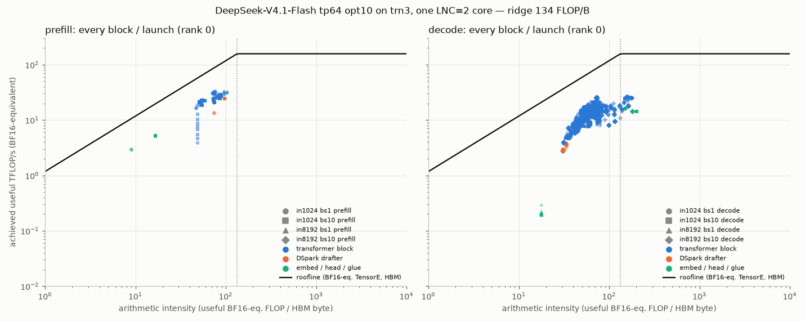
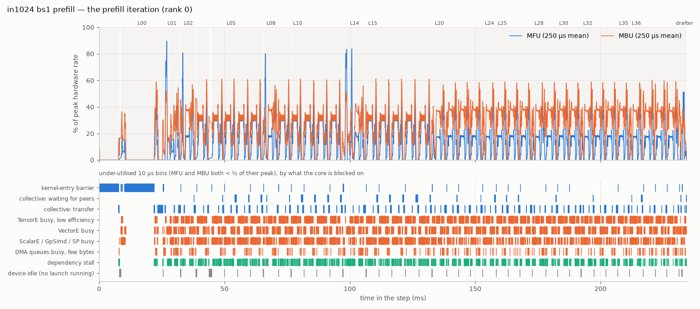
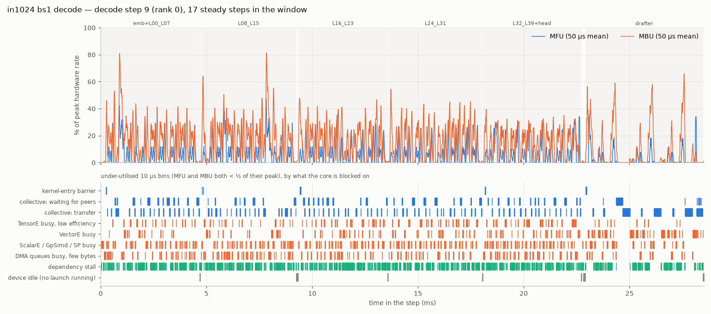
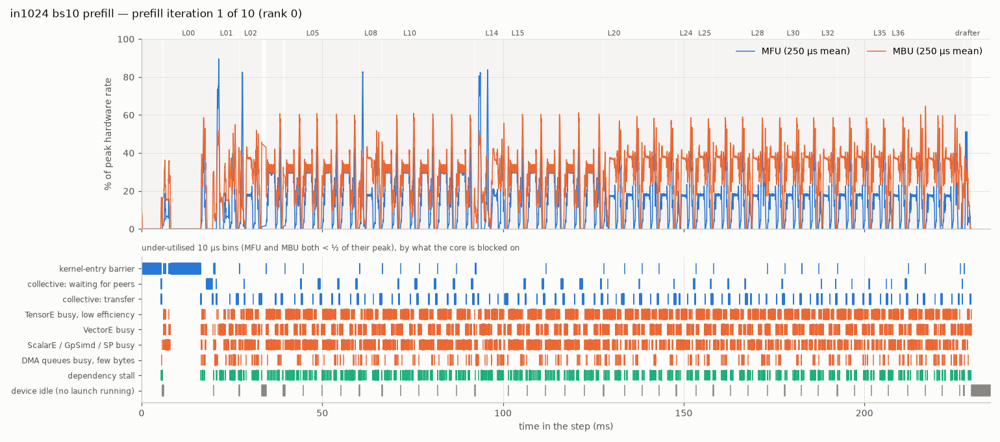
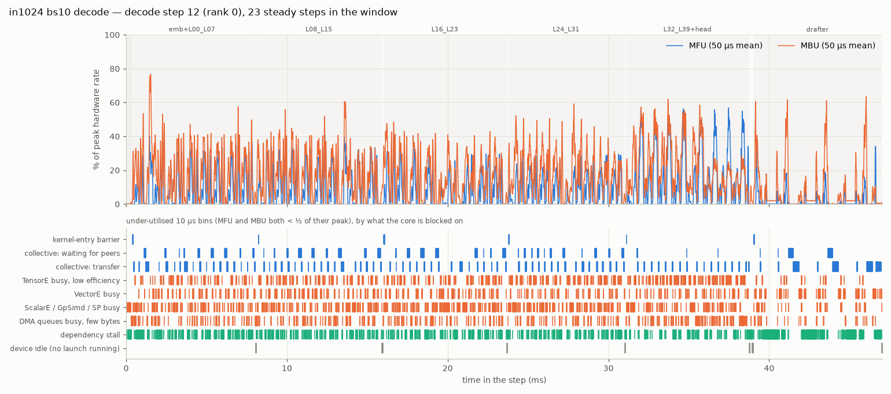
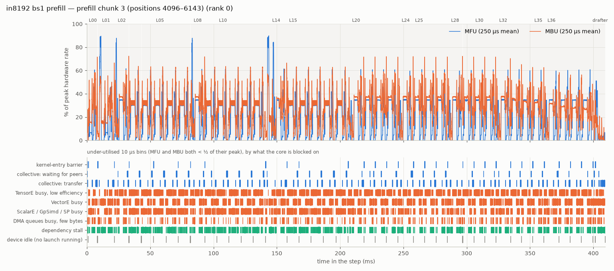
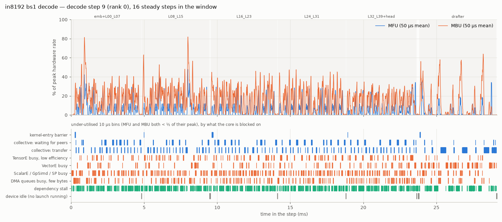
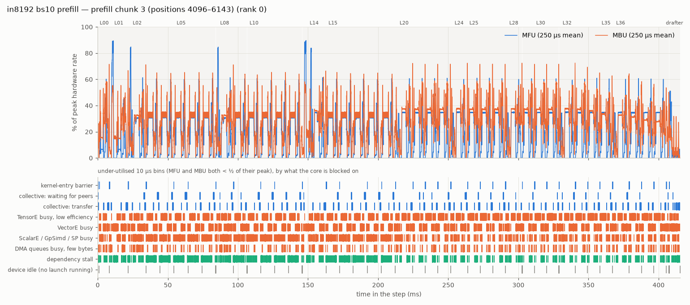
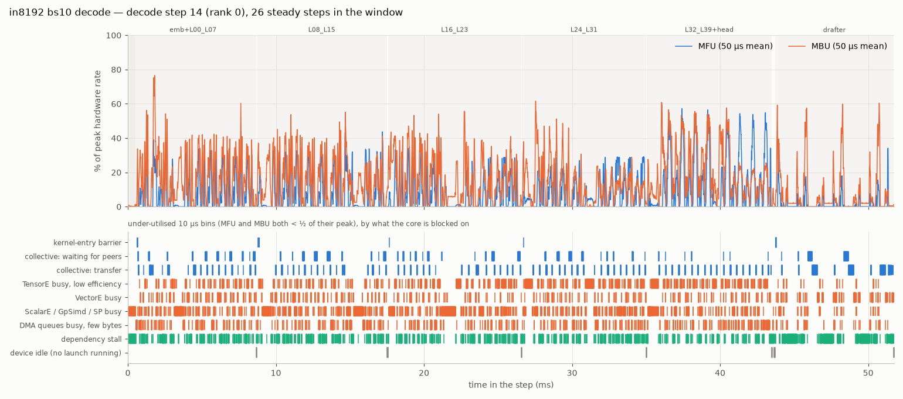

# DeepSeek-V4.1-Flash on trn3 — tp64 profile after opt10: prefill and decode

*2026-10-30 · branch `deepseek_v41_trn3` @ `b552a4e` ("opt9+10") · trn3.48xlarge, 64 logical cores (LNC=2) · scheme
`tp64` (one tensor-parallel group of 64; attention split 8-way, routed experts spread over all 64 ranks) · NKI
megakernels: one launch per block in prefill; per decode step a device **step prologue**, **5 fused launches of 8
blocks** (embedding fused into the first, the greedy head into the last), one tail graph and one DSpark drafter
launch · vLLM asynchronous scheduling · MXFP4 routed experts, FP8 dense weights.*

Same four configurations, windows and method as `PROFILE_REPORT_tp64_opt6.md` (which profiled `e9273ad`), each
profiled in a **prefill** window and a **decode** window on a live vLLM server: `in1024_bs1`, `in1024_bs10`
(`max_num_seqs=10`), `in8192_bs1`, `in8192_bs10` (`max_num_seqs=10`). Each configuration and phase has the same
five tables — (1) the overall latency breakdown, (2–3) the latency and roofline of every block / launch, with NKI
hotspots, (4) the peak MFU / MBU of every megakernel and what the core is blocked on whenever it is far below that
peak, (5) the same over the whole step or phase — and a utilisation timeline figure. *Cross-rank analysis* uses 8
simultaneously profiled ranks to say who waits for whom inside the collectives, and whether any launch waits for
its host. All latency breakdowns are in descending order.

## Summary

| Config · phase | Total | Transformer blocks | Drafter | Entry barriers | Device idle (+ host outside, prefill) | Rest | Per block | Block MFU / MBU (mean) | Peak MFU / MBU (10 µs) | Under-utilised device time |
|---|---:|---:|---:|---:|---:|---:|---:|---:|---:|---:|
| in1024 bs1 · prefill (TTFT) | 246.8 ms | 88.9 % | 0.8 % | (10.2 % inside the launches) | 6.6 % | 3.7 % | 5.48 ms | 14.0 % / 27.9 % | 100 % / 98 % | 82 % |
| in1024 bs1 · decode (per step) | 28.6 ms | 75.4 % | 19.1 % | 2.7 % | 1.6 % | 1.3 % | 0.54 ms | 6.3 % / 16.8 % | 99 % / 89 % | 89 % |
| in1024 bs10 · prefill (all requests) | 2.25 s | 93.7 % | 0.9 % | (4.5 % inside the launches) | 3.8 % | 1.7 % | 5.28 ms | 14.5 % / 28.9 % | 100 % / 98 % | 85 % |
| in1024 bs10 · decode (per step) | 47.2 ms | 79.2 % | 17.0 % | 1.9 % | 0.6 % | 1.3 % | 0.93 ms | 9.8 % / 19.4 % | 99 % / 92 % | 90 % |
| in8192 bs1 · prefill (TTFT) | 1.69 s | 94.6 % | 1.6 % | (1.8 % inside the launches) | 2.7 % | 1.2 % | 9.98 ms | 18.2 % / 30.0 % | 100 % / 98 % | 82 % |
| in8192 bs1 · decode (per step) | 29.5 ms | 76.2 % | 18.4 % | 2.7 % | 1.5 % | 1.3 % | 0.56 ms | 6.2 % / 16.6 % | 99 % / 89 % | 89 % |
| in8192 bs10 · prefill (all requests) | 16.70 s | 96.8 % | 1.6 % | (1.8 % inside the launches) | 0.8 % | 0.8 % | 10.11 ms | 17.9 % / 29.4 % | 100 % / 98 % | 82 % |
| in8192 bs10 · decode (per step) | 51.8 ms | 80.4 % | 15.7 % | 2.1 % | 0.2 % | 1.5 % | 1.04 ms | 9.0 % / 17.7 % | 99 % / 93 % | 92 % |

*Entry barriers* = the kernel-entry barriers of the decode step's launches (in prefill they sit inside each block
launch; the share is given in parentheses). *Device idle* = no launch on the core, plus (prefill) the host time
outside the device window. *Peak* = the best 10 µs bin anywhere in the phase; *under-utilised* = the share of the
device time in bins where both MFU and MBU are below half of their own megakernel's peak.

A decode step verifies 1 + 5 drafted tokens per sequence and emits ≈ 3.4 tokens per sequence at this prompt set's
≈ 48 % acceptance (bs1 in1024: 28.6 ms / 3.4 ≈ 8.4 ms TPOT; bench `bench_report.opt10.json` 8.1 ms).

**Against `PROFILE_REPORT_tp64_opt6.md` (`e9273ad`):** TTFT 0.30 → **0.25 s** (in1024) and 3.32 → **1.69 s**
(in8192); a bs1 decode step 47.1 → **28.6 ms** (in1024) and 51.6 → **29.5 ms** (in8192); a bs10 step 102.2 →
**47.2 ms** and 123.3 → **51.8 ms**. The device's idle time in a decode step fell from 7.5–32 ms to **0.09–0.45 ms**;
a bs1 decode block is 24–30 % faster (an `r2` block 0.63 → 0.46 ms; `r1_src_idx` only 5 %), an 8k-prefill
index-source block 3–6× faster (`r1_idx` 70.9 → 11.9 ms). A decode step is 8 launches (10 in opt6).

### Peak MFU / MBU per megakernel

Best 10 µs bin of each megakernel, **peak MFU / peak MBU %**, with the time-weighted mean MFU / MBU % in
parentheses (rank 0; prefill: the profiled iteration, or the 3rd chunk for in8192; decode: the steady steps). The
peaks are reached in short bursts — fp32 projections and MX GEMMs for MFU, weight / KV streaming for MBU — while the
means stay at 2–21 % / 7–36 %:

| prefill megakernel | in1024 bs1 | in1024 bs10 | in8192 bs1 | in8192 bs10 |
|---|---:|---:|---:|---:|
| `layer_prefill_r0_e_tp64` | 94 / 94 (13 / 24) | 97 / 94 (13 / 19) | 94 / 94 (13 / 24) | 94 / 94 (13 / 24) |
| `layer_prefill_r0_tp64` | 90 / 97 (2 / 7) | 97 / 97 (5 / 11) | 97 / 97 (10 / 29) | 96 / 97 (10 / 29) |
| `layer_prefill_r1_idx_tp64` | 99 / 97 (13 / 31) | 99 / 97 (13 / 21) | 98 / 98 (17 / 27) | 98 / 97 (17 / 27) |
| `layer_prefill_r1_src_idx_tp64` | 97 / 89 (12 / 28) | 98 / 93 (12 / 21) | 91 / 97 (16 / 27) | 91 / 98 (16 / 27) |
| `layer_prefill_r1_tap_tp64` | 97 / 98 (14 / 35) | 99 / 98 (14 / 23) | 97 / 77 (20 / 27) | 97 / 86 (20 / 29) |
| `layer_prefill_r1_tp64` | 97 / 97 (14 / 33) | 98 / 98 (14 / 24) | 99 / 98 (20 / 34) | 98 / 98 (20 / 34) |
| `layer_prefill_r2_src_idx_e_tp64` | 100 / 95 (16 / 24) | 100 / 95 (16 / 18) | 100 / 95 (20 / 26) | 100 / 95 (20 / 26) |
| `layer_prefill_r2_src_idx_tp64` | 100 / 97 (16 / 28) | 100 / 97 (15 / 20) | 100 / 98 (21 / 29) | 100 / 97 (19 / 26) |
| `layer_prefill_r2_tp64` | 99 / 93 (17 / 26) | 99 / 93 (17 / 20) | 98 / 98 (18 / 27) | 99 / 98 (17 / 26) |
| `DSpark drafter` | 99 / 93 (15 / 20) | 99 / 96 (15 / 13) | 99 / 60 (9 / 7) | 96 / 71 (9 / 10) |
| `embedding + hc_expand` | 0 / 60 (0 / 1) | 0 / 67 (0 / 2) | 0 / 72 (0 / 15) | 0 / 65 (0 / 15) |
| `tail all-gather graph` | 99 / 88 (3 / 27) | 99 / 88 (3 / 18) | 99 / 61 (2 / 19) | 99 / 73 (2 / 22) |
| **all device time** | 100 / 98 (13 / 26) | 100 / 98 (14 / 20) | 100 / 98 (18 / 28) | 100 / 98 (18 / 28) |

| decode megakernel | in1024 bs1 | in1024 bs10 | in8192 bs1 | in8192 bs10 |
|---|---:|---:|---:|---:|
| `layers_decode_embed_L00_L07_tp64` | 87 / 88 (7 / 18) | 87 / 92 (8 / 18) | 87 / 89 (7 / 18) | 84 / 93 (7 / 16) |
| `layers_decode_L08_L15_tp64` | 88 / 89 (7 / 19) | 87 / 76 (9 / 18) | 87 / 89 (7 / 18) | 87 / 84 (8 / 16) |
| `layers_decode_L16_L23_tp64` | 87 / 80 (6 / 16) | 79 / 77 (8 / 17) | 88 / 87 (6 / 16) | 82 / 82 (7 / 16) |
| `layers_decode_L24_L31_tp64` | 57 / 88 (6 / 16) | 58 / 83 (8 / 19) | 57 / 88 (5 / 16) | 69 / 81 (8 / 13) |
| `layers_decode_L32_L39_head_tp64` | 99 / 80 (6 / 15) | 99 / 84 (15 / 22) | 99 / 79 (6 / 14) | 99 / 80 (13 / 20) |
| `DSpark drafter` | 99 / 87 (2 / 9) | 99 / 86 (2 / 8) | 98 / 87 (2 / 9) | 99 / 87 (2 / 7) |
| `step prologue` | 0 / 0 (0 / 0) | 0 / 1 (0 / 0) | 0 / 0 (0 / 0) | 0 / 2 (0 / 1) |
| **all device time** | 99 / 89 (5 / 15) | 99 / 92 (8 / 17) | 99 / 89 (5 / 15) | 99 / 93 (8 / 15) |

### Where the time goes while the device is under-utilised (every configuration)

Share of the decode step (device idle included) or of a profiled prefill iteration (device time), by what the core is
blocked on in the 10 µs bins where MFU and MBU are both below half of their megakernel's peak:

| Where the time goes | in1024 bs1 prefill (profiled iteration) | in1024 bs1 decode (per step) | in1024 bs10 prefill (profiled iteration) | in1024 bs10 decode (per step) | in8192 bs1 prefill (profiled iteration) | in8192 bs1 decode (per step) | in8192 bs10 prefill (profiled iteration) | in8192 bs10 decode (per step) |
|---|---:|---:|---:|---:|---:|---:|---:|---:|
| device idle: no launch on the core | 0.0 % | 1.6 % | 0.0 % | 0.6 % | 0.0 % | 1.5 % | 0.0 % | 0.2 % |
| collective: waiting for peer ranks | 2.3 % | 10.3 % | 3.5 % | 7.3 % | 3.1 % | 9.9 % | 3.1 % | 6.1 % |
| kernel-entry barrier (all ranks must launch) | 8.6 % | 0.5 % | 3.0 % | 0.2 % | 0.4 % | 0.4 % | 0.4 % | 0.3 % |
| collective: transfer | 8.5 % | 11.5 % | 8.0 % | 10.3 % | 7.6 % | 11.7 % | 7.6 % | 10.1 % |
| TensorE busy at low efficiency | 27.3 % | 6.1 % | 29.8 % | 14.0 % | 33.7 % | 6.4 % | 31.2 % | 16.0 % |
| VectorE busy | 15.5 % | 7.3 % | 17.8 % | 9.7 % | 17.9 % | 7.0 % | 18.2 % | 8.7 % |
| ScalarE / GpSimd / SP busy | 11.2 % | 11.2 % | 13.0 % | 15.0 % | 10.7 % | 12.6 % | 11.2 % | 18.5 % |
| DMA queues busy, few bytes | 1.9 % | 7.8 % | 1.8 % | 8.6 % | 2.5 % | 8.1 % | 2.6 % | 9.2 % |
| dependency stall (no engine >= 70 % busy) | 6.9 % | 32.9 % | 8.3 % | 24.2 % | 6.4 % | 31.7 % | 8.0 % | 22.8 % |
| not under-utilised (MFU or MBU >= 1/2 of peak) | 17.8 % | 10.8 % | 14.9 % | 10.1 % | 17.7 % | 10.8 % | 17.6 % | 8.3 % |

**Key findings**

1. **The host is off the decode critical path.** With the device step prologue and asynchronous scheduling, the
   host submits every launch of a step while the previous step still runs: in the 8-rank captures each launch was
   submitted at least 14.7 ms (median 27–86 ms) before its device start, and **none of 2,816 launches waited for its
   host**. The device is idle 0.09–0.45 ms a step — the 30–80 µs turnaround between queued launches — against
   7.5–8.5 ms (bs1) and 31–32 ms (bs10) in opt6; a launch's device start spreads 4–32 µs over the ranks (2.2–8 ms
   for the first launch in opt6), and the six kernel-entry barriers of a step cost 0.76–1.11 ms together
   (3.9–8.3 ms in opt6).
2. **Decode, bs1 (28.6–29.5 ms a step):** the 40 blocks take 21.6–22.5 ms (0.43–1.18 ms each, ~7,100 instructions
   on 6-row tiles), the drafter 5.4–5.5 ms (19 %), everything else 1.6 ms. What the device waits on now: **peers at
   the MoE world all-reduce** (`ncc.all_reduce(srcs=[cc2_src])`, 6 × 5120 fp32 = 123 KB a block) 2.3–2.4 ms;
   collective transfers 3.3–3.4 ms (1.0 ms of it the drafter's padded 2.6 MB all-reduces for ≤ 6 live rows); and
   **dependency stalls** — a third of the device time, no engine ≥ 70 % busy — inside the MX GEMMs `mk_mx.py:gemm`,
   the hyper-connection Sinkhorn `sinkhorn_batched` / `hc_out_tile_spread`, the SwiGLU `_swiglu_cols`; the largest
   busy-but-inefficient item is ScalarE in `hc_in_tile.sumsq` (1.4 ms a step).
3. **Why ranks wait at the MoE all-reduce: routed-expert load imbalance, now smaller.** With 6 rows × top-6 over 384
   experts a rank runs only a few experts a step, and not as many as its peers. The last of the 8 captured ranks is
   51–54 µs behind the median rank (81–85 µs in opt6), 47–49 µs of it in its MoE span (correlation 0.87–0.89;
   attention span 0.11–0.12), and **each extra active expert costs a rank ≈ 45 µs** (66 µs in opt6): its 18.8 MB of
   MXFP4 weights stream at ≈ 420 GB/s (285 GB/s), a third of the HBM bandwidth. At bs10 the last rank is 58–59 µs
   behind (105 µs in opt6).
4. **Decode, bs10 (47.2–51.8 ms a step):** blocks 37.4–41.6 ms (0.79–2.44 ms each), the batched drafter 8.1 ms,
   0.09–0.28 ms idle. The largest items are the blocks' MoE all-reduce, still padded to 128 rows (2.6 MB) for 60 live
   ones — 3.1–3.2 ms of transfer and 3.0–3.2 ms of waiting a step (12–13 %) —, the `r1` attention all-reduce padded
   the same way (1.0 ms), the drafter's per-token attention `attn_token_body_ti` (1.9 ms of dependency stall), GpSimd
   in the KV / compressed-row gathers (`attn_fetch`, `gather_rows`), ScalarE in `hc_in_tile.sumsq` (1.4–1.5 ms).
   At in8192 the index blocks still cost 1.5–2.4 ms (an `r1` 0.87 ms) and the step prologue 0.49 ms.
5. **Every megakernel touches a hardware roof somewhere, and spends most of its time far below it.** The best 10 µs
   bin of every block / drafter megakernel reaches 79–100 % MFU (fp32 projections `fp32_proj_rows` / `gemm_fp32`, MX
   GEMMs `gemm` / `gemm_sb_multi`, the head's `_gemm`; only `…_L24_L31` peaks at 57–69 %) and 60–98 % MBU (weight /
   KV streaming); the time-weighted means are 2–21 % MFU and 7–36 % MBU, and **82–92 % of the device time** sits in
   bins where both are below half of the peak. Every block's arithmetic intensity (32–103 FLOP/B) is under the
   134 FLOP/B ridge, except the three DSpark tap blocks of a bs10 step (149–178).
6. **Prefill at 8k is no longer the indexer.** A 2048-token chunk takes 409–411 ms (801 ms in opt6); the 8
   index-source blocks are 25 % of it (62 %), their `index_topk` + `index_scores_span` ~1.9 ms a block. What
   remains is the per-token sparse attention in every block — TensorE busy at low efficiency 31–34 % of the device
   time (`key_tile_packed`, `attn_pv`, `attn_scores_toks`), fed by `attn_fetch` (GpSimd indirect DMA, 1.3 GB a
   block) —, the hyper-connection epilogue `hc_out_tile.acc_of` (VectorE, 10 %) and the 42 MB fp32 MoE all-reduce
   (6 % transfer, 3 % waiting). Chunk position does not matter (chunks 2–4 within 1 % per block kind).
7. **Prefill at 1k (0.25 s TTFT):** a block takes 4.6–5.9 ms (index-source blocks now like the others; L01 6.9 ms,
   L14 9.1 ms with the engram), with the same items as at 8k (TensorE 27 %, VectorE 16 %, collective transfer 9 %). The start of an iteration is
   host-paced: the hosts take 3.5–12 ms per launch for its first ~6 launches (~1.7 ms afterwards), the devices wait
   ≈ 14 ms per rank for them, and the ranks that start first wait in the entry barriers of the embedding graph and
   L00 (19.8 ms, 8 % of the rank-0 iteration). Part of this is likely profiler overhead (profiled 0.247 s vs bench
   0.232 s, *Caveats*).
8. **HBM scratch round trips** in decode blocks fell to 11 % of their HBM bytes at bs1 (21 % in opt6) and 20–22 % at
   bs10 (27–28 %); prefill blocks and the drafter move the same bytes as in opt6 (31–32 % / 23–45 % scratch). DMA is
   still almost all descriptor-generated (hardware DGE 38–61 %, GpSimd software DGE 35–57 %).
9. **Batching costs only queueing.** A bs10 prefill is ten / forty back-to-back bs1 iterations with 2.7–5.9 ms (in1024)
   / 0.04 ms (in8192, the next chunk already queued) of device idle between them (11 / 8.5 ms in opt6).


## How this was measured

**Serving setup (the one the bench uses).** `performance._serve_main` (`vllm serve` with the port imported first),
`DEEPSEEK_V41_SCHEME=tp64`, tensor-parallel 64, LNC=2 (64 logical NeuronCores on one trn3.48xlarge, 36 GiB HBM
each), `--max-model-len` = input + 256 (1280 / 8448), prefix caching off. `max_num_seqs` = 1 for the bs1 cells and
10 for the bs10 cells (`DEEPSEEK_V41_MAX_NUM_SEQS=10`). Code: branch `deepseek_v41_trn3` at `b552a4e` ("opt9+10",
clean tree), every optimization at its default — the direct executor launch and address-stable step buffers (opt7),
the optimized fused decode launches and prefill indexer (opt8), the device step prologue, the one-graph decode tail
and vLLM's asynchronous scheduling with the plugin's `NeuronAsyncScheduler` holdbacks (opt9), the reworked
`…_L08_L15` launch (opt10) — exactly as in `bench_report.opt10*.json`. Requests are greedy, `ignore_eos`, with
token-exact prompts: whole lines of `sonnet.txt`, tokenized and cut to exactly 1024 / 8192 tokens, a different
random line order per request. Same prompts, windows and capture method as `PROFILE_REPORT_tp64_opt6.md`.

**Capture (Method 1 of `neuron-framework-profiling-vllm-neuron`).** The plugin's Neuron profiler
(`--profiler-config '{"profiler":"cuda",...}'` + `--additional-config '{"neuron_profiler": {...}}'`) records a device
profile (NTFF) and the live system trace. Each server is warmed up with the exact workload first.

* **Prefill window**: server idle → `/start_profile` → the *bs* requests with `max_tokens=1` → all answered →
  `/stop_profile`. The window holds exactly the prefill iterations (including the drafter's prefill launch).
* **Decode window**: *bs* streaming requests; once every stream has produced ≥ 3 chunks (all prefills done) →
  `/start_profile`, 0.6–1.5 s, `/stop_profile`. The first step after the start (the profiler's start stalls it:
  88–117 ms) and the last, incomplete step are dropped; the tables are the mean of the 16–23 steady steps between
  (a decode step is now 28–30 ms at bs1, so the same windows hold about twice as many steps as in opt6).
* **Long prefills**: an 8192-token prompt is **4 chunks of 2048 rows** (vLLM's `max_num_batched_tokens` 2048 is
  below the port's 4096-token segment, which only lowers larger budgets). The device-trace buffers now hold three
  full chunks and most of the 4th; the live system trace is not limited, so **latency is complete for every
  iteration**. The in8192 per-block roofline columns are the **3rd chunk** (positions 4096–6143), the last one whose
  device trace is complete. As in opt6, a second server with `delay_iterations=4, max_iterations=1` was meant to
  capture the 4th chunk, but with asynchronous scheduling the iteration returns to the profiler while its last
  blocks are still queued on the device, so those captures end at block 34 (bs1) / 35 (bs10). A chunk's cost does
  not depend on its position (chunks 2–4: 409–411 ms each, live trace; table *Prefill chunk 1 vs chunk 3*).
* **Rank 0** carries the main tables (`neuron_cores: [0]`). To see who waits for whom inside the collectives, a
  second set of servers profiled **8 ranks at once** (`neuron_cores: [0, 4, 9, 18, 27, 36, 45, 63]`: one rank of
  every 8-rank attention group, two of rank 0's group, both NUMA halves) in the same windows; their clocks are
  aligned on the ends of the 64-rank all-reduces (*Cross-rank analysis*).
* Profile buffers: `NEURON_RT_PROFILE_BUF_INSTRUCTION_MB=512`, `NEURON_RT_PROFILE_BUF_EVENT_MB=256`; DGE notifications
  are **off** (they overflow the notification queue and kill the engine at tp64), so DMA bytes and timing are
  recorded but not per-tensor DMA metadata.
* **Profiler overhead is small**: profiled in8192 bs1 prefill request 1.689 s vs bench TTFT 1.673 s (p50); a profiled
  bs1 decode step is 28.6 ms (in1024) / 29.5 ms (in8192) for ≈ 3.3–3.4 tokens, against ≈ 27.6 / 29.8 ms from the
  bench's TPOT (8.1 / 9.1 ms) × tokens per step at its acceptance (48 / 45 %). The in1024 bs1 prefill is 0.247 s
  profiled vs 0.232 s in the bench; the difference sits in the host-paced start of the iteration (*Caveats*).

Ingested with `neuron-explorer view --ingest-only` (2.33, `--ignore-nc-buf-usage --ignore-instruction-hierarchy`);
every number below is computed from the parquet tables by the scripts in `profiling_tp64_opt10/scripts/` (see
*Artifacts*).

## What the numbers mean

**Units of work.** A **prefill iteration** is 46 NEFF executions on a core: `embedding + hc_expand` (one compiled
graph) → the **token history put** (NKI `history_put`: writes the iteration's token ids into the device-side token
history the step prologue reads the engram n-grams from) → **40 block megakernels** (`layer_prefill_<archetype>_tp64`,
one NKI kernel per transformer block: attention + MoE + hyper-connections + every collective inside) → the tail
graph (final norm + lm_head + sampler, with the vocab all-gathers) → two tiny glue graphs → the **DSpark drafter**
megakernel (`draft_prefill_tp64`). A **decode step** is **8 executions** (10 in opt6): the **step prologue** (NKI
`step_prologue`: the step's positions and cache slots, the window / compressed-slot index columns, both engram layers'
n-gram ids and the embedding ids, corrected on the device from the previous step's rejection output — no
collective), **5 fused launches** of 8 blocks each (`layers_decode_embed_L00_L07_tp64` — the token embedding +
`hc_expand` fused in front —, `…_L08_L15`, `…_L16_L23`, `…_L24_L31`, `…_L32_L39_head_tp64` — the greedy head
fused behind), **one decode tail graph** (draft verification by the plugin's rejection sampler and the drafter's
inputs; four glue graphs in opt6) and **one drafter launch** (`draft_decode_tp64` for one sequence,
`draft_decode_batched_tp64` for all sequences of a bs10 step). With asynchronous scheduling the host submits a
step's launches while the device still runs the previous step; it reads nothing back in between. A block's
*archetype* names what it carries: `r0/r1/r2` = compress ratio of its attention, `src` = writes the compressed-KV /
index caches, `idx` = index-source (computes the sparse top-k for the layers after it), `e` = engram lookup, `tap` =
DSpark tap (layers 37–39).

**Blocks inside a fused launch.** One NKI kernel has no per-member markers in the trace, so a fused launch is cut
into its members on the device timeline: `[kernel-entry barrier] [embed] block … block [head]`, each block ending
at the end of its **MoE world all-reduce** (its last collective; the next block needs that output). A member's
metrics are those of the instructions, DMA packets and collectives inside its window, so work that one engine runs
ahead into the next member's window (a weight prefetch) is charged to the next member.

**Latency** of a whole execution is its device time from the live `nc_exec_running` trace (rank 0); a member's is
its window on the device timeline. *Device idle* is the gap between consecutive executions; with asynchronous
scheduling the next launch is already queued when the previous one ends (see the *submitted ahead* column of
the cross-rank launch tables), so it is the runtime's launch-to-launch turnaround, not host work. For prefill, *host time
outside the device window* = client-measured time to the last first token − device window.

**Roofline columns** (per execution / member, averaged over the executions of a block). Hardware constants are those
the profiler reports for a trn3 logical core (2 physical cores):

| Constant | Value |
|---|---|
| TensorE peak (BF16) | 128 × 128 PE × 2 FLOP × 2.4 GHz × 2 cores = **157.3 TFLOP/s** (FP8 2×, MXFP8/MXFP4 4×) |
| HBM bandwidth | **1178 GB/s** per logical core (one HBM stack's share) |
| DMA bandwidth | 614 GB/s per physical core, 1228 GB/s per logical core |
| Ridge point | 157.3 T / 1.178 T = **133.5 FLOP/B** (BF16-equivalent) |

* **MFU** = useful TensorE FLOPs / (time × 157.3 TFLOP/s). FLOPs are the profiler's *BF16-equivalent*
  `adjusted_flops` (MXFP8 / MXFP4 matmuls count ×0.25, FP8 ×0.5, **FP32 ×4**), so MFU is the TensorE's utilisation
  at whatever precision it actually ran: a PE array saturated with fp32 matmuls reads 100 % although it delivers a
  quarter of the BF16 FLOP rate. *Useful* excludes the PE transposes; **HFU** includes them.
* **MBU** = (HBM bytes read + written by DMA) / (time × 1178 GB/s).
* **DMA active %**, **DMA BW %**, **AI**, **engine busy %** (interval-merged active time over both physical cores),
  **Collectives %** (CC-op time inside the unit, including the kernel-entry barrier and waiting for the slowest peer)
  and the **bottleneck engine** (the busiest) are defined as in `PROFILE_REPORT_tp64.md`.

**Timeline utilisation (sections 4–5).** Every execution is cut into **10 µs bins**. Per bin: MFU from the
TensorE instructions' FLOPs (each instruction's FLOPs spread over its duration), MBU from the DMA packets in flight
(each packet's bytes spread over its duration, scaled by the unit's HBM-bytes / DMA-bytes ratio, capped at 1),
the busy time of every engine on each physical core, DMA-queue activity, and the collective in flight (with the
tensor it carries, from the NKI source line of the instruction that rang its doorbell, e.g.
`ncc.all_reduce(srcs=[cc2_src], …)`). A collective's time is split into **waiting for peers** (its duration beyond
the fastest instance of the same collective in the capture: the rank that arrives last sees only the transfer) and
**transfer** (the rest). The **peak** MFU / MBU of a megakernel is its best bin; a bin is **under-utilised** when
both MFU and MBU are below half of that peak, and it is charged to one cause, in this order: an engine ≥ 70 % busy
on the busier core (*engine-bound* — busy but at low efficiency) → a collective in flight ≥ 50 % of the bin
(*waiting for peers* / *transfer* / *kernel-entry barrier*) → DMA queues ≥ 70 % active (*DMA-queue-bound*) →
otherwise *dependency stall*: every engine below 70 %, i.e. a chain of small dependent instructions handing off
between engines. The NKI function named is the one with the most instruction time on the deciding engine in that bin.
The step prologue and the token history put carry no source locations in their NEFFs; they show as
`(no source location)`.


## Results per configuration

Reading the sections below: **(1)** sums every execution of the phase (prefill: the whole window, arrival → first
token of the last request; decode: one step, the mean of the steady steps), largest first. **(2–3)** is one row per
block (a prefill launch, or a member of a fused decode launch), per kernel-entry barrier and per other launch, in
descending latency: the latency columns are complete (live system trace); the roofline columns are the device
profile of the executions named in the section note. **(4)** is per megakernel — each launched NEFF kind (the 40
block kernels by archetype in prefill; the step prologue, the 5 fused launches, the tail graph and the drafter in
decode; for decode a second table splits the fused launches by block kind) — the best 10 µs bin and where it is, the means, and the shares of the
megakernel's time in each blocking cause. **(5)** ranks the largest blocking items over the whole step / phase, and
the timeline figure shows where in the step they occur (top: MFU and MBU; bottom: one lane per cause, marking the
under-utilised bins). The roofline plot puts every block / launch of every configuration on one chart.




### in1024_bs1 · prefill — 1 request × 1024 tokens (`max_num_seqs=1`, context 1280)

One prefill iteration of 1024 rows (TTFT 0.247 s measured by the client in this run).


**1. Overall latency breakdown** (descending)

| Component | ms | % |
|---|---:|---:|
| 40 transformer blocks (megakernels) | 219.33 | 88.9 |
| host time outside the device window (HTTP, tokenizer, first schedule, response) | 12.33 | 5.0 |
| embedding + hc_expand | 8.06 | 3.3 |
| device idle between launches (host submission + launch turnaround) | 4.08 | 1.7 |
| DSpark drafter (megakernel) | 1.95 | 0.8 |
| final norm + lm_head + sampler | 0.99 | 0.4 |
| glue graphs (rejection sampler, gathers, drafter meta) | 0.11 | 0.0 |
| **Total** | **246.83** | 100 |

Transformer blocks by archetype (descending):

| Block archetype | blocks | ms (all blocks of this type) | ms per block | % of block time |
|---|---:|---:|---:|---:|
| `r2` | 15 | 76.99 | 5.133 | 35.1 |
| `r1` | 12 | 56.47 | 4.706 | 25.7 |
| `r1_idx` | 4 | 21.18 | 5.296 | 9.7 |
| `r0` | 1 | 16.76 | 16.759 | 7.6 |
| `r1_tap` | 3 | 14.25 | 4.749 | 6.5 |
| `r2_src_idx` | 2 | 11.87 | 5.933 | 5.4 |
| `r2_src_idx_e` | 1 | 9.11 | 9.110 | 4.2 |
| `r0_e` | 1 | 6.93 | 6.928 | 3.2 |
| `r1_src_idx` | 1 | 5.77 | 5.770 | 2.6 |

**2–3. Per-block latency and roofline** (descending by latency)

| Block | launches | ms (whole phase) | % of total | MFU % | HFU % | MBU % | DMA active % | DMA BW % | AI (FLOP/B) | Bottleneck engine (busy %) | Collectives % | TensorE % | VectorE % | GpSimd % |
|---|---:|---:|---:|---:|---:|---:|---:|---:|---:|---|---:|---:|---:|---:|
| L00 r0 | 1 | 16.759 | 6.8 | 2.5 | 3.4 | 6.7 | 14.5 | 6.2 | 49 | Collectives (92) | 92.0 | 11.6 | 12.9 | 8.9 |
| L14 r2_src_idx_e | 1 | 9.110 | 3.7 | 15.7 | 18.1 | 24.4 | 61.3 | 23.9 | 86 | DMA (61) | 15.0 | 45.3 | 49.8 | 33.9 |
| embedding + hc_expand | 1 | 8.058 | 3.3 | 0.0 | 0.0 | 2.0 | 2.8 | 0.7 | 0 | Collectives (98) | 97.9 | 0.1 | 0.5 | 0.4 |
| L01 r0_e | 1 | 6.928 | 2.8 | 13.3 | 15.9 | 23.6 | 61.9 | 23.3 | 75 | DMA (62) | 18.2 | 38.0 | 53.8 | 30.9 |
| L08 r2_src_idx | 1 | 5.942 | 2.4 | 15.9 | 19.3 | 29.2 | 63.3 | 27.3 | 73 | DMA (63) | 15.2 | 58.2 | 51.5 | 42.2 |
| L02 r2_src_idx | 1 | 5.924 | 2.4 | 15.5 | 18.8 | 28.8 | 61.6 | 27.0 | 72 | DMA (62) | 16.9 | 56.8 | 50.1 | 41.5 |
| L20 r1_src_idx | 1 | 5.770 | 2.3 | 11.9 | 15.0 | 29.1 | 66.2 | 27.2 | 55 | DMA (66) | 17.4 | 56.1 | 52.0 | 44.7 |
| L18 r2 | 1 | 5.458 | 2.2 | 15.7 | 23.5 | 24.6 | 51.4 | 23.5 | 85 | DMA (51) | 22.0 | 50.6 | 49.9 | 42.3 |
| L24 r1_idx | 1 | 5.354 | 2.2 | 12.2 | 15.5 | 30.6 | 66.9 | 28.7 | 53 | DMA (67) | 18.7 | 57.9 | 53.1 | 45.6 |
| L28 r1_idx | 1 | 5.342 | 2.2 | 14.3 | 18.0 | 32.7 | 72.2 | 30.7 | 58 | DMA (72) | 10.7 | 61.5 | 57.1 | 47.9 |
| L36 r1_idx | 1 | 5.323 | 2.2 | 12.2 | 15.5 | 30.6 | 66.9 | 28.7 | 53 | DMA (67) | 18.6 | 57.9 | 53.1 | 45.8 |
| L17 r2 | 1 | 5.317 | 2.2 | 16.2 | 24.2 | 25.3 | 53.0 | 24.1 | 85 | DMA (53) | 19.7 | 52.6 | 51.0 | 43.4 |
| L05 r2 | 1 | 5.311 | 2.2 | 16.2 | 24.2 | 25.3 | 53.3 | 24.1 | 85 | DMA (53) | 19.8 | 52.3 | 51.4 | 43.7 |
| L32 r1_idx | 1 | 5.164 | 2.1 | 12.6 | 16.0 | 31.6 | 68.8 | 29.6 | 53 | DMA (69) | 16.0 | 59.4 | 54.7 | 46.9 |
| L11 r2 | 1 | 5.160 | 2.1 | 16.7 | 24.9 | 26.0 | 53.8 | 24.8 | 85 | TensorE (54) | 17.4 | 54.1 | 52.9 | 44.3 |
| L12 r2 | 1 | 5.157 | 2.1 | 16.7 | 24.9 | 26.1 | 54.6 | 24.8 | 85 | DMA (55) | 17.2 | 53.9 | 52.5 | 44.6 |
| L10 r2 | 1 | 5.157 | 2.1 | 16.1 | 24.2 | 25.2 | 53.3 | 24.0 | 85 | DMA (53) | 20.3 | 52.3 | 51.1 | 44.6 |
| L19 r2 | 1 | 5.132 | 2.1 | 17.3 | 25.7 | 27.1 | 56.9 | 25.8 | 85 | DMA (57) | 13.9 | 55.6 | 54.3 | 45.3 |
| L16 r2 | 1 | 5.122 | 2.1 | 16.8 | 25.1 | 26.2 | 55.0 | 25.0 | 85 | DMA (55) | 16.7 | 55.0 | 53.7 | 45.0 |
| L13 r2 | 1 | 5.115 | 2.1 | 16.8 | 25.1 | 26.3 | 55.0 | 25.0 | 85 | DMA (55) | 16.8 | 54.8 | 53.5 | 45.3 |
| L15 r2 | 1 | 5.113 | 2.1 | 16.8 | 25.1 | 26.3 | 54.6 | 25.0 | 85 | DMA (55) | 17.3 | 54.3 | 53.2 | 45.2 |
| L07 r2 | 1 | 5.100 | 2.1 | 16.9 | 25.2 | 26.4 | 54.7 | 25.1 | 85 | TensorE (55) | 16.6 | 54.8 | 53.9 | 45.1 |
| L06 r2 | 1 | 5.074 | 2.1 | 17.5 | 26.0 | 27.1 | 57.8 | 25.8 | 86 | DMA (58) | 13.8 | 55.7 | 54.3 | 46.2 |
| L04 r2 | 1 | 4.980 | 2.0 | 17.8 | 26.5 | 27.9 | 59.5 | 26.6 | 85 | DMA (59) | 11.4 | 57.0 | 56.3 | 47.1 |
| L09 r2 | 1 | 4.959 | 2.0 | 17.9 | 26.6 | 27.7 | 58.4 | 26.4 | 86 | DMA (58) | 12.3 | 57.7 | 56.4 | 47.3 |
| L03 r2 | 1 | 4.838 | 2.0 | 18.1 | 26.9 | 28.2 | 58.5 | 26.9 | 85 | TensorE (59) | 10.4 | 58.6 | 57.4 | 47.6 |
| L39 r1_tap | 1 | 4.797 | 1.9 | 14.4 | 18.0 | 35.7 | 73.4 | 34.1 | 54 | DMA (73) | 13.2 | 61.8 | 58.3 | 48.9 |
| L37 r1_tap | 1 | 4.758 | 1.9 | 13.2 | 16.6 | 34.4 | 69.8 | 33.0 | 51 | DMA (70) | 17.3 | 59.3 | 55.2 | 47.1 |
| L23 r1 | 1 | 4.755 | 1.9 | 13.3 | 16.7 | 33.6 | 68.4 | 31.5 | 53 | DMA (68) | 19.6 | 59.5 | 55.1 | 45.9 |
| L27 r1 | 1 | 4.752 | 1.9 | 13.3 | 16.7 | 33.7 | 68.1 | 31.5 | 53 | DMA (68) | 19.7 | 60.1 | 55.4 | 46.2 |
| L26 r1 | 1 | 4.747 | 1.9 | 13.4 | 16.8 | 33.7 | 68.4 | 31.6 | 53 | DMA (68) | 20.2 | 60.0 | 55.1 | 46.2 |
| L22 r1 | 1 | 4.746 | 1.9 | 14.6 | 18.2 | 34.9 | 70.8 | 32.7 | 56 | DMA (71) | 15.8 | 61.4 | 57.2 | 46.9 |
| L29 r1 | 1 | 4.743 | 1.9 | 13.2 | 16.6 | 33.4 | 68.4 | 31.3 | 53 | DMA (68) | 19.0 | 59.6 | 54.8 | 46.2 |
| L21 r1 | 1 | 4.733 | 1.9 | 13.3 | 16.7 | 33.5 | 68.0 | 31.4 | 53 | DMA (68) | 20.2 | 59.6 | 54.8 | 45.9 |
| L25 r1 | 1 | 4.728 | 1.9 | 13.3 | 16.7 | 33.5 | 68.2 | 31.5 | 53 | DMA (68) | 20.3 | 59.3 | 54.7 | 45.8 |
| L34 r1 | 1 | 4.706 | 1.9 | 13.5 | 16.9 | 34.0 | 68.9 | 31.9 | 53 | DMA (69) | 19.2 | 60.1 | 55.4 | 46.4 |
| L38 r1_tap | 1 | 4.692 | 1.9 | 13.5 | 17.0 | 35.2 | 71.3 | 33.7 | 51 | DMA (71) | 15.8 | 60.7 | 56.8 | 48.1 |
| L35 r1 | 1 | 4.657 | 1.9 | 13.6 | 17.1 | 34.3 | 70.0 | 32.2 | 53 | DMA (70) | 18.5 | 61.0 | 56.0 | 47.1 |
| L33 r1 | 1 | 4.651 | 1.9 | 13.5 | 17.0 | 34.1 | 69.0 | 31.9 | 53 | DMA (69) | 18.8 | 60.6 | 55.7 | 46.7 |
| L30 r1 | 1 | 4.644 | 1.9 | 14.3 | 17.9 | 35.1 | 70.9 | 32.8 | 54 | DMA (71) | 16.2 | 62.2 | 57.6 | 47.4 |
| L31 r1 | 1 | 4.611 | 1.9 | 13.7 | 17.3 | 34.7 | 70.3 | 32.5 | 53 | DMA (70) | 17.9 | 61.6 | 56.7 | 47.5 |
| DSpark drafter (megakernel) | 1 | 1.945 | 0.8 | 15.4 | 20.6 | 21.1 | 51.4 | 19.0 | 97 | VectorE (63) | 18.9 | 58.2 | 63.2 | 32.3 |
| tail all-gather graph | 1 | 0.985 | 0.4 | 3.3 | 3.4 | 26.8 | 56.8 | 27.5 | 17 | VectorE (68) | 13.9 | 8.8 | 67.6 | 32.5 |
| token history put | 1 | 0.078 | 0.0 | 0.0 | 0.0 | 0.0 | 8.5 | 0.1 | 0 | GpSimd (24) | 0.0 | 0.0 | 3.1 | 24.1 |
| drafter meta | 1 | 0.018 | 0.0 | 0.0 | 0.0 | 0.0 | 11.8 | 0.1 | 0 | GpSimd (36) | 0.0 | 0.0 | 0.0 | 35.6 |
| glue | 1 | 0.013 | 0.0 | 0.0 | 0.0 | 0.0 | 14.4 | 0.3 | 0 | DMA (14) | 0.0 | 0.0 | 0.0 | 9.8 |

**Where the time goes inside the dominant blocks** (NKI source attribution)

*r2* — 15 executions, mean 5.134 ms. *Footprint* = time during which any engine of either core executes the function (functions overlap, so footprints do not add up to the block); the engine columns are each engine's busy time on that function, per physical core.

| Kernel function | footprint ms | Tensor ms | Vector ms | Scalar ms | GpSimd ms | Sync ms | HBM MB | GFLOP (BF16-eq.) |
|---|---:|---:|---:|---:|---:|---:|---:|---:|
| `mk_common.py:attn_fetch` | 1.527 | 0.000 | 0.000 | 0.000 | 1.327 | 0.000 | 695.4 | 0.00 |
| `mk_common.py:attn_scores` | 0.994 | 0.694 | 0.050 | 0.050 | 0.000 | 0.000 | 0.0 | 43.57 |
| `mk_common.py:attn_pv` | 0.796 | 0.658 | 0.019 | 0.000 | 0.000 | 0.000 | 0.0 | 43.62 |
| `mk_common.py:key_tile_packed` | 0.746 | 0.515 | 0.430 | 0.330 | 0.001 | 0.000 | 0.0 | 42.95 |
| `mk_common.py:hc_out_tile.acc_of` | 0.635 | 0.000 | 0.476 | 0.148 | 0.056 | 0.006 | 83.9 | 0.00 |
| `mk_common.py:hc_in_tile` | 0.496 | 0.357 | 0.089 | 0.091 | 0.018 | 0.000 | 42.0 | 14.76 |
| `mk_mx.py:gemm` | 0.399 | 0.291 | 0.072 | 0.053 | 0.000 | 0.003 | 44.6 | 30.33 |
| `mk_common.py:attn_softmax` | 0.330 | 0.000 | 0.129 | 0.083 | 0.000 | 0.000 | 0.0 | 0.00 |

*r1_idx* — 4 executions, mean 5.331 ms. *Footprint* = time during which any engine of either core executes the function (functions overlap, so footprints do not add up to the block); the engine columns are each engine's busy time on that function, per physical core.

| Kernel function | footprint ms | Tensor ms | Vector ms | Scalar ms | GpSimd ms | Sync ms | HBM MB | GFLOP (BF16-eq.) |
|---|---:|---:|---:|---:|---:|---:|---:|---:|
| `mk_common.py:attn_fetch` | 1.475 | 0.000 | 0.000 | 0.000 | 1.140 | 0.000 | 671.1 | 0.00 |
| `mk_common.py:attn_scores_toks` | 1.182 | 0.745 | 0.040 | 0.000 | 0.000 | 0.000 | 0.0 | 0.00 |
| `mk_common.py:attn_pv` | 1.046 | 0.620 | 0.016 | 0.000 | 0.000 | 0.000 | 0.0 | 43.62 |
| `mk_common.py:hc_out_tile.acc_of` | 0.654 | 0.000 | 0.478 | 0.145 | 0.056 | 0.006 | 83.9 | 0.00 |
| `mk_common.py:hc_in_tile` | 0.517 | 0.375 | 0.098 | 0.072 | 0.015 | 0.000 | 42.0 | 14.74 |
| `mk_common.py:attn_scores_begin` | 0.504 | 0.154 | 0.102 | 0.049 | 0.000 | 0.000 | 0.0 | 1.29 |
| `mk_mx.py:gemm` | 0.420 | 0.298 | 0.074 | 0.055 | 0.000 | 0.003 | 45.6 | 30.67 |
| `mk_common.py:attn_softmax` | 0.359 | 0.000 | 0.103 | 0.087 | 0.000 | 0.000 | 0.0 | 0.00 |

**4. Peak MFU / MBU per megakernel, and what the core is blocked on when it is under-utilised**

*Per 10 µs bin of the device timeline (rank 0). **Peak** = the best bin of that megakernel, and where it is
(block : NKI function). **Mean** = the megakernel's FLOPs / HBM bytes over its whole time. A bin is
**under-utilised** when both its MFU and its MBU are below half the megakernel's own peak. Each under-utilised
bin is charged to one cause; the cause columns are % of the megakernel's time: **CC wait** = waiting for peer
ranks inside a collective; **entry barrier** = the launch's kernel-entry barrier (waiting for every rank to
start the NEFF); **CC transfer** = the collective moving its data; **<engine> busy** = that engine is ≥ 70 %
busy on the busier physical core, but at low efficiency; **DMA queues** = DMA queues ≥ 70 % active while
moving few bytes; **dep. stall** = no engine ≥ 70 % busy (a chain of small dependent instructions across
engines). Cells below 0.5 % show `·`. The last column names the two largest items.*

| Megakernel | ms | peak MFU % (10 µs bin, where) | peak MBU % (where) | mean MFU / MBU % | under-utilised % | CC wait | entry barrier | CC transfer | TensorE busy | VectorE busy | ScalarE/GpSimd/SP busy | DMA queues | dep. stall | largest blocking items |
|---|---:|---|---|---:|---:|---:|---:|---:|---:|---:|---:|---:|---:|---|
| `layer_prefill_r2_tp64` | 77.01 | 99 (L15 r2: mk_common.py:gemm_fp32) | 93 (L13 r2: mk_common.py:hc_in_tile) | 16.9 / 26.2 | 83 | 6 | · | 8 | 29 | 17 | 14 | 1 | 8 | TensorE: `mk_common.py:key_tile_packed` (7.79 ms); VectorE: `mk_common.py:hc_out_tile.acc_of` (7.23 ms) |
| `layer_prefill_r1_tp64` | 56.65 | 97 (L22 r1: mk_mx.py:gemm_sb_multi) | 97 (L29 r1: DMA only) | 13.6 / 33.3 | 77 | · | · | 10 | 35 | 16 | 8 | 2 | 6 | TensorE: `mk_common.py:attn_scores_toks` (12.59 ms); VectorE: `mk_common.py:hc_out_tile.acc_of` (5.41 ms) |
| `layer_prefill_r1_idx_tp64` | 21.33 | 99 (L36 r1_idx: mk_common.py:gemm_fp32) | 97 (L24 r1_idx: DMA only) | 12.8 / 30.6 | 80 | 2 | · | 6 | 34 | 15 | 14 | 2 | 7 | TensorE: `mk_common.py:attn_scores_toks` (4.33 ms); VectorE: `mk_common.py:hc_out_tile.acc_of` (1.76 ms) |
| `layer_prefill_r0_tp64` | 16.76 | 90 (L00 r0: mk_mx.py:gemm) | 97 (L00 r0: DMA only) | 2.5 / 6.5 | 94 | · | 69 | 12 | 2 | 4 | 6 | · | 1 | entry barrier (11.51 ms); CC transfer @ AR-64 `cc2_src` (MoE out, fp32 21.0 MB) (1.85 ms) |
| `layer_prefill_r1_tap_tp64` | 14.29 | 97 (L39 r1_tap: mk_mx.py:gemm_sb_multi) | 98 (L37 r1_tap: mk_common.py:tap_tile) | 13.7 / 35.1 | 75 | · | · | 6 | 33 | 17 | 11 | 3 | 6 | TensorE: `mk_common.py:attn_scores_toks` (2.83 ms); VectorE: `mk_common.py:hc_out_tile.acc_of` (1.47 ms) |
| `layer_prefill_r2_src_idx_tp64` | 11.87 | 100 (L02 r2_src_idx: mk_compress.py:fp32_proj_rows) | 97 (L02 r2_src_idx: DMA only) | 15.7 / 28.3 | 78 | · | · | 8 | 27 | 15 | 18 | 2 | 6 | TensorE: `mk_common.py:attn_scores_toks` (1.52 ms); GpSimd: `mk_common.py:attn_fetch` (1.01 ms) |
| `layer_prefill_r2_src_idx_e_tp64` | 9.11 | 100 (L14 r2_src_idx_e: mk_compress.py:fp32_proj_rows) | 95 (L14 r2_src_idx_e: DMA only) | 15.7 / 24.4 | 79 | · | 2 | 10 | 22 | 19 | 8 | 7 | 11 | TensorE: `mk_common.py:attn_scores_toks` (1.16 ms); VectorE: `mk_common.py:engram_gate_tile` (0.76 ms) |
| `embedding + hc_expand` | 8.07 | 0 (embedding + hc_expand: DMA only) | 60 (embedding + hc_expand: model.py:?) | 0.0 / 0.7 | 99 | · | 95 | 2 | · | · | · | · | 2 | entry barrier (7.65 ms); CC transfer @ AR-64 XLA graph collective (bf16, 5.2 MB) (0.15 ms) |
| `layer_prefill_r0_e_tp64` | 6.93 | 94 (L01 r0_e: mk_mx.py:gemm) | 94 (L01 r0_e: mk_common.py:engram_gate_tile) | 13.3 / 23.6 | 75 | · | 2 | 10 | 6 | 23 | 16 | 7 | 11 | VectorE: `mk_common.py:engram_gate_tile` (0.86 ms); GpSimd: `mk_common.py:attn_fetch` (0.82 ms) |
| `layer_prefill_r1_src_idx_tp64` | 5.77 | 97 (L20 r1_src_idx: mk_common.py:gemm_fp32) | 89 (L20 r1_src_idx: mk_common.py:rope_inplace.mulf) | 11.9 / 28.4 | 78 | · | · | 11 | 29 | 15 | 12 | 3 | 7 | TensorE: `mk_common.py:attn_scores_toks` (1.13 ms); CC transfer @ AR-64 `cc2_src` (MoE out, fp32 21.0 MB) (0.53 ms) |
| DSpark drafter | 1.95 | 99 (drafter: blockquant.py:_gemm.ntile) | 93 (drafter: mk_mx.py:interleave_rows) | 15.4 / 19.8 | 76 | 2 | 2 | 10 | 2 | 47 | 3 | 2 | 9 | VectorE: `mk_mx.py:interleave_rows` (0.68 ms); CC transfer @ AG-64 `gv_src` (argmax values, fp32 4 B) (0.10 ms) |
| tail all-gather graph | 1.02 | 99 (tail all-gather graph: blockquant.py:_gemm.ntile) | 88 (tail all-gather graph: model.py:?) | 3.3 / 26.8 | 74 | 4 | 1 | 3 | 1 | 50 | 3 | 2 | 10 | VectorE: `rmsnorm.py:rms_norm.body` (0.21 ms); VectorE: `rotational_topk_utils.py:<module>` (0.18 ms) |
| token history put | 0.11 | 0 (token history put: DMA only) | 0 (token history put: DMA only) | 0.0 / 0.0 | 91 | · | · | · | · | · | · | · | 91 | dependency stall: `(no source location)` (0.08 ms); dependency stall: `(idle)` (0.02 ms) |
| glue | 0.05 | 0 (glue: DMA only) | 0 (glue: DMA only) | 0.0 / 0.0 | 79 | · | · | · | · | · | · | · | 79 | dependency stall: `(idle)` (0.03 ms); dependency stall: `(no source location)` (0.01 ms) |
| drafter meta | 0.02 | 0 (drafter meta: DMA only) | 0 (drafter meta: DMA only) | 0.0 / 0.0 | 59 | · | · | · | · | · | · | · | 59 | dependency stall: `(no source location)` (0.01 ms) |
| **all device time** | 230.95 | 100 (L14 r2_src_idx_e: mk_compress.py:fp32_proj_rows) | 98 (L37 r1_tap: mk_common.py:tap_tile) | 13.4 / 26.5 | 82 | 2 | 9 | 8 | 27 | 16 | 11 | 2 | 7 | TensorE: `mk_common.py:attn_scores_toks` (23.76 ms); entry barrier (19.82 ms) |

**5. Overall: the largest blocking items over the profiled iteration** (rank 0's device timeline plus the time with no launch on the core)

| # | Blocked on | What exactly | ms | % of the profiled iteration |
|---:|---|---|---:|---:|
| 1 | TensorE busy (low efficiency) | `mk_common.py:attn_scores_toks` | 23.76 | 10.1 |
| 2 | entry barrier | kernel-entry barrier | 19.82 | 8.4 |
| 3 | VectorE busy (low efficiency) | `mk_common.py:hc_out_tile.acc_of` | 18.83 | 8.0 |
| 4 | CC transfer | AR-64 `cc2_src` (MoE out, fp32 21.0 MB) | 16.53 | 7.0 |
| 5 | GpSimd busy (low efficiency) | `mk_common.py:attn_fetch` | 13.66 | 5.8 |
| 6 | TensorE busy (low efficiency) | `mk_common.py:attn_pv` | 13.63 | 5.8 |
| 7 | TensorE busy (low efficiency) | `mk_common.py:key_tile_packed` | 7.85 | 3.3 |
| 8 | TensorE busy (low efficiency) | `mk_common.py:hc_in_tile` | 6.68 | 2.8 |
| 9 | waiting for peers | AR-64 `cc2_src` (MoE out, fp32 21.0 MB) | 5.30 | 2.3 |
| 10 | TensorE busy (low efficiency) | `mk_common.py:attn_scores` | 4.40 | 1.9 |
| 11 | device idle (no launch on the core) | host submission + launch turnaround between launches | 4.08 | 1.7 |
| 12 | ScalarE busy (low efficiency) | `mk_common.py:hc_in_tile.sumsq_k` | 2.59 | 1.1 |
| 13 | VectorE busy (low efficiency) | `mk_common.py:hc_out_tile.out_of` | 2.50 | 1.1 |
| 14 | dependency stall | `mk_moe.py:run_expert.tile_ids` | 2.14 | 0.9 |
| 15 | TensorE busy (low efficiency) | `mk_mx.py:interleave_rows` | 2.09 | 0.9 |



**Reading 4–5 (in1024 prefill).**
* *Peaks.* Every block megakernel reaches 90–100 % MFU in some 10 µs bin (the fp32 GEMMs `gemm_fp32` and the
  compressor's `fp32_proj_rows`, the MX GEMMs `gemm_sb_multi` / `gemm`) and 89–98 % MBU (weight / KV streaming with
  no compute in flight). The block means are 12–17 % MFU and 24–35 % MBU (L00: 2.5 / 6.5 %, see below).
* *The index-source blocks are no longer special.* L02, 08, 20, 24, 28, 32 and 36 take 5.2–5.9 ms against
  4.6–5.5 ms for a regular block (12.5–15.9 ms in opt6); L14 (index source + engram) 9.1 ms. Their indexer
  (`index_scores_span`, `index_topk`) no longer appears among the largest items.
* *Every block now looks the same inside*: TensorE busy at low efficiency 22–35 % of its time in the per-token sparse
  attention — `attn_scores_toks` (the largest item of the phase, 23.8 ms), `attn_pv`, `key_tile_packed` — fed by
  `attn_fetch` (GpSimd indirect DMA of each token's 640 KV rows, ≈ 0.7 GB a block); VectorE in the
  hyper-connection epilogue `hc_out_tile.acc_of` (18.8 ms); and the transfer of each block's MoE world all-reduce
  (1024 × 5120 fp32 = 21 MB, 16.5 ms over the 40 blocks).
* *The iteration's first launches wait for the other ranks.* The embedding graph sits 7.7 ms and L00 13.2 ms in
  their kernel-entry barriers (19.8 ms, 8.4 % of the device time; L00's 16.8 ms is 69 % barrier). At the start of a
  prefill the hosts are the pace-setters: rank 0's host submits the first six launches 3.5–12 ms apart (~1.7 ms apart
  once the iteration runs), so several of them start on the device within 0.2 ms of their submission, and the 64
  hosts reach the first launch at different times. The 8-rank capture shows the spread directly (*Cross-rank analysis*,
  in1024 bs1 prefill): the ranks' device starts of the embedding graph and of L00 are 5.1 / 7.3 ms apart, in the
  order of their hosts' submissions (correlation 1.00). The barrier waits vary between captures (2.9 / 2.5 ms on
  rank 0 in the 8-rank one).


### in1024_bs1 · decode — 1 sequence (6 rows a step: 1 + 5 drafted tokens each), context ≈ 1024–1280

Per decode step (mean of 17 steady steps).


**1. Overall latency breakdown** (descending)

| Component | ms | % |
|---|---:|---:|
| 40 transformer blocks (megakernels) | 21.57 | 75.4 |
| DSpark drafter (megakernel) | 5.47 | 19.1 |
| kernel-entry barriers of the fused launches (waiting for all 64 ranks) | 0.76 | 2.7 |
| device idle between the step's launches (launch turnaround; the next launch is queued) | 0.41 | 1.4 |
| final norm + lm_head + greedy argmax (fused into the last launch) | 0.17 | 0.6 |
| step prologue (NKI: the step's index columns, n-gram ids, starts) | 0.12 | 0.4 |
| decode tail graph (draft verification + drafter inputs) | 0.05 | 0.2 |
| device idle between steps (drafter end → next step prologue) | 0.04 | 0.1 |
| embedding + hc_expand (fused into the first launch) | 0.04 | 0.1 |
| **Total** | **28.63** | 100 |

Transformer blocks by archetype (descending):

| Block archetype | blocks | ms (all blocks of this type) | ms per block | % of block time |
|---|---:|---:|---:|---:|
| `r2` | 15 | 6.83 | 0.455 | 31.7 |
| `r1` | 12 | 6.09 | 0.508 | 28.2 |
| `r1_idx` | 4 | 2.44 | 0.610 | 11.3 |
| `r1_tap` | 3 | 1.55 | 0.518 | 7.2 |
| `r2_src_idx` | 2 | 1.36 | 0.680 | 6.3 |
| `r2_src_idx_e` | 1 | 1.12 | 1.118 | 5.2 |
| `r1_src_idx` | 1 | 0.88 | 0.881 | 4.1 |
| `r0_e` | 1 | 0.87 | 0.866 | 4.0 |
| `r0` | 1 | 0.43 | 0.434 | 2.0 |

**2–3. Per-block latency and roofline** (descending by latency)

| Block | launches | ms per decode step | % of total | MFU % | HFU % | MBU % | DMA active % | DMA BW % | AI (FLOP/B) | Bottleneck engine (busy %) | Collectives % | TensorE % | VectorE % | GpSimd % |
|---|---:|---:|---:|---:|---:|---:|---:|---:|---:|---|---:|---:|---:|---:|
| DSpark drafter (megakernel) | 1 | 5.472 | 19.1 | 2.3 | 3.2 | 9.1 | 31.0 | 8.9 | 34 | VectorE (37) | 30.6 | 16.4 | 37.4 | 17.7 |
| L14 r2_src_idx_e | 1 | 1.118 | 3.9 | 8.3 | 8.5 | 21.9 | 58.9 | 21.2 | 51 | DMA (59) | 18.0 | 27.3 | 34.0 | 17.4 |
| L20 r1_src_idx | 1 | 0.881 | 3.1 | 3.5 | 4.6 | 12.3 | 46.2 | 12.0 | 38 | DMA (46) | 19.3 | 18.6 | 38.0 | 26.4 |
| L01 r0_e | 1 | 0.866 | 3.0 | 11.2 | 11.2 | 26.2 | 69.6 | 25.5 | 57 | DMA (70) | 19.1 | 28.1 | 36.0 | 16.9 |
| kernel-entry barrier | 5 | 0.763 | 2.7 | 1.8 | 2.4 | 22.9 | 63.0 | 20.3 | 10 | DMA (63) | 48.0 | 11.2 | 16.7 | 30.9 |
| L02 r2_src_idx | 1 | 0.717 | 2.5 | 4.1 | 4.5 | 14.3 | 46.0 | 13.8 | 38 | DMA (46) | 23.2 | 24.6 | 36.7 | 17.3 |
| L28 r1_idx | 1 | 0.643 | 2.2 | 6.3 | 8.0 | 16.6 | 52.9 | 16.2 | 51 | DMA (53) | 18.0 | 29.1 | 41.6 | 30.0 |
| L08 r2_src_idx | 1 | 0.643 | 2.2 | 4.8 | 5.2 | 13.3 | 42.1 | 12.8 | 47 | DMA (42) | 25.7 | 24.5 | 34.5 | 16.6 |
| L36 r1_idx | 1 | 0.609 | 2.1 | 4.8 | 6.5 | 13.2 | 51.3 | 12.9 | 48 | DMA (51) | 27.1 | 23.2 | 39.9 | 27.5 |
| L32 r1_idx | 1 | 0.604 | 2.1 | 4.7 | 6.1 | 13.4 | 47.4 | 13.3 | 46 | DMA (47) | 32.3 | 22.1 | 39.1 | 25.2 |
| L24 r1_idx | 1 | 0.585 | 2.0 | 3.9 | 5.3 | 13.4 | 49.9 | 13.5 | 39 | DMA (50) | 29.6 | 26.4 | 39.0 | 33.0 |
| L37 r1_tap | 1 | 0.534 | 1.9 | 5.0 | 6.8 | 14.2 | 51.6 | 13.9 | 47 | DMA (52) | 29.5 | 21.9 | 39.8 | 26.3 |
| L21 r1 | 1 | 0.529 | 1.8 | 5.2 | 7.0 | 17.0 | 53.5 | 16.6 | 40 | DMA (54) | 25.0 | 28.4 | 40.0 | 32.6 |
| L27 r1 | 1 | 0.528 | 1.8 | 4.9 | 6.7 | 15.3 | 50.2 | 14.9 | 43 | DMA (50) | 25.5 | 27.5 | 36.1 | 31.4 |
| L33 r1 | 1 | 0.522 | 1.8 | 4.9 | 6.7 | 14.3 | 49.4 | 14.0 | 46 | DMA (49) | 30.1 | 24.3 | 37.5 | 26.5 |
| L35 r1 | 1 | 0.519 | 1.8 | 6.6 | 8.5 | 16.6 | 56.8 | 16.2 | 52 | DMA (57) | 25.8 | 28.8 | 40.7 | 28.4 |
| L26 r1 | 1 | 0.519 | 1.8 | 5.3 | 7.1 | 16.2 | 52.8 | 15.9 | 43 | DMA (53) | 22.7 | 29.3 | 38.2 | 31.0 |
| L34 r1 | 1 | 0.518 | 1.8 | 6.0 | 7.8 | 15.4 | 53.0 | 15.1 | 51 | DMA (53) | 25.8 | 24.9 | 40.4 | 28.0 |
| L38 r1_tap | 1 | 0.517 | 1.8 | 5.0 | 6.8 | 14.5 | 49.8 | 13.9 | 46 | DMA (50) | 29.9 | 22.7 | 40.3 | 26.9 |
| L29 r1 | 1 | 0.515 | 1.8 | 7.0 | 8.9 | 18.1 | 52.8 | 17.4 | 51 | DMA (53) | 20.8 | 32.5 | 40.2 | 31.3 |
| L23 r1 | 1 | 0.505 | 1.8 | 5.6 | 7.5 | 11.9 | 43.0 | 11.6 | 62 | DMA (43) | 20.9 | 30.1 | 42.5 | 26.9 |
| L39 r1_tap | 1 | 0.503 | 1.8 | 10.2 | 12.2 | 17.8 | 56.6 | 17.0 | 76 | DMA (57) | 12.6 | 33.7 | 46.3 | 20.7 |
| L25 r1 | 1 | 0.501 | 1.7 | 7.0 | 9.0 | 18.7 | 56.6 | 18.2 | 49 | DMA (57) | 19.9 | 32.8 | 40.0 | 34.3 |
| L30 r1 | 1 | 0.486 | 1.7 | 6.9 | 8.9 | 18.5 | 53.9 | 17.7 | 49 | DMA (54) | 20.8 | 32.3 | 41.8 | 32.5 |
| L19 r2 | 1 | 0.482 | 1.7 | 7.0 | 7.4 | 17.9 | 53.3 | 17.6 | 51 | DMA (53) | 25.8 | 23.4 | 36.8 | 20.9 |
| L22 r1 | 1 | 0.477 | 1.7 | 8.9 | 11.0 | 21.2 | 58.7 | 20.5 | 56 | DMA (59) | 15.3 | 36.9 | 43.3 | 34.9 |
| L07 r2 | 1 | 0.476 | 1.7 | 5.6 | 6.1 | 12.0 | 44.0 | 11.9 | 62 | DMA (44) | 28.2 | 22.5 | 36.7 | 14.5 |
| L31 r1 | 1 | 0.474 | 1.7 | 5.8 | 7.8 | 12.7 | 44.0 | 12.3 | 61 | DMA (44) | 25.6 | 29.6 | 40.1 | 27.3 |
| L04 r2 | 1 | 0.473 | 1.7 | 6.4 | 6.9 | 17.9 | 54.2 | 17.2 | 47 | DMA (54) | 30.1 | 22.7 | 35.4 | 16.1 |
| L06 r2 | 1 | 0.464 | 1.6 | 6.3 | 6.8 | 18.1 | 55.5 | 17.4 | 46 | DMA (56) | 26.4 | 23.3 | 36.5 | 17.1 |
| L18 r2 | 1 | 0.463 | 1.6 | 6.9 | 7.4 | 18.3 | 55.0 | 18.0 | 50 | DMA (55) | 29.4 | 22.6 | 37.3 | 16.2 |
| L05 r2 | 1 | 0.460 | 1.6 | 5.8 | 6.3 | 17.7 | 51.8 | 16.9 | 44 | DMA (52) | 31.6 | 21.1 | 36.8 | 15.6 |
| L17 r2 | 1 | 0.455 | 1.6 | 6.1 | 6.6 | 18.0 | 54.9 | 17.2 | 45 | DMA (55) | 29.5 | 21.8 | 37.9 | 16.7 |
| L12 r2 | 1 | 0.455 | 1.6 | 5.9 | 6.4 | 17.8 | 56.6 | 17.1 | 44 | DMA (57) | 29.7 | 24.1 | 33.2 | 17.5 |
| L03 r2 | 1 | 0.451 | 1.6 | 6.7 | 7.2 | 18.6 | 55.6 | 18.2 | 48 | DMA (56) | 27.7 | 23.4 | 38.5 | 16.8 |
| L09 r2 | 1 | 0.449 | 1.6 | 10.4 | 11.0 | 22.4 | 63.2 | 22.0 | 62 | DMA (63) | 16.1 | 30.1 | 37.9 | 18.3 |
| L15 r2 | 1 | 0.445 | 1.6 | 6.0 | 6.5 | 10.9 | 44.7 | 12.8 | 74 | DMA (45) | 29.8 | 22.1 | 32.1 | 14.0 |
| L13 r2 | 1 | 0.444 | 1.6 | 6.8 | 7.3 | 19.6 | 55.9 | 19.2 | 46 | DMA (56) | 25.6 | 25.3 | 34.9 | 21.1 |
| L10 r2 | 1 | 0.439 | 1.5 | 6.1 | 6.6 | 18.7 | 59.1 | 17.9 | 43 | DMA (59) | 27.9 | 23.9 | 34.6 | 17.1 |
| L16 r2 | 1 | 0.437 | 1.5 | 5.7 | 6.2 | 15.3 | 49.1 | 15.4 | 49 | DMA (49) | 34.7 | 21.2 | 34.7 | 17.9 |
| L11 r2 | 1 | 0.434 | 1.5 | 6.2 | 6.7 | 18.3 | 58.6 | 18.0 | 45 | DMA (59) | 28.6 | 23.5 | 33.3 | 17.4 |
| L00 r0 | 1 | 0.434 | 1.5 | 8.5 | 8.6 | 20.9 | 61.8 | 20.5 | 54 | DMA (62) | 18.3 | 26.7 | 42.3 | 21.7 |
| greedy head (fused) | 1 | 0.167 | 0.6 | 10.2 | 10.2 | 9.0 | 29.5 | 7.4 | 151 | VectorE (41) | 17.7 | 13.8 | 41.0 | 12.2 |
| step prologue | 1 | 0.117 | 0.4 | 0.0 | 0.0 | 0.0 | 49.3 | 0.6 | 0 | GpSimd (61) | 0.0 | 0.9 | 17.4 | 61.2 |
| decode tail graph | 1 | 0.050 | 0.2 | 0.1 | 0.3 | 0.9 | 13.9 | 1.0 | 18 | GpSimd (32) | 0.0 | 13.4 | 14.4 | 32.4 |
| embed + hc_expand (fused) | 1 | 0.037 | 0.1 | 0.0 | 0.0 | 5.2 | 47.4 | 18.6 | 0 | Collectives (72) | 71.9 | 0.0 | 1.9 | 3.3 |

**Where the time goes inside the dominant blocks** (NKI source attribution)

*r2* — 255 executions, mean 0.455 ms. *Footprint* = time during which any engine of either core executes the function (functions overlap, so footprints do not add up to the block); the engine columns are each engine's busy time on that function, per physical core.

| Kernel function | footprint ms | Tensor ms | Vector ms | Scalar ms | GpSimd ms | Sync ms | HBM MB | GFLOP (BF16-eq.) |
|---|---:|---:|---:|---:|---:|---:|---:|---:|
| `mk_mx.py:gemm` | 0.056 | 0.038 | 0.009 | 0.006 | 0.000 | 0.000 | 0.0 | 3.76 |
| `mk_mx.py:_wdma` | 0.040 | 0.000 | 0.000 | 0.010 | 0.001 | 0.014 | 62.2 | 0.00 |
| `mk_common.py:hc_in_tile.sumsq` | 0.040 | 0.000 | 0.000 | 0.020 | 0.000 | 0.000 | 0.0 | 0.00 |
| `mk_common.py:sinkhorn_batched.colsum_div` | 0.038 | 0.000 | 0.012 | 0.007 | 0.000 | 0.000 | 0.0 | 0.00 |
| `mk_common.py:hc_out_spread_acc` | 0.023 | 0.000 | 0.004 | 0.002 | 0.000 | 0.006 | 0.0 | 0.00 |
| `mk_mx.py:load_w_group` | 0.021 | 0.000 | 0.001 | 0.000 | 0.014 | 0.000 | 0.0 | 0.00 |
| `mk_common.py:sinkhorn_batched.recip_rows` | 0.020 | 0.000 | 0.004 | 0.006 | 0.000 | 0.000 | 0.0 | 0.00 |
| `mk_common.py:hc_in_tile` | 0.019 | 0.006 | 0.002 | 0.002 | 0.000 | 0.000 | 0.0 | 0.02 |

*DSpark drafter* — 17 executions, mean 5.498 ms. *Footprint* = time during which any engine of either core executes the function (functions overlap, so footprints do not add up to the block); the engine columns are each engine's busy time on that function, per physical core.

| Kernel function | footprint ms | Tensor ms | Vector ms | Scalar ms | GpSimd ms | Sync ms | HBM MB | GFLOP (BF16-eq.) |
|---|---:|---:|---:|---:|---:|---:|---:|---:|
| `mk_mx.py:load_w_group` | 0.687 | 0.000 | 0.042 | 0.000 | 0.453 | 0.000 | 264.2 | 0.00 |
| `mk_common.py:hc_out_tile` | 0.514 | 0.000 | 0.241 | 0.064 | 0.000 | 0.000 | 0.0 | 0.00 |
| `mk_mx.py:interleave_rows` | 0.455 | 0.258 | 0.316 | 0.000 | 0.002 | 0.000 | 0.0 | 7.52 |
| `mk_common.py:sinkhorn.rowsum_div` | 0.400 | 0.000 | 0.093 | 0.115 | 0.000 | 0.000 | 0.0 | 0.00 |
| `mk_common.py:hc_in_tile` | 0.392 | 0.049 | 0.119 | 0.086 | 0.000 | 0.000 | 0.0 | 0.12 |
| `mk_mx.py:gemm` | 0.372 | 0.218 | 0.033 | 0.023 | 0.000 | 0.001 | 34.1 | 16.91 |
| `mk_common.py:bcast_row` | 0.169 | 0.000 | 0.051 | 0.000 | 0.035 | 0.000 | 0.1 | 0.00 |
| `draft_kernel.py:draft_body` | 0.160 | 0.008 | 0.066 | 0.002 | 0.006 | 0.003 | 62.2 | 0.01 |

**4. Peak MFU / MBU per megakernel, and what the core is blocked on when it is under-utilised**

*Per 10 µs bin of the device timeline (rank 0). **Peak** = the best bin of that megakernel, and where it is
(block : NKI function). **Mean** = the megakernel's FLOPs / HBM bytes over its whole time. A bin is
**under-utilised** when both its MFU and its MBU are below half the megakernel's own peak. Each under-utilised
bin is charged to one cause; the cause columns are % of the megakernel's time: **CC wait** = waiting for peer
ranks inside a collective; **entry barrier** = the launch's kernel-entry barrier (waiting for every rank to
start the NEFF); **CC transfer** = the collective moving its data; **<engine> busy** = that engine is ≥ 70 %
busy on the busier physical core, but at low efficiency; **DMA queues** = DMA queues ≥ 70 % active while
moving few bytes; **dep. stall** = no engine ≥ 70 % busy (a chain of small dependent instructions across
engines). Cells below 0.5 % show `·`. The last column names the two largest items.*

| Megakernel | ms / step | peak MFU % (10 µs bin, where) | peak MBU % (where) | mean MFU / MBU % | under-utilised % | CC wait | entry barrier | CC transfer | TensorE busy | VectorE busy | ScalarE/GpSimd/SP busy | DMA queues | dep. stall | largest blocking items |
|---|---:|---|---|---:|---:|---:|---:|---:|---:|---:|---:|---:|---:|---|
| DSpark drafter | 5.50 | 99 (drafter: blockquant.py:_gemm.ntile) | 87 (drafter: mk_common.py:route_topk) | 2.3 / 9.1 | 92 | 5 | 1 | 24 | 2 | 19 | 8 | 4 | 29 | CC transfer @ AR-64 `cc2_src` (MoE out, fp32 2.6 MB) (1.01 ms); dependency stall: `mk_common.py:sinkhorn.rowsum_div` (0.62 ms) |
| `layers_decode_L32_L39_head_tp64` | 4.65 | 99 (greedy head (fused): blockquant.py:_gemm.ntile) | 80 (L32 r1_idx: mk_mx.py:_wdma) | 5.9 / 14.6 | 90 | 14 | · | 8 | 8 | 6 | 13 | 8 | 32 | waiting for peers @ AR-64 `cc2_src` (MoE out, fp32 123 KB) (0.54 ms); dependency stall: `mk_mx.py:gemm` (0.23 ms) |
| `layers_decode_L08_L15_tp64` | 4.59 | 88 (L10 r2: mk_mx.py:gemm) | 89 (L14 r2_src_idx_e: mk_mx.py:gemm) | 6.8 / 18.6 | 85 | 10 | 1 | 11 | 6 | 5 | 11 | 10 | 33 | waiting for peers @ AR-64 `cc2_src` (MoE out, fp32 123 KB) (0.42 ms); dependency stall: `mk_mx.py:gemm` (0.31 ms) |
| `layers_decode_embed_L00_L07_tp64` | 4.57 | 87 (L07 r2: mk_mx.py:gemm) | 88 (L00 r0: mk_common.py:sinkhorn_batched.colsum_div) | 6.7 / 18.2 | 85 | 11 | 1 | 10 | 5 | 4 | 11 | 10 | 33 | waiting for peers @ AR-64 `cc2_src` (MoE out, fp32 123 KB) (0.44 ms); ScalarE: `mk_common.py:hc_in_tile.sumsq` (0.29 ms) |
| `layers_decode_L24_L31_tp64` | 4.40 | 57 (L31 r1: mk_mx.py:gemm) | 88 (L30 r1: mk_mx.py:_wdma) | 5.7 / 16.3 | 83 | 11 | · | 8 | 6 | 4 | 12 | 6 | 36 | waiting for peers @ AR-64 `cc2_src` (MoE out, fp32 123 KB) (0.48 ms); dependency stall: `mk_moe.py:_swiglu_cols` (0.34 ms) |
| `layers_decode_L16_L23_tp64` | 4.36 | 87 (L17 r2: mk_mx.py:gemm) | 80 (L19 r2: mk_mx.py:_wdma) | 5.7 / 16.4 | 85 | 12 | 1 | 8 | 6 | 4 | 12 | 7 | 36 | waiting for peers @ AR-64 `cc2_src` (MoE out, fp32 123 KB) (0.42 ms); ScalarE: `mk_common.py:hc_in_tile.sumsq` (0.29 ms) |
| step prologue | 0.13 | 0 (step prologue: (no source location)) | 0 (step prologue: (no source location)) | 0.0 / 0.0 | 85 | · | · | · | · | · | 42 | · | 43 | GpSimd: `(no source location)` (0.05 ms); dependency stall: `(idle)` (0.04 ms) |
| decode tail graph | 0.08 | 1 (decode tail graph: (no source location)) | 4 (decode tail graph: (no source location)) | 0.1 / 0.9 | 79 | · | · | · | · | · | · | · | 79 | dependency stall: `(idle)` (0.03 ms); dependency stall: `(no source location)` (0.01 ms) |
| **all device time** | 28.27 | 99 (greedy head (fused): blockquant.py:_gemm.ntile) | 89 (L14 r2_src_idx_e: mk_mx.py:gemm) | 5.4 / 15.2 | 89 | 11 | 1 | 12 | 6 | 7 | 11 | 8 | 33 | waiting for peers @ AR-64 `cc2_src` (MoE out, fp32 123 KB) (2.32 ms); ScalarE: `mk_common.py:hc_in_tile.sumsq` (1.38 ms) |

The same, by block kind inside the fused launches (members):

| Megakernel | ms / step | peak MFU % (10 µs bin, where) | peak MBU % (where) | mean MFU / MBU % | under-utilised % | CC wait | entry barrier | CC transfer | TensorE busy | VectorE busy | ScalarE/GpSimd/SP busy | DMA queues | dep. stall | largest blocking items |
|---|---:|---|---|---:|---:|---:|---:|---:|---:|---:|---:|---:|---:|---|
| r2 | 6.83 | 88 (L10 r2: mk_mx.py:gemm) | 86 (L03 r2: r2_decode.py:layer_decode_r2_tp64) | 6.5 / 17.4 | 86 | 16 | · | 8 | 5 | 2 | 12 | 9 | 34 | waiting for peers @ AR-64 `cc2_src` (MoE out, fp32 123 KB) (0.94 ms); ScalarE: `mk_common.py:hc_in_tile.sumsq` (0.53 ms) |
| r1 | 6.09 | 57 (L31 r1: mk_mx.py:gemm) | 88 (L30 r1: mk_mx.py:_wdma) | 6.1 / 16.3 | 83 | 13 | · | 7 | 6 | 4 | 11 | 7 | 35 | waiting for peers @ AR-64 `cc2_src` (MoE out, fp32 123 KB) (0.75 ms); ScalarE: `mk_common.py:hc_in_tile.sumsq` (0.40 ms) |
| DSpark drafter | 5.50 | 99 (drafter: blockquant.py:_gemm.ntile) | 87 (drafter: mk_common.py:route_topk) | 2.3 / 9.1 | 92 | 5 | 1 | 24 | 2 | 19 | 8 | 4 | 29 | CC transfer @ AR-64 `cc2_src` (MoE out, fp32 2.6 MB) (1.01 ms); dependency stall: `mk_common.py:sinkhorn.rowsum_div` (0.62 ms) |
| `r1_idx` | 2.44 | 66 (L32 r1_idx: mk_mx.py:gemm) | 86 (L24 r1_idx: mk_mx.py:_wdma) | 5.0 / 14.2 | 89 | 11 | · | 10 | 6 | 5 | 13 | 7 | 36 | waiting for peers @ AR-64 `cc2_src` (MoE out, fp32 123 KB) (0.21 ms); CC transfer @ AR-64 `cc2_src` (MoE out, fp32 123 KB) (0.13 ms) |
| `r1_tap` | 1.55 | 63 (L39 r1_tap: mk_mx.py:gemm) | 76 (L39 r1_tap: mk_mx.py:gemm_sb_multi_pre) | 6.7 / 15.4 | 83 | 16 | · | 6 | 6 | 7 | 11 | 8 | 29 | waiting for peers @ AR-64 `cc2_src` (MoE out, fp32 123 KB) (0.24 ms); dependency stall: `mk_common.py:sinkhorn_batched.colsum_div` (0.08 ms) |
| `r2_src_idx` | 1.36 | 85 (L02 r2_src_idx: mk_mx.py:gemm) | 80 (L02 r2_src_idx: mk_mx.py:gemm) | 4.4 / 13.9 | 88 | 10 | · | 13 | 11 | 8 | 8 | 5 | 33 | waiting for peers @ AR-64 `cc2_src` (MoE out, fp32 123 KB) (0.11 ms); TensorE: `mk_compress.py:fp32_proj_rows` (0.09 ms) |
| `r2_src_idx_e` | 1.12 | 86 (L14 r2_src_idx_e: mk_mx.py:gemm) | 89 (L14 r2_src_idx_e: mk_mx.py:gemm) | 8.3 / 21.9 | 81 | · | · | 16 | 7 | 12 | 5 | 11 | 29 | dependency stall: `mk_mx.py:gemm` (0.10 ms); CC transfer @ AR-64 `cc2_src` (MoE out, fp32 123 KB) (0.10 ms) |
| `r1_src_idx` | 0.88 | 66 (L20 r1_src_idx: mk_mx.py:gemm) | 66 (L20 r1_src_idx: mk_common.py:hc_out_tile_spread) | 3.5 / 12.3 | 87 | 2 | · | 13 | 3 | 7 | 12 | 5 | 45 | CC transfer @ AR-64 `cc2_src` (MoE out, fp32 123 KB) (0.07 ms); dependency stall: `mk_common.py:sinkhorn_batched.colsum_div` (0.05 ms) |
| `r0_e` | 0.86 | 83 (L01 r0_e: mk_mx.py:gemm) | 88 (L01 r0_e: mk_mx.py:gemm) | 11.2 / 26.3 | 73 | 5 | · | 11 | 3 | 8 | 9 | 10 | 26 | VectorE: `mk_common.py:engram_gate_tile` (0.06 ms); CC transfer @ AR-64 `emb` (engram rows, bf16 1.6 MB) (0.06 ms) |
| kernel-entry barrier | 0.79 | 37 (kernel-entry barrier: mk_mx.py:gemm) | 89 (kernel-entry barrier: mk_common.py:load_freqs) | 1.8 / 20.0 | 78 | · | 12 | · | · | · | 16 | 15 | 34 | dependency stall: `(idle)` (0.21 ms); DMA-queue (queues busy, low bytes): `(DMA only)` (0.11 ms) |
| r0 | 0.44 | 86 (L00 r0: mk_mx.py:gemm) | 88 (L00 r0: mk_common.py:sinkhorn_batched.colsum_div) | 8.4 / 20.7 | 86 | 2 | · | 9 | 6 | 3 | 17 | 15 | 35 | ScalarE: `mk_common.py:hc_in_tile.sumsq` (0.03 ms); GpSimd: `mk_common.py:engram_gather` (0.03 ms) |
| greedy head (fused) | 0.17 | 99 (greedy head (fused): blockquant.py:_gemm.ntile) | 54 (greedy head (fused): mk_common.py:hc_out_tile_spread) | 10.3 / 7.5 | 78 | 9 | · | 10 | · | 23 | 3 | · | 33 | VectorE: `head_kernel.py:head_greedy_body` (0.04 ms); dependency stall: `mk_common.py:hc_out_tile_spread` (0.02 ms) |
| step prologue | 0.13 | 0 (step prologue: (no source location)) | 0 (step prologue: (no source location)) | 0.0 / 0.0 | 85 | · | · | · | · | · | 42 | · | 43 | GpSimd: `(no source location)` (0.05 ms); dependency stall: `(idle)` (0.04 ms) |
| decode tail graph | 0.08 | 1 (decode tail graph: (no source location)) | 4 (decode tail graph: (no source location)) | 0.1 / 0.9 | 79 | · | · | · | · | · | · | · | 79 | dependency stall: `(idle)` (0.03 ms); dependency stall: `(no source location)` (0.01 ms) |
| `embed + hc_expand (fused)` | 0.03 | 0 (mk_mx.py:load_w_group) | 64 (mk_mx.py:_wdma) | 0.0 / 5.5 | 97 | 5 | · | 59 | · | · | · | 31 | 2 | CC transfer @ AR-64 `e_src` (token embedding, bf16 61 KB) (0.02 ms); DMA-queue (queues busy, low bytes): `mk_mx.py:_wdma` (0.00 ms) |
| **all device time** | 28.27 | 99 (greedy head (fused): blockquant.py:_gemm.ntile) | 89 (L14 r2_src_idx_e: mk_mx.py:gemm) | 5.4 / 15.2 | 89 | 11 | 1 | 12 | 6 | 7 | 11 | 8 | 33 | waiting for peers @ AR-64 `cc2_src` (MoE out, fp32 123 KB) (2.32 ms); ScalarE: `mk_common.py:hc_in_tile.sumsq` (1.38 ms) |

**5. Overall: the largest blocking items over the step** (rank 0's device timeline plus the time with no launch on the core)

| # | Blocked on | What exactly | ms / step | % of the step |
|---:|---|---|---:|---:|
| 1 | waiting for peers | AR-64 `cc2_src` (MoE out, fp32 123 KB) | 2.32 | 8.1 |
| 2 | ScalarE busy (low efficiency) | `mk_common.py:hc_in_tile.sumsq` | 1.38 | 4.8 |
| 3 | dependency stall | `mk_mx.py:gemm` | 1.31 | 4.6 |
| 4 | CC transfer | AR-64 `cc2_src` (MoE out, fp32 123 KB) | 1.06 | 3.7 |
| 5 | CC transfer | AR-64 `cc2_src` (MoE out, fp32 2.6 MB) | 1.01 | 3.5 |
| 6 | TensorE busy (low efficiency) | `mk_mx.py:gemm` | 0.69 | 2.4 |
| 7 | CC transfer | AR-8 `cc_src` (attention out, fp32 123 KB) | 0.63 | 2.2 |
| 8 | dependency stall | `mk_common.py:sinkhorn.rowsum_div` | 0.62 | 2.1 |
| 9 | dependency stall | `mk_common.py:sinkhorn_batched.colsum_div` | 0.60 | 2.1 |
| 10 | dependency stall | `mk_common.py:hc_out_tile_spread` | 0.54 | 1.9 |
| 11 | GpSimd busy (low efficiency) | `mk_mx.py:load_w_group` | 0.51 | 1.8 |
| 12 | VectorE busy (low efficiency) | `mk_common.py:hc_out_tile` | 0.46 | 1.6 |
| 13 | dependency stall | `mk_moe.py:_swiglu_cols` | 0.46 | 1.6 |
| 14 | DMA queues busy | `mk_mx.py:gemm` | 0.46 | 1.6 |
| 15 | device idle (no launch on the core) | launch turnaround between queued launches | 0.45 | 1.6 |



**Reading 4–5 (bs1 decode).**
* *The step is now the device's.* 28.6 ms a step (47.1 ms in opt6): blocks 21.6 ms (0.43–1.12 ms each, 0.54 ms on
  average), drafter 5.5 ms, and only 0.45 ms with no launch on the core — the 30–80 µs turnaround between queued
  launches (the host submits every launch 16–45 ms ahead of its device start, *Cross-rank analysis*). The five fused
  launches' entry phases (launch start → end of the kernel-entry barrier) take 0.76 ms together (opt6: 3.9 ms, almost
  all of it the first launch waiting for the slowest host).
* *Peaks.* The fused launches reach 57–88 % MFU in the blocks' MX GEMMs `mk_mx.py:gemm` (99 % in the head's
  `_gemm`) and 80–89 % MBU (the weight DMA `mk_mx.py:_wdma` of the next block's attention / expert weights, or the
  GEMMs streaming them) in their best bins; their means are 5.7–6.8 % MFU and 14.6–18.6 % MBU, and 83–90 % of their time is under-utilised.
* *Waiting for peers* — 10 % of the step, 2.3 ms — is almost all one tensor: each block's MoE world
  all-reduce of `cc2_src` (6 × 5120 fp32, 123 KB). The 8-rank capture puts the cause on the routed experts: the last
  rank to arrive is the one whose local experts got more of the step's 36 (row, expert) picks, and each extra active
  expert now costs a rank ≈ 45 µs (66 µs in opt6) — *Cross-rank analysis*.
* *Dependency stalls* — 33 % of the step: no engine reaches 70 % busy. A block is ~7,100 instructions over
  6-row tiles (TensorE ≈ 2,750 of ≈ 0.24 µs each, SP 1,760, VectorE 1,210, ScalarE 790, GpSimd 610), so the hand-offs
  between engines set the pace: inside the MX GEMMs `mk_mx.py:gemm` (1.3 ms a step), the hyper-connection
  `sinkhorn_batched.colsum_div` / `hc_out_tile_spread`, the SwiGLU `mk_moe.py:_swiglu_cols`. The busy-but-inefficient
  items are ScalarE in `hc_in_tile.sumsq` (1.4 ms a step, the largest single compute item), GpSimd in the expert
  weight staging `load_w_group` and VectorE in `hc_out_tile`.
* *The drafter* (5.5 ms, 92 % under-utilised) is a quarter collective transfer: its MoE all-reduce still moves a
  padded 128-row tile (2.6 MB fp32, ≥ 343 µs each, three a launch → 1.0 ms a step) for ≤ 6 live rows; the rest is
  VectorE in `interleave_rows` / `hc_out_tile` and the Sinkhorn chain (`sinkhorn.rowsum_div`, 0.6 ms).


### in1024_bs10 · prefill — 10 requests × 1024 tokens (`max_num_seqs=10`, context 1280)

The scheduler prefills one prompt per iteration (10 iterations of 1024 rows), so the 10 requests get their first token 0.24, 0.47, 0.69, … 2.25 s after arrival (mean TTFT 1.25 s). Totals are for the whole batch; device metrics are from the iterations whose device trace is complete.


**1. Overall latency breakdown** (descending)

| Component | ms | % |
|---|---:|---:|
| 40 transformer blocks (megakernels) | 2,110.86 | 93.7 |
| device idle between launches (host submission + launch turnaround) | 39.26 | 1.7 |
| device idle between iterations (vLLM scheduler, output processing, input prep) | 34.74 | 1.5 |
| embedding + hc_expand | 26.14 | 1.2 |
| DSpark drafter (megakernel) | 19.26 | 0.9 |
| host time outside the device window (HTTP, tokenizer, first schedule, response) | 12.57 | 0.6 |
| final norm + lm_head + sampler | 9.89 | 0.4 |
| glue graphs (rejection sampler, gathers, drafter meta) | 1.19 | 0.1 |
| **Total** | **2,253.91** | 100 |

Transformer blocks by archetype (descending):

| Block archetype | blocks | ms (all blocks of this type) | ms per block | % of block time |
|---|---:|---:|---:|---:|
| `r2` | 150 | 771.53 | 5.144 | 36.6 |
| `r1` | 120 | 564.00 | 4.700 | 26.7 |
| `r1_idx` | 40 | 211.91 | 5.298 | 10.0 |
| `r1_tap` | 30 | 143.01 | 4.767 | 6.8 |
| `r2_src_idx` | 20 | 125.10 | 6.255 | 5.9 |
| `r2_src_idx_e` | 10 | 91.27 | 9.127 | 4.3 |
| `r0` | 10 | 77.00 | 7.700 | 3.6 |
| `r0_e` | 10 | 69.23 | 6.923 | 3.3 |
| `r1_src_idx` | 10 | 57.80 | 5.780 | 2.7 |

**2–3. Per-block latency and roofline** (descending by latency)

| Block | launches | ms (whole phase) | % of total | MFU % | HFU % | MBU % | DMA active % | DMA BW % | AI (FLOP/B) | Bottleneck engine (busy %) | Collectives % | TensorE % | VectorE % | GpSimd % |
|---|---:|---:|---:|---:|---:|---:|---:|---:|---:|---|---:|---:|---:|---:|
| L14 r2_src_idx_e | 10 | 91.272 | 4.0 | 15.7 | 18.0 | 24.3 | 46.5 | 17.7 | 86 | VectorE (50) | 15.7 | 45.3 | 50.5 | 34.0 |
| L00 r0 | 10 | 76.999 | 3.4 | 5.9 | 8.2 | 16.2 | 28.8 | 11.2 | 49 | Collectives (74) | 74.0 | 28.9 | 33.0 | 23.0 |
| L01 r0_e | 10 | 69.228 | 3.1 | 13.3 | 15.9 | 23.6 | 53.5 | 18.4 | 75 | VectorE (56) | 18.3 | 39.0 | 55.8 | 31.6 |
| L02 r2_src_idx | 10 | 62.605 | 2.8 | 14.7 | 17.8 | 26.9 | 50.2 | 19.4 | 73 | TensorE (56) | 16.1 | 56.1 | 50.5 | 40.3 |
| L08 r2_src_idx | 10 | 62.496 | 2.8 | 15.2 | 18.3 | 27.4 | 46.4 | 19.2 | 74 | TensorE (57) | 14.5 | 56.8 | 51.6 | 41.1 |
| L20 r1_src_idx | 10 | 57.805 | 2.6 | 11.9 | 15.0 | 29.0 | 50.2 | 20.0 | 55 | TensorE (56) | 17.2 | 56.4 | 52.2 | 44.9 |
| L18 r2 | 10 | 54.482 | 2.4 | 15.7 | 23.5 | 24.6 | 40.1 | 17.2 | 85 | TensorE (52) | 22.1 | 51.7 | 51.2 | 43.9 |
| L24 r1_idx | 10 | 53.614 | 2.4 | 12.1 | 15.4 | 30.4 | 50.5 | 20.8 | 53 | TensorE (58) | 19.0 | 58.0 | 53.2 | 46.1 |
| L28 r1_idx | 10 | 53.461 | 2.4 | 14.3 | 18.0 | 32.7 | 55.1 | 22.1 | 58 | TensorE (62) | 10.7 | 62.4 | 58.1 | 48.8 |
| L36 r1_idx | 10 | 53.212 | 2.4 | 12.2 | 15.5 | 30.6 | 48.4 | 19.3 | 53 | TensorE (58) | 18.4 | 58.5 | 53.4 | 46.5 |
| L05 r2 | 10 | 53.171 | 2.4 | 16.2 | 24.2 | 25.3 | 41.8 | 18.0 | 85 | TensorE (54) | 19.8 | 53.8 | 53.2 | 45.4 |
| L17 r2 | 10 | 52.231 | 2.3 | 16.4 | 24.5 | 25.7 | 42.2 | 18.2 | 85 | TensorE (54) | 18.6 | 53.8 | 53.3 | 46.0 |
| L19 r2 | 10 | 51.735 | 2.3 | 17.0 | 25.2 | 26.5 | 44.0 | 18.8 | 85 | TensorE (56) | 15.9 | 55.5 | 55.2 | 46.9 |
| L32 r1_idx | 10 | 51.619 | 2.3 | 12.6 | 16.0 | 31.6 | 50.0 | 19.8 | 53 | TensorE (60) | 16.0 | 60.3 | 54.9 | 47.9 |
| L13 r2 | 10 | 51.462 | 2.3 | 16.7 | 25.0 | 26.2 | 43.4 | 18.7 | 85 | TensorE (55) | 17.0 | 55.3 | 54.8 | 46.9 |
| L04 r2 | 10 | 51.231 | 2.3 | 17.3 | 25.8 | 27.1 | 45.3 | 19.5 | 85 | TensorE (57) | 13.9 | 56.8 | 56.5 | 47.7 |
| L11 r2 | 10 | 51.157 | 2.3 | 16.8 | 25.1 | 26.2 | 43.4 | 18.7 | 85 | TensorE (55) | 16.9 | 55.3 | 54.7 | 47.0 |
| L12 r2 | 10 | 51.083 | 2.3 | 16.9 | 25.2 | 26.4 | 43.2 | 18.6 | 85 | TensorE (56) | 16.2 | 55.8 | 55.2 | 47.1 |
| L10 r2 | 10 | 51.082 | 2.3 | 16.4 | 24.6 | 25.6 | 42.0 | 18.2 | 85 | TensorE (55) | 18.8 | 54.6 | 53.7 | 46.4 |
| L03 r2 | 10 | 50.864 | 2.3 | 17.4 | 25.9 | 27.2 | 45.1 | 19.4 | 85 | TensorE (57) | 14.3 | 57.3 | 56.8 | 48.0 |
| L16 r2 | 10 | 50.809 | 2.3 | 16.8 | 25.2 | 26.3 | 43.5 | 18.6 | 85 | TensorE (56) | 16.5 | 56.1 | 55.4 | 47.2 |
| L07 r2 | 10 | 50.626 | 2.2 | 17.2 | 25.7 | 26.9 | 44.3 | 19.2 | 85 | TensorE (57) | 14.6 | 56.6 | 56.1 | 47.8 |
| L06 r2 | 10 | 50.613 | 2.2 | 17.8 | 26.3 | 27.4 | 45.5 | 19.6 | 87 | TensorE (58) | 12.6 | 57.6 | 57.1 | 48.3 |
| L09 r2 | 10 | 50.515 | 2.2 | 17.5 | 26.0 | 27.1 | 45.1 | 19.4 | 86 | TensorE (57) | 14.3 | 57.4 | 56.8 | 48.3 |
| L15 r2 | 10 | 50.471 | 2.2 | 17.0 | 25.5 | 26.7 | 44.0 | 18.8 | 85 | TensorE (57) | 16.1 | 56.6 | 56.1 | 47.8 |
| L39 r1_tap | 10 | 48.441 | 2.1 | 14.3 | 17.8 | 35.3 | 52.3 | 22.7 | 54 | TensorE (62) | 14.2 | 61.7 | 58.1 | 49.1 |
| L37 r1_tap | 10 | 47.639 | 2.1 | 13.2 | 16.6 | 34.4 | 50.5 | 22.2 | 51 | TensorE (60) | 17.3 | 59.6 | 55.4 | 48.0 |
| L26 r1 | 10 | 47.538 | 2.1 | 13.3 | 16.7 | 33.6 | 51.7 | 22.9 | 53 | TensorE (60) | 20.3 | 60.5 | 55.6 | 47.0 |
| L27 r1 | 10 | 47.535 | 2.1 | 13.3 | 16.7 | 33.6 | 51.4 | 22.9 | 53 | TensorE (61) | 20.0 | 60.6 | 55.7 | 46.9 |
| L22 r1 | 10 | 47.458 | 2.1 | 14.6 | 18.2 | 34.9 | 54.1 | 23.9 | 56 | TensorE (63) | 15.7 | 62.9 | 58.4 | 48.4 |
| L29 r1 | 10 | 47.429 | 2.1 | 13.2 | 16.6 | 33.4 | 51.4 | 22.5 | 53 | TensorE (60) | 19.2 | 60.0 | 55.1 | 46.6 |
| L25 r1 | 10 | 47.275 | 2.1 | 13.3 | 16.7 | 33.6 | 51.7 | 22.9 | 53 | TensorE (60) | 20.1 | 60.3 | 55.4 | 46.6 |
| L23 r1 | 10 | 47.274 | 2.1 | 13.4 | 16.8 | 33.8 | 51.9 | 23.1 | 53 | TensorE (61) | 19.6 | 60.7 | 55.8 | 47.1 |
| L34 r1 | 10 | 47.043 | 2.1 | 13.5 | 16.9 | 34.0 | 50.0 | 21.4 | 53 | TensorE (61) | 19.1 | 61.1 | 56.3 | 47.4 |
| L38 r1_tap | 10 | 46.929 | 2.1 | 13.5 | 17.0 | 35.2 | 52.1 | 22.7 | 51 | TensorE (62) | 15.6 | 61.6 | 57.3 | 49.4 |
| L35 r1 | 10 | 46.767 | 2.1 | 13.6 | 17.0 | 34.2 | 50.4 | 21.6 | 53 | TensorE (62) | 18.7 | 61.6 | 56.5 | 47.8 |
| L21 r1 | 10 | 46.676 | 2.1 | 13.5 | 16.9 | 34.0 | 52.3 | 23.4 | 53 | TensorE (61) | 18.9 | 61.2 | 56.5 | 47.6 |
| L33 r1 | 10 | 46.525 | 2.1 | 13.5 | 16.9 | 34.1 | 50.2 | 21.4 | 53 | TensorE (61) | 18.8 | 61.2 | 56.4 | 47.6 |
| L30 r1 | 10 | 46.392 | 2.1 | 14.3 | 17.9 | 35.1 | 53.7 | 23.3 | 54 | TensorE (63) | 16.0 | 63.4 | 58.0 | 48.9 |
| L31 r1 | 10 | 46.093 | 2.0 | 13.8 | 17.3 | 34.7 | 53.1 | 22.5 | 53 | TensorE (62) | 17.5 | 62.4 | 57.5 | 48.4 |
| embedding + hc_expand | 10 | 26.145 | 1.2 | 0.0 | 0.0 | 10.2 | 12.9 | 3.0 | 0 | Collectives (88) | 88.3 | 0.4 | 2.5 | 2.1 |
| DSpark drafter (megakernel) | 10 | 19.259 | 0.9 | 15.5 | 20.8 | 21.3 | 37.0 | 12.9 | 97 | VectorE (64) | 16.7 | 58.9 | 64.0 | 33.0 |
| tail all-gather graph | 10 | 9.891 | 0.4 | 3.3 | 3.3 | 26.7 | 40.5 | 18.4 | 17 | VectorE (68) | 14.6 | 9.6 | 67.8 | 33.9 |
| token history put | 10 | 0.841 | 0.0 | 0.0 | 0.0 | 0.0 | 12.7 | 0.2 | 0 | GpSimd (24) | 0.0 | 0.0 | 2.6 | 24.4 |
| drafter meta | 10 | 0.223 | 0.0 | 0.0 | 0.0 | 0.0 | 5.3 | 0.1 | 0 | GpSimd (33) | 0.0 | 0.0 | 0.0 | 32.6 |
| glue | 10 | 0.130 | 0.0 | 0.0 | 0.0 | 0.0 | 9.5 | 0.2 | 0 | GpSimd (10) | 0.0 | 0.0 | 0.0 | 9.8 |

**Where the time goes inside the dominant blocks** (NKI source attribution)

*r2* — 120 executions, mean 5.140 ms. *Footprint* = time during which any engine of either core executes the function (functions overlap, so footprints do not add up to the block); the engine columns are each engine's busy time on that function, per physical core.

| Kernel function | footprint ms | Tensor ms | Vector ms | Scalar ms | GpSimd ms | Sync ms | HBM MB | GFLOP (BF16-eq.) |
|---|---:|---:|---:|---:|---:|---:|---:|---:|
| `mk_common.py:attn_fetch` | 1.551 | 0.000 | 0.000 | 0.000 | 1.326 | 0.000 | 695.4 | 0.00 |
| `mk_common.py:attn_scores` | 0.991 | 0.696 | 0.053 | 0.050 | 0.000 | 0.000 | 0.0 | 43.57 |
| `mk_common.py:attn_pv` | 0.781 | 0.657 | 0.019 | 0.000 | 0.000 | 0.000 | 0.0 | 43.62 |
| `mk_common.py:key_tile_packed` | 0.776 | 0.516 | 0.431 | 0.330 | 0.001 | 0.000 | 0.0 | 42.95 |
| `mk_common.py:hc_out_tile.acc_of` | 0.665 | 0.000 | 0.476 | 0.148 | 0.056 | 0.006 | 83.9 | 0.00 |
| `mk_common.py:hc_in_tile` | 0.522 | 0.358 | 0.089 | 0.091 | 0.018 | 0.000 | 42.0 | 14.76 |
| `mk_mx.py:gemm` | 0.416 | 0.291 | 0.072 | 0.053 | 0.000 | 0.003 | 44.6 | 30.33 |
| `mk_mx.py:interleave_rows` | 0.320 | 0.149 | 0.169 | 0.000 | 0.000 | 0.000 | 0.0 | 10.77 |

*r1_idx* — 32 executions, mean 5.342 ms. *Footprint* = time during which any engine of either core executes the function (functions overlap, so footprints do not add up to the block); the engine columns are each engine's busy time on that function, per physical core.

| Kernel function | footprint ms | Tensor ms | Vector ms | Scalar ms | GpSimd ms | Sync ms | HBM MB | GFLOP (BF16-eq.) |
|---|---:|---:|---:|---:|---:|---:|---:|---:|
| `mk_common.py:attn_fetch` | 1.459 | 0.000 | 0.000 | 0.000 | 1.140 | 0.000 | 671.1 | 0.00 |
| `mk_common.py:attn_scores_toks` | 1.121 | 0.745 | 0.040 | 0.000 | 0.000 | 0.000 | 0.0 | 0.00 |
| `mk_common.py:attn_pv` | 0.993 | 0.620 | 0.016 | 0.000 | 0.000 | 0.000 | 0.0 | 43.62 |
| `mk_common.py:hc_out_tile.acc_of` | 0.646 | 0.000 | 0.478 | 0.145 | 0.056 | 0.006 | 83.9 | 0.00 |
| `mk_common.py:hc_in_tile` | 0.510 | 0.375 | 0.098 | 0.072 | 0.015 | 0.000 | 42.0 | 14.74 |
| `mk_common.py:attn_scores_begin` | 0.483 | 0.154 | 0.102 | 0.049 | 0.000 | 0.000 | 0.0 | 1.29 |
| `mk_mx.py:gemm` | 0.447 | 0.298 | 0.074 | 0.055 | 0.000 | 0.003 | 45.6 | 30.67 |
| `mk_mx.py:interleave_rows` | 0.373 | 0.151 | 0.120 | 0.107 | 0.000 | 0.000 | 0.0 | 13.29 |

**4. Peak MFU / MBU per megakernel, and what the core is blocked on when it is under-utilised**

*Per 10 µs bin of the device timeline (rank 0). **Peak** = the best bin of that megakernel, and where it is
(block : NKI function). **Mean** = the megakernel's FLOPs / HBM bytes over its whole time. A bin is
**under-utilised** when both its MFU and its MBU are below half the megakernel's own peak. Each under-utilised
bin is charged to one cause; the cause columns are % of the megakernel's time: **CC wait** = waiting for peer
ranks inside a collective; **entry barrier** = the launch's kernel-entry barrier (waiting for every rank to
start the NEFF); **CC transfer** = the collective moving its data; **<engine> busy** = that engine is ≥ 70 %
busy on the busier physical core, but at low efficiency; **DMA queues** = DMA queues ≥ 70 % active while
moving few bytes; **dep. stall** = no engine ≥ 70 % busy (a chain of small dependent instructions across
engines). Cells below 0.5 % show `·`. The last column names the two largest items.*

| Megakernel | ms | peak MFU % (10 µs bin, where) | peak MBU % (where) | mean MFU / MBU % | under-utilised % | CC wait | entry barrier | CC transfer | TensorE busy | VectorE busy | ScalarE/GpSimd/SP busy | DMA queues | dep. stall | largest blocking items |
|---|---:|---|---|---:|---:|---:|---:|---:|---:|---:|---:|---:|---:|---|
| `layer_prefill_r2_tp64` | 616.86 | 99 (L10 r2: mk_common.py:gemm_fp32) | 93 (L06 r2: mk_common.py:hc_in_tile) | 16.9 / 19.5 | 87 | 7 | · | 8 | 30 | 18 | 15 | 1 | 8 | TensorE: `mk_common.py:key_tile_packed` (63.64 ms); VectorE: `mk_common.py:hc_out_tile.acc_of` (60.76 ms) |
| `layer_prefill_r1_tp64` | 452.47 | 98 (L30 r1: mk_common.py:gemm_fp32) | 98 (L29 r1: DMA only) | 13.6 / 23.6 | 83 | 1 | · | 9 | 37 | 17 | 9 | 1 | 8 | TensorE: `mk_common.py:attn_scores_toks` (100.62 ms); VectorE: `mk_common.py:hc_out_tile.acc_of` (43.34 ms) |
| `layer_prefill_r1_idx_tp64` | 170.96 | 99 (L32 r1_idx: mk_common.py:gemm_fp32) | 97 (L28 r1_idx: DMA only) | 12.8 / 21.4 | 85 | 2 | · | 6 | 35 | 16 | 16 | 2 | 8 | TensorE: `mk_common.py:attn_scores_toks` (31.73 ms); VectorE: `mk_common.py:hc_out_tile.acc_of` (14.34 ms) |
| `layer_prefill_r1_tap_tp64` | 114.75 | 99 (L38 r1_tap: mk_common.py:gemm_fp32) | 98 (L39 r1_tap: mk_common.py:tap_tile) | 13.7 / 23.5 | 82 | · | · | 7 | 35 | 18 | 12 | 2 | 8 | TensorE: `mk_common.py:attn_scores_toks` (22.83 ms); VectorE: `mk_common.py:hc_out_tile.acc_of` (11.14 ms) |
| `layer_prefill_r2_src_idx_tp64` | 100.14 | 100 (L02 r2_src_idx: mk_compress.py:fp32_proj_rows) | 97 (L08 r2_src_idx: DMA only) | 14.9 / 20.1 | 82 | · | · | 9 | 26 | 17 | 17 | 2 | 10 | TensorE: `mk_common.py:attn_scores_toks` (13.53 ms); CC transfer @ AR-64 `cc2_src` (MoE out, fp32 21.0 MB) (7.75 ms) |
| `layer_prefill_r2_src_idx_e_tp64` | 73.03 | 100 (L14 r2_src_idx_e: mk_compress.py:fp32_proj_rows) | 95 (L14 r2_src_idx_e: DMA only) | 15.7 / 18.1 | 81 | · | 2 | 10 | 22 | 21 | 10 | 4 | 11 | VectorE: `mk_common.py:engram_gate_tile` (6.81 ms); TensorE: `mk_common.py:attn_scores_toks` (6.31 ms) |
| `layer_prefill_r0_tp64` | 65.89 | 97 (L00 r0: mk_common.py:gemm_fp32) | 97 (L00 r0: DMA only) | 5.0 / 10.6 | 90 | 16 | 39 | 4 | 5 | 9 | 13 | 1 | 3 | entry barrier (25.61 ms); waiting for peers @ AR-64 `cc2_src` (MoE out, fp32 21.0 MB) (10.77 ms) |
| `layer_prefill_r0_e_tp64` | 55.43 | 97 (L01 r0_e: mk_common.py:gemm_fp32) | 94 (L01 r0_e: mk_common.py:engram_gate_tile) | 13.3 / 18.7 | 79 | · | 2 | 11 | 6 | 25 | 17 | 7 | 11 | VectorE: `mk_common.py:engram_gate_tile` (7.28 ms); GpSimd: `mk_common.py:attn_fetch` (6.54 ms) |
| `layer_prefill_r1_src_idx_tp64` | 46.28 | 98 (L20 r1_src_idx: blockquant.py:_gemm.ntile) | 93 (L20 r1_src_idx: mk_common.py:rope_inplace) | 11.9 / 20.8 | 85 | · | · | 10 | 34 | 16 | 14 | 2 | 8 | TensorE: `mk_common.py:attn_scores_toks` (9.96 ms); CC transfer @ AR-64 `cc2_src` (MoE out, fp32 21.0 MB) (4.22 ms) |
| `embedding + hc_expand` | 24.29 | 0 (embedding + hc_expand: DMA only) | 67 (embedding + hc_expand: model.py:?) | 0.0 / 1.6 | 97 | 1 | 86 | 4 | · | · | · | 1 | 5 | entry barrier (20.97 ms); CC transfer @ AR-64 XLA graph collective (bf16, 5.2 MB) (0.97 ms) |
| DSpark drafter | 15.42 | 99 (drafter: blockquant.py:_gemm.ntile) | 96 (drafter: mk_mx.py:interleave_rows) | 15.5 / 13.4 | 79 | · | 2 | 10 | 3 | 49 | 3 | 2 | 11 | VectorE: `mk_mx.py:interleave_rows` (5.68 ms); VectorE: `mk_common.py:bcast_row` (0.72 ms) |
| tail all-gather graph | 8.21 | 99 (tail all-gather graph: blockquant.py:_gemm.ntile) | 88 (tail all-gather graph: model.py:?) | 3.3 / 18.0 | 81 | 4 | 1 | 3 | · | 52 | 4 | 2 | 14 | VectorE: `rmsnorm.py:rms_norm.body` (1.96 ms); VectorE: `rotational_topk_utils.py:<module>` (1.36 ms) |
| token history put | 0.83 | 0 (token history put: DMA only) | 0 (token history put: DMA only) | 0.0 / 0.0 | 95 | · | · | · | · | · | 5 | 7 | 83 | dependency stall: `(no source location)` (0.55 ms); dependency stall: `(idle)` (0.14 ms) |
| glue | 0.38 | 0 (glue: DMA only) | 0 (glue: (no source location)) | 0.0 / 0.0 | 93 | · | · | · | · | · | · | · | 93 | dependency stall: `(idle)` (0.30 ms); dependency stall: `(no source location)` (0.06 ms) |
| drafter meta | 0.23 | 0 (drafter meta: DMA only) | 0 (drafter meta: DMA only) | 0.0 / 0.0 | 74 | · | · | · | · | · | · | · | 74 | dependency stall: `(no source location)` (0.11 ms); dependency stall: `(idle)` (0.06 ms) |
| **all device time** | 1,745.19 | 100 (L14 r2_src_idx_e: mk_compress.py:fp32_proj_rows) | 98 (L39 r1_tap: mk_common.py:tap_tile) | 14.2 / 20.3 | 85 | 3 | 3 | 8 | 30 | 18 | 13 | 2 | 8 | TensorE: `mk_common.py:attn_scores_toks` (185.44 ms); VectorE: `mk_common.py:hc_out_tile.acc_of` (152.31 ms) |

**5. Overall: the largest blocking items over the 8 device-profiled iterations (device time)** (rank 0's device timeline)

| # | Blocked on | What exactly | ms | % of the 8 device-profiled iterations (device time) |
|---:|---|---|---:|---:|
| 1 | TensorE busy (low efficiency) | `mk_common.py:attn_scores_toks` | 185.44 | 10.6 |
| 2 | VectorE busy (low efficiency) | `mk_common.py:hc_out_tile.acc_of` | 152.31 | 8.7 |
| 3 | TensorE busy (low efficiency) | `mk_common.py:attn_pv` | 116.34 | 6.7 |
| 4 | CC transfer | AR-64 `cc2_src` (MoE out, fp32 21.0 MB) | 116.31 | 6.7 |
| 5 | GpSimd busy (low efficiency) | `mk_common.py:attn_fetch` | 109.35 | 6.3 |
| 6 | TensorE busy (low efficiency) | `mk_common.py:key_tile_packed` | 63.64 | 3.6 |
| 7 | waiting for peers | AR-64 `cc2_src` (MoE out, fp32 21.0 MB) | 58.40 | 3.3 |
| 8 | TensorE busy (low efficiency) | `mk_common.py:hc_in_tile` | 55.85 | 3.2 |
| 9 | entry barrier | kernel-entry barrier | 51.72 | 3.0 |
| 10 | TensorE busy (low efficiency) | `mk_common.py:attn_scores` | 32.51 | 1.9 |
| 11 | VectorE busy (low efficiency) | `mk_common.py:hc_out_tile.out_of` | 24.64 | 1.4 |
| 12 | ScalarE busy (low efficiency) | `mk_common.py:hc_in_tile.sumsq_k` | 24.40 | 1.4 |
| 13 | TensorE busy (low efficiency) | `mk_mx.py:interleave_rows` | 20.99 | 1.2 |
| 14 | VectorE busy (low efficiency) | `mk_mx.py:interleave_rows` | 18.57 | 1.1 |



**Reading 4–5.** Each of the ten iterations is the in1024 bs1 prefill again (one prompt per iteration, 216–230 ms
of device time each, 282–290 ms in opt6): the regular and index block kinds take the same time within 1 %
(`r2_src_idx` 5 %), and the blocking items rank the same — the per-token attention (`attn_scores_toks`, `attn_pv`,
`key_tile_packed`, `attn_fetch`), `hc_out_tile.acc_of`, the MoE all-reduce transfer. What batching adds is queueing
— the k-th request waits for the k − 1 prefills before it — and 2.7–5.9 ms of device idle between two iterations
(scheduler, output processing and the next prompt's input preparation; ~11 ms in opt6). Each iteration's first
launches again wait in their entry barriers for the slowest host (embedding graph 2.2 ms, L00 4.2 ms on average, up
to 5.3 / 10.3 ms), less than in the single-request capture.


### in1024_bs10 · decode — 10 sequences (60 rows a step: 1 + 5 drafted tokens each), context ≈ 1024–1280

Per decode step (mean of 23 steady steps).


**1. Overall latency breakdown** (descending)

| Component | ms | % |
|---|---:|---:|
| 40 transformer blocks (megakernels) | 37.40 | 79.2 |
| DSpark drafter (megakernel) | 8.05 | 17.0 |
| kernel-entry barriers of the fused launches (waiting for all 64 ranks) | 0.91 | 1.9 |
| step prologue (NKI: the step's index columns, n-gram ids, starts) | 0.27 | 0.6 |
| device idle between the step's launches (launch turnaround; the next launch is queued) | 0.24 | 0.5 |
| final norm + lm_head + greedy argmax (fused into the last launch) | 0.19 | 0.4 |
| decode tail graph (draft verification + drafter inputs) | 0.09 | 0.2 |
| device idle between steps (drafter end → next step prologue) | 0.04 | 0.1 |
| embedding + hc_expand (fused into the first launch) | 0.04 | 0.1 |
| **Total** | **47.22** | 100 |

Transformer blocks by archetype (descending):

| Block archetype | blocks | ms (all blocks of this type) | ms per block | % of block time |
|---|---:|---:|---:|---:|
| `r2` | 15 | 12.67 | 0.844 | 33.9 |
| `r1` | 12 | 10.39 | 0.866 | 27.8 |
| `r1_idx` | 4 | 4.31 | 1.078 | 11.5 |
| `r1_tap` | 3 | 2.62 | 0.873 | 7.0 |
| `r2_src_idx` | 2 | 2.35 | 1.173 | 6.3 |
| `r2_src_idx_e` | 1 | 1.59 | 1.586 | 4.2 |
| `r1_src_idx` | 1 | 1.45 | 1.449 | 3.9 |
| `r0_e` | 1 | 1.23 | 1.233 | 3.3 |
| `r0` | 1 | 0.80 | 0.797 | 2.1 |

**2–3. Per-block latency and roofline** (descending by latency)

| Block | launches | ms per decode step | % of total | MFU % | HFU % | MBU % | DMA active % | DMA BW % | AI (FLOP/B) | Bottleneck engine (busy %) | Collectives % | TensorE % | VectorE % | GpSimd % |
|---|---:|---:|---:|---:|---:|---:|---:|---:|---:|---|---:|---:|---:|---:|
| DSpark drafter (megakernel) | 1 | 8.051 | 17.0 | 1.8 | 2.4 | 7.8 | 35.5 | 7.3 | 31 | VectorE (36) | 26.4 | 19.5 | 35.7 | 26.2 |
| L14 r2_src_idx_e | 1 | 1.586 | 3.4 | 9.2 | 11.2 | 17.6 | 62.3 | 21.5 | 70 | DMA (62) | 19.5 | 33.9 | 39.3 | 31.8 |
| L20 r1_src_idx | 1 | 1.449 | 3.1 | 4.2 | 6.1 | 12.2 | 55.0 | 13.9 | 45 | DMA (55) | 25.8 | 26.8 | 42.7 | 41.7 |
| L02 r2_src_idx | 1 | 1.257 | 2.7 | 6.5 | 8.9 | 14.7 | 49.0 | 13.7 | 59 | DMA (49) | 23.9 | 31.9 | 41.4 | 29.2 |
| L01 r0_e | 1 | 1.233 | 2.6 | 10.1 | 11.5 | 26.0 | 66.1 | 25.0 | 52 | DMA (66) | 22.9 | 32.0 | 40.6 | 26.1 |
| L28 r1_idx | 1 | 1.140 | 2.4 | 7.3 | 9.8 | 19.2 | 57.9 | 17.9 | 51 | DMA (58) | 19.6 | 38.0 | 45.8 | 34.7 |
| L08 r2_src_idx | 1 | 1.090 | 2.3 | 8.6 | 11.2 | 17.1 | 54.3 | 16.6 | 68 | DMA (54) | 21.1 | 35.7 | 41.0 | 31.0 |
| L36 r1_idx | 1 | 1.062 | 2.2 | 13.2 | 16.1 | 26.6 | 76.6 | 25.0 | 66 | DMA (77) | 13.0 | 44.8 | 52.6 | 40.5 |
| L24 r1_idx | 1 | 1.058 | 2.2 | 6.6 | 9.1 | 18.6 | 61.5 | 17.6 | 47 | DMA (62) | 28.9 | 37.5 | 44.0 | 44.8 |
| L32 r1_idx | 1 | 1.051 | 2.2 | 13.2 | 16.3 | 26.4 | 76.0 | 25.0 | 67 | DMA (76) | 18.8 | 44.7 | 49.1 | 45.2 |
| L21 r1 | 1 | 0.993 | 2.1 | 6.5 | 9.2 | 15.1 | 56.4 | 18.7 | 57 | DMA (56) | 27.2 | 31.7 | 40.3 | 36.9 |
| L19 r2 | 1 | 0.927 | 2.0 | 9.8 | 12.9 | 20.5 | 58.2 | 18.8 | 64 | DMA (58) | 24.5 | 37.8 | 46.0 | 31.1 |
| kernel-entry barrier | 5 | 0.906 | 1.9 | 1.3 | 2.6 | 17.0 | 57.2 | 15.6 | 9 | DMA (57) | 45.9 | 17.2 | 20.0 | 38.8 |
| L35 r1 | 1 | 0.901 | 1.9 | 15.4 | 18.8 | 27.9 | 72.9 | 26.1 | 74 | DMA (73) | 10.9 | 49.9 | 51.7 | 28.6 |
| L07 r2 | 1 | 0.890 | 1.9 | 8.4 | 11.5 | 14.8 | 49.4 | 15.7 | 75 | DMA (49) | 26.5 | 34.4 | 45.4 | 22.4 |
| L37 r1_tap | 1 | 0.890 | 1.9 | 15.6 | 19.1 | 14.0 | 75.1 | 27.1 | 149 | DMA (75) | 11.3 | 47.5 | 52.4 | 29.5 |
| L33 r1 | 1 | 0.887 | 1.9 | 15.7 | 19.1 | 28.3 | 72.6 | 26.6 | 74 | DMA (73) | 11.2 | 49.2 | 53.4 | 29.0 |
| L22 r1 | 1 | 0.885 | 1.9 | 9.6 | 12.6 | 17.2 | 63.0 | 21.5 | 74 | DMA (63) | 17.4 | 42.3 | 45.2 | 29.7 |
| L23 r1 | 1 | 0.880 | 1.9 | 7.8 | 10.8 | 15.7 | 53.1 | 17.5 | 65 | DMA (53) | 26.5 | 36.3 | 44.1 | 24.9 |
| L04 r2 | 1 | 0.869 | 1.8 | 9.3 | 12.5 | 20.2 | 54.2 | 18.4 | 61 | DMA (54) | 27.7 | 34.7 | 45.1 | 24.4 |
| L38 r1_tap | 1 | 0.867 | 1.8 | 16.0 | 19.6 | 12.7 | 76.4 | 27.7 | 169 | DMA (76) | 11.8 | 50.6 | 57.0 | 31.5 |
| L39 r1_tap | 1 | 0.862 | 1.8 | 16.1 | 19.7 | 13.9 | 75.5 | 27.1 | 155 | DMA (76) | 11.6 | 50.7 | 55.3 | 27.4 |
| L34 r1 | 1 | 0.859 | 1.8 | 16.2 | 19.7 | 29.5 | 76.4 | 27.5 | 73 | DMA (76) | 11.0 | 50.4 | 52.9 | 31.9 |
| L05 r2 | 1 | 0.859 | 1.8 | 8.2 | 11.4 | 19.3 | 51.8 | 17.3 | 56 | DMA (52) | 29.5 | 33.8 | 43.5 | 25.0 |
| L15 r2 | 1 | 0.854 | 1.8 | 10.4 | 13.7 | 15.2 | 56.2 | 18.0 | 91 | DMA (56) | 26.2 | 37.4 | 47.7 | 23.0 |
| L12 r2 | 1 | 0.851 | 1.8 | 7.9 | 11.1 | 18.5 | 51.9 | 17.1 | 57 | DMA (52) | 32.4 | 31.8 | 40.3 | 25.4 |
| L18 r2 | 1 | 0.850 | 1.8 | 8.7 | 12.0 | 19.8 | 54.5 | 18.1 | 59 | DMA (54) | 25.5 | 36.9 | 47.0 | 25.3 |
| L03 r2 | 1 | 0.849 | 1.8 | 9.5 | 12.8 | 20.8 | 54.5 | 18.9 | 61 | DMA (54) | 25.5 | 35.4 | 47.2 | 24.3 |
| L06 r2 | 1 | 0.848 | 1.8 | 10.4 | 13.7 | 21.4 | 58.3 | 19.7 | 65 | DMA (58) | 20.6 | 38.4 | 48.5 | 26.6 |
| L29 r1 | 1 | 0.846 | 1.8 | 10.7 | 14.0 | 20.1 | 61.6 | 21.8 | 71 | DMA (62) | 19.3 | 43.1 | 48.1 | 30.7 |
| L17 r2 | 1 | 0.846 | 1.8 | 10.2 | 13.5 | 21.6 | 58.0 | 19.6 | 62 | DMA (58) | 22.4 | 39.5 | 47.4 | 26.4 |
| L27 r1 | 1 | 0.842 | 1.8 | 6.5 | 9.6 | 18.5 | 53.7 | 17.3 | 47 | DMA (54) | 30.0 | 34.7 | 39.8 | 29.4 |
| L30 r1 | 1 | 0.837 | 1.8 | 10.5 | 13.8 | 17.6 | 61.3 | 21.8 | 80 | DMA (61) | 20.7 | 43.0 | 48.0 | 30.5 |
| L31 r1 | 1 | 0.836 | 1.8 | 9.5 | 12.7 | 15.9 | 56.9 | 19.0 | 79 | DMA (57) | 21.1 | 41.8 | 48.6 | 26.6 |
| L13 r2 | 1 | 0.828 | 1.8 | 9.5 | 12.8 | 19.0 | 58.8 | 19.2 | 66 | DMA (59) | 24.9 | 35.1 | 44.9 | 28.4 |
| L25 r1 | 1 | 0.823 | 1.7 | 9.4 | 12.7 | 22.2 | 61.3 | 20.8 | 56 | DMA (61) | 22.3 | 40.6 | 46.8 | 30.7 |
| L11 r2 | 1 | 0.816 | 1.7 | 7.9 | 11.3 | 19.2 | 54.0 | 17.5 | 55 | DMA (54) | 29.4 | 32.0 | 41.5 | 26.1 |
| L09 r2 | 1 | 0.807 | 1.7 | 11.9 | 15.4 | 23.5 | 63.5 | 21.7 | 67 | DMA (63) | 17.8 | 42.0 | 51.7 | 26.6 |
| L26 r1 | 1 | 0.801 | 1.7 | 7.0 | 10.3 | 19.8 | 57.8 | 18.5 | 47 | DMA (58) | 27.7 | 36.4 | 43.2 | 30.6 |
| L00 r0 | 1 | 0.797 | 1.7 | 6.4 | 8.2 | 18.4 | 53.6 | 16.5 | 47 | DMA (54) | 31.0 | 28.7 | 43.3 | 22.4 |
| L10 r2 | 1 | 0.793 | 1.7 | 8.0 | 11.4 | 19.6 | 53.6 | 17.9 | 54 | DMA (54) | 30.9 | 32.1 | 43.2 | 24.7 |
| L16 r2 | 1 | 0.779 | 1.6 | 11.1 | 14.3 | 22.7 | 59.0 | 21.6 | 65 | DMA (59) | 25.5 | 37.0 | 49.4 | 31.5 |
| step prologue | 1 | 0.275 | 0.6 | 0.0 | 0.0 | 0.1 | 34.1 | 0.4 | 0 | GpSimd (72) | 0.0 | 0.5 | 12.3 | 72.0 |
| greedy head (fused) | 1 | 0.188 | 0.4 | 9.1 | 9.1 | 6.0 | 38.3 | 8.6 | 203 | VectorE (46) | 11.4 | 13.3 | 45.9 | 11.0 |
| decode tail graph | 1 | 0.093 | 0.2 | 0.0 | 0.0 | 5.4 | 34.4 | 5.1 | 0 | GpSimd (41) | 0.0 | 0.0 | 24.5 | 41.3 |
| embed + hc_expand (fused) | 1 | 0.036 | 0.1 | 0.0 | 0.0 | 1.4 | 41.4 | 9.0 | 0 | Collectives (75) | 74.7 | 0.0 | 0.5 | 19.4 |

**Where the time goes inside the dominant blocks** (NKI source attribution)

*r2* — 345 executions, mean 0.844 ms. *Footprint* = time during which any engine of either core executes the function (functions overlap, so footprints do not add up to the block); the engine columns are each engine's busy time on that function, per physical core.

| Kernel function | footprint ms | Tensor ms | Vector ms | Scalar ms | GpSimd ms | Sync ms | HBM MB | GFLOP (BF16-eq.) |
|---|---:|---:|---:|---:|---:|---:|---:|---:|
| `mk_common.py:attn_fetch` | 0.100 | 0.000 | 0.000 | 0.000 | 0.074 | 0.001 | 42.8 | 0.00 |
| `mk_common.py:attn_scores` | 0.083 | 0.048 | 0.004 | 0.003 | 0.000 | 0.000 | 0.0 | 2.72 |
| `mk_common.py:key_tile_packed` | 0.081 | 0.038 | 0.029 | 0.022 | 0.000 | 0.000 | 0.0 | 2.68 |
| `mk_common.py:hc_in_tile` | 0.071 | 0.025 | 0.008 | 0.010 | 0.000 | 0.001 | 7.0 | 0.51 |
| `mk_common.py:hc_out_spread_acc` | 0.071 | 0.000 | 0.032 | 0.010 | 0.000 | 0.002 | 0.0 | 0.00 |
| `mk_mx.py:gemm` | 0.067 | 0.039 | 0.009 | 0.006 | 0.000 | 0.000 | 0.0 | 3.76 |
| `mk_common.py:attn_pv` | 0.065 | 0.042 | 0.001 | 0.000 | 0.000 | 0.000 | 0.0 | 2.73 |
| `mk_mx.py:_wdma` | 0.059 | 0.000 | 0.000 | 0.016 | 0.001 | 0.017 | 78.0 | 0.00 |

*DSpark drafter* — 23 executions, mean 8.074 ms. *Footprint* = time during which any engine of either core executes the function (functions overlap, so footprints do not add up to the block); the engine columns are each engine's busy time on that function, per physical core.

| Kernel function | footprint ms | Tensor ms | Vector ms | Scalar ms | GpSimd ms | Sync ms | HBM MB | GFLOP (BF16-eq.) |
|---|---:|---:|---:|---:|---:|---:|---:|---:|
| `mk_common.py:attn_token_body_ti` | 1.332 | 0.247 | 0.352 | 0.090 | 0.643 | 0.000 | 42.7 | 0.33 |
| `mk_mx.py:load_w_group` | 0.741 | 0.000 | 0.041 | 0.000 | 0.448 | 0.000 | 264.2 | 0.00 |
| `mk_common.py:hc_out_tile` | 0.569 | 0.000 | 0.241 | 0.076 | 0.000 | 0.025 | 34.4 | 0.00 |
| `mk_common.py:hc_in_tile` | 0.513 | 0.105 | 0.155 | 0.096 | 0.000 | 0.003 | 20.0 | 1.79 |
| `mk_common.py:sinkhorn.rowsum_div` | 0.484 | 0.000 | 0.107 | 0.135 | 0.000 | 0.000 | 0.0 | 0.00 |
| `mk_mx.py:interleave_rows` | 0.476 | 0.258 | 0.315 | 0.000 | 0.000 | 0.000 | 0.0 | 7.52 |
| `mk_mx.py:gemm` | 0.426 | 0.227 | 0.033 | 0.023 | 0.000 | 0.003 | 35.2 | 16.91 |
| `draft_kernel.py:draft_body` | 0.223 | 0.008 | 0.074 | 0.016 | 0.018 | 0.006 | 83.4 | 0.05 |

**4. Peak MFU / MBU per megakernel, and what the core is blocked on when it is under-utilised**

*Per 10 µs bin of the device timeline (rank 0). **Peak** = the best bin of that megakernel, and where it is
(block : NKI function). **Mean** = the megakernel's FLOPs / HBM bytes over its whole time. A bin is
**under-utilised** when both its MFU and its MBU are below half the megakernel's own peak. Each under-utilised
bin is charged to one cause; the cause columns are % of the megakernel's time: **CC wait** = waiting for peer
ranks inside a collective; **entry barrier** = the launch's kernel-entry barrier (waiting for every rank to
start the NEFF); **CC transfer** = the collective moving its data; **<engine> busy** = that engine is ≥ 70 %
busy on the busier physical core, but at low efficiency; **DMA queues** = DMA queues ≥ 70 % active while
moving few bytes; **dep. stall** = no engine ≥ 70 % busy (a chain of small dependent instructions across
engines). Cells below 0.5 % show `·`. The last column names the two largest items.*

| Megakernel | ms / step | peak MFU % (10 µs bin, where) | peak MBU % (where) | mean MFU / MBU % | under-utilised % | CC wait | entry barrier | CC transfer | TensorE busy | VectorE busy | ScalarE/GpSimd/SP busy | DMA queues | dep. stall | largest blocking items |
|---|---:|---|---|---:|---:|---:|---:|---:|---:|---:|---:|---:|---:|---|
| `layers_decode_embed_L00_L07_tp64` | 8.14 | 87 (L01 r0_e: mk_mx.py:gemm) | 92 (L00 r0: mk_common.py:_sp_dma) | 8.0 / 17.9 | 88 | 8 | · | 10 | 11 | 9 | 13 | 9 | 26 | waiting for peers @ AR-64 `cc2_src` (MoE out, fp32 2.6 MB) (0.62 ms); CC transfer @ AR-64 `cc2_src` (MoE out, fp32 2.6 MB) (0.53 ms) |
| DSpark drafter | 8.07 | 99 (blockquant.py:_gemm.ntile) | 86 (mk_mx.py:load_w_group) | 1.8 / 7.6 | 94 | 9 | · | 17 | 3 | 13 | 5 | 5 | 42 | dependency stall: `mk_common.py:attn_token_body_ti` (1.86 ms); CC transfer @ AR-64 `cc2_src` (MoE out, fp32 2.6 MB) (1.05 ms) |
| `layers_decode_L08_L15_tp64` | 7.79 | 87 (L14 r2_src_idx_e: mk_mx.py:gemm) | 76 (L08 r2_src_idx: mk_common.py:_sp_dma) | 9.0 / 18.2 | 82 | 9 | · | 8 | 13 | 10 | 13 | 7 | 22 | waiting for peers @ AR-64 `cc2_src` (MoE out, fp32 2.6 MB) (0.71 ms); VectorE: `mk_common.py:hc_out_spread_acc` (0.45 ms) |
| `layers_decode_L16_L23_tp64` | 7.73 | 79 (L19 r2: mk_mx.py:gemm) | 77 (L16 r2: mk_common.py:gather_rows_cores) | 8.0 / 17.3 | 85 | 9 | · | 9 | 13 | 10 | 18 | 6 | 21 | waiting for peers @ AR-64 `cc2_src` (MoE out, fp32 2.6 MB) (0.64 ms); GpSimd: `mk_common.py:gather_rows` (0.48 ms) |
| `layers_decode_L32_L39_head_tp64` | 7.72 | 99 (greedy head (fused): blockquant.py:_gemm.ntile) | 84 (L36 r1_idx: mk_common.py:gather_rows) | 14.7 / 21.7 | 79 | 1 | · | 9 | 19 | 8 | 15 | 12 | 13 | TensorE: `mk_mx.py:gemm_sb_multi_pre` (0.45 ms); GpSimd: `mk_common.py:gather_rows` (0.36 ms) |
| `layers_decode_L24_L31_tp64` | 7.33 | 58 (L31 r1: mk_mx.py:gemm) | 83 (L28 r1_idx: mk_common.py:attn_fetch) | 8.2 / 18.6 | 80 | 8 | · | 10 | 13 | 6 | 16 | 5 | 20 | waiting for peers @ AR-64 `cc2_src` (MoE out, fp32 2.6 MB) (0.56 ms); GpSimd: `mk_common.py:gather_rows` (0.43 ms) |
| step prologue | 0.14 | 0 (step prologue: (no source location)) | 1 (step prologue: (no source location)) | 0.0 / 0.2 | 84 | · | · | · | · | · | 44 | · | 40 | GpSimd: `(no source location)` (0.06 ms); dependency stall: `(idle)` (0.04 ms) |
| decode tail graph | 0.12 | 0 (decode tail graph: DMA only) | 20 (decode tail graph: (no source location)) | 0.0 / 5.3 | 76 | · | · | · | · | · | 1 | · | 75 | dependency stall: `(no source location)` (0.06 ms); dependency stall: `(idle)` (0.03 ms) |
| **all device time** | 47.03 | 99 (blockquant.py:_gemm.ntile) | 92 (L00 r0: mk_common.py:_sp_dma) | 8.2 / 16.7 | 90 | 7 | · | 10 | 14 | 10 | 15 | 9 | 24 | waiting for peers @ AR-64 `cc2_src` (MoE out, fp32 2.6 MB) (3.24 ms); CC transfer @ AR-64 `cc2_src` (MoE out, fp32 2.6 MB) (3.09 ms) |

The same, by block kind inside the fused launches (members):

| Megakernel | ms / step | peak MFU % (10 µs bin, where) | peak MBU % (where) | mean MFU / MBU % | under-utilised % | CC wait | entry barrier | CC transfer | TensorE busy | VectorE busy | ScalarE/GpSimd/SP busy | DMA queues | dep. stall | largest blocking items |
|---|---:|---|---|---:|---:|---:|---:|---:|---:|---:|---:|---:|---:|---|
| r2 | 12.66 | 80 (L07 r2: mk_mx.py:gemm) | 77 (L16 r2: mk_common.py:gather_rows_cores) | 9.4 / 19.0 | 81 | 11 | · | 7 | 12 | 10 | 11 | 7 | 23 | waiting for peers @ AR-64 `cc2_src` (MoE out, fp32 2.6 MB) (1.32 ms); VectorE: `mk_common.py:hc_out_spread_acc` (0.82 ms) |
| r1 | 10.39 | 82 (L34 r1: mk_mx.py:gemm_sb_multi_pre) | 80 (L33 r1: mk_mx.py:gemm_sb_multi_pre) | 10.4 / 20.3 | 82 | 8 | · | 9 | 16 | 7 | 14 | 7 | 19 | waiting for peers @ AR-64 `cc2_src` (MoE out, fp32 2.6 MB) (0.84 ms); CC transfer @ AR-64 `cc2_src` (MoE out, fp32 2.6 MB) (0.50 ms) |
| DSpark drafter | 8.07 | 99 (blockquant.py:_gemm.ntile) | 86 (mk_mx.py:load_w_group) | 1.8 / 7.6 | 94 | 9 | · | 17 | 3 | 13 | 5 | 5 | 42 | dependency stall: `mk_common.py:attn_token_body_ti` (1.86 ms); CC transfer @ AR-64 `cc2_src` (MoE out, fp32 2.6 MB) (1.05 ms) |
| `r1_idx` | 4.31 | 76 (L32 r1_idx: mk_mx.py:gemm_sb_multi_pre) | 84 (L36 r1_idx: mk_common.py:gather_rows) | 10.0 / 22.2 | 75 | 4 | · | 10 | 15 | 6 | 22 | 6 | 13 | GpSimd: `mk_common.py:gather_rows` (0.58 ms); CC transfer @ AR-64 `cc2_src` (MoE out, fp32 2.6 MB) (0.25 ms) |
| `r1_tap` | 2.62 | 80 (L37 r1_tap: mk_mx.py:gemm_sb_multi_pre) | 40 (L39 r1_tap: mk_mx.py:gemm_sb_multi_pre) | 15.9 / 13.5 | 71 | 1 | · | 10 | 15 | 9 | 11 | 13 | 12 | CC transfer @ AR-8 `cc_src` (attention out, fp32 2.6 MB) (0.13 ms); VectorE: `mk_common.py:hc_out_tile_spread` (0.13 ms) |
| `r2_src_idx` | 2.35 | 76 (L08 r2_src_idx: mk_mx.py:gemm) | 76 (L02 r2_src_idx: mk_mx.py:gemm_sb_multi) | 7.5 / 15.5 | 80 | 5 | · | 11 | 11 | 11 | 14 | 3 | 24 | CC transfer @ AR-64 `cc2_src` (MoE out, fp32 2.6 MB) (0.18 ms); VectorE: `mk_common.py:hc_out_spread_acc` (0.14 ms) |
| `r2_src_idx_e` | 1.59 | 87 (L14 r2_src_idx_e: mk_mx.py:gemm) | 72 (L14 r2_src_idx_e: mk_mx.py:_wdma) | 9.2 / 17.5 | 84 | 5 | · | 10 | 14 | 10 | 16 | 8 | 21 | TensorE: `mk_compress.py:fp32_proj_rows` (0.08 ms); CC transfer @ AR-64 `cc2_src` (MoE out, fp32 2.6 MB) (0.07 ms) |
| `r1_src_idx` | 1.45 | 70 (L20 r1_src_idx: mk_mx.py:gemm_sb_multi) | 70 (L20 r1_src_idx: mk_common.py:gather_rows) | 4.2 / 12.2 | 88 | 1 | · | 13 | 11 | 12 | 26 | 6 | 19 | GpSimd: `mk_common.py:gather_rows` (0.25 ms); CC transfer @ AR-64 `cc2_src` (MoE out, fp32 2.6 MB) (0.13 ms) |
| `r0_e` | 1.23 | 87 (L01 r0_e: mk_mx.py:gemm) | 90 (L01 r0_e: mk_mx.py:gemm) | 10.1 / 26.0 | 76 | 4 | · | 14 | 6 | 9 | 15 | 11 | 18 | CC transfer @ AR-64 `cc2_src` (MoE out, fp32 2.6 MB) (0.10 ms); CC transfer @ AR-64 `emb` (engram rows, bf16 1.6 MB) (0.06 ms) |
| kernel-entry barrier | 1.08 | 37 (kernel-entry barrier: mk_mx.py:gemm) | 70 (kernel-entry barrier: mk_mx.py:_wdma) | 0.9 / 11.7 | 83 | · | 5 | · | 1 | · | 11 | 13 | 40 | dependency stall: `(idle)` (0.21 ms); dependency stall: `(no source location)` (0.17 ms) |
| r0 | 0.80 | 66 (L00 r0: mk_mx.py:gemm) | 92 (L00 r0: mk_common.py:_sp_dma) | 6.4 / 17.2 | 87 | 7 | · | 12 | 5 | 8 | 19 | 12 | 24 | CC transfer @ AR-64 `cc2_src` (MoE out, fp32 2.6 MB) (0.08 ms); waiting for peers @ AR-64 `cc2_src` (MoE out, fp32 2.6 MB) (0.06 ms) |
| greedy head (fused) | 0.19 | 99 (greedy head (fused): blockquant.py:_gemm.ntile) | 25 (greedy head (fused): blockquant.py:_gemm.ntile) | 9.1 / 6.0 | 67 | · | · | 12 | 1 | 25 | 1 | · | 28 | dependency stall: `head_kernel.py:head_greedy_body` (0.03 ms); VectorE: `mk_common.py:hc_out_tile_spread` (0.02 ms) |
| step prologue | 0.14 | 0 (step prologue: (no source location)) | 1 (step prologue: (no source location)) | 0.0 / 0.2 | 84 | · | · | · | · | · | 44 | · | 40 | GpSimd: `(no source location)` (0.06 ms); dependency stall: `(idle)` (0.04 ms) |
| decode tail graph | 0.12 | 0 (decode tail graph: DMA only) | 20 (decode tail graph: (no source location)) | 0.0 / 5.3 | 76 | · | · | · | · | · | 1 | · | 75 | dependency stall: `(no source location)` (0.06 ms); dependency stall: `(idle)` (0.03 ms) |
| `embed + hc_expand (fused)` | 0.03 | 0 (mk_common.py:engram_gather) | 55 (r0_decode.py:layer_decode_r0_tp64) | 0.0 / 1.7 | 98 | 1 | · | 72 | · | · | 4 | 10 | 10 | CC transfer @ AR-64 `e_src` (token embedding, bf16 614 KB) (0.03 ms); dependency stall: `r0_decode.py:layer_decode_r0_tp64` (0.00 ms) |
| **all device time** | 47.03 | 99 (blockquant.py:_gemm.ntile) | 92 (L00 r0: mk_common.py:_sp_dma) | 8.2 / 16.7 | 90 | 7 | · | 10 | 14 | 10 | 15 | 9 | 24 | waiting for peers @ AR-64 `cc2_src` (MoE out, fp32 2.6 MB) (3.24 ms); CC transfer @ AR-64 `cc2_src` (MoE out, fp32 2.6 MB) (3.09 ms) |

**5. Overall: the largest blocking items over the step** (rank 0's device timeline plus the time with no launch on the core)

| # | Blocked on | What exactly | ms / step | % of the step |
|---:|---|---|---:|---:|
| 1 | waiting for peers | AR-64 `cc2_src` (MoE out, fp32 2.6 MB) | 3.24 | 6.8 |
| 2 | CC transfer | AR-64 `cc2_src` (MoE out, fp32 2.6 MB) | 3.09 | 6.5 |
| 3 | dependency stall | `mk_common.py:attn_token_body_ti` | 1.86 | 3.9 |
| 4 | GpSimd busy (low efficiency) | `mk_common.py:attn_fetch` | 1.54 | 3.3 |
| 5 | ScalarE busy (low efficiency) | `mk_common.py:hc_in_tile.sumsq` | 1.47 | 3.1 |
| 6 | GpSimd busy (low efficiency) | `mk_common.py:gather_rows` | 1.34 | 2.8 |
| 7 | TensorE busy (low efficiency) | `mk_common.py:attn_pv` | 1.28 | 2.7 |
| 8 | dependency stall | `mk_common.py:hc_in_tile` | 1.18 | 2.5 |
| 9 | TensorE busy (low efficiency) | `mk_common.py:key_tile_packed` | 1.10 | 2.3 |
| 10 | VectorE busy (low efficiency) | `mk_common.py:hc_out_spread_acc` | 1.10 | 2.3 |
| 11 | dependency stall | `mk_mx.py:interleave_rows` | 1.05 | 2.2 |
| 12 | CC transfer | AR-8 `cc_src` (attention out, fp32 2.6 MB) | 0.96 | 2.0 |
| 13 | TensorE busy (low efficiency) | `mk_common.py:hc_in_tile` | 0.91 | 1.9 |
| 14 | dependency stall | `mk_mx.py:gemm` | 0.68 | 1.4 |
| 15 | device idle (no launch on the core) | launch turnaround between queued launches | 0.28 | 0.6 |



**Reading 4–5 (bs10 decode, 60 rows a step).**
* *The host is gone from the step* (31 ms of opt6's 102 ms step): 0.28 ms with no launch on the core, kernel-entry
  barriers 0.9 ms. The 14–16 ms host gap before the drafter is gone (opt7 slices the taps on the device), the gap
  between steps too (asynchronous scheduling); the step is 47.2 ms, of which blocks 37.4 ms (0.80–1.59 ms each) and
  the batched drafter 8.1 ms.
* *Collectives are the largest item*: the blocks' MoE world all-reduce is still padded to 128 rows (2.6 MB fp32) for
  60 live rows — 3.2 ms a step waiting for the slowest rank and 3.1 ms transferring (13 % of the step); the
  attention all-reduce of the `r1` blocks is padded the same way (1.0 ms of transfer). The routed-expert
  imbalance behind the wait is larger at 360 (row, expert) picks a step (*Cross-rank analysis*).
* *Compute*: a block is ~12,600 instructions (TensorE ≈ 7,200 of ≈ 0.25 µs). GpSimd busy in the per-token KV
  fetch `attn_fetch` and the compressed-row gathers `gather_rows` (software DGE, 2.9 ms together), ScalarE in
  `hc_in_tile.sumsq` (1.5 ms), TensorE at low efficiency in the per-token attention (`attn_pv`, `key_tile_packed`)
  and the hyper-connection `hc_in_tile`, VectorE in `hc_out_spread_acc`. The index blocks (`r1_idx` 1.08 ms against
  0.87 ms for an `r1`) no longer stand out (1.97 ms in opt6).
* *The drafter* (one batched launch for the ten sequences, 8.1 ms, 94 % under-utilised): 42 % dependency stall, most
  of it in its per-token attention `attn_token_body_ti` (1.9 ms), and 17 % transfer of its padded 2.6 MB MoE
  all-reduces (1.05 ms).


### in8192_bs1 · prefill — 1 request × 8192 tokens (`max_num_seqs=1`, context 8448)

Chunked prefill: 4 iterations of 2048 rows (TTFT 1.689 s). Latency columns sum the 4 chunks; roofline columns are the 3rd chunk (positions 4096–6143).


**1. Overall latency breakdown** (descending)

| Component | ms | % |
|---|---:|---:|
| 40 transformer blocks (megakernels) | 1,597.28 | 94.6 |
| device idle between launches (host submission + launch turnaround) | 27.71 | 1.6 |
| DSpark drafter (megakernel) | 27.12 | 1.6 |
| host time outside the device window (HTTP, tokenizer, first schedule, response) | 17.09 | 1.0 |
| embedding + hc_expand | 11.82 | 0.7 |
| final norm + lm_head + sampler | 7.17 | 0.4 |
| glue graphs (rejection sampler, gathers, drafter meta) | 0.69 | 0.0 |
| device idle between iterations (vLLM scheduler, output processing, input prep) | 0.11 | 0.0 |
| **Total** | **1,688.99** | 100 |

Transformer blocks by archetype (descending):

| Block archetype | blocks | ms (all blocks of this type) | ms per block | % of block time |
|---|---:|---:|---:|---:|
| `r2` | 60 | 577.15 | 9.619 | 36.1 |
| `r1` | 48 | 424.86 | 8.851 | 26.6 |
| `r1_idx` | 16 | 189.99 | 11.875 | 11.9 |
| `r1_tap` | 12 | 106.86 | 8.905 | 6.7 |
| `r2_src_idx` | 8 | 90.13 | 11.266 | 5.6 |
| `r2_src_idx_e` | 4 | 67.88 | 16.969 | 4.2 |
| `r0_e` | 4 | 53.28 | 13.321 | 3.3 |
| `r1_src_idx` | 4 | 49.63 | 12.406 | 3.1 |
| `r0` | 4 | 37.50 | 9.375 | 2.3 |

**2–3. Per-block latency and roofline** (descending by latency)

| Block | launches | ms (whole phase) | % of total | MFU % | HFU % | MBU % | DMA active % | DMA BW % | AI (FLOP/B) | Bottleneck engine (busy %) | Collectives % | TensorE % | VectorE % | GpSimd % |
|---|---:|---:|---:|---:|---:|---:|---:|---:|---:|---|---:|---:|---:|---:|
| L14 r2_src_idx_e | 4 | 67.877 | 4.0 | 20.1 | 25.8 | 26.0 | 64.6 | 25.7 | 103 | DMA (65) | 14.7 | 49.2 | 59.4 | 37.6 |
| L01 r0_e | 4 | 53.283 | 3.2 | 13.2 | 15.8 | 23.8 | 63.2 | 23.9 | 74 | DMA (63) | 16.2 | 37.5 | 56.1 | 30.8 |
| L20 r1_src_idx | 4 | 49.626 | 2.9 | 16.3 | 23.6 | 27.3 | 66.5 | 26.1 | 80 | DMA (66) | 16.6 | 56.0 | 65.5 | 45.6 |
| L24 r1_idx | 4 | 48.436 | 2.9 | 16.1 | 23.5 | 27.3 | 64.8 | 26.1 | 79 | DMA (65) | 20.8 | 54.0 | 62.8 | 42.3 |
| L28 r1_idx | 4 | 47.886 | 2.8 | 18.2 | 26.1 | 29.6 | 69.1 | 28.2 | 82 | VectorE (69) | 11.4 | 58.3 | 69.1 | 45.2 |
| L36 r1_idx | 4 | 47.146 | 2.8 | 16.6 | 24.3 | 28.1 | 65.2 | 22.2 | 79 | VectorE (66) | 18.4 | 56.0 | 66.5 | 44.5 |
| L32 r1_idx | 4 | 46.526 | 2.8 | 16.8 | 24.6 | 28.5 | 67.4 | 27.0 | 79 | DMA (67) | 17.4 | 56.5 | 65.9 | 44.4 |
| L08 r2_src_idx | 4 | 45.423 | 2.7 | 21.2 | 29.5 | 29.6 | 67.6 | 28.2 | 96 | DMA (68) | 15.6 | 61.0 | 64.6 | 44.7 |
| L02 r2_src_idx | 4 | 44.706 | 2.6 | 21.0 | 29.2 | 29.3 | 66.8 | 28.0 | 96 | DMA (67) | 16.5 | 60.6 | 64.0 | 44.7 |
| L18 r2 | 4 | 40.236 | 2.4 | 16.8 | 25.2 | 25.9 | 57.2 | 24.9 | 87 | DMA (57) | 19.6 | 52.9 | 51.2 | 45.2 |
| L05 r2 | 4 | 39.626 | 2.3 | 16.8 | 25.3 | 26.0 | 57.7 | 25.0 | 87 | DMA (58) | 19.3 | 54.6 | 52.9 | 46.2 |
| L17 r2 | 4 | 38.973 | 2.3 | 17.2 | 25.9 | 26.6 | 58.0 | 25.6 | 87 | DMA (58) | 17.0 | 55.4 | 53.1 | 46.7 |
| L10 r2 | 4 | 38.577 | 2.3 | 17.0 | 25.6 | 26.2 | 58.6 | 25.2 | 87 | DMA (59) | 18.7 | 55.7 | 53.4 | 47.3 |
| L12 r2 | 4 | 38.509 | 2.3 | 17.9 | 26.7 | 27.6 | 61.6 | 26.5 | 87 | DMA (62) | 14.1 | 58.2 | 56.1 | 48.5 |
| L11 r2 | 4 | 38.424 | 2.3 | 17.5 | 26.3 | 27.0 | 60.9 | 26.0 | 87 | DMA (61) | 16.2 | 56.6 | 54.4 | 47.8 |
| L06 r2 | 4 | 38.330 | 2.3 | 18.1 | 27.0 | 27.8 | 61.9 | 26.7 | 87 | DMA (62) | 13.2 | 58.0 | 56.1 | 48.7 |
| L07 r2 | 4 | 38.307 | 2.3 | 17.8 | 26.7 | 27.4 | 60.6 | 26.4 | 87 | DMA (61) | 14.4 | 57.9 | 55.7 | 48.3 |
| L19 r2 | 4 | 38.194 | 2.3 | 17.6 | 26.5 | 27.1 | 60.1 | 26.0 | 87 | DMA (60) | 15.4 | 56.7 | 54.6 | 47.7 |
| L03 r2 | 4 | 38.187 | 2.3 | 17.5 | 26.2 | 27.0 | 60.3 | 25.9 | 87 | DMA (60) | 18.7 | 55.5 | 53.7 | 47.1 |
| L13 r2 | 4 | 38.114 | 2.3 | 17.7 | 26.5 | 27.3 | 61.0 | 26.3 | 87 | DMA (61) | 14.7 | 57.8 | 55.5 | 48.3 |
| L15 r2 | 4 | 38.086 | 2.3 | 18.0 | 26.9 | 27.7 | 62.3 | 26.6 | 87 | DMA (62) | 17.3 | 57.2 | 55.0 | 48.0 |
| L04 r2 | 4 | 38.079 | 2.3 | 17.7 | 26.4 | 27.3 | 60.7 | 26.3 | 87 | DMA (61) | 14.7 | 56.9 | 54.9 | 47.5 |
| L16 r2 | 4 | 37.757 | 2.2 | 18.3 | 27.3 | 28.0 | 61.9 | 27.0 | 87 | DMA (62) | 12.2 | 57.9 | 55.9 | 48.8 |
| L09 r2 | 4 | 37.755 | 2.2 | 18.6 | 27.8 | 28.5 | 62.4 | 27.4 | 88 | DMA (62) | 13.4 | 59.2 | 57.1 | 49.5 |
| L00 r0 | 4 | 37.500 | 2.2 | 10.5 | 14.6 | 29.8 | 69.8 | 28.3 | 47 | DMA (70) | 19.9 | 51.1 | 59.1 | 40.2 |
| L23 r1 | 4 | 36.216 | 2.1 | 18.9 | 28.3 | 34.0 | 72.7 | 32.4 | 74 | DMA (73) | 22.0 | 60.4 | 67.5 | 48.5 |
| L39 r1_tap | 4 | 36.195 | 2.1 | 20.1 | 29.7 | 36.4 | 75.0 | 25.6 | 73 | DMA (75) | 16.5 | 62.3 | 69.3 | 50.2 |
| L26 r1 | 4 | 35.982 | 2.1 | 19.1 | 28.6 | 34.4 | 74.3 | 32.7 | 74 | DMA (74) | 21.5 | 61.1 | 69.2 | 49.3 |
| L27 r1 | 4 | 35.959 | 2.1 | 19.1 | 28.6 | 34.4 | 73.4 | 32.8 | 74 | DMA (73) | 21.1 | 60.8 | 65.8 | 47.9 |
| L22 r1 | 4 | 35.736 | 2.1 | 20.9 | 30.7 | 36.3 | 77.3 | 34.5 | 77 | DMA (77) | 17.4 | 64.6 | 71.7 | 51.0 |
| L37 r1_tap | 4 | 35.735 | 2.1 | 19.2 | 28.7 | 35.7 | 75.2 | 26.6 | 72 | DMA (75) | 16.9 | 61.0 | 69.8 | 50.8 |
| L25 r1 | 4 | 35.570 | 2.1 | 19.6 | 29.2 | 34.9 | 75.2 | 33.3 | 75 | DMA (75) | 18.6 | 62.1 | 69.7 | 50.0 |
| L35 r1 | 4 | 35.568 | 2.1 | 19.4 | 29.0 | 34.8 | 74.4 | 29.0 | 74 | DMA (74) | 20.1 | 62.1 | 69.9 | 50.1 |
| L21 r1 | 4 | 35.264 | 2.1 | 19.4 | 29.0 | 34.9 | 75.6 | 33.3 | 74 | DMA (76) | 20.9 | 62.2 | 70.0 | 49.8 |
| L29 r1 | 4 | 35.230 | 2.1 | 19.5 | 29.1 | 34.9 | 74.8 | 33.3 | 74 | DMA (75) | 16.4 | 62.4 | 67.5 | 50.1 |
| L34 r1 | 4 | 35.086 | 2.1 | 19.6 | 29.3 | 35.2 | 75.1 | 29.7 | 74 | DMA (75) | 19.2 | 62.8 | 70.5 | 50.6 |
| L38 r1_tap | 4 | 34.928 | 2.1 | 19.7 | 29.5 | 36.6 | 76.6 | 26.7 | 72 | DMA (77) | 15.7 | 62.5 | 72.9 | 52.4 |
| L33 r1 | 4 | 34.877 | 2.1 | 19.7 | 29.5 | 35.4 | 75.7 | 31.6 | 74 | DMA (76) | 17.8 | 63.0 | 70.7 | 50.7 |
| L30 r1 | 4 | 34.774 | 2.1 | 20.2 | 30.1 | 36.0 | 76.4 | 34.4 | 75 | DMA (76) | 17.1 | 63.9 | 69.4 | 49.8 |
| L31 r1 | 4 | 34.595 | 2.0 | 19.9 | 29.7 | 35.7 | 77.4 | 34.0 | 74 | DMA (77) | 18.2 | 63.3 | 71.0 | 51.4 |
| DSpark drafter (megakernel) | 4 | 27.120 | 1.6 | 8.5 | 11.7 | 15.3 | 35.2 | 7.1 | 74 | VectorE (62) | 20.5 | 43.2 | 61.7 | 27.0 |
| embedding + hc_expand | 4 | 11.823 | 0.7 | 0.0 | 0.0 | 39.0 | 52.8 | 14.0 | 0 | Collectives (64) | 63.6 | 0.7 | 8.4 | 6.7 |
| tail all-gather graph | 4 | 7.167 | 0.4 | 1.9 | 1.9 | 27.5 | 53.0 | 18.5 | 9 | VectorE (63) | 30.8 | 5.9 | 63.5 | 26.6 |
| token history put | 4 | 0.568 | 0.0 | 0.0 | 0.0 | 0.0 | 59.0 | 0.6 | 0 | DMA (59) | 0.0 | 0.9 | 2.4 | 28.1 |
| drafter meta | 4 | 0.073 | 0.0 | 0.0 | 0.0 | 0.0 | 1.6 | 0.0 | 0 | GpSimd (34) | 0.0 | 0.0 | 0.0 | 33.7 |
| glue | 4 | 0.052 | 0.0 | 0.0 | 0.0 | 0.0 | 0.3 | 0.0 | 0 | GpSimd (9) | 0.0 | 0.0 | 0.0 | 9.2 |

**Where the time goes inside the dominant blocks** (NKI source attribution)

*r2* — 15 executions, mean 9.614 ms. *Footprint* = time during which any engine of either core executes the function (functions overlap, so footprints do not add up to the block); the engine columns are each engine's busy time on that function, per physical core.

| Kernel function | footprint ms | Tensor ms | Vector ms | Scalar ms | GpSimd ms | Sync ms | HBM MB | GFLOP (BF16-eq.) |
|---|---:|---:|---:|---:|---:|---:|---:|---:|
| `mk_common.py:attn_fetch` | 3.088 | 0.000 | 0.000 | 0.000 | 2.631 | 0.000 | 1380.1 | 0.00 |
| `mk_common.py:attn_scores` | 1.994 | 1.395 | 0.108 | 0.099 | 0.000 | 0.000 | 0.0 | 87.14 |
| `mk_common.py:attn_pv` | 1.541 | 1.314 | 0.038 | 0.000 | 0.000 | 0.000 | 0.0 | 87.24 |
| `mk_common.py:key_tile_packed` | 1.531 | 1.035 | 0.864 | 0.674 | 0.001 | 0.000 | 0.0 | 85.90 |
| `mk_common.py:hc_out_tile.acc_of` | 1.343 | 0.000 | 0.952 | 0.294 | 0.112 | 0.013 | 167.8 | 0.00 |
| `mk_common.py:hc_in_tile` | 1.015 | 0.704 | 0.177 | 0.178 | 0.035 | 0.001 | 84.1 | 29.53 |
| `mk_mx.py:gemm` | 0.780 | 0.570 | 0.145 | 0.102 | 0.000 | 0.006 | 89.1 | 60.67 |
| `mk_common.py:attn_softmax` | 0.614 | 0.000 | 0.254 | 0.171 | 0.000 | 0.000 | 0.0 | 0.00 |

*r1_idx* — 4 executions, mean 11.879 ms. *Footprint* = time during which any engine of either core executes the function (functions overlap, so footprints do not add up to the block); the engine columns are each engine's busy time on that function, per physical core.

| Kernel function | footprint ms | Tensor ms | Vector ms | Scalar ms | GpSimd ms | Sync ms | HBM MB | GFLOP (BF16-eq.) |
|---|---:|---:|---:|---:|---:|---:|---:|---:|
| `mk_common.py:attn_fetch` | 2.888 | 0.000 | 0.000 | 0.000 | 2.279 | 0.000 | 1342.2 | 0.00 |
| `mk_common.py:key_tile_packed` | 2.334 | 1.251 | 0.942 | 0.586 | 0.000 | 0.000 | 0.0 | 85.90 |
| `mk_common.py:attn_pv` | 1.961 | 1.313 | 0.038 | 0.000 | 0.000 | 0.000 | 0.0 | 87.24 |
| `mk_common.py:attn_scores_toks` | 1.948 | 1.341 | 0.000 | 0.000 | 0.000 | 0.000 | 0.0 | 85.90 |
| `mk_common.py:hc_out_tile.acc_of` | 1.450 | 0.000 | 0.961 | 0.290 | 0.111 | 0.013 | 184.5 | 0.00 |
| `mk_compress.py:index_topk` | 1.245 | 0.149 | 0.548 | 0.005 | 0.656 | 0.158 | 151.0 | 4.58 |
| `mk_common.py:hc_in_tile` | 1.064 | 0.725 | 0.188 | 0.162 | 0.029 | 0.001 | 84.0 | 29.53 |
| `mk_mx.py:gemm` | 0.827 | 0.583 | 0.150 | 0.108 | 0.000 | 0.006 | 91.2 | 61.34 |

**4. Peak MFU / MBU per megakernel, and what the core is blocked on when it is under-utilised**

*Per 10 µs bin of the device timeline (rank 0). **Peak** = the best bin of that megakernel, and where it is
(block : NKI function). **Mean** = the megakernel's FLOPs / HBM bytes over its whole time. A bin is
**under-utilised** when both its MFU and its MBU are below half the megakernel's own peak. Each under-utilised
bin is charged to one cause; the cause columns are % of the megakernel's time: **CC wait** = waiting for peer
ranks inside a collective; **entry barrier** = the launch's kernel-entry barrier (waiting for every rank to
start the NEFF); **CC transfer** = the collective moving its data; **<engine> busy** = that engine is ≥ 70 %
busy on the busier physical core, but at low efficiency; **DMA queues** = DMA queues ≥ 70 % active while
moving few bytes; **dep. stall** = no engine ≥ 70 % busy (a chain of small dependent instructions across
engines). Cells below 0.5 % show `·`. The last column names the two largest items.*

| Megakernel | ms | peak MFU % (10 µs bin, where) | peak MBU % (where) | mean MFU / MBU % | under-utilised % | CC wait | entry barrier | CC transfer | TensorE busy | VectorE busy | ScalarE/GpSimd/SP busy | DMA queues | dep. stall | largest blocking items |
|---|---:|---|---|---:|---:|---:|---:|---:|---:|---:|---:|---:|---:|---|
| `layer_prefill_r2_tp64` | 144.21 | 98 (L05 r2: mk_common.py:gemm_fp32) | 98 (L18 r2: mk_common.py:rope_inplace) | 17.6 / 27.1 | 84 | 7 | · | 7 | 30 | 17 | 15 | 1 | 6 | TensorE: `mk_common.py:key_tile_packed` (15.63 ms); VectorE: `mk_common.py:hc_out_tile.acc_of` (15.13 ms) |
| `layer_prefill_r1_tp64` | 106.20 | 99 (L27 r1: mk_common.py:gemm_fp32) | 98 (L26 r1: DMA only) | 19.6 / 34.0 | 79 | 1 | 1 | 7 | 42 | 16 | 6 | 2 | 4 | TensorE: `mk_common.py:key_tile_packed` (15.14 ms); TensorE: `mk_common.py:attn_pv` (14.48 ms) |
| `layer_prefill_r1_idx_tp64` | 47.52 | 98 (L28 r1_idx: mk_mx.py:gemm_sb_multi) | 98 (L24 r1_idx: DMA only) | 16.9 / 27.0 | 85 | 3 | · | 6 | 37 | 18 | 9 | 3 | 8 | TensorE: `mk_common.py:key_tile_packed` (6.04 ms); TensorE: `mk_common.py:attn_pv` (5.01 ms) |
| `layer_prefill_r1_tap_tp64` | 26.68 | 97 (L39 r1_tap: mk_mx.py:gemm_sb_multi) | 77 (L37 r1_tap: mk_common.py:tap_tile) | 19.7 / 27.4 | 77 | · | · | 5 | 41 | 17 | 6 | 3 | 5 | TensorE: `mk_common.py:attn_pv` (3.75 ms); TensorE: `mk_common.py:key_tile_packed` (3.61 ms) |
| `layer_prefill_r2_src_idx_tp64` | 22.72 | 100 (L08 r2_src_idx: mk_compress.py:fp32_proj_rows) | 98 (L08 r2_src_idx: DMA only) | 21.1 / 29.3 | 77 | 2 | · | 7 | 38 | 16 | 5 | 2 | 7 | TensorE: `mk_common.py:key_tile_packed` (2.82 ms); TensorE: `mk_common.py:attn_pv` (2.12 ms) |
| `layer_prefill_r2_src_idx_e_tp64` | 16.95 | 100 (L14 r2_src_idx_e: mk_compress.py:fp32_proj_rows) | 95 (L14 r2_src_idx_e: DMA only) | 20.1 / 26.0 | 77 | · | 1 | 9 | 25 | 21 | 6 | 7 | 9 | TensorE: `mk_common.py:key_tile_packed` (1.58 ms); VectorE: `mk_common.py:engram_gate_tile` (1.48 ms) |
| `layer_prefill_r0_e_tp64` | 13.32 | 94 (L01 r0_e: mk_mx.py:gemm) | 94 (L01 r0_e: DMA only) | 13.2 / 23.8 | 77 | · | 2 | 11 | 5 | 25 | 18 | 6 | 11 | VectorE: `mk_common.py:engram_gate_tile` (1.76 ms); GpSimd: `mk_common.py:attn_fetch` (1.63 ms) |
| `layer_prefill_r1_src_idx_tp64` | 12.38 | 91 (L20 r1_src_idx: mk_common.py:gemm_fp32) | 97 (L20 r1_src_idx: DMA only) | 16.3 / 27.2 | 84 | · | · | 10 | 36 | 17 | 10 | 2 | 8 | TensorE: `mk_common.py:key_tile_packed` (1.52 ms); VectorE: `mk_common.py:hc_out_tile.acc_of` (0.99 ms) |
| DSpark drafter | 7.67 | 99 (drafter: blockquant.py:_gemm.ntile) | 60 (drafter: mk_mx.py:interleave_rows) | 8.5 / 7.4 | 91 | · | 1 | 12 | 11 | 38 | 6 | 2 | 20 | VectorE: `mk_mx.py:interleave_rows` (1.81 ms); TensorE: `mk_mx.py:gemm` (0.77 ms) |
| `layer_prefill_r0_tp64` | 7.34 | 97 (L00 r0: mk_mx.py:gemm_sb_multi) | 97 (L00 r0: DMA only) | 10.4 / 29.3 | 72 | · | · | 11 | 7 | 16 | 29 | 3 | 6 | GpSimd: `mk_common.py:attn_fetch` (1.66 ms); VectorE: `mk_common.py:hc_out_tile.acc_of` (0.81 ms) |
| tail all-gather graph | 1.84 | 99 (tail all-gather graph: blockquant.py:_gemm.ntile) | 61 (tail all-gather graph: model.py:?) | 1.9 / 19.3 | 73 | 14 | 1 | 2 | 1 | 46 | 3 | 1 | 6 | VectorE: `rmsnorm.py:rms_norm.body` (0.51 ms); waiting for peers @ AG-64 XLA graph collective (fp32, 8 KB) (0.25 ms) |
| `embedding + hc_expand` | 0.82 | 0 (embedding + hc_expand: DMA only) | 72 (embedding + hc_expand: model.py:?) | 0.0 / 14.5 | 82 | 6 | 4 | 39 | · | · | · | 1 | 32 | CC transfer @ AR-64 XLA graph collective (bf16, 8.4 MB) (0.25 ms); dependency stall: `(idle)` (0.24 ms) |
| token history put | 0.14 | 0 (token history put: DMA only) | 0 (token history put: (no source location)) | 0.0 / 0.0 | 71 | · | · | · | · | · | · | 43 | 29 | DMA-queue (queues busy, low bytes): `(no source location)` (0.06 ms); dependency stall: `(idle)` (0.02 ms) |
| glue | 0.05 | 0 (glue: DMA only) | 0 (glue: (no source location)) | 0.0 / 0.0 | 80 | · | · | · | · | · | · | · | 80 | dependency stall: `(idle)` (0.04 ms) |
| drafter meta | 0.02 | 0 (drafter meta: DMA only) | 0 (drafter meta: DMA only) | 0.0 / 0.0 | 59 | · | · | · | · | · | · | · | 59 | dependency stall: `(no source location)` (0.01 ms) |
| **all device time** | 407.86 | 100 (L08 r2_src_idx: mk_compress.py:fp32_proj_rows) | 98 (L26 r1: DMA only) | 17.9 / 28.5 | 82 | 3 | · | 8 | 34 | 18 | 11 | 3 | 6 | TensorE: `mk_common.py:key_tile_packed` (46.35 ms); TensorE: `mk_common.py:attn_pv` (40.96 ms) |

**5. Overall: the largest blocking items over the profiled chunk 3 (positions 4096–6143, device time)** (rank 0's device timeline)

| # | Blocked on | What exactly | ms | % of the profiled chunk 3 (positions 4096–6143, device time) |
|---:|---|---|---:|---:|
| 1 | TensorE busy (low efficiency) | `mk_common.py:key_tile_packed` | 46.35 | 11.4 |
| 2 | TensorE busy (low efficiency) | `mk_common.py:attn_pv` | 40.96 | 10.0 |
| 3 | VectorE busy (low efficiency) | `mk_common.py:hc_out_tile.acc_of` | 39.51 | 9.7 |
| 4 | CC transfer | AR-64 `cc2_src` (MoE out, fp32 41.9 MB) | 22.89 | 5.6 |
| 5 | GpSimd busy (low efficiency) | `mk_common.py:attn_fetch` | 19.14 | 4.7 |
| 6 | TensorE busy (low efficiency) | `mk_common.py:hc_in_tile` | 14.02 | 3.4 |
| 7 | TensorE busy (low efficiency) | `mk_common.py:attn_scores_toks` | 13.33 | 3.3 |
| 8 | waiting for peers | AR-64 `cc2_src` (MoE out, fp32 41.9 MB) | 12.06 | 3.0 |
| 9 | TensorE busy (low efficiency) | `mk_common.py:attn_scores` | 8.04 | 2.0 |
| 10 | ScalarE busy (low efficiency) | `mk_common.py:hc_in_tile.sumsq_k` | 5.33 | 1.3 |
| 11 | VectorE busy (low efficiency) | `mk_common.py:hc_out_tile.out_of` | 4.66 | 1.1 |
| 12 | VectorE busy (low efficiency) | `mk_mx.py:interleave_rows` | 4.27 | 1.0 |
| 13 | CC transfer | AR-8 `cc_src` (attention out, fp32 41.9 MB) | 3.94 | 1.0 |
| 14 | TensorE busy (low efficiency) | `mk_compress.py:index_scores_span` | 3.83 | 0.9 |



**Reading 4–5 (in8192 prefill, the 2048-token chunk at 4096–6143).**
* *The indexer is no longer the phase.* A chunk takes 409–411 ms (801 ms in opt6); the 8 index-source blocks
  take 100 of its 397 ms of block time (493 of 801 ms in opt6): 11.3–12.4 ms each (17.0 ms for L14, which also
  carries the engram) against 8.9–9.6 ms for a regular block. In an `r1_idx` block the indexer's own work is now
  `index_topk` 1.2 ms (GpSimd + VectorE) and `index_scores_span` 0.7 ms (it was 14 ms and 37 ms of TensorE in opt6);
  the rest of the block is the same work as an `r1`.
* *Every block is the per-token sparse attention*: TensorE busy at low efficiency 25–42 % of a block's time (L00 / L01: 5–7 %) —
  `key_tile_packed` (packing each token's gathered keys for the PE, 46 ms of the chunk), `attn_pv` (41 ms),
  `attn_scores_toks` / `attn_scores` — fed by `attn_fetch` (GpSimd indirect DMA, 1.3 GB a block); VectorE in the
  hyper-connection epilogue `hc_out_tile.acc_of` (40 ms); the hyper-connection prologue `hc_in_tile` on TensorE.
  Block means are 10–21 % MFU and 24–34 % MBU, with peaks of 91–100 % / 77–98 %.
* *Collectives*: the MoE world all-reduce of a 2048 × 5120 fp32 tile (42 MB) is 23 ms of transfer and 12 ms of
  waiting a chunk (9 % of the device time); the attention all-reduce 4 ms.
* *Chunk position does not matter*: chunks 2–4 take 409–411 ms; chunk 1 442 ms, of which the extra is its first
  launches waiting in their entry barriers (embedding 9.5 ms, L00 15.9 ms against 0.8 / 7.2 ms for later chunks)
  — see *Prefill chunk 1 vs chunk 3*.


### in8192_bs1 · decode — 1 sequence (6 rows a step: 1 + 5 drafted tokens each), context ≈ 8192–8448

Per decode step (mean of 16 steady steps).


**1. Overall latency breakdown** (descending)

| Component | ms | % |
|---|---:|---:|
| 40 transformer blocks (megakernels) | 22.48 | 76.2 |
| DSpark drafter (megakernel) | 5.43 | 18.4 |
| kernel-entry barriers of the fused launches (waiting for all 64 ranks) | 0.78 | 2.7 |
| device idle between the step's launches (launch turnaround; the next launch is queued) | 0.40 | 1.3 |
| final norm + lm_head + greedy argmax (fused into the last launch) | 0.16 | 0.6 |
| step prologue (NKI: the step's index columns, n-gram ids, starts) | 0.14 | 0.5 |
| decode tail graph (draft verification + drafter inputs) | 0.05 | 0.2 |
| device idle between steps (drafter end → next step prologue) | 0.04 | 0.1 |
| embedding + hc_expand (fused into the first launch) | 0.04 | 0.1 |
| **Total** | **29.52** | 100 |

Transformer blocks by archetype (descending):

| Block archetype | blocks | ms (all blocks of this type) | ms per block | % of block time |
|---|---:|---:|---:|---:|
| `r2` | 15 | 6.86 | 0.457 | 30.5 |
| `r1` | 12 | 6.10 | 0.508 | 27.1 |
| `r1_idx` | 4 | 2.93 | 0.733 | 13.0 |
| `r1_tap` | 3 | 1.62 | 0.539 | 7.2 |
| `r2_src_idx` | 2 | 1.48 | 0.740 | 6.6 |
| `r2_src_idx_e` | 1 | 1.18 | 1.179 | 5.2 |
| `r1_src_idx` | 1 | 1.01 | 1.007 | 4.5 |
| `r0_e` | 1 | 0.88 | 0.884 | 3.9 |
| `r0` | 1 | 0.43 | 0.428 | 1.9 |

**2–3. Per-block latency and roofline** (descending by latency)

| Block | launches | ms per decode step | % of total | MFU % | HFU % | MBU % | DMA active % | DMA BW % | AI (FLOP/B) | Bottleneck engine (busy %) | Collectives % | TensorE % | VectorE % | GpSimd % |
|---|---:|---:|---:|---:|---:|---:|---:|---:|---:|---|---:|---:|---:|---:|
| DSpark drafter (megakernel) | 1 | 5.430 | 18.4 | 2.3 | 3.2 | 9.2 | 31.2 | 9.0 | 34 | VectorE (38) | 30.0 | 16.5 | 37.7 | 17.8 |
| L14 r2_src_idx_e | 1 | 1.179 | 4.0 | 7.9 | 8.2 | 21.4 | 57.8 | 20.7 | 49 | DMA (58) | 19.1 | 28.0 | 34.0 | 20.6 |
| L20 r1_src_idx | 1 | 1.007 | 3.4 | 3.1 | 4.1 | 11.5 | 43.5 | 11.2 | 36 | DMA (44) | 19.7 | 21.4 | 35.5 | 32.9 |
| L01 r0_e | 1 | 0.884 | 3.0 | 10.9 | 11.0 | 26.1 | 68.4 | 25.2 | 56 | DMA (68) | 19.6 | 27.9 | 36.1 | 16.6 |
| L28 r1_idx | 1 | 0.795 | 2.7 | 5.5 | 6.9 | 14.6 | 48.1 | 14.2 | 51 | DMA (48) | 16.2 | 30.1 | 45.2 | 32.4 |
| kernel-entry barrier | 5 | 0.783 | 2.7 | 2.0 | 2.6 | 19.0 | 63.0 | 17.5 | 15 | DMA (63) | 46.7 | 11.5 | 17.6 | 35.0 |
| L02 r2_src_idx | 1 | 0.765 | 2.6 | 3.8 | 4.2 | 13.7 | 48.4 | 13.4 | 37 | DMA (48) | 26.7 | 25.2 | 37.2 | 22.9 |
| L24 r1_idx | 1 | 0.740 | 2.5 | 3.3 | 4.3 | 12.9 | 43.5 | 12.6 | 34 | DMA (44) | 27.3 | 26.9 | 38.2 | 37.7 |
| L32 r1_idx | 1 | 0.722 | 2.4 | 3.8 | 5.1 | 13.5 | 48.0 | 13.2 | 37 | DMA (48) | 29.4 | 19.9 | 36.8 | 36.0 |
| L08 r2_src_idx | 1 | 0.715 | 2.4 | 3.7 | 4.1 | 12.6 | 42.3 | 12.1 | 39 | DMA (42) | 30.0 | 24.3 | 33.7 | 22.3 |
| L36 r1_idx | 1 | 0.677 | 2.3 | 4.2 | 5.7 | 13.1 | 50.2 | 12.8 | 42 | DMA (50) | 26.1 | 21.9 | 39.5 | 32.2 |
| L21 r1 | 1 | 0.577 | 2.0 | 5.1 | 6.8 | 17.3 | 52.6 | 16.9 | 39 | DMA (53) | 25.4 | 25.6 | 39.5 | 36.7 |
| L37 r1_tap | 1 | 0.566 | 1.9 | 4.7 | 6.4 | 13.4 | 49.9 | 13.1 | 47 | DMA (50) | 30.6 | 22.7 | 38.1 | 25.9 |
| L33 r1 | 1 | 0.533 | 1.8 | 5.0 | 6.8 | 14.2 | 49.1 | 13.8 | 47 | DMA (49) | 30.3 | 21.6 | 37.1 | 26.0 |
| L38 r1_tap | 1 | 0.531 | 1.8 | 6.0 | 7.9 | 15.4 | 52.1 | 14.8 | 52 | DMA (52) | 23.9 | 25.7 | 41.4 | 27.2 |
| L34 r1 | 1 | 0.523 | 1.8 | 6.8 | 8.7 | 16.3 | 53.8 | 15.9 | 55 | DMA (54) | 23.7 | 27.2 | 40.8 | 27.1 |
| L39 r1_tap | 1 | 0.521 | 1.8 | 10.5 | 12.4 | 17.9 | 55.6 | 17.0 | 78 | DMA (56) | 11.1 | 34.9 | 45.1 | 20.8 |
| L29 r1 | 1 | 0.513 | 1.7 | 7.3 | 9.2 | 18.5 | 54.1 | 17.8 | 51 | DMA (54) | 17.8 | 31.2 | 41.2 | 31.4 |
| L35 r1 | 1 | 0.509 | 1.7 | 6.3 | 8.2 | 15.5 | 54.2 | 15.1 | 54 | DMA (54) | 25.5 | 26.5 | 41.7 | 26.9 |
| L22 r1 | 1 | 0.503 | 1.7 | 9.1 | 11.1 | 20.7 | 59.7 | 19.8 | 58 | DMA (60) | 14.3 | 36.7 | 41.7 | 32.9 |
| L23 r1 | 1 | 0.498 | 1.7 | 5.5 | 7.5 | 12.2 | 42.5 | 11.9 | 60 | VectorE (43) | 20.0 | 31.0 | 42.5 | 27.0 |
| L26 r1 | 1 | 0.492 | 1.7 | 5.2 | 7.2 | 16.8 | 53.8 | 16.4 | 42 | DMA (54) | 24.4 | 28.3 | 37.9 | 35.3 |
| L30 r1 | 1 | 0.491 | 1.7 | 7.3 | 9.2 | 18.7 | 52.2 | 17.9 | 51 | DMA (52) | 20.6 | 32.3 | 42.5 | 33.6 |
| L27 r1 | 1 | 0.490 | 1.7 | 5.3 | 7.2 | 15.8 | 50.1 | 15.4 | 45 | DMA (50) | 26.6 | 29.0 | 33.9 | 33.6 |
| L25 r1 | 1 | 0.486 | 1.6 | 5.3 | 7.3 | 16.9 | 53.0 | 16.6 | 42 | DMA (53) | 26.0 | 27.6 | 37.8 | 32.0 |
| L31 r1 | 1 | 0.482 | 1.6 | 5.7 | 7.7 | 12.5 | 43.5 | 12.2 | 61 | DMA (44) | 23.9 | 30.8 | 40.2 | 27.8 |
| L19 r2 | 1 | 0.481 | 1.6 | 7.1 | 7.5 | 17.5 | 53.2 | 17.2 | 53 | DMA (53) | 25.9 | 24.6 | 36.8 | 19.9 |
| L07 r2 | 1 | 0.478 | 1.6 | 5.6 | 6.1 | 12.0 | 44.9 | 11.8 | 62 | DMA (45) | 28.9 | 23.3 | 36.8 | 13.8 |
| L18 r2 | 1 | 0.475 | 1.6 | 6.0 | 6.5 | 17.4 | 53.7 | 17.0 | 46 | DMA (54) | 30.8 | 22.0 | 36.3 | 15.7 |
| L04 r2 | 1 | 0.475 | 1.6 | 6.2 | 6.7 | 17.7 | 52.7 | 16.9 | 47 | DMA (53) | 31.2 | 23.5 | 36.6 | 15.1 |
| L03 r2 | 1 | 0.472 | 1.6 | 6.6 | 7.1 | 17.9 | 55.7 | 17.5 | 49 | DMA (56) | 27.4 | 25.1 | 39.1 | 16.2 |
| L06 r2 | 1 | 0.463 | 1.6 | 7.5 | 8.0 | 19.8 | 59.4 | 18.5 | 50 | DMA (59) | 24.0 | 26.0 | 40.2 | 17.3 |
| L12 r2 | 1 | 0.462 | 1.6 | 6.2 | 6.7 | 18.0 | 57.3 | 17.2 | 46 | DMA (57) | 29.8 | 24.0 | 32.8 | 17.4 |
| L05 r2 | 1 | 0.462 | 1.6 | 5.8 | 6.3 | 17.6 | 54.1 | 16.9 | 44 | DMA (54) | 29.1 | 24.0 | 36.8 | 16.0 |
| L17 r2 | 1 | 0.458 | 1.6 | 6.0 | 6.5 | 17.9 | 57.3 | 17.2 | 45 | DMA (57) | 23.9 | 23.8 | 39.8 | 16.4 |
| L16 r2 | 1 | 0.451 | 1.5 | 8.4 | 8.9 | 19.6 | 55.1 | 19.4 | 57 | DMA (55) | 22.6 | 26.0 | 37.5 | 19.7 |
| L10 r2 | 1 | 0.443 | 1.5 | 6.0 | 6.5 | 18.6 | 59.5 | 17.8 | 43 | DMA (59) | 27.9 | 23.5 | 33.9 | 16.9 |
| L15 r2 | 1 | 0.437 | 1.5 | 6.5 | 7.1 | 10.6 | 46.9 | 13.4 | 82 | DMA (47) | 28.3 | 24.5 | 33.3 | 14.5 |
| L13 r2 | 1 | 0.433 | 1.5 | 6.4 | 6.9 | 19.4 | 56.9 | 19.1 | 44 | DMA (57) | 25.9 | 24.7 | 34.9 | 21.4 |
| L11 r2 | 1 | 0.433 | 1.5 | 6.2 | 6.7 | 18.3 | 58.3 | 18.0 | 45 | DMA (58) | 28.5 | 23.8 | 33.5 | 17.3 |
| L09 r2 | 1 | 0.431 | 1.5 | 10.6 | 11.1 | 23.0 | 65.4 | 22.4 | 61 | DMA (65) | 15.0 | 33.2 | 38.0 | 19.1 |
| L00 r0 | 1 | 0.428 | 1.5 | 8.6 | 8.7 | 21.1 | 62.1 | 20.7 | 54 | DMA (62) | 17.7 | 26.8 | 42.3 | 21.4 |
| greedy head (fused) | 1 | 0.163 | 0.6 | 10.5 | 10.5 | 9.3 | 29.9 | 7.6 | 151 | VectorE (42) | 16.0 | 12.0 | 42.3 | 12.4 |
| step prologue | 1 | 0.135 | 0.5 | 0.0 | 0.0 | 0.0 | 44.9 | 0.5 | 0 | GpSimd (66) | 0.0 | 0.8 | 18.9 | 65.7 |
| decode tail graph | 1 | 0.051 | 0.2 | 0.1 | 0.3 | 1.0 | 14.1 | 1.0 | 18 | GpSimd (34) | 0.0 | 14.0 | 15.1 | 34.0 |
| embed + hc_expand (fused) | 1 | 0.038 | 0.1 | 0.0 | 0.0 | 7.6 | 50.5 | 21.2 | 0 | Collectives (71) | 71.1 | 0.0 | 2.1 | 5.1 |

**Where the time goes inside the dominant blocks** (NKI source attribution)

*r2* — 240 executions, mean 0.457 ms. *Footprint* = time during which any engine of either core executes the function (functions overlap, so footprints do not add up to the block); the engine columns are each engine's busy time on that function, per physical core.

| Kernel function | footprint ms | Tensor ms | Vector ms | Scalar ms | GpSimd ms | Sync ms | HBM MB | GFLOP (BF16-eq.) |
|---|---:|---:|---:|---:|---:|---:|---:|---:|
| `mk_mx.py:gemm` | 0.059 | 0.038 | 0.009 | 0.006 | 0.000 | 0.000 | 0.0 | 3.75 |
| `mk_mx.py:_wdma` | 0.041 | 0.000 | 0.000 | 0.010 | 0.001 | 0.015 | 63.8 | 0.00 |
| `mk_common.py:hc_in_tile.sumsq` | 0.040 | 0.000 | 0.000 | 0.020 | 0.000 | 0.000 | 0.0 | 0.00 |
| `mk_common.py:sinkhorn_batched.colsum_div` | 0.038 | 0.000 | 0.012 | 0.007 | 0.000 | 0.000 | 0.0 | 0.00 |
| `mk_common.py:hc_out_spread_acc` | 0.023 | 0.000 | 0.004 | 0.002 | 0.000 | 0.006 | 0.0 | 0.00 |
| `mk_mx.py:load_w_group` | 0.021 | 0.000 | 0.001 | 0.000 | 0.014 | 0.000 | 0.0 | 0.00 |
| `mk_common.py:sinkhorn_batched.recip_rows` | 0.020 | 0.000 | 0.004 | 0.006 | 0.000 | 0.000 | 0.0 | 0.00 |
| `mk_common.py:hc_in_tile` | 0.019 | 0.006 | 0.002 | 0.002 | 0.000 | 0.000 | 0.0 | 0.02 |

*DSpark drafter* — 16 executions, mean 5.456 ms. *Footprint* = time during which any engine of either core executes the function (functions overlap, so footprints do not add up to the block); the engine columns are each engine's busy time on that function, per physical core.

| Kernel function | footprint ms | Tensor ms | Vector ms | Scalar ms | GpSimd ms | Sync ms | HBM MB | GFLOP (BF16-eq.) |
|---|---:|---:|---:|---:|---:|---:|---:|---:|
| `mk_mx.py:load_w_group` | 0.685 | 0.000 | 0.042 | 0.000 | 0.453 | 0.000 | 264.2 | 0.00 |
| `mk_common.py:hc_out_tile` | 0.514 | 0.000 | 0.241 | 0.064 | 0.000 | 0.000 | 0.0 | 0.00 |
| `mk_mx.py:interleave_rows` | 0.452 | 0.258 | 0.316 | 0.000 | 0.002 | 0.000 | 0.0 | 7.52 |
| `mk_common.py:sinkhorn.rowsum_div` | 0.400 | 0.000 | 0.093 | 0.115 | 0.000 | 0.000 | 0.0 | 0.00 |
| `mk_common.py:hc_in_tile` | 0.392 | 0.049 | 0.119 | 0.086 | 0.000 | 0.000 | 0.0 | 0.12 |
| `mk_mx.py:gemm` | 0.368 | 0.217 | 0.033 | 0.023 | 0.000 | 0.001 | 34.1 | 16.91 |
| `mk_common.py:bcast_row` | 0.169 | 0.000 | 0.051 | 0.000 | 0.035 | 0.000 | 0.1 | 0.00 |
| `draft_kernel.py:draft_body` | 0.160 | 0.008 | 0.066 | 0.002 | 0.006 | 0.003 | 62.2 | 0.01 |

**4. Peak MFU / MBU per megakernel, and what the core is blocked on when it is under-utilised**

*Per 10 µs bin of the device timeline (rank 0). **Peak** = the best bin of that megakernel, and where it is
(block : NKI function). **Mean** = the megakernel's FLOPs / HBM bytes over its whole time. A bin is
**under-utilised** when both its MFU and its MBU are below half the megakernel's own peak. Each under-utilised
bin is charged to one cause; the cause columns are % of the megakernel's time: **CC wait** = waiting for peer
ranks inside a collective; **entry barrier** = the launch's kernel-entry barrier (waiting for every rank to
start the NEFF); **CC transfer** = the collective moving its data; **<engine> busy** = that engine is ≥ 70 %
busy on the busier physical core, but at low efficiency; **DMA queues** = DMA queues ≥ 70 % active while
moving few bytes; **dep. stall** = no engine ≥ 70 % busy (a chain of small dependent instructions across
engines). Cells below 0.5 % show `·`. The last column names the two largest items.*

| Megakernel | ms / step | peak MFU % (10 µs bin, where) | peak MBU % (where) | mean MFU / MBU % | under-utilised % | CC wait | entry barrier | CC transfer | TensorE busy | VectorE busy | ScalarE/GpSimd/SP busy | DMA queues | dep. stall | largest blocking items |
|---|---:|---|---|---:|---:|---:|---:|---:|---:|---:|---:|---:|---:|---|
| DSpark drafter | 5.46 | 98 (drafter: blockquant.py:_gemm.ntile) | 87 (drafter: mk_common.py:route_topk) | 2.3 / 9.2 | 92 | 4 | 1 | 25 | 2 | 19 | 8 | 4 | 29 | CC transfer @ AR-64 `cc2_src` (MoE out, fp32 2.6 MB) (1.01 ms); dependency stall: `mk_common.py:sinkhorn.rowsum_div` (0.62 ms) |
| `layers_decode_L32_L39_head_tp64` | 4.89 | 99 (greedy head (fused): blockquant.py:_gemm.ntile) | 79 (L35 r1: mk_mx.py:_wdma) | 5.8 / 14.4 | 90 | 12 | · | 9 | 8 | 6 | 14 | 9 | 31 | waiting for peers @ AR-64 `cc2_src` (MoE out, fp32 123 KB) (0.52 ms); dependency stall: `mk_mx.py:gemm` (0.25 ms) |
| `layers_decode_L08_L15_tp64` | 4.69 | 87 (L12 r2: mk_mx.py:gemm) | 89 (L14 r2_src_idx_e: mk_mx.py:_wdma) | 6.5 / 18.3 | 85 | 10 | · | 11 | 6 | 4 | 13 | 9 | 32 | waiting for peers @ AR-64 `cc2_src` (MoE out, fp32 123 KB) (0.43 ms); dependency stall: `mk_mx.py:gemm` (0.29 ms) |
| `layers_decode_embed_L00_L07_tp64` | 4.69 | 87 (L03 r2: mk_mx.py:gemm) | 89 (L00 r0: mk_common.py:sinkhorn_batched.colsum_div) | 6.6 / 17.9 | 84 | 12 | · | 9 | 5 | 4 | 11 | 10 | 32 | waiting for peers @ AR-64 `cc2_src` (MoE out, fp32 123 KB) (0.47 ms); ScalarE: `mk_common.py:hc_in_tile.sumsq` (0.29 ms) |
| `layers_decode_L24_L31_tp64` | 4.64 | 57 (L29 r1: mk_moe.py:_mm_tile) | 88 (L25 r1: mk_mx.py:_wdma) | 5.4 / 15.7 | 83 | 12 | · | 7 | 7 | 4 | 12 | 7 | 33 | waiting for peers @ AR-64 `cc2_src` (MoE out, fp32 123 KB) (0.52 ms); dependency stall: `mk_moe.py:_swiglu_cols` (0.34 ms) |
| `layers_decode_L16_L23_tp64` | 4.59 | 88 (L19 r2: mk_mx.py:gemm) | 87 (L22 r1: mk_mx.py:_wdma) | 5.8 / 16.4 | 88 | 12 | · | 8 | 7 | 3 | 15 | 8 | 34 | waiting for peers @ AR-64 `cc2_src` (MoE out, fp32 123 KB) (0.41 ms); ScalarE: `mk_common.py:hc_in_tile.sumsq` (0.30 ms) |
| step prologue | 0.13 | 0 (step prologue: DMA only) | 0 (step prologue: (no source location)) | 0.0 / 0.0 | 100 | · | · | · | · | · | 62 | · | 37 | GpSimd: `(no source location)` (0.08 ms); dependency stall: `(idle)` (0.04 ms) |
| decode tail graph | 0.08 | 1 (decode tail graph: (no source location)) | 4 (decode tail graph: (no source location)) | 0.1 / 1.0 | 78 | · | · | · | · | · | · | · | 78 | dependency stall: `(idle)` (0.03 ms); dependency stall: `(no source location)` (0.01 ms) |
| **all device time** | 29.17 | 99 (greedy head (fused): blockquant.py:_gemm.ntile) | 89 (L00 r0: mk_common.py:sinkhorn_batched.colsum_div) | 5.3 / 15.0 | 89 | 10 | · | 12 | 7 | 7 | 13 | 8 | 32 | waiting for peers @ AR-64 `cc2_src` (MoE out, fp32 123 KB) (2.36 ms); ScalarE: `mk_common.py:hc_in_tile.sumsq` (1.40 ms) |

The same, by block kind inside the fused launches (members):

| Megakernel | ms / step | peak MFU % (10 µs bin, where) | peak MBU % (where) | mean MFU / MBU % | under-utilised % | CC wait | entry barrier | CC transfer | TensorE busy | VectorE busy | ScalarE/GpSimd/SP busy | DMA queues | dep. stall | largest blocking items |
|---|---:|---|---|---:|---:|---:|---:|---:|---:|---:|---:|---:|---:|---|
| r2 | 6.86 | 88 (L19 r2: mk_mx.py:gemm) | 85 (L18 r2: mk_mx.py:gemm) | 6.7 / 17.6 | 85 | 16 | · | 7 | 5 | 1 | 13 | 9 | 34 | waiting for peers @ AR-64 `cc2_src` (MoE out, fp32 123 KB) (0.96 ms); ScalarE: `mk_common.py:hc_in_tile.sumsq` (0.54 ms) |
| r1 | 6.10 | 68 (L33 r1: mk_mx.py:gemm) | 88 (L25 r1: mk_mx.py:_wdma) | 6.1 / 16.3 | 84 | 13 | · | 8 | 7 | 4 | 12 | 7 | 34 | waiting for peers @ AR-64 `cc2_src` (MoE out, fp32 123 KB) (0.72 ms); ScalarE: `mk_common.py:hc_in_tile.sumsq` (0.41 ms) |
| DSpark drafter | 5.46 | 98 (drafter: blockquant.py:_gemm.ntile) | 87 (drafter: mk_common.py:route_topk) | 2.3 / 9.2 | 92 | 4 | 1 | 25 | 2 | 19 | 8 | 4 | 29 | CC transfer @ AR-64 `cc2_src` (MoE out, fp32 2.6 MB) (1.01 ms); dependency stall: `mk_common.py:sinkhorn.rowsum_div` (0.62 ms) |
| `r1_idx` | 2.93 | 65 (L32 r1_idx: mk_mx.py:gemm) | 83 (L24 r1_idx: mk_mx.py:_wdma) | 4.2 / 13.5 | 90 | 12 | · | 9 | 9 | 4 | 17 | 7 | 31 | waiting for peers @ AR-64 `cc2_src` (MoE out, fp32 123 KB) (0.28 ms); GpSimd: `mk_common.py:cmp_gather_onchip` (0.17 ms) |
| `r1_tap` | 1.62 | 56 (L39 r1_tap: mk_mx.py:gemm) | 78 (L39 r1_tap: mk_mx.py:gemm_sb_multi_pre) | 7.0 / 15.5 | 80 | 14 | · | 6 | 5 | 7 | 10 | 9 | 30 | waiting for peers @ AR-64 `cc2_src` (MoE out, fp32 123 KB) (0.21 ms); dependency stall: `mk_mx.py:gemm` (0.10 ms) |
| `r2_src_idx` | 1.48 | 84 (L02 r2_src_idx: mk_mx.py:gemm) | 74 (L02 r2_src_idx: mk_mx.py:gemm) | 3.7 / 13.2 | 86 | 5 | · | 20 | 10 | 7 | 12 | 4 | 28 | CC transfer @ AR-64 `cc2_src` (MoE out, fp32 123 KB) (0.14 ms); CC transfer @ AR-8 `sc_src` (indexer scores, fp32 2.2 MB) (0.11 ms) |
| `r2_src_idx_e` | 1.18 | 85 (L14 r2_src_idx_e: mk_mx.py:gemm) | 89 (L14 r2_src_idx_e: mk_mx.py:_wdma) | 7.9 / 21.4 | 81 | 2 | · | 15 | 7 | 11 | 8 | 11 | 27 | dependency stall: `mk_mx.py:gemm` (0.09 ms); CC transfer @ AR-64 `cc2_src` (MoE out, fp32 123 KB) (0.07 ms) |
| `r1_src_idx` | 1.01 | 50 (L20 r1_src_idx: mk_mx.py:gemm) | 65 (L20 r1_src_idx: mk_common.py:cmp_gather_onchip) | 3.1 / 11.5 | 86 | 3 | · | 15 | 6 | 5 | 18 | 6 | 34 | CC transfer @ AR-64 `cc2_src` (MoE out, fp32 123 KB) (0.08 ms); GpSimd: `mk_common.py:gather_rows` (0.07 ms) |
| `r0_e` | 0.88 | 85 (L01 r0_e: mk_mx.py:gemm) | 88 (L01 r0_e: mk_mx.py:gemm) | 10.9 / 26.0 | 72 | 5 | · | 10 | 3 | 8 | 9 | 11 | 26 | VectorE: `mk_common.py:engram_gate_tile` (0.06 ms); DMA-queue (queues busy, low bytes): `mk_mx.py:gemm` (0.06 ms) |
| kernel-entry barrier | 0.82 | 37 (kernel-entry barrier: mk_mx.py:gemm) | 81 (kernel-entry barrier: mk_common.py:hc_in_tile) | 1.8 / 16.7 | 79 | · | 9 | · | · | 1 | 17 | 18 | 32 | dependency stall: `(idle)` (0.19 ms); DMA-queue (queues busy, low bytes): `(DMA only)` (0.14 ms) |
| r0 | 0.43 | 84 (L00 r0: mk_mx.py:gemm) | 89 (L00 r0: mk_common.py:sinkhorn_batched.colsum_div) | 8.6 / 21.1 | 85 | 5 | · | 6 | 5 | 3 | 18 | 13 | 35 | ScalarE: `mk_common.py:hc_in_tile.sumsq` (0.04 ms); dependency stall: `mk_mx.py:gemm` (0.03 ms) |
| greedy head (fused) | 0.16 | 99 (greedy head (fused): blockquant.py:_gemm.ntile) | 51 (greedy head (fused): mk_common.py:sinkhorn_batched.colsum_div) | 10.5 / 7.6 | 74 | 7 | · | 10 | · | 22 | 3 | · | 32 | VectorE: `head_kernel.py:head_greedy_body` (0.04 ms); dependency stall: `mk_common.py:hc_out_tile_spread` (0.02 ms) |
| step prologue | 0.13 | 0 (step prologue: DMA only) | 0 (step prologue: (no source location)) | 0.0 / 0.0 | 100 | · | · | · | · | · | 62 | · | 37 | GpSimd: `(no source location)` (0.08 ms); dependency stall: `(idle)` (0.04 ms) |
| decode tail graph | 0.08 | 1 (decode tail graph: (no source location)) | 4 (decode tail graph: (no source location)) | 0.1 / 1.0 | 78 | · | · | · | · | · | · | · | 78 | dependency stall: `(idle)` (0.03 ms); dependency stall: `(no source location)` (0.01 ms) |
| `embed + hc_expand (fused)` | 0.04 | 0 (mk_common.py:engram_gather) | 79 (mk_mx.py:_wdma) | 0.0 / 6.9 | 95 | 24 | · | 48 | · | · | · | 24 | · | CC transfer @ AR-64 `e_src` (token embedding, bf16 61 KB) (0.02 ms); waiting for peers @ AR-64 `e_src` (token embedding, bf16 61 KB) (0.01 ms) |
| **all device time** | 29.17 | 99 (greedy head (fused): blockquant.py:_gemm.ntile) | 89 (L00 r0: mk_common.py:sinkhorn_batched.colsum_div) | 5.3 / 15.0 | 89 | 10 | · | 12 | 7 | 7 | 13 | 8 | 32 | waiting for peers @ AR-64 `cc2_src` (MoE out, fp32 123 KB) (2.36 ms); ScalarE: `mk_common.py:hc_in_tile.sumsq` (1.40 ms) |

**5. Overall: the largest blocking items over the step** (rank 0's device timeline plus the time with no launch on the core)

| # | Blocked on | What exactly | ms / step | % of the step |
|---:|---|---|---:|---:|
| 1 | waiting for peers | AR-64 `cc2_src` (MoE out, fp32 123 KB) | 2.36 | 8.0 |
| 2 | ScalarE busy (low efficiency) | `mk_common.py:hc_in_tile.sumsq` | 1.40 | 4.7 |
| 3 | dependency stall | `mk_mx.py:gemm` | 1.29 | 4.3 |
| 4 | CC transfer | AR-64 `cc2_src` (MoE out, fp32 2.6 MB) | 1.01 | 3.4 |
| 5 | CC transfer | AR-64 `cc2_src` (MoE out, fp32 123 KB) | 1.00 | 3.4 |
| 6 | TensorE busy (low efficiency) | `mk_mx.py:gemm` | 0.68 | 2.3 |
| 7 | dependency stall | `mk_common.py:sinkhorn.rowsum_div` | 0.62 | 2.1 |
| 8 | CC transfer | AR-8 `cc_src` (attention out, fp32 123 KB) | 0.62 | 2.1 |
| 9 | dependency stall | `mk_common.py:sinkhorn_batched.colsum_div` | 0.57 | 1.9 |
| 10 | dependency stall | `mk_common.py:hc_out_tile_spread` | 0.50 | 1.7 |
| 11 | DMA queues busy | `mk_mx.py:gemm` | 0.47 | 1.6 |
| 12 | GpSimd busy (low efficiency) | `mk_mx.py:load_w_group` | 0.47 | 1.6 |
| 13 | dependency stall | `mk_mx.py:interleave_rows` | 0.47 | 1.6 |
| 14 | VectorE busy (low efficiency) | `mk_common.py:hc_out_tile` | 0.46 | 1.5 |
| 15 | device idle (no launch on the core) | launch turnaround between queued launches | 0.44 | 1.5 |



**Reading 4–5.** The same step as in1024 bs1 plus a longer context: 29.5 vs 28.6 ms, blocks 22.5 vs 21.6 ms — the
difference is the index blocks (the four `r1_idx` 0.73 vs 0.61 ms, `r1_src_idx` 1.01 vs 0.88 ms, `r2_src_idx`
0.74 vs 0.68 ms: indexer scoring and top-k over 8k positions and the compressed-key gathers); every other block
kind (within 4 %), the drafter (5.4 ms), the entry barriers (0.78 ms) and the 0.44 ms with no launch on the core
are the in1024 numbers. The blocking items rank the same: waiting for peers at the MoE all-reduce (2.4 ms),
ScalarE in `hc_in_tile.sumsq` (1.4 ms), dependency stalls inside `mk_mx.py:gemm`, the drafter's padded
all-reduces (1.0 ms).


### in8192_bs10 · prefill — 10 requests × 8192 tokens (`max_num_seqs=10`, context 8448)

40 iterations of one 2048-row chunk each (one prompt's four chunks, then the next), so the requests get their first token 1.70, 3.37, 5.03, … 16.69 s after arrival (mean TTFT 9.20 s). Roofline columns are the first prompt's 3rd chunk (positions 4096–6143).


**1. Overall latency breakdown** (descending)

| Component | ms | % |
|---|---:|---:|
| 40 transformer blocks (megakernels) | 16,169.52 | 96.8 |
| DSpark drafter (megakernel) | 269.75 | 1.6 |
| device idle between launches (host submission + launch turnaround) | 124.50 | 0.7 |
| final norm + lm_head + sampler | 71.46 | 0.4 |
| embedding + hc_expand | 46.60 | 0.3 |
| host time outside the device window (HTTP, tokenizer, first schedule, response) | 14.00 | 0.1 |
| glue graphs (rejection sampler, gathers, drafter meta) | 7.36 | 0.0 |
| device idle between iterations (vLLM scheduler, output processing, input prep) | 1.45 | 0.0 |
| **Total** | **16,704.63** | 100 |

Transformer blocks by archetype (descending):

| Block archetype | blocks | ms (all blocks of this type) | ms per block | % of block time |
|---|---:|---:|---:|---:|
| `r2` | 600 | 5,915.60 | 9.859 | 36.6 |
| `r1` | 480 | 4,247.80 | 8.850 | 26.3 |
| `r1_idx` | 160 | 1,898.66 | 11.867 | 11.7 |
| `r1_tap` | 120 | 1,069.71 | 8.914 | 6.6 |
| `r2_src_idx` | 80 | 1,009.45 | 12.618 | 6.2 |
| `r2_src_idx_e` | 40 | 679.08 | 16.977 | 4.2 |
| `r0_e` | 40 | 533.31 | 13.333 | 3.3 |
| `r1_src_idx` | 40 | 496.71 | 12.418 | 3.1 |
| `r0` | 40 | 319.20 | 7.980 | 2.0 |

**2–3. Per-block latency and roofline** (descending by latency)

| Block | launches | ms (whole phase) | % of total | MFU % | HFU % | MBU % | DMA active % | DMA BW % | AI (FLOP/B) | Bottleneck engine (busy %) | Collectives % | TensorE % | VectorE % | GpSimd % |
|---|---:|---:|---:|---:|---:|---:|---:|---:|---:|---|---:|---:|---:|---:|
| L14 r2_src_idx_e | 40 | 679.075 | 4.1 | 20.1 | 25.8 | 26.0 | 65.9 | 25.7 | 103 | DMA (66) | 14.7 | 49.4 | 61.0 | 37.9 |
| L01 r0_e | 40 | 533.312 | 3.2 | 13.2 | 15.7 | 23.8 | 63.5 | 23.8 | 74 | DMA (64) | 16.4 | 37.8 | 55.9 | 31.2 |
| L08 r2_src_idx | 40 | 505.090 | 3.0 | 19.1 | 26.5 | 26.3 | 63.5 | 25.1 | 97 | DMA (63) | 14.2 | 58.4 | 61.4 | 42.3 |
| L02 r2_src_idx | 40 | 504.363 | 3.0 | 18.9 | 26.3 | 26.1 | 62.7 | 24.9 | 97 | DMA (63) | 15.1 | 58.2 | 61.5 | 41.5 |
| L20 r1_src_idx | 40 | 496.715 | 3.0 | 16.3 | 23.6 | 27.3 | 65.9 | 26.0 | 80 | DMA (66) | 16.7 | 55.8 | 65.2 | 45.4 |
| L24 r1_idx | 40 | 483.525 | 2.9 | 16.1 | 23.6 | 27.4 | 64.5 | 26.1 | 79 | DMA (64) | 20.6 | 54.4 | 63.9 | 42.9 |
| L28 r1_idx | 40 | 478.038 | 2.9 | 18.2 | 26.1 | 29.6 | 69.1 | 28.2 | 82 | VectorE (70) | 11.6 | 58.5 | 69.6 | 45.4 |
| L36 r1_idx | 40 | 470.888 | 2.8 | 16.6 | 24.3 | 28.2 | 66.1 | 23.5 | 79 | VectorE (66) | 18.3 | 56.1 | 66.4 | 45.0 |
| L32 r1_idx | 40 | 466.205 | 2.8 | 16.8 | 24.6 | 28.5 | 67.3 | 27.2 | 79 | DMA (67) | 17.5 | 56.7 | 67.1 | 45.0 |
| L18 r2 | 40 | 409.564 | 2.5 | 16.4 | 24.7 | 25.0 | 55.7 | 24.0 | 88 | DMA (56) | 18.8 | 54.2 | 52.8 | 44.2 |
| L05 r2 | 40 | 405.143 | 2.4 | 16.4 | 24.7 | 25.0 | 55.4 | 24.0 | 88 | DMA (55) | 19.1 | 54.6 | 52.5 | 43.9 |
| L17 r2 | 40 | 397.392 | 2.4 | 16.9 | 25.3 | 25.6 | 56.9 | 24.6 | 88 | DMA (57) | 16.7 | 56.2 | 54.1 | 45.1 |
| L04 r2 | 40 | 395.428 | 2.4 | 17.3 | 25.8 | 26.3 | 57.8 | 25.3 | 88 | DMA (58) | 14.7 | 55.6 | 54.8 | 45.4 |
| L03 r2 | 40 | 394.911 | 2.4 | 17.1 | 25.6 | 26.0 | 57.9 | 25.0 | 88 | DMA (58) | 18.2 | 56.0 | 54.5 | 45.7 |
| L12 r2 | 40 | 394.769 | 2.4 | 17.4 | 26.1 | 26.5 | 58.4 | 25.5 | 88 | DMA (58) | 14.1 | 57.7 | 55.3 | 45.8 |
| L11 r2 | 40 | 394.027 | 2.4 | 17.1 | 25.6 | 25.9 | 57.7 | 24.9 | 88 | DMA (58) | 15.8 | 56.9 | 54.5 | 45.6 |
| L10 r2 | 40 | 393.813 | 2.4 | 16.6 | 25.1 | 25.2 | 56.4 | 24.2 | 88 | DMA (56) | 18.1 | 55.2 | 53.5 | 45.4 |
| L06 r2 | 40 | 393.219 | 2.4 | 17.6 | 26.4 | 26.7 | 59.0 | 25.6 | 88 | DMA (59) | 13.2 | 58.0 | 55.8 | 46.4 |
| L07 r2 | 40 | 392.227 | 2.3 | 17.4 | 26.0 | 26.4 | 58.3 | 25.4 | 88 | DMA (58) | 14.4 | 56.4 | 54.5 | 46.0 |
| L19 r2 | 40 | 390.593 | 2.3 | 17.2 | 25.9 | 26.0 | 56.7 | 25.1 | 88 | DMA (57) | 15.2 | 56.6 | 54.3 | 45.6 |
| L13 r2 | 40 | 389.901 | 2.3 | 17.3 | 26.0 | 26.3 | 58.6 | 25.3 | 88 | DMA (59) | 14.6 | 57.4 | 55.0 | 46.2 |
| L15 r2 | 40 | 389.824 | 2.3 | 17.6 | 26.3 | 26.7 | 60.0 | 25.7 | 88 | DMA (60) | 16.9 | 58.5 | 56.0 | 46.9 |
| L09 r2 | 40 | 387.568 | 2.3 | 18.2 | 27.1 | 27.4 | 61.4 | 26.3 | 89 | DMA (61) | 13.0 | 59.9 | 57.1 | 47.6 |
| L16 r2 | 40 | 387.218 | 2.3 | 17.9 | 26.7 | 27.0 | 59.7 | 26.0 | 88 | DMA (60) | 12.1 | 58.9 | 56.9 | 47.1 |
| L39 r1_tap | 40 | 362.676 | 2.2 | 20.1 | 29.7 | 36.5 | 75.2 | 26.6 | 73 | DMA (75) | 15.7 | 62.4 | 71.9 | 51.4 |
| L23 r1 | 40 | 361.534 | 2.2 | 18.9 | 28.3 | 33.9 | 73.5 | 32.4 | 74 | DMA (73) | 22.0 | 60.5 | 68.2 | 49.3 |
| L27 r1 | 40 | 359.748 | 2.2 | 19.2 | 28.6 | 34.4 | 73.1 | 32.8 | 74 | DMA (73) | 21.1 | 60.6 | 64.7 | 47.5 |
| L26 r1 | 40 | 359.631 | 2.2 | 19.2 | 28.6 | 34.4 | 72.7 | 32.8 | 74 | DMA (73) | 21.3 | 61.0 | 65.9 | 47.8 |
| L22 r1 | 40 | 357.991 | 2.1 | 20.8 | 30.6 | 36.1 | 76.1 | 34.3 | 77 | DMA (76) | 17.8 | 63.8 | 69.0 | 49.0 |
| L37 r1_tap | 40 | 357.613 | 2.1 | 19.2 | 28.7 | 35.6 | 74.6 | 28.7 | 72 | DMA (75) | 17.3 | 60.9 | 67.8 | 49.8 |
| L35 r1 | 40 | 355.801 | 2.1 | 19.4 | 28.9 | 34.8 | 71.7 | 29.4 | 74 | DMA (72) | 20.3 | 60.6 | 63.5 | 46.3 |
| L25 r1 | 40 | 355.722 | 2.1 | 19.6 | 29.1 | 34.9 | 75.3 | 33.2 | 75 | DMA (75) | 19.1 | 62.3 | 69.3 | 50.0 |
| L21 r1 | 40 | 352.953 | 2.1 | 19.4 | 29.1 | 34.9 | 74.7 | 33.3 | 74 | DMA (75) | 20.0 | 62.0 | 67.1 | 48.8 |
| L29 r1 | 40 | 352.313 | 2.1 | 19.5 | 29.1 | 34.9 | 74.8 | 33.3 | 74 | DMA (75) | 16.4 | 62.0 | 67.0 | 49.3 |
| L34 r1 | 40 | 350.828 | 2.1 | 19.7 | 29.4 | 35.3 | 75.6 | 31.6 | 74 | DMA (76) | 18.8 | 62.9 | 70.7 | 51.2 |
| L38 r1_tap | 40 | 349.425 | 2.1 | 19.7 | 29.5 | 36.6 | 75.6 | 27.2 | 72 | DMA (76) | 15.8 | 62.4 | 72.2 | 52.2 |
| L33 r1 | 40 | 349.173 | 2.1 | 19.7 | 29.4 | 35.3 | 75.2 | 33.4 | 74 | DMA (75) | 18.0 | 62.2 | 66.2 | 48.9 |
| L30 r1 | 40 | 346.973 | 2.1 | 20.2 | 30.1 | 36.0 | 77.4 | 34.4 | 75 | DMA (77) | 17.0 | 63.9 | 71.7 | 51.6 |
| L31 r1 | 40 | 345.133 | 2.1 | 19.8 | 29.7 | 35.6 | 75.8 | 34.0 | 74 | DMA (76) | 18.3 | 62.9 | 67.3 | 48.6 |
| L00 r0 | 40 | 319.196 | 1.9 | 10.5 | 14.6 | 29.8 | 70.0 | 28.3 | 47 | DMA (70) | 20.0 | 50.7 | 61.0 | 40.2 |
| DSpark drafter (megakernel) | 40 | 269.746 | 1.6 | 8.6 | 11.7 | 15.3 | 38.9 | 10.1 | 74 | VectorE (62) | 20.5 | 43.5 | 62.0 | 27.2 |
| tail all-gather graph | 40 | 71.461 | 0.4 | 1.9 | 1.9 | 27.9 | 54.4 | 21.5 | 9 | VectorE (64) | 28.4 | 6.2 | 64.4 | 27.2 |
| embedding + hc_expand | 40 | 46.599 | 0.3 | 0.0 | 0.0 | 39.0 | 52.7 | 14.0 | 0 | Collectives (63) | 63.4 | 0.7 | 8.5 | 6.7 |
| token history put | 40 | 6.064 | 0.0 | 0.0 | 0.0 | 0.0 | 57.1 | 0.6 | 0 | DMA (57) | 0.0 | 0.9 | 2.4 | 27.3 |
| drafter meta | 40 | 0.776 | 0.0 | 0.0 | 0.0 | 0.0 | 2.0 | 0.0 | 0 | GpSimd (34) | 0.0 | 0.0 | 0.0 | 33.9 |
| glue | 40 | 0.518 | 0.0 | 0.0 | 0.0 | 0.0 | 14.6 | 0.1 | 0 | DMA (15) | 0.0 | 0.0 | 0.0 | 11.6 |

**Where the time goes inside the dominant blocks** (NKI source attribution)

*r2* — 15 executions, mean 9.838 ms. *Footprint* = time during which any engine of either core executes the function (functions overlap, so footprints do not add up to the block); the engine columns are each engine's busy time on that function, per physical core.

| Kernel function | footprint ms | Tensor ms | Vector ms | Scalar ms | GpSimd ms | Sync ms | HBM MB | GFLOP (BF16-eq.) |
|---|---:|---:|---:|---:|---:|---:|---:|---:|
| `mk_common.py:attn_fetch` | 3.084 | 0.000 | 0.000 | 0.000 | 2.631 | 0.000 | 1380.1 | 0.00 |
| `mk_common.py:attn_scores` | 2.037 | 1.412 | 0.109 | 0.099 | 0.000 | 0.000 | 0.0 | 87.14 |
| `mk_common.py:key_tile_packed` | 1.767 | 1.171 | 0.842 | 0.642 | 0.001 | 0.000 | 0.0 | 85.90 |
| `mk_common.py:attn_pv` | 1.676 | 1.351 | 0.038 | 0.000 | 0.000 | 0.000 | 0.0 | 87.24 |
| `mk_common.py:hc_out_tile.acc_of` | 1.368 | 0.000 | 0.953 | 0.300 | 0.111 | 0.014 | 167.8 | 0.00 |
| `mk_common.py:hc_in_tile` | 1.270 | 0.704 | 0.194 | 0.194 | 0.034 | 0.001 | 84.1 | 29.53 |
| `mk_mx.py:gemm` | 0.779 | 0.570 | 0.147 | 0.103 | 0.000 | 0.006 | 89.1 | 60.67 |
| `mk_common.py:attn_softmax` | 0.700 | 0.000 | 0.254 | 0.171 | 0.000 | 0.000 | 0.0 | 0.00 |

*r1_idx* — 4 executions, mean 11.874 ms. *Footprint* = time during which any engine of either core executes the function (functions overlap, so footprints do not add up to the block); the engine columns are each engine's busy time on that function, per physical core.

| Kernel function | footprint ms | Tensor ms | Vector ms | Scalar ms | GpSimd ms | Sync ms | HBM MB | GFLOP (BF16-eq.) |
|---|---:|---:|---:|---:|---:|---:|---:|---:|
| `mk_common.py:attn_fetch` | 2.905 | 0.000 | 0.000 | 0.000 | 2.279 | 0.000 | 1342.2 | 0.00 |
| `mk_common.py:key_tile_packed` | 2.410 | 1.251 | 0.942 | 0.586 | 0.000 | 0.000 | 0.0 | 85.90 |
| `mk_common.py:attn_pv` | 2.097 | 1.311 | 0.038 | 0.000 | 0.000 | 0.000 | 0.0 | 87.24 |
| `mk_common.py:attn_scores_toks` | 2.079 | 1.341 | 0.000 | 0.000 | 0.000 | 0.000 | 0.0 | 85.90 |
| `mk_common.py:hc_out_tile.acc_of` | 1.460 | 0.000 | 0.961 | 0.290 | 0.112 | 0.013 | 184.5 | 0.00 |
| `mk_compress.py:index_topk` | 1.246 | 0.149 | 0.548 | 0.005 | 0.656 | 0.158 | 151.0 | 4.58 |
| `mk_common.py:hc_in_tile` | 1.074 | 0.731 | 0.188 | 0.162 | 0.029 | 0.001 | 84.0 | 29.53 |
| `mk_mx.py:gemm` | 0.834 | 0.583 | 0.150 | 0.108 | 0.000 | 0.006 | 91.2 | 61.34 |

**4. Peak MFU / MBU per megakernel, and what the core is blocked on when it is under-utilised**

*Per 10 µs bin of the device timeline (rank 0). **Peak** = the best bin of that megakernel, and where it is
(block : NKI function). **Mean** = the megakernel's FLOPs / HBM bytes over its whole time. A bin is
**under-utilised** when both its MFU and its MBU are below half the megakernel's own peak. Each under-utilised
bin is charged to one cause; the cause columns are % of the megakernel's time: **CC wait** = waiting for peer
ranks inside a collective; **entry barrier** = the launch's kernel-entry barrier (waiting for every rank to
start the NEFF); **CC transfer** = the collective moving its data; **<engine> busy** = that engine is ≥ 70 %
busy on the busier physical core, but at low efficiency; **DMA queues** = DMA queues ≥ 70 % active while
moving few bytes; **dep. stall** = no engine ≥ 70 % busy (a chain of small dependent instructions across
engines). Cells below 0.5 % show `·`. The last column names the two largest items.*

| Megakernel | ms | peak MFU % (10 µs bin, where) | peak MBU % (where) | mean MFU / MBU % | under-utilised % | CC wait | entry barrier | CC transfer | TensorE busy | VectorE busy | ScalarE/GpSimd/SP busy | DMA queues | dep. stall | largest blocking items |
|---|---:|---|---|---:|---:|---:|---:|---:|---:|---:|---:|---:|---:|---|
| `layer_prefill_r2_tp64` | 147.57 | 99 (L06 r2: mk_mx.py:gemm_sb_multi) | 98 (L13 r2: DMA only) | 17.2 / 26.1 | 84 | 7 | · | 8 | 26 | 17 | 15 | 1 | 10 | TensorE: `mk_common.py:attn_pv` (15.53 ms); VectorE: `mk_common.py:hc_out_tile.acc_of` (15.18 ms) |
| `layer_prefill_r1_tp64` | 106.28 | 98 (L22 r1: mk_mx.py:gemm_sb_multi) | 98 (L22 r1: DMA only) | 19.6 / 34.3 | 79 | 1 | 1 | 7 | 41 | 17 | 6 | 2 | 4 | TensorE: `mk_common.py:attn_pv` (15.00 ms); TensorE: `mk_common.py:key_tile_packed` (13.23 ms) |
| `layer_prefill_r1_idx_tp64` | 47.50 | 98 (L28 r1_idx: mk_mx.py:gemm_sb_multi) | 97 (L28 r1_idx: DMA only) | 16.9 / 27.4 | 85 | 3 | · | 6 | 37 | 18 | 9 | 3 | 9 | TensorE: `mk_common.py:key_tile_packed` (6.91 ms); TensorE: `mk_common.py:attn_pv` (4.47 ms) |
| `layer_prefill_r1_tap_tp64` | 26.66 | 97 (L39 r1_tap: mk_mx.py:gemm_sb_multi) | 86 (L37 r1_tap: mk_common.py:tap_tile) | 19.7 / 28.7 | 80 | · | · | 5 | 41 | 18 | 6 | 3 | 5 | TensorE: `mk_common.py:attn_pv` (3.81 ms); TensorE: `mk_common.py:key_tile_packed` (3.25 ms) |
| `layer_prefill_r2_src_idx_tp64` | 25.23 | 100 (L02 r2_src_idx: mk_compress.py:fp32_proj_rows) | 97 (L02 r2_src_idx: DMA only) | 19.0 / 26.1 | 81 | 2 | · | 7 | 24 | 18 | 17 | 4 | 10 | TensorE: `mk_common.py:attn_pv` (2.81 ms); GpSimd: `mk_common.py:attn_fetch` (2.31 ms) |
| `layer_prefill_r2_src_idx_e_tp64` | 16.95 | 100 (L14 r2_src_idx_e: mk_compress.py:fp32_proj_rows) | 95 (L14 r2_src_idx_e: DMA only) | 20.1 / 26.0 | 77 | · | 1 | 8 | 25 | 21 | 6 | 7 | 8 | TensorE: `mk_common.py:key_tile_packed` (1.93 ms); VectorE: `mk_common.py:engram_gate_tile` (1.54 ms) |
| `layer_prefill_r0_e_tp64` | 13.35 | 94 (L01 r0_e: mk_mx.py:gemm) | 94 (L01 r0_e: DMA only) | 13.2 / 23.8 | 76 | · | 2 | 10 | 4 | 25 | 18 | 6 | 10 | VectorE: `mk_common.py:engram_gate_tile` (1.69 ms); GpSimd: `mk_common.py:attn_fetch` (1.62 ms) |
| `layer_prefill_r1_src_idx_tp64` | 12.40 | 91 (L20 r1_src_idx: mk_common.py:gemm_fp32) | 98 (L20 r1_src_idx: DMA only) | 16.3 / 27.1 | 85 | · | · | 11 | 37 | 16 | 9 | 3 | 8 | TensorE: `mk_common.py:key_tile_packed` (1.45 ms); TensorE: `mk_common.py:attn_pv` (1.06 ms) |
| DSpark drafter | 7.65 | 96 (drafter: blockquant.py:_gemm.ntile) | 71 (drafter: mk_mx.py:interleave_rows) | 8.6 / 10.5 | 88 | · | · | 12 | 12 | 37 | 4 | 2 | 20 | VectorE: `mk_mx.py:interleave_rows` (1.68 ms); TensorE: `mk_mx.py:gemm` (0.75 ms) |
| `layer_prefill_r0_tp64` | 7.34 | 96 (L00 r0: mk_mx.py:gemm_sb_multi) | 97 (L00 r0: DMA only) | 10.4 / 29.3 | 73 | · | · | 9 | 6 | 18 | 29 | 4 | 6 | GpSimd: `mk_common.py:attn_fetch` (1.66 ms); VectorE: `mk_common.py:hc_out_tile.acc_of` (1.01 ms) |
| tail all-gather graph | 1.81 | 99 (tail all-gather graph: blockquant.py:_gemm.ntile) | 73 (tail all-gather graph: model.py:?) | 1.9 / 22.4 | 75 | 12 | 1 | 1 | 2 | 46 | 2 | 2 | 9 | VectorE: `rmsnorm.py:rms_norm.body` (0.51 ms); waiting for peers @ AG-64 XLA graph collective (fp32, 8 KB) (0.22 ms) |
| `embedding + hc_expand` | 0.82 | 0 (embedding + hc_expand: DMA only) | 65 (embedding + hc_expand: model.py:?) | 0.0 / 14.6 | 72 | 5 | 4 | 30 | · | · | · | 2 | 30 | dependency stall: `(idle)` (0.23 ms); CC transfer @ AR-64 XLA graph collective (bf16, 8.4 MB) (0.22 ms) |
| token history put | 0.14 | 0 (token history put: DMA only) | 0 (token history put: (no source location)) | 0.0 / 0.0 | 79 | · | · | · | · | · | · | 50 | 29 | DMA-queue (queues busy, low bytes): `(no source location)` (0.07 ms); dependency stall: `(idle)` (0.02 ms) |
| glue | 0.05 | 0 (glue: DMA only) | 0 (glue: DMA only) | 0.0 / 0.0 | 42 | · | · | · | · | · | · | · | 42 | dependency stall: `(no source location)` (0.01 ms); dependency stall: `(idle)` (0.01 ms) |
| drafter meta | 0.02 | 0 (drafter meta: DMA only) | 0 (drafter meta: DMA only) | 0.0 / 0.0 | 58 | · | · | · | · | · | · | · | 58 | dependency stall: `(no source location)` (0.01 ms) |
| **all device time** | 413.78 | 100 (L02 r2_src_idx: mk_compress.py:fp32_proj_rows) | 98 (L20 r1_src_idx: DMA only) | 17.6 / 28.2 | 82 | 3 | · | 8 | 31 | 18 | 11 | 3 | 8 | TensorE: `mk_common.py:attn_pv` (43.78 ms); TensorE: `mk_common.py:key_tile_packed` (43.26 ms) |

**5. Overall: the largest blocking items over the profiled chunk 3 (positions 4096–6143, device time)** (rank 0's device timeline)

| # | Blocked on | What exactly | ms | % of the profiled chunk 3 (positions 4096–6143, device time) |
|---:|---|---|---:|---:|
| 1 | TensorE busy (low efficiency) | `mk_common.py:attn_pv` | 43.78 | 10.6 |
| 2 | TensorE busy (low efficiency) | `mk_common.py:key_tile_packed` | 43.26 | 10.5 |
| 3 | VectorE busy (low efficiency) | `mk_common.py:hc_out_tile.acc_of` | 40.43 | 9.8 |
| 4 | CC transfer | AR-64 `cc2_src` (MoE out, fp32 41.9 MB) | 22.70 | 5.5 |
| 5 | GpSimd busy (low efficiency) | `mk_common.py:attn_fetch` | 20.89 | 5.0 |
| 6 | TensorE busy (low efficiency) | `mk_common.py:attn_scores_toks` | 13.43 | 3.2 |
| 7 | waiting for peers | AR-64 `cc2_src` (MoE out, fp32 41.9 MB) | 12.16 | 2.9 |
| 8 | TensorE busy (low efficiency) | `mk_common.py:hc_in_tile` | 9.27 | 2.2 |
| 9 | dependency stall | `mk_common.py:hc_in_tile` | 7.98 | 1.9 |
| 10 | TensorE busy (low efficiency) | `mk_common.py:attn_scores` | 5.58 | 1.3 |
| 11 | ScalarE busy (low efficiency) | `mk_common.py:hc_in_tile.sumsq_k` | 5.38 | 1.3 |
| 12 | VectorE busy (low efficiency) | `mk_mx.py:interleave_rows` | 4.82 | 1.2 |
| 13 | ScalarE busy (low efficiency) | `mk_common.py:hc_in_tile.sumsq` | 4.71 | 1.1 |
| 14 | CC transfer | AR-8 `cc_src` (attention out, fp32 41.9 MB) | 4.56 | 1.1 |



**Reading 4–5.** Forty iterations of one 2048-row chunk (each prompt's four chunks in a row), 414–438 ms each
(16.7 s for the batch; 33.3 s in opt6): every block kind costs what it costs at bs1 within 3 % except the two
`r2_src_idx` blocks (L02, L08: 12.6 against 11.3 ms at bs1, in every chunk — the same kernel with `max_num_seqs=10`'s
larger cache tables; 6.25 against 5.93 ms at in1024), and the blocking items rank the same (the per-token attention,
`hc_out_tile.acc_of`, the 42 MB MoE all-reduce). With asynchronous scheduling the next chunk is already queued when
one ends: the device is idle 0.04 ms between two iterations (8.5 ms in opt6), so batching adds only queueing — the
k-th request's first token comes after the k − 1 prompts before it (mean TTFT 9.2 s).


### in8192_bs10 · decode — 10 sequences (60 rows a step: 1 + 5 drafted tokens each), context ≈ 8192–8448

Per decode step (mean of 26 steady steps).


**1. Overall latency breakdown** (descending)

| Component | ms | % |
|---|---:|---:|
| 40 transformer blocks (megakernels) | 41.65 | 80.4 |
| DSpark drafter (megakernel) | 8.12 | 15.7 |
| kernel-entry barriers of the fused launches (waiting for all 64 ranks) | 1.11 | 2.1 |
| step prologue (NKI: the step's index columns, n-gram ids, starts) | 0.49 | 1.0 |
| final norm + lm_head + greedy argmax (fused into the last launch) | 0.19 | 0.4 |
| decode tail graph (draft verification + drafter inputs) | 0.09 | 0.2 |
| device idle between the step's launches (launch turnaround; the next launch is queued) | 0.05 | 0.1 |
| embedding + hc_expand (fused into the first launch) | 0.04 | 0.1 |
| device idle between steps (drafter end → next step prologue) | 0.04 | 0.1 |
| **Total** | **51.77** | 100 |

Transformer blocks by archetype (descending):

| Block archetype | blocks | ms (all blocks of this type) | ms per block | % of block time |
|---|---:|---:|---:|---:|
| `r2` | 15 | 12.62 | 0.842 | 30.3 |
| `r1` | 12 | 10.41 | 0.868 | 25.0 |
| `r1_idx` | 4 | 6.16 | 1.540 | 14.8 |
| `r2_src_idx` | 2 | 3.35 | 1.673 | 8.0 |
| `r1_tap` | 3 | 2.57 | 0.858 | 6.2 |
| `r1_src_idx` | 1 | 2.44 | 2.444 | 5.9 |
| `r2_src_idx_e` | 1 | 2.06 | 2.064 | 5.0 |
| `r0_e` | 1 | 1.23 | 1.227 | 2.9 |
| `r0` | 1 | 0.79 | 0.795 | 1.9 |

**2–3. Per-block latency and roofline** (descending by latency)

| Block | launches | ms per decode step | % of total | MFU % | HFU % | MBU % | DMA active % | DMA BW % | AI (FLOP/B) | Bottleneck engine (busy %) | Collectives % | TensorE % | VectorE % | GpSimd % |
|---|---:|---:|---:|---:|---:|---:|---:|---:|---:|---|---:|---:|---:|---:|
| DSpark drafter (megakernel) | 1 | 8.124 | 15.7 | 1.8 | 2.4 | 7.7 | 33.1 | 6.8 | 31 | VectorE (33) | 26.8 | 17.4 | 33.3 | 24.1 |
| L20 r1_src_idx | 1 | 2.444 | 4.7 | 2.6 | 3.7 | 10.6 | 49.5 | 11.3 | 32 | GpSimd (50) | 16.5 | 27.7 | 36.3 | 49.8 |
| L14 r2_src_idx_e | 1 | 2.064 | 4.0 | 7.2 | 9.1 | 13.7 | 65.4 | 19.0 | 70 | DMA (65) | 15.0 | 31.7 | 39.5 | 47.3 |
| L02 r2_src_idx | 1 | 1.785 | 3.4 | 4.8 | 6.9 | 14.5 | 54.8 | 13.1 | 44 | DMA (55) | 17.9 | 31.3 | 40.3 | 46.9 |
| L28 r1_idx | 1 | 1.682 | 3.2 | 5.7 | 7.4 | 6.9 | 46.2 | 14.1 | 111 | VectorE (53) | 15.0 | 47.1 | 52.9 | 26.7 |
| L32 r1_idx | 1 | 1.608 | 3.1 | 8.8 | 11.8 | 21.7 | 66.6 | 19.3 | 54 | DMA (67) | 11.8 | 50.7 | 51.3 | 60.1 |
| L24 r1_idx | 1 | 1.564 | 3.0 | 5.4 | 7.1 | 18.0 | 53.7 | 16.2 | 40 | DMA (54) | 19.3 | 49.1 | 51.0 | 43.0 |
| L08 r2_src_idx | 1 | 1.561 | 3.0 | 6.2 | 8.5 | 16.9 | 57.7 | 15.6 | 49 | DMA (58) | 18.8 | 34.2 | 40.9 | 50.5 |
| L36 r1_idx | 1 | 1.308 | 2.5 | 11.0 | 13.4 | 25.5 | 64.7 | 22.5 | 57 | DMA (65) | 13.2 | 44.3 | 54.2 | 34.0 |
| L01 r0_e | 1 | 1.227 | 2.4 | 9.9 | 11.3 | 25.9 | 64.4 | 23.6 | 51 | DMA (64) | 23.2 | 30.1 | 39.5 | 25.8 |
| kernel-entry barrier | 5 | 1.113 | 2.1 | 1.3 | 2.5 | 16.1 | 53.4 | 14.0 | 8 | DMA (53) | 44.6 | 17.1 | 20.4 | 41.7 |
| L21 r1 | 1 | 1.069 | 2.1 | 6.0 | 8.5 | 14.6 | 55.3 | 19.8 | 55 | DMA (55) | 24.2 | 29.9 | 41.2 | 37.3 |
| L16 r2 | 1 | 1.041 | 2.0 | 8.3 | 10.7 | 22.9 | 62.8 | 20.7 | 48 | DMA (63) | 19.7 | 29.8 | 46.4 | 46.7 |
| L19 r2 | 1 | 0.903 | 1.7 | 10.0 | 13.2 | 20.9 | 59.9 | 18.2 | 64 | DMA (60) | 26.2 | 36.7 | 46.4 | 40.1 |
| L22 r1 | 1 | 0.881 | 1.7 | 9.5 | 12.6 | 14.9 | 58.6 | 20.3 | 85 | DMA (59) | 18.4 | 41.7 | 44.0 | 29.1 |
| L38 r1_tap | 1 | 0.880 | 1.7 | 15.8 | 19.3 | 11.8 | 73.9 | 25.4 | 178 | DMA (74) | 11.2 | 51.4 | 53.6 | 31.3 |
| L33 r1 | 1 | 0.873 | 1.7 | 15.9 | 19.4 | 28.9 | 73.2 | 25.4 | 74 | DMA (73) | 11.6 | 51.8 | 52.5 | 28.5 |
| L35 r1 | 1 | 0.872 | 1.7 | 15.9 | 19.5 | 29.5 | 72.0 | 25.7 | 72 | DMA (72) | 11.5 | 50.4 | 53.0 | 29.4 |
| L23 r1 | 1 | 0.868 | 1.7 | 8.3 | 11.4 | 16.6 | 53.0 | 17.3 | 66 | DMA (53) | 23.8 | 37.3 | 43.2 | 24.6 |
| L34 r1 | 1 | 0.868 | 1.7 | 16.0 | 19.5 | 29.0 | 72.4 | 25.5 | 74 | DMA (72) | 11.4 | 51.7 | 52.7 | 28.0 |
| L07 r2 | 1 | 0.866 | 1.7 | 8.2 | 11.4 | 15.2 | 49.5 | 14.9 | 72 | DMA (50) | 27.8 | 33.0 | 46.0 | 23.4 |
| L30 r1 | 1 | 0.862 | 1.7 | 10.0 | 13.2 | 13.7 | 58.1 | 19.8 | 97 | DMA (58) | 20.0 | 39.0 | 45.2 | 28.8 |
| L05 r2 | 1 | 0.860 | 1.7 | 8.3 | 11.5 | 19.2 | 51.3 | 16.6 | 58 | DMA (51) | 28.1 | 32.8 | 44.6 | 24.0 |
| L15 r2 | 1 | 0.859 | 1.7 | 9.4 | 12.7 | 13.1 | 50.1 | 16.0 | 96 | DMA (50) | 28.5 | 34.5 | 44.2 | 21.3 |
| L39 r1_tap | 1 | 0.847 | 1.6 | 16.4 | 20.0 | 13.5 | 75.0 | 25.6 | 162 | DMA (75) | 11.6 | 52.4 | 54.6 | 28.6 |
| L37 r1_tap | 1 | 0.846 | 1.6 | 16.4 | 20.1 | 14.0 | 76.4 | 26.6 | 157 | DMA (76) | 12.0 | 50.3 | 55.8 | 31.6 |
| L29 r1 | 1 | 0.838 | 1.6 | 11.3 | 14.6 | 11.6 | 59.1 | 21.2 | 130 | DMA (59) | 18.7 | 40.0 | 46.1 | 28.5 |
| L31 r1 | 1 | 0.836 | 1.6 | 9.8 | 13.1 | 9.4 | 53.6 | 18.1 | 140 | DMA (54) | 18.7 | 39.9 | 46.8 | 25.6 |
| L12 r2 | 1 | 0.835 | 1.6 | 8.3 | 11.6 | 19.1 | 53.7 | 16.8 | 58 | DMA (54) | 30.8 | 32.5 | 41.4 | 26.2 |
| L18 r2 | 1 | 0.833 | 1.6 | 9.1 | 12.5 | 20.2 | 54.2 | 17.8 | 60 | DMA (54) | 24.9 | 35.9 | 46.3 | 25.8 |
| L27 r1 | 1 | 0.827 | 1.6 | 6.4 | 9.6 | 11.0 | 50.7 | 16.4 | 78 | DMA (51) | 31.3 | 33.7 | 34.9 | 30.4 |
| L11 r2 | 1 | 0.825 | 1.6 | 8.0 | 11.3 | 19.3 | 52.1 | 16.6 | 55 | DMA (52) | 30.3 | 32.2 | 40.3 | 25.7 |
| L13 r2 | 1 | 0.821 | 1.6 | 10.1 | 13.5 | 19.1 | 57.5 | 18.9 | 70 | DMA (57) | 24.8 | 36.4 | 45.1 | 27.8 |
| L25 r1 | 1 | 0.815 | 1.6 | 9.8 | 13.1 | 22.7 | 58.5 | 20.1 | 57 | DMA (58) | 21.2 | 39.2 | 45.1 | 30.9 |
| L04 r2 | 1 | 0.814 | 1.6 | 10.1 | 13.5 | 21.5 | 56.1 | 18.9 | 63 | DMA (56) | 27.9 | 34.8 | 47.0 | 25.4 |
| L03 r2 | 1 | 0.812 | 1.6 | 9.4 | 12.9 | 21.0 | 54.8 | 18.2 | 60 | DMA (55) | 29.2 | 33.4 | 45.9 | 24.7 |
| L17 r2 | 1 | 0.811 | 1.6 | 10.0 | 13.4 | 21.9 | 56.4 | 18.8 | 61 | DMA (56) | 24.4 | 35.3 | 47.8 | 26.0 |
| L26 r1 | 1 | 0.803 | 1.6 | 7.2 | 10.4 | 16.7 | 53.6 | 17.6 | 57 | DMA (54) | 28.5 | 35.0 | 42.1 | 31.1 |
| L00 r0 | 1 | 0.795 | 1.5 | 6.4 | 8.2 | 18.4 | 52.8 | 15.9 | 46 | DMA (53) | 30.7 | 29.0 | 43.1 | 22.1 |
| L09 r2 | 1 | 0.793 | 1.5 | 12.4 | 16.0 | 24.3 | 62.2 | 21.3 | 68 | DMA (62) | 17.4 | 42.1 | 50.4 | 25.9 |
| L06 r2 | 1 | 0.778 | 1.5 | 11.8 | 15.5 | 23.8 | 62.8 | 21.0 | 66 | DMA (63) | 19.6 | 40.1 | 50.5 | 29.2 |
| L10 r2 | 1 | 0.772 | 1.5 | 8.2 | 11.7 | 20.4 | 55.1 | 17.4 | 54 | DMA (55) | 31.5 | 32.8 | 44.0 | 26.1 |
| step prologue | 1 | 0.493 | 1.0 | 0.0 | 0.0 | 0.1 | 29.6 | 0.4 | 0 | GpSimd (81) | 0.0 | 0.3 | 19.1 | 81.2 |
| greedy head (fused) | 1 | 0.189 | 0.4 | 9.0 | 9.0 | 6.6 | 37.0 | 8.5 | 182 | VectorE (43) | 10.0 | 10.5 | 43.0 | 10.3 |
| decode tail graph | 1 | 0.094 | 0.2 | 0.0 | 0.0 | 5.3 | 32.9 | 4.8 | 0 | GpSimd (40) | 0.0 | 0.0 | 23.9 | 39.9 |
| embed + hc_expand (fused) | 1 | 0.041 | 0.1 | 0.0 | 0.0 | 1.3 | 34.8 | 6.6 | 0 | Collectives (78) | 77.7 | 0.0 | 0.4 | 14.7 |

**Where the time goes inside the dominant blocks** (NKI source attribution)

*r2* — 390 executions, mean 0.842 ms. *Footprint* = time during which any engine of either core executes the function (functions overlap, so footprints do not add up to the block); the engine columns are each engine's busy time on that function, per physical core.

| Kernel function | footprint ms | Tensor ms | Vector ms | Scalar ms | GpSimd ms | Sync ms | HBM MB | GFLOP (BF16-eq.) |
|---|---:|---:|---:|---:|---:|---:|---:|---:|
| `mk_common.py:attn_fetch` | 0.101 | 0.000 | 0.000 | 0.000 | 0.075 | 0.001 | 41.4 | 0.00 |
| `mk_common.py:attn_scores` | 0.081 | 0.047 | 0.004 | 0.003 | 0.000 | 0.000 | 0.0 | 2.72 |
| `mk_common.py:key_tile_packed` | 0.075 | 0.036 | 0.028 | 0.021 | 0.000 | 0.000 | 0.0 | 2.68 |
| `mk_common.py:hc_out_spread_acc` | 0.071 | 0.000 | 0.032 | 0.010 | 0.000 | 0.002 | 0.0 | 0.00 |
| `mk_mx.py:gemm` | 0.064 | 0.038 | 0.009 | 0.006 | 0.000 | 0.000 | 0.0 | 3.77 |
| `mk_common.py:attn_pv` | 0.064 | 0.042 | 0.001 | 0.000 | 0.000 | 0.000 | 0.0 | 2.73 |
| `mk_common.py:hc_in_tile` | 0.059 | 0.023 | 0.008 | 0.010 | 0.000 | 0.001 | 6.3 | 0.51 |
| `mk_mx.py:_wdma` | 0.058 | 0.000 | 0.000 | 0.016 | 0.001 | 0.017 | 78.3 | 0.00 |

*DSpark drafter* — 26 executions, mean 8.146 ms. *Footprint* = time during which any engine of either core executes the function (functions overlap, so footprints do not add up to the block); the engine columns are each engine's busy time on that function, per physical core.

| Kernel function | footprint ms | Tensor ms | Vector ms | Scalar ms | GpSimd ms | Sync ms | HBM MB | GFLOP (BF16-eq.) |
|---|---:|---:|---:|---:|---:|---:|---:|---:|
| `mk_common.py:attn_token_body_ti` | 1.200 | 0.247 | 0.353 | 0.090 | 0.643 | 0.000 | 42.7 | 0.33 |
| `mk_mx.py:load_w_group` | 0.737 | 0.000 | 0.042 | 0.000 | 0.459 | 0.000 | 265.0 | 0.00 |
| `mk_common.py:hc_out_tile` | 0.569 | 0.000 | 0.241 | 0.076 | 0.000 | 0.025 | 34.4 | 0.00 |
| `mk_common.py:hc_in_tile` | 0.513 | 0.105 | 0.155 | 0.096 | 0.000 | 0.003 | 20.0 | 1.79 |
| `mk_common.py:sinkhorn.rowsum_div` | 0.484 | 0.000 | 0.107 | 0.135 | 0.000 | 0.000 | 0.0 | 0.00 |
| `mk_mx.py:interleave_rows` | 0.447 | 0.258 | 0.316 | 0.000 | 0.000 | 0.000 | 0.0 | 7.54 |
| `mk_mx.py:gemm` | 0.401 | 0.227 | 0.033 | 0.023 | 0.000 | 0.003 | 35.2 | 16.91 |
| `draft_kernel.py:draft_body` | 0.222 | 0.008 | 0.075 | 0.016 | 0.018 | 0.006 | 83.4 | 0.05 |

**4. Peak MFU / MBU per megakernel, and what the core is blocked on when it is under-utilised**

*Per 10 µs bin of the device timeline (rank 0). **Peak** = the best bin of that megakernel, and where it is
(block : NKI function). **Mean** = the megakernel's FLOPs / HBM bytes over its whole time. A bin is
**under-utilised** when both its MFU and its MBU are below half the megakernel's own peak. Each under-utilised
bin is charged to one cause; the cause columns are % of the megakernel's time: **CC wait** = waiting for peer
ranks inside a collective; **entry barrier** = the launch's kernel-entry barrier (waiting for every rank to
start the NEFF); **CC transfer** = the collective moving its data; **<engine> busy** = that engine is ≥ 70 %
busy on the busier physical core, but at low efficiency; **DMA queues** = DMA queues ≥ 70 % active while
moving few bytes; **dep. stall** = no engine ≥ 70 % busy (a chain of small dependent instructions across
engines). Cells below 0.5 % show `·`. The last column names the two largest items.*

| Megakernel | ms / step | peak MFU % (10 µs bin, where) | peak MBU % (where) | mean MFU / MBU % | under-utilised % | CC wait | entry barrier | CC transfer | TensorE busy | VectorE busy | ScalarE/GpSimd/SP busy | DMA queues | dep. stall | largest blocking items |
|---|---:|---|---|---:|---:|---:|---:|---:|---:|---:|---:|---:|---:|---|
| `layers_decode_L16_L23_tp64` | 8.97 | 82 (L19 r2: mk_mx.py:gemm) | 82 (L17 r2: mk_common.py:_sp_dma) | 6.9 / 15.7 | 89 | 6 | · | 9 | 16 | 8 | 25 | 7 | 18 | GpSimd: `mk_common.py:gather_rows` (0.97 ms); waiting for peers @ AR-64 `cc2_src` (MoE out, fp32 2.6 MB) (0.52 ms) |
| `layers_decode_embed_L00_L07_tp64` | 8.90 | 84 (L01 r0_e: mk_mx.py:gemm) | 93 (L00 r0: mk_common.py:_sp_dma) | 7.3 / 16.4 | 90 | 7 | · | 9 | 10 | 9 | 17 | 10 | 23 | waiting for peers @ AR-64 `cc2_src` (MoE out, fp32 2.6 MB) (0.56 ms); CC transfer @ AR-64 `cc2_src` (MoE out, fp32 2.6 MB) (0.55 ms) |
| `layers_decode_L08_L15_tp64` | 8.69 | 87 (L14 r2_src_idx_e: mk_mx.py:gemm) | 84 (L08 r2_src_idx: mk_common.py:_sp_dma) | 8.2 / 16.4 | 88 | 7 | · | 7 | 12 | 10 | 23 | 9 | 19 | GpSimd: `mk_common.py:gather_rows_cores` (0.62 ms); waiting for peers @ AR-64 `cc2_src` (MoE out, fp32 2.6 MB) (0.62 ms) |
| `layers_decode_L32_L39_head_tp64` | 8.44 | 99 (greedy head (fused): blockquant.py:_gemm.ntile) | 80 (L35 r1: mk_mx.py:gemm_sb_multi_pre) | 13.5 / 20.0 | 80 | 1 | · | 9 | 23 | 8 | 15 | 10 | 14 | TensorE: `mk_mx.py:gemm_sb_multi_pre` (0.54 ms); GpSimd: `mk_compress.py:_gather_kT` (0.38 ms) |
| `layers_decode_L24_L31_tp64` | 8.37 | 69 (L30 r1: mk_mx.py:gemm) | 81 (L24 r1_idx: r1_idx_decode.py:layer_decode_r1_idx_tp64) | 7.6 / 12.9 | 89 | 7 | · | 10 | 23 | 5 | 15 | 9 | 20 | TensorE: `mk_compress.py:index_scores_span_static` (0.89 ms); waiting for peers @ AR-64 `cc2_src` (MoE out, fp32 2.6 MB) (0.54 ms) |
| DSpark drafter | 8.15 | 99 (blockquant.py:_gemm.ntile) | 87 (mk_mx.py:load_w_group) | 1.8 / 7.1 | 95 | 9 | 1 | 17 | 3 | 13 | 6 | 5 | 42 | dependency stall: `mk_common.py:attn_token_body_ti` (1.86 ms); CC transfer @ AR-64 `cc2_src` (MoE out, fp32 2.6 MB) (1.04 ms) |
| step prologue | 0.14 | 0 (step prologue: (no source location)) | 2 (step prologue: (no source location)) | 0.0 / 0.5 | 80 | · | · | · | · | · | 42 | · | 37 | GpSimd: `(no source location)` (0.06 ms); dependency stall: `(idle)` (0.04 ms) |
| decode tail graph | 0.12 | 0 (decode tail graph: DMA only) | 23 (decode tail graph: (no source location)) | 0.0 / 5.0 | 84 | · | · | · | · | · | 2 | 5 | 78 | dependency stall: `(no source location)` (0.06 ms); dependency stall: `(idle)` (0.03 ms) |
| **all device time** | 51.78 | 99 (blockquant.py:_gemm.ntile) | 93 (L00 r0: mk_common.py:_sp_dma) | 7.5 / 14.8 | 92 | 6 | · | 10 | 16 | 9 | 18 | 9 | 23 | CC transfer @ AR-64 `cc2_src` (MoE out, fp32 2.6 MB) (3.20 ms); waiting for peers @ AR-64 `cc2_src` (MoE out, fp32 2.6 MB) (3.00 ms) |

The same, by block kind inside the fused launches (members):

| Megakernel | ms / step | peak MFU % (10 µs bin, where) | peak MBU % (where) | mean MFU / MBU % | under-utilised % | CC wait | entry barrier | CC transfer | TensorE busy | VectorE busy | ScalarE/GpSimd/SP busy | DMA queues | dep. stall | largest blocking items |
|---|---:|---|---|---:|---:|---:|---:|---:|---:|---:|---:|---:|---:|---|
| r2 | 12.62 | 82 (L19 r2: mk_mx.py:gemm) | 82 (L17 r2: mk_common.py:_sp_dma) | 9.4 / 18.5 | 84 | 10 | · | 7 | 13 | 10 | 13 | 8 | 21 | waiting for peers @ AR-64 `cc2_src` (MoE out, fp32 2.6 MB) (1.21 ms); VectorE: `mk_common.py:hc_out_spread_acc` (0.81 ms) |
| r1 | 10.41 | 77 (L33 r1: mk_mx.py:gemm_sb_multi_pre) | 80 (L35 r1: mk_mx.py:gemm_sb_multi_pre) | 10.5 / 17.2 | 85 | 8 | · | 10 | 16 | 7 | 15 | 9 | 21 | waiting for peers @ AR-64 `cc2_src` (MoE out, fp32 2.6 MB) (0.76 ms); CC transfer @ AR-8 `cc_src` (attention out, fp32 2.6 MB) (0.51 ms) |
| DSpark drafter | 8.15 | 99 (blockquant.py:_gemm.ntile) | 87 (mk_mx.py:load_w_group) | 1.8 / 7.1 | 95 | 9 | 1 | 17 | 3 | 13 | 6 | 5 | 42 | dependency stall: `mk_common.py:attn_token_body_ti` (1.86 ms); CC transfer @ AR-64 `cc2_src` (MoE out, fp32 2.6 MB) (1.04 ms) |
| `r1_idx` | 6.17 | 75 (L32 r1_idx: mk_mx.py:gemm) | 81 (L24 r1_idx: r1_idx_decode.py:layer_decode_r1_idx_tp64) | 7.6 / 16.4 | 83 | 2 | · | 9 | 28 | 4 | 18 | 8 | 13 | TensorE: `mk_compress.py:index_scores_span_static` (0.89 ms); GpSimd: `mk_compress.py:_gather_kT` (0.34 ms) |
| `r2_src_idx` | 3.35 | 80 (L08 r2_src_idx: mk_mx.py:gemm) | 84 (L08 r2_src_idx: mk_common.py:_sp_dma) | 5.5 / 14.8 | 89 | 2 | · | 8 | 9 | 8 | 39 | 6 | 17 | GpSimd: `mk_common.py:gather_rows_cores` (0.55 ms); GpSimd: `mk_compress.py:index_scores_keys` (0.52 ms) |
| `r1_tap` | 2.57 | 77 (L39 r1_tap: mk_mx.py:gemm_sb_multi_pre) | 43 (L39 r1_tap: mk_mx.py:load_w_group) | 16.2 / 13.0 | 75 | 1 | · | 10 | 18 | 8 | 12 | 12 | 13 | CC transfer @ AR-8 `cc_src` (attention out, fp32 2.6 MB) (0.13 ms); CC transfer @ AR-64 `cc2_src` (MoE out, fp32 2.6 MB) (0.13 ms) |
| `r1_src_idx` | 2.44 | 71 (L20 r1_src_idx: mk_mx.py:gemm_sb_multi) | 63 (L20 r1_src_idx: mk_mx.py:gemm) | 2.6 / 10.3 | 89 | 1 | · | 11 | 18 | 7 | 38 | 3 | 11 | GpSimd: `mk_common.py:gather_rows` (0.78 ms); TensorE: `mk_compress.py:index_scores_span` (0.33 ms) |
| `r2_src_idx_e` | 2.06 | 87 (L14 r2_src_idx_e: mk_mx.py:gemm) | 61 (L14 r2_src_idx_e: mk_mx.py:gemm) | 7.2 / 13.5 | 86 | 1 | · | 8 | 8 | 9 | 38 | 9 | 13 | GpSimd: `mk_common.py:gather_rows_cores` (0.29 ms); GpSimd: `mk_compress.py:index_scores_keys` (0.26 ms) |
| kernel-entry barrier | 1.50 | 37 (kernel-entry barrier: mk_mx.py:gemm) | 71 (kernel-entry barrier: r0_decode.py:layer_decode_r0_tp64) | 0.6 / 7.9 | 89 | · | 3 | · | 1 | · | 10 | 9 | 43 | dependency stall: `(no source location)` (0.38 ms); dependency stall: `(idle)` (0.20 ms) |
| `r0_e` | 1.23 | 84 (L01 r0_e: mk_mx.py:gemm) | 90 (L01 r0_e: mk_mx.py:_wdma) | 9.9 / 24.6 | 78 | 4 | · | 14 | 5 | 9 | 14 | 11 | 20 | CC transfer @ AR-64 `cc2_src` (MoE out, fp32 2.6 MB) (0.10 ms); CC transfer @ AR-64 `emb` (engram rows, bf16 1.6 MB) (0.06 ms) |
| r0 | 0.79 | 73 (L00 r0: mk_mx.py:gemm) | 93 (L00 r0: mk_common.py:_sp_dma) | 6.4 / 16.4 | 89 | 3 | · | 16 | 7 | 10 | 17 | 13 | 23 | CC transfer @ AR-64 `cc2_src` (MoE out, fp32 2.6 MB) (0.12 ms); VectorE: `mk_common.py:hc_out_spread_acc` (0.06 ms) |
| greedy head (fused) | 0.19 | 99 (greedy head (fused): blockquant.py:_gemm.ntile) | 30 (greedy head (fused): blockquant.py:_gemm.ntile) | 9.1 / 6.5 | 69 | · | · | 11 | · | 28 | · | 1 | 29 | dependency stall: `head_kernel.py:head_greedy_body` (0.03 ms); VectorE: `head_kernel.py:head_greedy_body` (0.02 ms) |
| step prologue | 0.14 | 0 (step prologue: (no source location)) | 2 (step prologue: (no source location)) | 0.0 / 0.5 | 80 | · | · | · | · | · | 42 | · | 37 | GpSimd: `(no source location)` (0.06 ms); dependency stall: `(idle)` (0.04 ms) |
| decode tail graph | 0.12 | 0 (decode tail graph: DMA only) | 23 (decode tail graph: (no source location)) | 0.0 / 5.0 | 84 | · | · | · | · | · | 2 | 5 | 78 | dependency stall: `(no source location)` (0.06 ms); dependency stall: `(idle)` (0.03 ms) |
| `embed + hc_expand (fused)` | 0.04 | 0 (mk_common.py:engram_gather) | 54 (r0_decode.py:layer_decode_r0_tp64) | 0.0 / 1.3 | 97 | 8 | · | 72 | · | · | 5 | 1 | 12 | CC transfer @ AR-64 `e_src` (token embedding, bf16 614 KB) (0.03 ms); dependency stall: `r0_decode.py:layer_decode_r0_tp64` (0.00 ms) |
| **all device time** | 51.78 | 99 (blockquant.py:_gemm.ntile) | 93 (L00 r0: mk_common.py:_sp_dma) | 7.5 / 14.8 | 92 | 6 | · | 10 | 16 | 9 | 18 | 9 | 23 | CC transfer @ AR-64 `cc2_src` (MoE out, fp32 2.6 MB) (3.20 ms); waiting for peers @ AR-64 `cc2_src` (MoE out, fp32 2.6 MB) (3.00 ms) |

**5. Overall: the largest blocking items over the step** (rank 0's device timeline plus the time with no launch on the core)

| # | Blocked on | What exactly | ms / step | % of the step |
|---:|---|---|---:|---:|
| 1 | CC transfer | AR-64 `cc2_src` (MoE out, fp32 2.6 MB) | 3.20 | 6.2 |
| 2 | waiting for peers | AR-64 `cc2_src` (MoE out, fp32 2.6 MB) | 3.00 | 5.8 |
| 3 | dependency stall | `mk_common.py:attn_token_body_ti` | 1.86 | 3.6 |
| 4 | GpSimd busy (low efficiency) | `mk_common.py:attn_fetch` | 1.45 | 2.8 |
| 5 | ScalarE busy (low efficiency) | `mk_common.py:hc_in_tile.sumsq` | 1.40 | 2.7 |
| 6 | TensorE busy (low efficiency) | `mk_common.py:attn_pv` | 1.39 | 2.7 |
| 7 | GpSimd busy (low efficiency) | `mk_common.py:gather_rows` | 1.31 | 2.5 |
| 8 | GpSimd busy (low efficiency) | `mk_common.py:gather_rows_cores` | 1.26 | 2.4 |
| 9 | TensorE busy (low efficiency) | `mk_common.py:key_tile_packed` | 1.15 | 2.2 |
| 10 | VectorE busy (low efficiency) | `mk_common.py:hc_out_spread_acc` | 1.08 | 2.1 |
| 11 | TensorE busy (low efficiency) | `mk_common.py:hc_in_tile` | 1.05 | 2.0 |
| 12 | dependency stall | `mk_mx.py:interleave_rows` | 1.02 | 2.0 |
| 13 | CC transfer | AR-8 `cc_src` (attention out, fp32 2.6 MB) | 1.00 | 1.9 |
| 14 | TensorE busy (low efficiency) | `mk_compress.py:index_scores_span_static` | 0.89 | 1.7 |
| 15 | device idle (no launch on the core) | launch turnaround between queued launches | 0.09 | 0.2 |



**Reading 4–5.** As in1024 bs10 plus the 8k context: 51.8 ms a step (123.3 ms in opt6), 0.09 ms with no launch on
the core (32 ms in opt6). The context-length work is in the index blocks — `r1_idx` 1.54 ms and `r1_src_idx`
2.44 ms against 0.87 ms for an `r1` (4.2 / 4.3 ms in opt6): the indexer's scoring `index_scores_span_static`
(TensorE busy 0.9 ms a step) and the compressed-row gathers `gather_rows` / `gather_rows_cores`
(GpSimd software DGE, 2.6 ms a step together; `_gather_kT` in the last launch) — and in the step prologue, which builds the ten sequences' index
columns over the longer context (0.49 ms on the live trace against 0.27 ms at in1024; its work runs on one of
the two physical cores, `program_id 0`, and the next launch starts while it finishes). The largest items are
still the padded MoE all-reduce (3.2 ms transfer + 3.0 ms waiting a step) and the drafter (8.1 ms, its per-token
attention `attn_token_body_ti` 1.9 ms of dependency stall).


## Cross-configuration analysis

### Against opt6 (same configurations, windows and method)

Latency components, opt6 (`PROFILE_REPORT_tp64_opt6.md`, `e9273ad`) → opt10 (prefill: the whole window up to the
last first token; decode: one steady step):

| Config · phase | Total ms: opt6 → opt10 | Blocks ms: opt6 → opt10 | Drafter ms: opt6 → opt10 | Entry barriers ms: opt6 → opt10 | Device idle ms: opt6 → opt10 | Host outside ms: opt6 → opt10 |
|---|---:|---:|---:|---:|---:|---:|
| in1024 bs1 prefill | 298.9 → **246.8** | 274.0 → **219.3** | 1.93 → **1.95** | – | 4.72 → **4.08** | 13.2 → **12.3** |
| in1024 bs1 decode | 47.1 → **28.6** | 30.0 → **21.6** | 5.45 → **5.47** | 3.85 → **0.76** | 7.52 → **0.45** | – |
| in1024 bs10 prefill | 2.93 s → **2.25 s** | 2.74 s → **2.11 s** | 19.3 → **19.3** | – | 108.2 → **74.0** | 13.2 → **12.6** |
| in1024 bs10 decode | 102.2 → **47.2** | 53.4 → **37.4** | 8.98 → **8.05** | 8.30 → **0.91** | 31.0 → **0.28** | – |
| in8192 bs1 prefill | 3.32 s → **1.69 s** | 3.19 s → **1.60 s** | 27.1 → **27.1** | – | 58.6 → **27.8** | 21.6 → **17.1** |
| in8192 bs1 decode | 51.6 → **29.5** | 33.2 → **22.5** | 5.51 → **5.43** | 4.12 → **0.78** | 8.49 → **0.44** | – |
| in8192 bs10 prefill | 33.31 s → **16.70 s** | 32.07 s → **16.17 s** | 268.9 → **269.7** | – | 654.2 → **125.9** | 23.0 → **14.0** |
| in8192 bs10 decode | 123.3 → **51.8** | 72.5 → **41.6** | 12.1 → **8.12** | 5.94 → **1.11** | 32.3 → **0.09** | – |

| ms per block, opt6 → opt10 | in1024 bs1 prefill | in1024 bs1 decode | in1024 bs10 prefill | in1024 bs10 decode | in8192 bs1 prefill | in8192 bs1 decode | in8192 bs10 prefill | in8192 bs10 decode |
|---|---:|---:|---:|---:|---:|---:|---:|---:|
| `r0` | 8.24 → **16.76** | 0.62 → **0.43** | 7.61 → **7.70** | 1.07 → **0.80** | 12.82 → **9.38** | 0.61 → **0.43** | 11.29 → **7.98** | 1.06 → **0.79** |
| `r0_e` | 6.93 → **6.93** | 1.21 → **0.87** | 6.92 → **6.92** | 1.67 → **1.23** | 13.38 → **13.32** | 1.21 → **0.88** | 13.38 → **13.33** | 1.68 → **1.23** |
| `r2` | 5.17 → **5.13** | 0.63 → **0.46** | 5.15 → **5.14** | 1.10 → **0.84** | 9.64 → **9.62** | 0.65 → **0.46** | 9.86 → **9.86** | 1.26 → **0.84** |
| `r2_src_idx` | 12.50 → **5.93** | 0.90 → **0.68** | 13.04 → **6.26** | 1.87 → **1.17** | 44.50 → **11.27** | 1.06 → **0.74** | 45.44 → **12.62** | 3.24 → **1.67** |
| `r2_src_idx_e` | 15.87 → **9.11** | 1.56 → **1.12** | 15.89 → **9.13** | 2.52 → **1.59** | 50.10 → **16.97** | 1.73 → **1.18** | 49.96 → **16.98** | 3.81 → **2.06** |
| `r1_src_idx` | 14.22 → **5.77** | 0.93 → **0.88** | 14.22 → **5.78** | 2.09 → **1.45** | 71.32 → **12.41** | 1.27 → **1.01** | 71.24 → **12.42** | 4.26 → **2.44** |
| `r1_idx` | 13.87 → **5.30** | 0.86 → **0.61** | 13.88 → **5.30** | 1.97 → **1.08** | 70.94 → **11.87** | 1.22 → **0.73** | 70.99 → **11.87** | 4.22 → **1.54** |
| `r1` | 4.71 → **4.71** | 0.72 → **0.51** | 4.70 → **4.70** | 1.18 → **0.87** | 8.86 → **8.85** | 0.77 → **0.51** | 8.86 → **8.85** | 1.29 → **0.87** |
| `r1_tap` | 4.76 → **4.75** | 0.73 → **0.52** | 4.77 → **4.77** | 1.22 → **0.87** | 8.89 → **8.90** | 0.79 → **0.54** | 8.92 → **8.91** | 1.33 → **0.86** |


### Overview across configurations

| Config / phase | Total ms | Blocks ms | Drafter ms | Entry barriers ms | Head ms | Embed ms | Device idle ms | Host outside ms | ms / block | Block MFU % | Block MBU % | Block DMA active % | Block CC % | Block TensorE % | Block VectorE % | Block GpSimd % | HBM GB / block |
|---|---|---|---|---|---|---|---|---|---|---|---|---|---|---|---|---|---|
| in1024 bs1 prefill | 246.83 | 219.33 | 1.95 | 0.00 | 0.99 | 8.06 | 4.08 | 12.33 | 5.48 | 13.97 | 27.93 | 59.22 | 22.70 | 52.92 | 50.92 | 41.94 | 1.81 |
| in1024 bs1 decode | 28.63 | 21.57 | 5.47 | 0.76 | 0.17 | 0.04 | 0.45 | 0.00 | 0.54 | 6.31 | 16.81 | 53.01 | 24.67 | 25.88 | 37.99 | 23.20 | 0.11 |
| in1024 bs10 prefill | 2253.91 | 2110.86 | 19.26 | 0.00 | 9.89 | 26.14 | 74.00 | 12.57 | 5.28 | 14.49 | 28.94 | 47.24 | 19.46 | 55.76 | 53.97 | 44.71 | 1.81 |
| in1024 bs10 decode | 47.22 | 37.40 | 8.05 | 0.91 | 0.19 | 0.04 | 0.28 | 0.00 | 0.93 | 9.83 | 19.41 | 60.57 | 22.27 | 38.16 | 46.07 | 30.16 | 0.21 |
| in8192 bs1 prefill | 1688.99 | 1597.28 | 27.12 | 0.00 | 7.17 | 11.82 | 27.82 | 17.09 | 9.98 | 18.19 | 30.05 | 67.11 | 17.03 | 57.64 | 62.24 | 46.71 | 3.52 |
| in8192 bs1 decode | 29.52 | 22.48 | 5.43 | 0.78 | 0.16 | 0.04 | 0.44 | 0.00 | 0.56 | 6.16 | 16.61 | 52.61 | 24.13 | 26.27 | 38.01 | 24.95 | 0.11 |
| in8192 bs10 prefill | 16704.63 | 16169.52 | 269.75 | 0.00 | 71.46 | 46.60 | 125.95 | 14.00 | 10.11 | 17.92 | 29.44 | 65.83 | 16.83 | 57.48 | 61.74 | 45.67 | 3.50 |
| in8192 bs10 decode | 51.77 | 41.65 | 8.12 | 1.11 | 0.19 | 0.04 | 0.09 | 0.00 | 1.04 | 8.95 | 17.72 | 58.59 | 20.26 | 38.20 | 45.68 | 34.25 | 0.22 |


### Collectives inside the transformer blocks (per block, rank 0)

| Config / phase | block µs | attention AR (8 ranks) µs: count, MB | MoE AR (64 ranks) µs: count, MB | indexer-scores AR (8 ranks) µs | engram AR µs | CC share of block |
|---|---:|---:|---:|---:|---:|---:|
| in1024 bs1 prefill | 5493 | 145 (1.00×, 20.97 MB fp32) | 686 (1.00×, 20.97 MB fp32) | 16 (0.20×, 4.26 MB fp32) | 9 (0.05×, 12.58 MB bf16) | 23 % |
| in1024 bs1 decode | 539 | 27 (1.00×, 0.12 MB fp32) | 96 (1.00×, 0.12 MB fp32) | 7 (0.20×, 0.38 MB fp32) | 3 (0.05×, 1.57 MB bf16) | 25 % |
| in1024 bs10 prefill | 5299 | 145 (1.00×, 20.97 MB fp32) | 683 (1.00×, 20.97 MB fp32) | 15 (0.20×, 4.26 MB fp32) | 9 (0.05×, 12.58 MB bf16) | 19 % |
| in1024 bs10 decode | 935 | 54 (1.00×, 1.93 MB fp32) | 143 (1.00×, 2.62 MB fp32) | 9 (0.20×, 0.53 MB fp32) | 3 (0.05×, 1.57 MB bf16) | 22 % |
| in8192 bs1 prefill | 9932 | 279 (1.00×, 41.94 MB fp32) | 1155 (1.00×, 41.94 MB fp32) | 68 (0.20×, 56.23 MB fp32) | 15 (0.05×, 25.17 MB bf16) | 17 % |
| in8192 bs1 decode | 562 | 25 (1.00×, 0.12 MB fp32) | 95 (1.00×, 0.12 MB fp32) | 9 (0.15×, 3.24 MB fp32) | 3 (0.05×, 1.57 MB bf16) | 24 % |
| in8192 bs10 prefill | 10081 | 275 (1.00×, 41.94 MB fp32) | 1167 (1.00×, 41.94 MB fp32) | 67 (0.20×, 56.23 MB fp32) | 15 (0.05×, 25.17 MB bf16) | 17 % |
| in8192 bs10 decode | 1041 | 54 (1.00×, 1.93 MB fp32) | 140 (1.00×, 2.62 MB fp32) | 14 (0.20×, 3.51 MB fp32) | 3 (0.05×, 1.57 MB bf16) | 20 % |


The *Block* columns are time-weighted over all block executions with device data. *CC share* counts the
kernel-entry barrier and every collective inside the block (including waiting for the slowest peer). The attention
all-reduce runs inside each 8-rank attention group, the MoE all-reduce over all 64 ranks (the routed experts are
spread over all of them); the indexer-scores all-reduce belongs to the index-source blocks and the engram one to
blocks 1 and 14. At bs10 decode the MoE all-reduce carries 128 rows (2.6 MB) for 60 live ones in every
block, and the attention one carries exactly 60 rows (1.2 MB) in L00–L19 and 128 rows (2.6 MB) in L20–L39 (the
1.93 MB above is their mean), as in opt6; the bs1 all-reduces are exact (6 rows, 123 KB). At in8192 the `r1_idx`
blocks add one small 8-rank all-reduce (`a_`, 101 KB) in decode.

### Where the HBM bytes go

| Config / phase | Kernel | HBM GB / launch | of which scratch round-trips GB | scratch % | DMA: DGE hw % | DMA: GpSimd sw-DGE % | DMA: collectives % |
|---|---|---|---|---|---|---|---|
| in1024 bs1 prefill | blocks | 1.81 | 0.56 | 30.83 | 42.15 | 56.72 | 1.75 |
| in1024 bs1 prefill | drafter | 0.48 | 0.11 | 22.79 | 46.45 | 45.96 | 0.28 |
| in1024 bs1 decode | blocks | 0.11 | 0.01 | 10.66 | 48.90 | 42.83 | 0.28 |
| in1024 bs1 decode | drafter | 0.59 | 0.23 | 38.84 | 37.91 | 50.57 | 1.33 |
| in1024 bs10 prefill | blocks | 1.81 | 0.56 | 30.85 | 42.12 | 56.76 | 1.71 |
| in1024 bs10 prefill | drafter | 0.48 | 0.11 | 22.79 | 46.48 | 46.03 | 0.26 |
| in1024 bs10 decode | blocks | 0.21 | 0.04 | 20.02 | 60.57 | 35.23 | 1.04 |
| in1024 bs10 decode | drafter | 0.74 | 0.33 | 45.37 | 42.95 | 48.52 | 1.23 |
| in8192 bs1 prefill | blocks | 3.52 | 1.13 | 32.27 | 41.94 | 56.16 | 0.93 |
| in8192 bs1 prefill | drafter | 1.38 | 0.42 | 30.55 | 46.66 | 51.20 | 0.25 |
| in8192 bs1 decode | blocks | 0.11 | 0.01 | 10.84 | 49.03 | 42.78 | 0.23 |
| in8192 bs1 decode | drafter | 0.59 | 0.23 | 38.84 | 37.91 | 50.57 | 1.33 |
| in8192 bs10 prefill | blocks | 3.50 | 1.13 | 32.46 | 42.19 | 55.87 | 0.93 |
| in8192 bs10 prefill | drafter | 1.38 | 0.42 | 30.55 | 47.78 | 48.58 | 0.58 |
| in8192 bs10 decode | blocks | 0.22 | 0.05 | 21.52 | 59.35 | 36.10 | 0.98 |
| in8192 bs10 decode | drafter | 0.74 | 0.33 | 45.34 | 43.39 | 48.28 | 1.30 |


*Scratch round-trips* are the bytes the profiler classes as spill/reload: data a megakernel writes to an HBM
scratch tensor and reads back. They are 11 % of a decode block's HBM traffic at bs1 (21 % in opt6) and 20–22 % at
bs10 (27–28 %); a bs1 decode block now moves 0.11 GB (0.13 GB). The prefill blocks and the drafter move exactly what
they moved in opt6 (1.81 / 3.52 GB a prefill block, 31–32 % scratch; drafter 0.48–1.38 GB): the faster indexer reads
the same bytes. Almost all DMA is descriptor-generated — hardware DGE (static-pattern transfers) and GpSimd software
DGE (indirect gathers: KV rows, compressed keys, expert weights); collectives move ≤ 2 % of the bytes.

### Prefill chunk 1 vs chunk 3 (in8192)

Latency of every chunk (live trace) and the roofline columns of chunks 1 and 3 (device trace), per block kind:

| in8192 bs1: block kind | chunk 1 ms | chunk 2 ms | chunk 3 ms | chunk 4 ms | chunk 1 MFU % | chunk 1 MBU % | chunk 1 HBM GB | chunk 3 MFU % | chunk 3 MBU % | chunk 3 HBM GB |
|---|---|---|---|---|---|---|---|---|---|---|
| r2_src_idx_e | 17.06 | 16.94 | 16.94 | 16.93 | 19.98 | 25.82 | 5.19 | 20.12 | 26.00 | 5.19 |
| r0_e | 13.32 | 13.32 | 13.31 | 13.33 | 13.21 | 23.82 | 3.74 | 13.22 | 23.84 | 3.74 |
| r1_src_idx | 12.46 | 12.43 | 12.38 | 12.35 | 16.22 | 27.17 | 3.99 | 16.32 | 27.34 | 3.99 |
| r1_idx | 11.95 | 11.92 | 11.83 | 11.80 | 16.75 | 28.14 | 3.97 | 16.91 | 28.41 | 3.97 |
| r2_src_idx | 11.01 | 11.34 | 11.36 | 11.36 | 21.81 | 30.43 | 3.94 | 21.12 | 29.47 | 3.94 |
| r2 | 9.62 | 9.64 | 9.61 | 9.61 | 17.59 | 27.09 | 3.07 | 17.63 | 27.15 | 3.07 |
| r1_tap | 8.98 | 8.92 | 8.88 | 8.84 | 19.45 | 35.86 | 3.80 | 19.65 | 36.24 | 3.80 |
| r1 | 8.91 | 8.86 | 8.83 | 8.80 | 19.45 | 34.77 | 3.66 | 19.62 | 35.07 | 3.66 |
| DSpark drafter (megakernel) | 3.29 | 7.94 | 7.65 | 8.24 | 17.62 | 24.11 | 0.94 | 8.54 | 15.31 | 1.38 |
| r0 | 15.88 | 7.17 | 7.18 | 7.27 | 4.78 | 13.59 | 2.56 | 10.47 | 29.78 | 2.56 |
| tail all-gather graph | 1.79 | 1.79 | 1.80 | 1.79 | 1.87 | 27.65 | 0.60 | 1.86 | 27.52 | 0.60 |
| embedding + hc_expand | 9.47 | 0.79 | 0.79 | 0.78 | 0.00 | 3.38 | 0.38 | 0.00 | 39.00 | 0.38 |
| token history put | 0.14 | 0.14 | 0.14 | 0.14 | 0.00 | 0.01 | 0.00 | 0.00 | 0.01 | 0.00 |

| in8192 bs10: block kind | chunk 1 ms | chunk 2 ms | chunk 3 ms | chunk 4 ms | chunk 1 MFU % | chunk 1 MBU % | chunk 1 HBM GB | chunk 3 MFU % | chunk 3 MBU % | chunk 3 HBM GB |
|---|---|---|---|---|---|---|---|---|---|---|
| r2_src_idx_e | 17.08 | 16.95 | 16.94 | 16.93 | 19.95 | 25.78 | 5.19 | 20.12 | 26.00 | 5.19 |
| r0_e | 13.35 | 13.34 | 13.34 | 13.31 | 13.18 | 23.77 | 3.74 | 13.19 | 23.79 | 3.74 |
| r2_src_idx | 12.30 | 12.63 | 12.61 | 12.61 | 19.52 | 26.92 | 3.90 | 19.02 | 26.23 | 3.90 |
| r1_src_idx | 12.46 | 12.42 | 12.40 | 12.37 | 16.21 | 27.16 | 3.99 | 16.30 | 27.31 | 3.99 |
| r1_idx | 11.95 | 11.91 | 11.83 | 11.79 | 16.74 | 28.13 | 3.97 | 16.91 | 28.42 | 3.97 |
| r2 | 9.88 | 9.86 | 9.84 | 9.83 | 17.12 | 25.96 | 3.02 | 17.23 | 26.12 | 3.03 |
| r1_tap | 8.99 | 8.93 | 8.87 | 8.85 | 19.42 | 35.81 | 3.80 | 19.66 | 36.26 | 3.80 |
| r1 | 8.91 | 8.86 | 8.84 | 8.80 | 19.46 | 34.78 | 3.66 | 19.60 | 35.04 | 3.66 |
| DSpark drafter (megakernel) | 3.30 | 7.94 | 7.63 | 8.23 | 17.57 | 24.05 | 0.94 | 8.56 | 15.35 | 1.38 |
| r0 | 13.82 | 7.18 | 7.17 | 7.26 | 5.49 | 15.61 | 2.56 | 10.48 | 29.80 | 2.56 |
| tail all-gather graph | 1.78 | 1.79 | 1.78 | 1.78 | 1.88 | 27.75 | 0.60 | 1.88 | 27.88 | 0.60 |
| embedding + hc_expand | 7.57 | 0.78 | 0.79 | 0.79 | 0.00 | 4.23 | 0.38 | 0.00 | 39.02 | 0.38 |
| token history put | 0.14 | 0.14 | 0.14 | 0.17 | 0.00 | 0.01 | 0.00 | 0.00 | 0.01 | 0.00 |


Block cost does not grow with the chunk's position: chunks 2–4 agree within 1 % for every block kind (the attention reads a fixed 640 KV rows per token and the indexer scores the padded read length), and
chunk 3's roofline columns are chunk 1's within ~1 point. The exceptions are chunk 1's block 0 and embedding graph
(15.9 / 9.5 ms against 7.2 / 0.8 ms: the first launches of a request wait in their entry barriers for the slowest
host), `r2_src_idx` (3 % cheaper on chunk 1) and the drafter (3.3 ms on chunk 1, 7.6–8.2 ms on later chunks).

## Cross-rank analysis: who waits for whom, and why

Rank 0's collectives include the time it waits for the slowest of the 64 ranks. To see which rank is late and
what it was doing, separate servers profiled **8 ranks at once** — `[0, 4, 9, 18, 27, 36, 45, 63]`: one rank of each
8-rank attention group, two of rank 0's group, all on different devices and both NUMA halves — in the same decode
windows (and the in1024 prefill window). Each rank's timestamps are relative to its own session start; the offsets
from the wall-clock session origins (`SystemProfileMetadata.first_ts`) are refined on the ends of the 64-rank
all-reduces (which complete on every rank within a few µs), after which those ends agree within **1.7–3.4 µs
(median) and 4.9–5.7 µs (p90)** in the decode captures, 6.0 / 8.8 µs in the prefill one. A collective's *arrival*
on a rank is the instant its trigger instruction rings the collective's doorbell; *rank 0's wait vs the last of 8*
is a lower bound on its true wait (56 ranks are not captured),
*duration-based* is rank 0's duration minus the fastest instance of the same collective in the capture. The last
table of each capture follows every launch on every rank: its device-start spread, rank 0's entry barrier, how far
ahead of its device start the host had submitted it (the *i*-th `nrt_model_submit` of a rank's session belongs to
its *i*-th device execution) and whether the device ever waited for the host (submission ended after the previous
launch on that core had ended).

### in1024 bs1 · decode

**Alignment**: ranks [0, 4, 9, 18, 27, 36, 45, 63]; after aligning on the 64-rank all-reduce ends, those ends agree within 1.7 µs (median; p90 5.5 µs).

| Collective (rank 0) | per step | mean µs | fastest µs | rank 0 wait, duration-based µs | rank 0 wait vs last of 8 captured ranks µs | arrival spread over 8 ranks µs: mean / p50 / p90 | last to arrive (rank: times) |
|---|---:|---:|---:|---:|---:|---:|---|
| AR-64 `cc2_src` (MoE out, 123 KB) | 40.0 | 96.8 | 13.1 | 83.6 | 42.5 | 66.8 / 57.8 / 100.5 | 45: 58, 0: 50, 63: 49, 9: 39 |
| AR-8 `cc_src` (attention out, 123 KB) | 40.0 | 26.6 | 13.6 | 13.0 | 11.3 | 15.3 / 9.1 / 39.6 | 63: 63, 45: 56, 18: 42, 4: 42 |
| AR-64 `cc2_src` (MoE out, 2.6 MB) — drafter | 3.0 | 427.8 | 342.7 | 85.1 | 165.6 | 171.1 / 303.3 / 309.5 | 9: 8, 4: 4, 63: 4, 27: 3 |
| kernel-entry barrier | 6.0 | 67.5 | 36.9 | 30.6 | 30.4 | 31.8 / 33.0 / 44.3 | 4: 14, 36: 10, 63: 10, 9: 8 |
| AR-8 `sc_src` (indexer scores, 31 KB) | 2.0 | 36.7 | 10.1 | 26.6 | 20.9 | 24.0 / 33.8 / 45.4 | 9: 6, 4: 6, 18: 2, 36: 1 |
| AR-8 `sc_src` (indexer scores, 328 KB) | 3.0 | 34.1 | 17.2 | 16.9 | 20.9 | 25.3 / 23.9 / 45.2 | 63: 11, 18: 6, 36: 3, 27: 2 |
| AG-64 `gv_src` (argmax values, 4 B) — drafter | 10.0 | 11.5 | 7.7 | 3.8 | 0.7 | 1.7 / 1.6 / 2.8 | 18: 40, 36: 15, 9: 8, 0: 8 |
| AR-64 `mcc_src` (draft Markov embedding, 512 B) — drafter | 5.0 | 11.8 | 5.9 | 5.9 | 4.2 | 5.0 / 5.3 / 6.0 | 45: 16, 27: 10, 9: 5, 63: 3 |
| AR-8 `sc_src` (indexer scores, 655 KB) | 3.0 | 34.1 | 26.1 | 8.1 | 15.9 | 18.0 / 14.7 / 37.6 | 45: 9, 63: 5, 4: 3, 9: 3 |
| AR-8 `cc_src` (attention out, 2.6 MB) — drafter | 3.0 | 52.5 | 44.9 | 7.6 | 6.4 | 7.9 / 4.5 / 17.6 | 63: 8, 0: 5, 27: 5, 36: 3 |
| AR-64 `emb` (engram rows, 1.6 MB) | 2.0 | 66.2 | 59.1 | 7.1 | 3.3 | 6.6 / 2.5 / 13.3 | 0: 6, 63: 3, 27: 3, 9: 2 |
| AG-64 `gv_src` (argmax values, 24 B) | 1.0 | 17.6 | 7.3 | 10.2 | 1.0 | 12.5 / 13.2 / 22.3 | 0: 4, 18: 2, 63: 1, 45: 1 |
| AR-64 `e_loc` (draft-token embedding, 1.3 MB) — drafter | 1.0 | 48.0 | 42.2 | 5.7 | 15.5 | 17.7 / 17.0 / 20.4 | 4: 4, 36: 2, 18: 1, 63: 1 |
| AR-64 `e_src` (token embedding, 61 KB) | 1.0 | 27.8 | 25.5 | 2.4 | 16.7 | 17.2 / 17.5 / 20.7 | 63: 4, 36: 2, 18: 2 |
| AG-64 `gi_src` (argmax indices, 24 B) | 1.0 | 7.8 | 7.3 | 0.5 | 1.0 | 12.5 / 13.2 / 22.3 | 0: 4, 18: 2, 63: 1, 45: 1 |

| Over all blocks and steps | mean | p50 | p90 |
|---|---:|---:|---:|
| arrival spread at the MoE world all-reduce over the 8 ranks, µs | 66.8 | 57.8 | 100.5 |
| last rank's lateness vs the median rank, µs | 53.8 | 49.7 | 85.3 |
|  … of which its MoE span (attention AR end → MoE AR trigger) is longer by, µs | 48.7 | 47.1 | 83.7 |
|  … of which its attention span (block start → attention AR trigger) is longer by, µs | 2.3 | 0.1 | 14.1 |
| last rank's extra HBM reads in its MoE span vs the median rank, MB | 20.2 | 18.8 | 37.5 |
| MoE span per rank, µs (all ranks) | 188.8 | 168.1 | 243.9 |
| MoE-span HBM reads per rank, MB (all ranks) | 38.6 | 37.2 | 56.0 |

Correlation over all (block, rank) samples: arrival delay vs MoE span **0.89**, vs attention span **0.12**; MoE span vs MoE-span HBM reads **0.96**.

| Launch (8 ranks, steady steps) | device-start spread over the 8 ranks, µs (mean / p90) | kernel-entry barrier, rank 0, µs (mean) | correlation of a rank's device-start delay with: its previous launch's end delay / its host's submission-end delay | device idle before the launch, µs (median) | submitted ahead of its device start, ms (median; min over all) | launches the device waited on the host for (host gap > 0) |
|---|---:|---:|---:|---:|---:|---:|
| step prologue (no collective) | 10 / 12 | – (none) | 0.40 / -0.06 | 42 | 27.74; 16.47 | 0 of 64 |
| first fused launch (`…_embed_L00_L07`) | 16 / 18 | 45 | 1.00 / -0.09 | -28 | 27.05; 15.75 | 0 of 64 |
| fused launches 2–5 | 12 / 27 | 79 | 0.57 / -0.06 | 34 | 36.16; 19.32 | 0 of 256 |
| decode tail graph | 10 / 11 | – (none) | 0.35 / -0.02 | 46 | 44.96; 33.97 | 0 of 64 |
| drafter launch | 17 / 19 | 46 | 1.00 / -0.09 | 79 | 41.17; 31.21 | 0 of 64 |

### in8192 bs1 · decode

**Alignment**: ranks [0, 4, 9, 18, 27, 36, 45, 63]; after aligning on the 64-rank all-reduce ends, those ends agree within 1.8 µs (median; p90 5.7 µs).

| Collective (rank 0) | per step | mean µs | fastest µs | rank 0 wait, duration-based µs | rank 0 wait vs last of 8 captured ranks µs | arrival spread over 8 ranks µs: mean / p50 / p90 | last to arrive (rank: times) |
|---|---:|---:|---:|---:|---:|---:|---|
| AR-64 `cc2_src` (MoE out, 123 KB) | 40.0 | 94.3 | 13.5 | 80.8 | 41.0 | 64.9 / 57.1 / 101.2 | 45: 72, 0: 51, 63: 40, 27: 39 |
| AR-8 `cc_src` (attention out, 123 KB) | 40.0 | 24.3 | 14.7 | 9.5 | 11.0 | 16.1 / 7.1 / 42.4 | 0: 50, 45: 49, 63: 49, 18: 40 |
| kernel-entry barrier | 6.0 | 66.6 | 42.7 | 23.8 | 32.1 | 34.8 / 35.5 / 54.1 | 36: 16, 4: 11, 18: 8, 63: 7 |
| AR-64 `cc2_src` (MoE out, 2.6 MB) — drafter | 3.0 | 390.6 | 345.6 | 45.0 | 190.9 | 194.6 / 304.3 / 310.1 | 9: 10, 27: 4, 18: 4, 63: 2 |
| AR-8 `a_` (a_, 101 KB) | 4.0 | 30.5 | 14.2 | 16.3 | 19.4 | 27.5 / 33.4 / 45.7 | 36: 9, 4: 7, 27: 6, 18: 5 |
| AR-8 `sc_src` (indexer scores, 2.2 MB) | 3.0 | 63.5 | 46.7 | 16.8 | 24.2 | 27.3 / 35.6 / 41.5 | 63: 12, 4: 4, 27: 4, 18: 3 |
| AR-8 `sc_src` (indexer scores, 4.3 MB) | 3.0 | 60.4 | 51.0 | 9.4 | 11.2 | 12.4 / 3.8 / 30.8 | 36: 7, 63: 4, 18: 4, 4: 4 |
| AR-64 `mcc_src` (draft Markov embedding, 512 B) — drafter | 5.0 | 11.9 | 8.0 | 3.9 | 4.4 | 5.0 / 5.4 / 6.2 | 45: 15, 27: 13, 9: 7, 4: 2 |
| AR-8 `cc_src` (attention out, 2.6 MB) — drafter | 3.0 | 51.8 | 45.7 | 6.1 | 6.2 | 7.6 / 3.6 / 17.9 | 63: 9, 27: 4, 0: 4, 18: 3 |
| AG-64 `gv_src` (argmax values, 24 B) | 1.0 | 20.2 | 7.6 | 12.6 | 4.4 | 10.4 / 10.2 / 17.8 | 63: 2, 0: 2, 45: 2, 9: 1 |
| AR-64 `emb` (engram rows, 1.6 MB) | 2.0 | 64.0 | 60.2 | 3.8 | 2.5 | 7.8 / 9.4 / 14.3 | 0: 5, 63: 4, 27: 2, 36: 2 |
| AG-64 `gi_src` (argmax indices, 4 B) — drafter | 5.0 | 14.6 | 13.1 | 1.5 | 0.8 | 1.7 / 1.6 / 2.6 | 18: 20, 9: 7, 36: 6, 63: 3 |
| AG-64 `gv_src` (argmax values, 4 B) — drafter | 5.0 | 8.5 | 7.4 | 1.1 | 0.5 | 1.5 / 1.4 / 2.3 | 18: 26, 36: 8, 4: 3, 63: 2 |
| AR-64 `e_loc` (draft-token embedding, 1.3 MB) — drafter | 1.0 | 45.3 | 43.4 | 2.0 | 14.7 | 16.6 / 16.1 / 19.4 | 63: 4, 4: 3, 36: 1 |
| AR-64 `e_src` (token embedding, 61 KB) | 1.0 | 25.7 | 24.2 | 1.5 | 21.4 | 21.5 / 21.3 / 23.2 | 9: 5, 18: 2, 63: 1 |
| AG-64 `gi_src` (argmax indices, 24 B) | 1.0 | 7.7 | 6.9 | 0.8 | 4.4 | 10.3 / 10.2 / 17.7 | 63: 2, 0: 2, 45: 2, 9: 1 |

| Over all blocks and steps | mean | p50 | p90 |
|---|---:|---:|---:|
| arrival spread at the MoE world all-reduce over the 8 ranks, µs | 64.9 | 57.1 | 101.2 |
| last rank's lateness vs the median rank, µs | 50.8 | 46.6 | 82.7 |
|  … of which its MoE span (attention AR end → MoE AR trigger) is longer by, µs | 46.5 | 46.8 | 83.2 |
|  … of which its attention span (block start → attention AR trigger) is longer by, µs | 2.6 | 0.1 | 13.0 |
| last rank's extra HBM reads in its MoE span vs the median rank, MB | 19.7 | 18.8 | 37.6 |
| MoE span per rank, µs (all ranks) | 187.0 | 173.0 | 238.2 |
| MoE-span HBM reads per rank, MB (all ranks) | 37.7 | 36.1 | 54.0 |

Correlation over all (block, rank) samples: arrival delay vs MoE span **0.87**, vs attention span **0.11**; MoE span vs MoE-span HBM reads **0.97**.

| Launch (8 ranks, steady steps) | device-start spread over the 8 ranks, µs (mean / p90) | kernel-entry barrier, rank 0, µs (mean) | correlation of a rank's device-start delay with: its previous launch's end delay / its host's submission-end delay | device idle before the launch, µs (median) | submitted ahead of its device start, ms (median; min over all) | launches the device waited on the host for (host gap > 0) |
|---|---:|---:|---:|---:|---:|---:|
| step prologue (no collective) | 10 / 11 | – (none) | 0.46 / -0.21 | 42 | 28.43; 15.57 | 0 of 64 |
| first fused launch (`…_embed_L00_L07`) | 15 / 17 | 50 | 0.96 / -0.29 | -45 | 27.65; 14.69 | 0 of 64 |
| fused launches 2–5 | 10 / 23 | 76 | 0.78 / -0.07 | 34 | 36.08; 18.18 | 0 of 256 |
| decode tail graph | 14 / 21 | – (none) | 0.34 / -0.07 | 45 | 45.78; 33.19 | 0 of 64 |
| drafter launch | 16 / 17 | 44 | 1.00 / -0.29 | 79 | 43.13; 29.49 | 0 of 64 |

### in1024 bs10 · decode

**Alignment**: ranks [0, 4, 9, 18, 27, 36, 45, 63]; after aligning on the 64-rank all-reduce ends, those ends agree within 3.0 µs (median; p90 4.9 µs).

| Collective (rank 0) | per step | mean µs | fastest µs | rank 0 wait, duration-based µs | rank 0 wait vs last of 8 captured ranks µs | arrival spread over 8 ranks µs: mean / p50 / p90 | last to arrive (rank: times) |
|---|---:|---:|---:|---:|---:|---:|---|
| AR-64 `cc2_src` (MoE out, 2.6 MB) | 40.0 | 143.4 | 42.7 | 100.7 | 59.3 | 101.3 / 103.3 / 169.9 | 45: 107, 63: 107, 0: 80, 27: 63 |
| AR-64 `cc2_src` (MoE out, 2.6 MB) — drafter | 3.0 | 578.2 | 344.7 | 233.5 | 261.3 | 267.0 / 311.0 / 387.4 | 63: 10, 9: 10, 18: 9, 27: 4 |
| AR-8 `cc_src` (attention out, 1.2 MB) | 20.0 | 55.3 | 41.1 | 14.1 | 11.1 | 15.3 / 7.4 / 37.2 | 63: 56, 45: 38, 18: 38, 36: 33 |
| AR-8 `cc_src` (attention out, 2.6 MB) | 20.0 | 53.0 | 44.4 | 8.6 | 10.6 | 15.3 / 7.9 / 38.1 | 63: 45, 0: 40, 27: 35, 45: 34 |
| kernel-entry barrier | 6.0 | 66.8 | 41.4 | 25.4 | 29.2 | 31.7 / 35.7 / 39.9 | 4: 27, 36: 22, 9: 20, 18: 8 |
| AR-8 `sc_src` (indexer scores, 655 KB) | 5.0 | 47.2 | 28.2 | 19.0 | 22.7 | 26.4 / 33.9 / 56.9 | 4: 14, 63: 13, 18: 8, 45: 7 |
| AR-8 `sc_src` (indexer scores, 328 KB) | 3.0 | 35.7 | 21.0 | 14.6 | 14.2 | 18.5 / 9.4 / 39.1 | 63: 9, 4: 9, 9: 8, 27: 5 |
| AR-8 `cc_src` (attention out, 2.6 MB) — drafter | 3.0 | 53.3 | 46.4 | 7.0 | 8.1 | 10.7 / 6.2 / 24.1 | 4: 13, 9: 8, 36: 5, 63: 5 |
| AR-64 `emb` (engram rows, 1.6 MB) | 2.0 | 64.8 | 56.7 | 8.1 | 3.1 | 4.4 / 3.4 / 4.8 | 18: 9, 9: 6, 63: 5, 36: 2 |
| AR-64 `e_loc` (draft-token embedding, 1.3 MB) — drafter | 1.0 | 49.3 | 39.7 | 9.6 | 18.4 | 23.7 / 21.3 / 29.2 | 9: 6, 4: 3, 36: 2, 18: 2 |
| AG-64 `gi_src` (argmax indices, 40 B) — drafter | 5.0 | 8.9 | 7.3 | 1.6 | 1.4 | 2.2 / 2.2 / 3.2 | 18: 28, 9: 18, 63: 10, 45: 5 |
| AR-64 `mcc_src` (draft Markov embedding, 5 KB) — drafter | 5.0 | 10.2 | 8.9 | 1.3 | 1.1 | 2.8 / 2.8 / 4.4 | 27: 26, 0: 13, 4: 9, 45: 7 |
| AG-64 `gv_src` (argmax values, 40 B) — drafter | 5.0 | 7.3 | 6.3 | 1.0 | 1.4 | 2.2 / 2.2 / 3.2 | 18: 28, 9: 17, 63: 8, 27: 7 |
| AR-64 `e_src` (token embedding, 614 KB) | 1.0 | 31.1 | 29.4 | 1.7 | 21.8 | 21.8 / 20.9 / 25.6 | 36: 7, 4: 4, 9: 2 |
| AG-64 `gv_src` (argmax values, 240 B) | 1.0 | 10.4 | 9.1 | 1.4 | 1.6 | 3.0 / 2.9 / 4.1 | 18: 4, 4: 3, 27: 2, 63: 2 |
| AG-64 `gi_src` (argmax indices, 240 B) | 1.0 | 10.8 | 10.0 | 0.8 | 1.6 | 2.9 / 2.8 / 4.1 | 9: 3, 18: 3, 4: 3, 27: 2 |

| Over all blocks and steps | mean | p50 | p90 |
|---|---:|---:|---:|
| arrival spread at the MoE world all-reduce over the 8 ranks, µs | 101.3 | 103.3 | 169.9 |
| last rank's lateness vs the median rank, µs | 58.9 | 54.4 | 113.2 |
|  … of which its MoE span (attention AR end → MoE AR trigger) is longer by, µs | 55.9 | 51.5 | 118.2 |
|  … of which its attention span (block start → attention AR trigger) is longer by, µs | 0.9 | 0.2 | 5.8 |
| last rank's extra HBM reads in its MoE span vs the median rank, MB | 21.4 | 18.9 | 46.3 |
| MoE span per rank, µs (all ranks) | 308.7 | 299.1 | 374.3 |
| MoE-span HBM reads per rank, MB (all ranks) | 79.5 | 70.0 | 172.6 |

Correlation over all (block, rank) samples: arrival delay vs MoE span **0.96**, vs attention span **0.07**; MoE span vs MoE-span HBM reads **0.95**.

| Launch (8 ranks, steady steps) | device-start spread over the 8 ranks, µs (mean / p90) | kernel-entry barrier, rank 0, µs (mean) | correlation of a rank's device-start delay with: its previous launch's end delay / its host's submission-end delay | device idle before the launch, µs (median) | submitted ahead of its device start, ms (median; min over all) | launches the device waited on the host for (host gap > 0) |
|---|---:|---:|---:|---:|---:|---:|
| step prologue (no collective) | 8 / 10 | – (none) | -0.01 / -0.11 | 42 | 45.91; 34.15 | 0 of 104 |
| first fused launch (`…_embed_L00_L07`) | 14 / 17 | 53 | 0.78 / -0.14 | -183 | 45.18; 33.28 | 0 of 104 |
| fused launches 2–5 | 8 / 11 | 75 | 0.68 / -0.04 | 36 | 60.00; 40.16 | 0 of 416 |
| decode tail graph | 4 / 5 | – (none) | 0.72 / 0.16 | 40 | 78.62; 67.47 | 0 of 104 |
| drafter launch | 19 / 20 | 49 | 0.94 / 0.04 | 81 | 77.85; 66.84 | 0 of 104 |

### in8192 bs10 · decode

**Alignment**: ranks [0, 4, 9, 18, 27, 36, 45, 63]; after aligning on the 64-rank all-reduce ends, those ends agree within 3.4 µs (median; p90 5.6 µs).

| Collective (rank 0) | per step | mean µs | fastest µs | rank 0 wait, duration-based µs | rank 0 wait vs last of 8 captured ranks µs | arrival spread over 8 ranks µs: mean / p50 / p90 | last to arrive (rank: times) |
|---|---:|---:|---:|---:|---:|---:|---|
| AR-64 `cc2_src` (MoE out, 2.6 MB) | 40.0 | 139.4 | 43.2 | 96.3 | 57.5 | 97.5 / 96.1 / 165.3 | 63: 158, 45: 118, 0: 71, 9: 59 |
| AR-64 `cc2_src` (MoE out, 2.6 MB) — drafter | 3.0 | 563.5 | 348.7 | 214.7 | 288.8 | 300.2 / 312.3 / 611.0 | 9: 17, 36: 6, 0: 6, 18: 5 |
| AR-8 `cc_src` (attention out, 1.2 MB) | 20.0 | 57.7 | 41.5 | 16.1 | 13.4 | 18.8 / 9.8 / 39.7 | 63: 61, 45: 46, 18: 43, 9: 36 |
| kernel-entry barrier | 6.0 | 75.8 | 39.2 | 36.6 | 38.8 | 42.5 / 37.6 / 73.6 | 36: 33, 4: 32, 9: 15, 18: 5 |
| AR-8 `cc_src` (attention out, 2.6 MB) | 20.0 | 50.6 | 44.4 | 6.2 | 10.7 | 16.0 / 9.3 / 32.6 | 63: 89, 36: 45, 27: 35, 45: 29 |
| AR-8 `sc_src` (indexer scores, 4.3 MB) | 5.0 | 72.1 | 50.1 | 22.0 | 32.2 | 40.9 / 35.8 / 96.5 | 63: 19, 4: 16, 36: 14, 9: 10 |
| AR-8 `sc_src` (indexer scores, 2.2 MB) | 3.0 | 61.7 | 47.9 | 13.7 | 14.5 | 19.6 / 10.5 / 39.6 | 27: 9, 0: 8, 18: 8, 36: 6 |
| AR-64 `e_loc` (draft-token embedding, 1.3 MB) — drafter | 1.0 | 73.4 | 46.0 | 27.4 | 39.0 | 44.6 / 27.8 / 92.5 | 36: 6, 9: 5, 63: 1, 45: 1 |
| AR-8 `cc_src` (attention out, 2.6 MB) — drafter | 3.0 | 52.3 | 46.6 | 5.7 | 9.8 | 12.4 / 5.7 / 30.4 | 9: 9, 63: 8, 4: 8, 18: 7 |
| AR-64 `emb` (engram rows, 1.6 MB) | 2.0 | 65.5 | 60.7 | 4.8 | 3.8 | 5.4 / 3.6 / 5.7 | 18: 15, 9: 5, 63: 4, 45: 3 |
| AR-64 `mcc_src` (draft Markov embedding, 5 KB) — drafter | 5.0 | 10.1 | 8.5 | 1.6 | 1.2 | 3.2 / 2.9 / 4.7 | 27: 26, 0: 18, 18: 13, 45: 8 |
| AG-64 `gi_src` (argmax indices, 40 B) — drafter | 5.0 | 8.9 | 7.6 | 1.2 | 1.6 | 2.6 / 2.4 / 4.0 | 18: 33, 9: 17, 63: 13, 45: 6 |
| AG-64 `gv_src` (argmax values, 40 B) — drafter | 5.0 | 7.3 | 6.3 | 1.0 | 1.6 | 2.6 / 2.4 / 4.1 | 18: 31, 9: 17, 63: 13, 27: 8 |
| AR-64 `e_src` (token embedding, 614 KB) | 1.0 | 32.5 | 29.3 | 3.2 | 26.8 | 30.2 / 24.9 / 38.2 | 36: 7, 4: 7, 18: 1 |
| AG-64 `gv_src` (argmax values, 240 B) | 1.0 | 8.8 | 7.3 | 1.5 | 2.8 | 4.0 / 3.7 / 5.2 | 4: 4, 9: 3, 45: 3, 18: 2 |
| AG-64 `gi_src` (argmax indices, 240 B) | 1.0 | 11.3 | 10.0 | 1.2 | 2.7 | 4.0 / 3.7 / 5.6 | 9: 3, 45: 3, 18: 3, 4: 3 |

| Over all blocks and steps | mean | p50 | p90 |
|---|---:|---:|---:|
| arrival spread at the MoE world all-reduce over the 8 ranks, µs | 97.5 | 96.1 | 165.3 |
| last rank's lateness vs the median rank, µs | 57.9 | 54.0 | 110.5 |
|  … of which its MoE span (attention AR end → MoE AR trigger) is longer by, µs | 52.8 | 47.9 | 105.7 |
|  … of which its attention span (block start → attention AR trigger) is longer by, µs | 2.3 | 0.4 | 9.4 |
| last rank's extra HBM reads in its MoE span vs the median rank, MB | 17.4 | 12.5 | 37.9 |
| MoE span per rank, µs (all ranks) | 303.5 | 291.6 | 376.1 |
| MoE-span HBM reads per rank, MB (all ranks) | 75.0 | 67.6 | 173.3 |

Correlation over all (block, rank) samples: arrival delay vs MoE span **0.95**, vs attention span **0.10**; MoE span vs MoE-span HBM reads **0.89**.

| Launch (8 ranks, steady steps) | device-start spread over the 8 ranks, µs (mean / p90) | kernel-entry barrier, rank 0, µs (mean) | correlation of a rank's device-start delay with: its previous launch's end delay / its host's submission-end delay | device idle before the launch, µs (median) | submitted ahead of its device start, ms (median; min over all) | launches the device waited on the host for (host gap > 0) |
|---|---:|---:|---:|---:|---:|---:|
| step prologue (no collective) | 31 / 62 | – (none) | 0.18 / 0.10 | 43 | 49.99; 30.35 | 0 of 120 |
| first fused launch (`…_embed_L00_L07`) | 21 / 31 | 54 | 0.89 / 0.13 | -407 | 49.07; 29.32 | 0 of 120 |
| fused launches 2–5 | 17 / 47 | 83 | 0.22 / -0.07 | 38 | 66.63; 36.72 | 0 of 480 |
| decode tail graph | 18 / 40 | – (none) | 0.02 / -0.02 | 40 | 85.56; 65.65 | 0 of 120 |
| drafter launch | 32 / 71 | 69 | 0.94 / -0.00 | 81 | 84.22; 64.63 | 0 of 120 |

### in1024 bs1 · prefill (one iteration)

**Alignment**: ranks [0, 4, 9, 18, 27, 36, 45, 63]; after aligning on the 64-rank all-reduce ends, those ends agree within 6.0 µs (median; p90 8.8 µs).

| Collective (rank 0) | per step | mean µs | fastest µs | rank 0 wait, duration-based µs | rank 0 wait vs last of 8 captured ranks µs | arrival spread over 8 ranks µs: mean / p50 / p90 | last to arrive (rank: times) |
|---|---:|---:|---:|---:|---:|---:|---|
| AR-64 `cc2_src` (MoE out, 21.0 MB) | 40.0 | 713.2 | 279.5 | 433.7 | 195.3 | 392.7 / 210.4 / 581.9 | 63: 12, 45: 8, 4: 6, 36: 4 |
| kernel-entry barrier | 42.0 | 313.5 | 39.0 | 274.5 | 270.5 | 753.5 / 30.9 / 3942.2 | 36: 10, 4: 9, 18: 8, 9: 7 |
| AR-8 `cc_src` (attention out, 21.0 MB) | 40.0 | 184.8 | 123.4 | 61.4 | 148.1 | 437.2 / 19.1 / 190.3 | 9: 10, 63: 10, 36: 9, 18: 4 |
| AR-64 `emb` (engram rows, 12.6 MB) | 2.0 | 457.4 | 188.8 | 268.6 | 1285.9 | 3069.3 / 3069.3 / 5451.0 | 4: 1, 63: 1 |
| AR-8 `sc_src` (indexer scores, 2.6 MB) | 3.0 | 60.8 | 44.7 | 16.1 | 308.7 | 1397.5 / 41.2 / 3302.7 | 18: 1, 4: 1, 63: 1 |
| AG-64 `gv_src` (argmax values, 4 B) — drafter | 10.0 | 11.7 | 8.1 | 3.6 | 0.3 | 0.9 / 0.7 / 1.2 | 18: 6, 36: 2, 4: 2 |
| AR-64 `mcc_src` (draft Markov embedding, 512 B) — drafter | 5.0 | 11.1 | 5.8 | 5.3 | 4.3 | 5.3 / 5.6 / 6.1 | 63: 2, 0: 1, 45: 1, 9: 1 |
| AR-8 `sc_src` (indexer scores, 5.2 MB) | 5.0 | 87.0 | 81.7 | 5.3 | 35.4 | 37.5 / 38.9 / 43.4 | 63: 2, 36: 2, 4: 1 |
| AR-64 XLA-graph collective (5.2 MB) | 2.0 | 107.7 | 103.8 | 3.9 | 2575.2 | 5079.7 / 5079.7 / 5079.7 | 4: 2 |
| AR-64 `e_loc` (draft-token embedding, 1.3 MB) — drafter | 1.0 | 74.5 | 74.5 | 0.0 | 33.8 | 34.7 / 34.7 / 34.7 | 63: 1 |

| Over all blocks and steps | mean | p50 | p90 |
|---|---:|---:|---:|
| arrival spread at the MoE world all-reduce over the 8 ranks, µs | 392.7 | 210.4 | 581.9 |
| last rank's lateness vs the median rank, µs | 250.5 | 130.4 | 532.0 |
|  … of which its MoE span (attention AR end → MoE AR trigger) is longer by, µs | 131.0 | 116.3 | 253.3 |
|  … of which its attention span (block start → attention AR trigger) is longer by, µs | -18.7 | -1.1 | 7.6 |
| last rank's extra HBM reads in its MoE span vs the median rank, MB | 29.3 | 25.0 | 61.3 |
| MoE span per rank, µs (all ranks) | 1472.9 | 1452.6 | 1603.0 |
| MoE-span HBM reads per rank, MB (all ranks) | 436.6 | 475.4 | 487.7 |

Correlation over all (block, rank) samples: arrival delay vs MoE span **0.42**, vs attention span **-0.05**; MoE span vs MoE-span HBM reads **0.96**.

| Launch (8 ranks, steady steps) | device-start spread over the 8 ranks, µs (mean / p90) | kernel-entry barrier, rank 0, µs (mean) | correlation of a rank's device-start delay with: its previous launch's end delay / its host's submission-end delay | device idle before the launch, µs (median) | submitted ahead of its device start, ms (median; min over all) | launches the device waited on the host for (host gap > 0) |
|---|---:|---:|---:|---:|---:|---:|
| embedding graph (the iteration's first launch) | 5083 / 5083 | 2939 | – / 1.00 | – | 0.10; 0.07 | 0 of 8 |
| first block launch (L00) | 7279 / 7279 | 2537 | 0.92 / 1.00 | 4005 | 0.16; 0.13 | 8 of 8 (3.34 ms of device wait per rank and iteration) |
| block launches L01–L39 | 483 / 555 | 196 | 0.17 / 0.10 | 9 | 40.07; 0.02 | 23 of 312 (9.65 ms of device wait per rank and iteration) |
| drafter launch | 18 / 18 | 61 | 1.00 / -0.11 | 44 | 49.01; 47.91 | 0 of 8 |
| other launches (history put, tail, glue, drafter meta) | 1064 / 2954 | – (none) | -0.21 / 0.93 | 39 | 53.58; 0.03 | 5 of 24 (1.35 ms of device wait per rank and iteration) |


**What this says.**

* **The MoE world all-reduce still waits for the rank with the most routed-expert work — less than before.** At
  bs1 the arrival spread at that all-reduce is ~65 µs over the 8 captured ranks (~100 µs in opt6); the rank that
  arrives last is 51–54 µs behind the median rank (81–85 µs), 47–49 µs of it in its **MoE span** (attention
  all-reduce end → MoE all-reduce trigger: hc_out of the attention, hc_in of the FFN, the router, the routed
  experts, the 1/64 shared expert, the partial combine), correlation 0.87–0.89; its attention span explains nothing
  (0.11–0.12: the 8 attention groups do identical work). The MoE span tracks the rank's HBM reads in it (0.96–0.97),
  which are dominated by the weights of the routed experts it must run: regressing one on the other, **each extra
  active expert adds ≈ 45 µs** (r = 0.95–0.97; 66 µs in opt6) — its 18.8 MB of MXFP4 weights + scales now stream at
  ≈ 420 GB/s (285 GB/s), a third of the HBM bandwidth. At bs10 (60 rows, 360 picks) the spread is 98–101 µs, the
  last rank 58–59 µs behind the median, 53–56 µs of it in its MoE span (0.95–0.96), and rank 0 waits ~100 µs a block
  (duration-based; ~180 µs in opt6). In prefill (6,144 picks) every rank runs nearly all its experts and the
  imbalance is in rows per expert: the last rank is 130 µs (median) behind at a 21 MB all-reduce whose transfer
  alone takes 0.28 ms or more (correlation with the MoE span only 0.42 — the host-paced start of the iteration
  also shifts the ranks' early blocks). Levers: balance the per-rank expert count (expert placement / replication of hot
  experts), or stream a single expert's weights at the HBM roof (18.8 MB in ≈ 16 µs), which would cut the
  imbalance about 3×.
* **The host no longer sets the decode step's pace.** In every steady step of the four decode captures, every launch
  on every captured rank had been submitted at least 14.7 ms before its device start (median 27–86 ms per launch
  kind: the host runs about a step ahead), and **none of the 2,816 launches waited for its host**. A launch's device
  start spreads only 4–32 µs over the 8 ranks (opt6: 2.2–3.2 ms for a bs1 step's first launch, 6–8 ms at bs10) and
  follows the end of the previous execution on the same core (correlation 0.8–1.0 for the first fused launch and the
  drafter), not the host's submission (−0.3 to 0.2). Rank 0's kernel-entry barriers average 67–76 µs, of which
  ~37–43 µs is their floor (the fastest barrier in the capture, when every rank arrives together): six of them,
  ~0.4 ms a step.
* **The start of a prefill is still host-paced.** In the in1024 prefill the hosts take 3.5–12 ms to submit each of the
  first ~6 launches (the history put and L00–L04; ~1.7 ms each afterwards), so the device waits for its host there
  (8 of 8 L00s and 23 of 312 block launches over the 8 ranks: ≈ 14 ms per rank and iteration), and the 8 hosts
  reach the embedding graph up to 5.1 ms apart — device start follows submission (correlation 1.00). The ranks that
  start early wait in the entry barriers of the embedding graph and L00 (rank 0: 2.9 + 2.5 ms in this capture,
  7.7 + 13.2 ms in the rank-0 capture). Part of this may be the profiler (*Caveats*: the profiled in1024 TTFT is
  15 ms above the bench's).
* **Waiting elsewhere is small.** The attention all-reduces (8 ranks) spread ~15 µs, the indexer ones ~18–26 µs;
  the drafter's padded 2.6 MB all-reduces have a ~345 µs transfer floor (the fastest instance), and at bs10 its
  ten sequences' routed experts add the same imbalance (rank 0 waits 215–234 µs beyond the floor).

## Optimisation leads, by measured size

| Lead | Where | Measured cost | Evidence |
|---|---|---|---|
| Routed-expert imbalance at the MoE world all-reduce | `cc2_src` all-reduce of every block; the per-expert loop in `mk_moe.py` | 2.3–2.4 ms of a bs1 step waiting (8 %), 3.0–3.2 ms of a bs10 step; ≈ 45 µs per extra active expert (weights at ≈ 420 GB/s) | cross-rank MoE tables, decode cause tables |
| Padded collectives | bs10 blocks' MoE all-reduce (128 rows for 60, 2.6 MB) and the `r1` attention all-reduce; the drafter's MoE all-reduce (a 128-row tile at every batch size) | bs10: 3.1–3.2 ms of MoE transfer + 1.0 ms of attention transfer a step; drafter 1.0 ms a step (bs1 and bs10) | decode cause tables, collective table |
| Chains of small dependent instructions in decode blocks | inside `mk_mx.py:gemm`, the hyper-connection `sinkhorn_batched` / `hc_out_tile_spread`, `mk_moe.py:_swiglu_cols`, `interleave_rows` | 32–33 % of bs1 decode device time, 23–24 % at bs10 (no engine ≥ 70 % busy; ~7,100 instructions a bs1 block, ~12,600 at bs10) | decode cause tables, instruction counts |
| ScalarE in the hyper-connection prologue | `mk_common.py:hc_in_tile.sumsq` | 1.4–1.5 ms of every decode step (the largest single compute item at bs1) | decode cause tables |
| Per-token sparse attention in prefill | `key_tile_packed`, `attn_scores(_toks)`, `attn_pv` (TensorE at low efficiency), `attn_fetch` (GpSimd indirect DMA) | 27–34 % of prefill device time TensorE-busy + 4.7–6.3 % GpSimd in `attn_fetch` | prefill cause tables, hotspots |
| Hyper-connection epilogue in prefill | `mk_common.py:hc_out_tile.acc_of` (VectorE) | 8–10 % of a prefill iteration / chunk | prefill cause tables |
| fp32 MoE all-reduce in prefill | `cc2_src`, 1024 / 2048 rows × 5120 fp32 (21 / 42 MB) a block | 5.6–7.0 % of prefill device time in its transfer, 2.3–3.3 % waiting | prefill cause tables, collective table |
| Drafter at bs10 | `attn_token_body_ti` (per-token attention, dependency stall) + padded all-reduces | 8.1 ms of a 47–52 ms bs10 step; 1.9 ms of it the attention stall | bs10 decode tables |
| Host-paced prefill start | the first ~6 launches of a prefill iteration and the first launches' entry barriers | ≈ 14 ms of device wait per rank + 2–20 ms of barrier per iteration (in1024 bs1: 19.8 ms of entry barrier, 8 % of the iteration); partly the profiler | in1024 prefill cross-rank table, prefill breakdowns |

The roofline position of every block (AI 32–103 FLOP/B, below the 134 FLOP/B ridge, except the three DSpark tap
blocks of a bs10 step at 149–178; mean MBU ≤ 37 %, mean MFU ≤ 21 %) says what the timelines say: the kernels reach
the roofs only in short bursts, and with the host off the decode critical path the rest is waiting for other
ranks and chains of small instructions — so the leads above are about expert balance, padding and serial work, not
about faster matmuls.


## Caveats

* **Rank 0 carries the main tables.** All 64 ranks run the same kernels, but the routed experts a rank holds decide
  how much MoE work it gets in a decode step (6 rows × top-6 over 384 experts at bs1), so a single rank's MoE time is
  not every rank's. The 8-rank captures (*Cross-rank analysis*) show the spread; collective time on rank 0
  includes waiting for the slowest peer.
* **Waiting for peers vs transfer** inside a collective is estimated on one rank as the time beyond the fastest
  instance of the same collective in the capture (the rank that arrives last sees only the transfer). The 8-rank
  captures check it: rank 0's duration-based wait and its wait behind the last of the 8 captured ranks (a lower
  bound — 56 ranks are not captured) are compared in the cross-rank tables.
* **Fused-launch members** are cut at the end of each block's world all-reduce on the device timeline: work an
  engine runs ahead into the next block (weight prefetch, the next block's first DMAs) is charged to the next
  member, and the kernel-entry barrier is its own row. Member latencies sum exactly to the launch.
* **Timeline MBU** spreads each unit's HBM bytes over its DMA packets in proportion to their bytes (DGE
  notifications are off, so a packet's source/destination memory is not recorded); the per-bin HBM/DMA ratio is
  capped at 1, so a bin never shows more HBM traffic than DMA it moved. Per-block MBU in tables 2–3 uses the exact
  per-instruction HBM bytes.
* **MFU is BF16-equivalent**: an MXFP4 or MXFP8 matmul counts 0.25× its raw FLOPs, an FP8×FP8 one 0.5×, an FP32 one
  4×, so 100 % means the TensorE runs at its peak rate for the precision it is actually using — the peak-MFU bins
  of the index-source blocks are fp32 projections (`mk_compress.py:fp32_proj_rows`) that saturate the PE array at a
  quarter of the BF16 FLOP rate. Some TensorE work is counted with no FLOPs by the profiler (`attn_scores_toks` in
  the `r1` blocks shows TensorE time but 0 GFLOP); it still counts as TensorE busy.
* **No DGE notifications** (they overflow the notification queue and kill the engine at tp64): DMA bytes and timing
  are complete, per-tensor DMA metadata is not.
* **Profiler overhead**: rank-0 captures reproduce the bench within 1–4 % (in8192 bs1 TTFT 1.689 vs 1.673 s; bs1
  decode steps 28.6 / 29.5 ms against ≈ 27.6 / 29.8 ms from the bench's TPOT × tokens per step), except the in1024
  prefill: 0.247 vs 0.232 s (bench p50, over prompts of 1009 tokens on average). Its extra ~15 ms sit in the
  host-paced start of the iteration, where the system trace shows 61 MB of device-to-host copies
  (`dmem_buf_copyout`, 26 ms of copy time in the iteration, against 50 `nrt_tensor_read` calls) that look like the
  profiler draining its buffers, so part of that start (and of the first launches' barrier waits) may be
  profiler-made. The
  8-rank captures add a little more (in1024 bs1 prefill 0.258 s) and are used for who-waits-for-whom only.
* **Asynchronous scheduling and the capture windows.** The decode and prefill windows are opened and closed
  explicitly, so they are complete. Iteration-counted captures are not: with `delay_iterations=4, max_iterations=1`
  the profiler stops when the 4th iteration *returns* on the host, while that chunk's last blocks are still queued
  on the device, so the "4th chunk" captures end at block 34 / 35. The in8192 roofline and timeline columns are
  therefore the 3rd chunk of the rank-0 window (complete), and the chunk table compares chunk 1 with chunk 3.
* **Decode steps** exclude the first step after `/start_profile` (88–117 ms: the profiler's start stalls it) and the
  window's last, incomplete step; the 8-rank tables also skip the second step, which the profiler's start reaches on
  the 8 ranks at different times. The in8192 bs10 decode window comes from a separate, decode-only server, as in
  opt6; this time the combined server's second session recorded too, and its 27 steady steps give the same step
  (51.75 vs 51.77 ms) and block-kind times within 1 %.
* **The prologue, the history put and the XLA graphs carry no NKI source locations**: their bins show
  `(no source location)` or `DMA only`.

## Artifacts and reproduction

Scripts, figures and summary data are next to this report in `profiling_tp64_opt10/` (`scripts/`, `*.png`,
`overview.csv`, `report_data.json`); the raw captures and the parquet stay under `/mnt/nvme/ds41_profiling_opt10/`:

| Path | What |
|---|---|
| `scripts/profile_cell.py`, `scripts/chain.sh` | capture driver (server with the profiler on the chosen ranks, warm-up, prefill / decode windows) and the run chain (11 servers) |
| `scripts/ingest.sh`, `scripts/process.sh`, `scripts/queue.sh`, `scripts/auto_enqueue.sh` | stage one worker's session (NTFF + system trace + NEFFs), `neuron-explorer view --ingest-only`, then analyze; several queue workers share one queue file (a run is claimed with `mkdir`), each with its own `--api-server-port` |
| `scripts/analyze6.py` | per execution and per unit (fused launches split into members) metrics; every collective with the NKI line that triggered it |
| `scripts/timeline6.py`, `scripts/tl_summary.py`, `scripts/util6.py` | 10 µs utilisation bins, under-utilisation causes, peak / cause tables |
| `scripts/skew6.py`, `scripts/skew_report.py`, `scripts/assemble_skew.py` | 8-rank clock alignment, arrival skew per collective, MoE-span attribution, launch / host-submission table |
| `scripts/tables6.py`, `scripts/hot6.py`, `scripts/gen6.py`, `scripts/plot6.py`, `scripts/figs.py`, `scripts/make_configs.py`, `scripts/build6.py` | the tables, figures and this report |
| `profiles/<cell>_{r0,c2,mr,d2}/` | raw captures: `output/` (NTFF, `ntrace.pb`, NEFFs), `server.log`, `driver.log`, `windows.json` (client timings), `run_spec.json` |
| `data/<run>/profiles/global/` | ingested parquet per session (rank) |
| `analysis/<run>/` | `execs`, `units`, `ccops`, `bins_10us` parquet; `analysis/skew_<cell>_<phase>/skew_*.parquet` |

To repeat one cell:

```bash
# capture (tp64; rank 0 or several ranks), bs10 cells set DEEPSEEK_V41_MAX_NUM_SEQS=10 themselves (--ms 10)
NEURON_RT_PROFILE_BUF_INSTRUCTION_MB=512 NEURON_RT_PROFILE_BUF_EVENT_MB=256 DEEPSEEK_V41_SCHEME=tp64 \
  python profiling_tp64_opt10/scripts/profile_cell.py --cell in1024_bs1 --tag _r0 --isl 1024 --bs 1 --ms 1 --ctx 1280 \
  --decode-window 0.6 [--ranks 0,4,9,18,27,36,45,63]
# ingest + analyze one worker session (session 0 = prefill window, 1 = decode window)
profiling_tp64_opt10/scripts/process.sh in1024_bs1_r0 "" 1 in1024_bs1_decode
python profiling_tp64_opt10/scripts/make_configs.py && python profiling_tp64_opt10/scripts/gen6.py && \
  python profiling_tp64_opt10/scripts/figs.py && python profiling_tp64_opt10/scripts/build6.py PROFILE_REPORT_tp64_opt10.md
```
