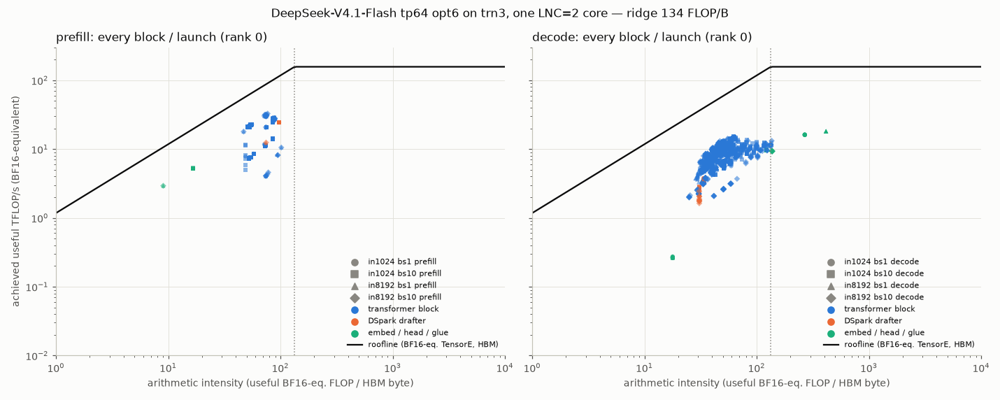
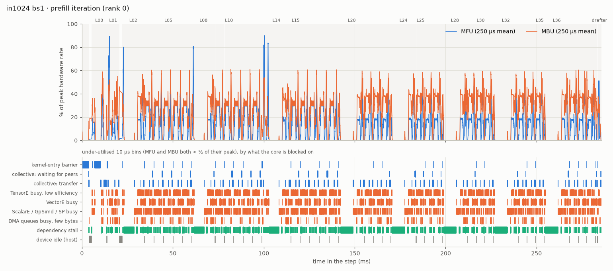
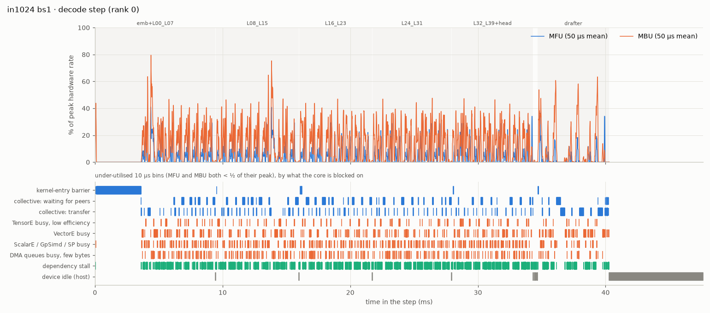
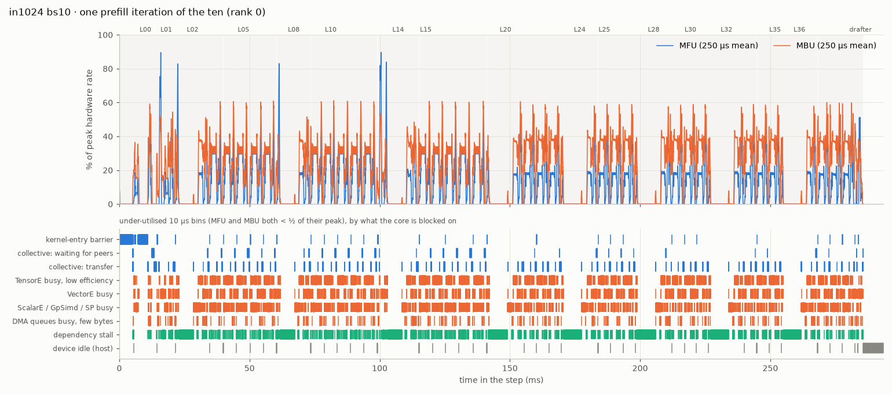
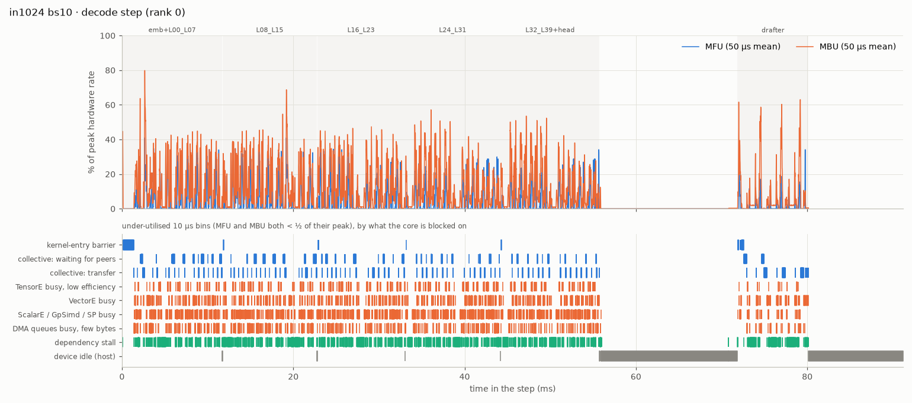
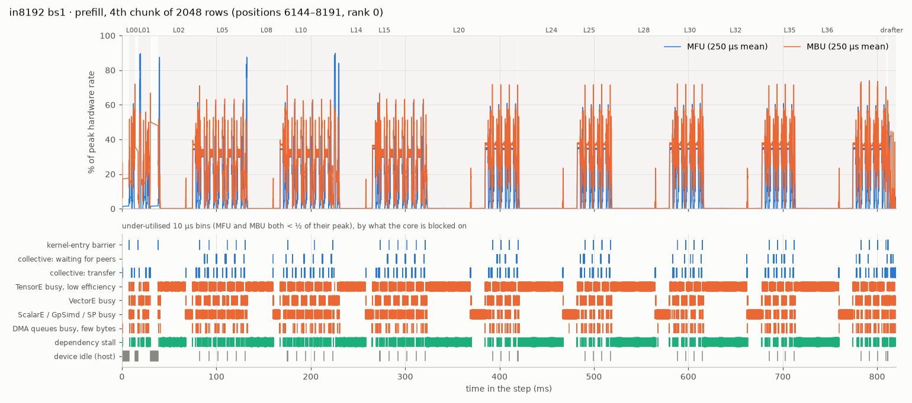
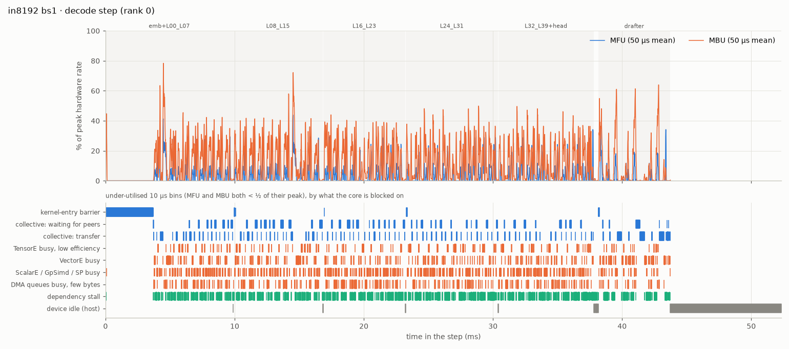
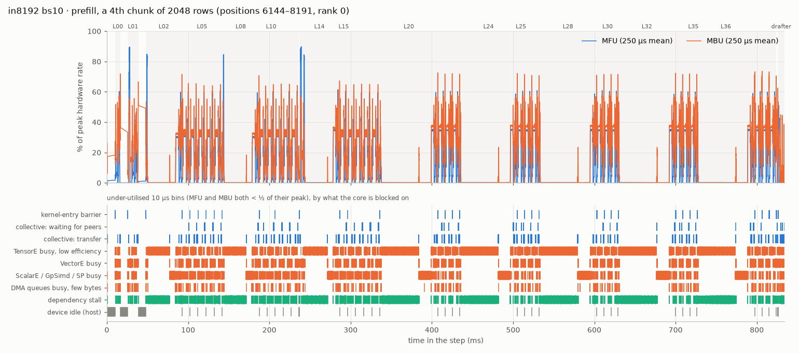
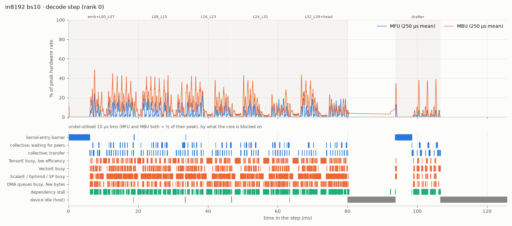

# DeepSeek-V4.1-Flash on trn3 — tp64 profile after opt6: prefill and decode

*2026-10-27 · branch `deepseek_v41_trn3` @ `e9273ad` ("opt6") · trn3.48xlarge, 64 logical cores (LNC=2) · scheme
`tp64` (one tensor-parallel group of 64; attention split 8-way, routed experts spread over all 64 ranks) · NKI
megakernels: one launch per block in prefill, **5 fused launches of 8 blocks** per decode step (embedding fused into
the first, the greedy head into the last), one DSpark drafter launch · MXFP4 routed experts, FP8 dense weights.*

Same four configurations and windows as `PROFILE_REPORT_tp64.md` (which profiled `eef3283`), each profiled in a
**prefill** window and a **decode** window on a live vLLM server: `in1024_bs1`, `in1024_bs10` (`max_num_seqs=10`),
`in8192_bs1`, `in8192_bs10` (`max_num_seqs=10`). Each configuration and phase has the three tables of that report —
(1) the overall latency breakdown, (2–3) the latency and roofline of every block / launch, with NKI hotspots — and two
new ones: **(4) the peak MFU / MBU of every megakernel and what the core is blocked on whenever it is far below that
peak**, and **(5) the same over the whole step or phase**, with a utilisation timeline figure. *Cross-rank analysis*
uses 8 simultaneously profiled ranks to say who waits for whom inside the collectives, and why. All latency
breakdowns are in descending order.

## Summary

| Config · phase | Total | Transformer blocks | Drafter | Entry barriers | Device idle (host) | Rest | Per block | Block MFU / MBU (mean) | Peak MFU / MBU (10 µs) | Under-utilised device time |
|---|---:|---:|---:|---:|---:|---:|---:|---:|---:|---:|
| in1024 bs1 · prefill (TTFT) | 298.9 ms | 91.7 % | 0.6 % | (3.8 % inside the launches) | 6.0 % | 1.7 % | 6.85 ms | 11.2 % / 22.4 % | 100 % / 98 % | 85 % |
| in1024 bs1 · decode (per step) | 47.1 ms | 63.6 % | 11.6 % | 8.2 % | 16.0 % | 0.6 % | 0.75 ms | 4.6 % / 14.3 % | 98 % / 89 % | 91 % |
| in1024 bs10 · prefill (all requests) | 2.93 s | 93.5 % | 0.7 % | (4.1 % inside the launches) | 4.1 % | 1.7 % | 6.85 ms | 11.1 % / 22.3 % | 100 % / 98 % | 87 % |
| in1024 bs10 · decode (per step) | 102.2 ms | 52.3 % | 8.8 % | 8.1 % | 30.4 % | 0.5 % | 1.34 ms | 5.9 % / 14.0 % | 99 % / 91 % | 94 % |
| in8192 bs1 · prefill (TTFT) | 3.32 s | 96.0 % | 0.8 % | (0.9 % inside the launches) | 2.4 % | 0.8 % | 19.95 ms | 9.1 % / 15.1 % | 100 % / 98 % | 90 % |
| in8192 bs1 · decode (per step) | 51.6 ms | 64.3 % | 10.7 % | 8.0 % | 16.5 % | 0.6 % | 0.83 ms | 4.2 % / 13.6 % | 99 % / 89 % | 92 % |
| in8192 bs10 · prefill (all requests) | 33.31 s | 96.3 % | 0.8 % | (0.9 % inside the launches) | 2.0 % | 0.9 % | 20.04 ms | 9.0 % / 14.9 % | 100 % / 98 % | 90 % |
| in8192 bs10 · decode (per step) | 123.3 ms | 58.8 % | 9.8 % | 4.8 % | 26.2 % | 0.4 % | 1.81 ms | 4.4 % / 12.1 % | 99 % / 95 % | 95 % |

*Entry barriers* = the kernel-entry barrier of the decode step's launches (in prefill it sits inside each block
launch; the share is given in parentheses). *Device idle (host)* = no launch on the core, plus (prefill) the host
time outside the device window. *Peak* = the best 10 µs bin anywhere in the phase; *under-utilised* = the share of the
device time in bins where both MFU and MBU are below half of their own megakernel's peak.

A decode step verifies 1 + 5 drafted tokens per sequence and emits ≈ 3.4 tokens per sequence at this prompt set's
≈ 48 % acceptance (bs1 in1024: 47.1 ms / 3.4 ≈ 13.8 ms TPOT; bench `bench_report.opt6.json` 13.3 ms).

**Against `PROFILE_REPORT_tp64.md` (eef3283):** TTFT 1.08 → **0.30 s** (in1024) and 8.55 → **3.32 s** (in8192); a
bs1 decode step 100.5 → **47.1 ms** (in1024) and 101.9 → **51.6 ms** (in8192); a bs10 step 222.5 → **102.2 ms** and
254.6 → **123.3 ms**. A decode step is 10 launches instead of 46 (73 at bs10); a prefill block 26 → 6.9 ms (in1024).

### Peak MFU / MBU per megakernel

Best 10 µs bin of each megakernel, **peak MFU / peak MBU %**, with the time-weighted mean MFU / MBU % in
parentheses (rank 0; prefill: the profiled iteration or 4th chunk; decode: the steady steps). The peaks are reached
in short bursts — fp32 projections and MX GEMMs for MFU, weight / KV streaming for MBU — while the means stay at
2–20 % / 5–36 %:

| prefill megakernel | in1024 bs1 | in1024 bs10 | in8192 bs1 | in8192 bs10 |
|---|---:|---:|---:|---:|
| `layer_prefill_r0_e_tp64` | 98 / 94 (13 / 24) | 99 / 94 (13 / 24) | 94 / 93 (13 / 24) | 95 / 94 (13 / 24) |
| `layer_prefill_r0_tp64` | 93 / 96 (5 / 13) | 93 / 97 (5 / 13) | 97 / 98 (11 / 32) | 97 / 98 (11 / 32) |
| `layer_prefill_r1_idx_tp64` | 97 / 97 (5 / 12) | 98 / 97 (5 / 10) | 98 / 98 (3 / 5) | 98 / 98 (3 / 5) |
| `layer_prefill_r1_src_idx_tp64` | 98 / 90 (5 / 12) | 99 / 90 (5 / 11) | 97 / 97 (3 / 5) | 94 / 97 (3 / 5) |
| `layer_prefill_r1_tap_tp64` | 98 / 98 (14 / 35) | 98 / 98 (14 / 29) | 98 / 97 (20 / 36) | 97 / 97 (20 / 36) |
| `layer_prefill_r1_tp64` | 97 / 97 (14 / 33) | 98 / 98 (14 / 29) | 98 / 98 (20 / 35) | 97 / 98 (20 / 35) |
| `layer_prefill_r2_src_idx_e_tp64` | 100 / 94 (9 / 14) | 100 / 96 (9 / 14) | 100 / 95 (7 / 9) | 100 / 94 (7 / 9) |
| `layer_prefill_r2_src_idx_tp64` | 100 / 97 (7 / 13) | 100 / 98 (7 / 13) | 100 / 98 (5 / 8) | 100 / 97 (5 / 7) |
| `layer_prefill_r2_tp64` | 99 / 92 (17 / 26) | 99 / 93 (17 / 26) | 99 / 98 (18 / 27) | 99 / 98 (17 / 26) |
| `DSpark drafter` | 99 / 95 (16 / 20) | 99 / 97 (15 / 17) | 95 / 95 (8 / 14) | 99 / 95 (8 / 14) |
| `embedding + hc_expand` | 0 / 53 (0 / 1) | 0 / 68 (0 / 1) | 0 / 65 (0 / 17) | 0 / 62 (0 / 17) |
| `tail all-gather graph` | 99 / 88 (3 / 27) | 99 / 88 (3 / 22) | 99 / 89 (2 / 28) | 85 / 88 (2 / 28) |
| **all device time** | 100 / 98 (11 / 22) | 100 / 98 (11 / 20) | 100 / 98 (9 / 15) | 100 / 98 (9 / 15) |

| decode megakernel | in1024 bs1 | in1024 bs10 | in8192 bs1 | in8192 bs10 |
|---|---:|---:|---:|---:|
| `layers_decode_embed_L00_L07_tp64` | 91 / 88 (3 / 10) | 91 / 91 (4 / 9) | 91 / 89 (3 / 10) | 91 / 93 (4 / 11) |
| `layers_decode_L08_L15_tp64` | 91 / 89 (5 / 15) | 90 / 82 (6 / 14) | 90 / 85 (4 / 14) | 90 / 91 (5 / 14) |
| `layers_decode_L16_L23_tp64` | 81 / 79 (4 / 14) | 82 / 83 (6 / 14) | 87 / 77 (4 / 14) | 86 / 95 (5 / 14) |
| `layers_decode_L24_L31_tp64` | 84 / 85 (4 / 14) | 86 / 82 (5 / 12) | 81 / 78 (3 / 12) | 84 / 75 (4 / 9) |
| `layers_decode_L32_L39_head_tp64` | 83 / 84 (4 / 14) | 99 / 82 (5 / 13) | 99 / 77 (4 / 13) | 92 / 77 (4 / 9) |
| `DSpark drafter` | 98 / 84 (2 / 9) | 99 / 87 (2 / 7) | 98 / 85 (2 / 9) | 99 / 88 (1 / 5) |
| **all device time** | 98 / 89 (4 / 12) | 99 / 91 (5 / 11) | 99 / 89 (4 / 12) | 99 / 95 (4 / 10) |

### Where the time goes while the device is under-utilised (every configuration)

Share of the decode step (device idle included) or of a profiled prefill iteration (device time), by what the core is
blocked on in the 10 µs bins where MFU and MBU are both below half of their megakernel's peak:

| Where the time goes | in1024 bs1 prefill (profiled iteration) | in1024 bs1 decode (per step) | in1024 bs10 prefill (profiled iteration) | in1024 bs10 decode (per step) | in8192 bs1 prefill (profiled iteration) | in8192 bs1 decode (per step) | in8192 bs10 prefill (profiled iteration) | in8192 bs10 decode (per step) |
|---|---:|---:|---:|---:|---:|---:|---:|---:|
| device idle: no launch on the core (host) | 0.0 % | 16.0 % | 0.0 % | 30.4 % | 0.0 % | 16.4 % | 0.0 % | 26.2 % |
| collective: waiting for peer ranks | 1.8 % | 10.5 % | 2.4 % | 5.4 % | 1.2 % | 8.0 % | 1.2 % | 3.5 % |
| kernel-entry barrier (all ranks must launch) | 2.5 % | 7.0 % | 2.8 % | 8.3 % | 0.1 % | 6.8 % | 0.1 % | 7.4 % |
| collective: transfer | 7.2 % | 6.6 % | 6.6 % | 4.7 % | 4.4 % | 6.8 % | 4.6 % | 4.4 % |
| TensorE busy at low efficiency | 22.6 % | 3.3 % | 22.9 % | 5.1 % | 46.2 % | 4.6 % | 43.4 % | 9.8 % |
| VectorE busy | 12.7 % | 7.1 % | 13.1 % | 7.2 % | 8.9 % | 6.7 % | 9.0 % | 5.8 % |
| ScalarE / GpSimd / SP busy | 12.0 % | 9.0 % | 12.2 % | 12.6 % | 16.1 % | 12.9 % | 16.9 % | 20.9 % |
| DMA queues busy, few bytes | 1.6 % | 6.6 % | 1.8 % | 4.9 % | 1.1 % | 7.2 % | 1.2 % | 4.6 % |
| dependency stall (no engine >= 70 % busy) | 24.8 % | 26.6 % | 24.8 % | 17.5 % | 12.3 % | 23.8 % | 14.2 % | 13.7 % |
| not under-utilised (MFU or MBU >= 1/2 of peak) | 14.7 % | 7.5 % | 13.4 % | 3.9 % | 9.5 % | 6.8 % | 9.5 % | 3.7 % |

**Key findings**

1. **Every megakernel touches a hardware roof somewhere, and spends almost all its time far below it.** The best
   10 µs bin of every block / drafter megakernel reaches **81–100 % MFU** (the fp32 compressor / indexer projections
   `mk_compress.py:fp32_proj_rows` and `mk_common.py:gemm_fp32`, which saturate the PE array at fp32's quarter rate,
   and the MX expert / attention GEMMs `mk_mx.py:gemm*`) and **75–98 % MBU** (weight streaming `mk_mx.py:_wdma` /
   `load_w_group` with no compute in flight). The time-weighted means are 4–11 % MFU and 12–22 % MBU, and **85–95 %
   of the device time** (67–98 % per megakernel) sits in bins where both are below half of the peak. Every block's arithmetic intensity is under the 134 FLOP/B ridge.
2. **Decode, bs1 (47–52 ms a step):** the 40 blocks take 30–33 ms (0.6–0.9 ms each), the drafter 5.5 ms. What the
   step waits on: **the host** — 7.5–8.5 ms with no launch on the core, the host's 6.4–9.4 ms between steps (median,
   fastest to slowest of the 8 captured ranks) —; **peers at the MoE world all-reduce** (`ncc.all_reduce(srcs=[cc2_src])`: each block's routed + shared
   expert output, 6 rows × 5120 fp32 = 123 KB) **4.1–4.3 ms**; the **kernel-entry barrier of the step's first launch**
   3.2–3.5 ms; and **dependency stalls** — a third of the block time, no engine above ~35 % busy on average, on a chain of
   ~8,000 small instructions per block (6-row tiles; TensorE ≈ 2,800 of ~0.2 µs each): `hc_in_tile` / `sinkhorn`, the MoE token compaction
   `mk_moe.py:run_expert.tile_ids`, MX staging `interleave_rows`, the router `route_topk`.
3. **Why ranks wait at the MoE all-reduce: routed-expert load imbalance.** With 6 rows × top-6 over 384 experts, a
   rank holds 0–3 experts that a step actually uses. In the 8-rank captures the last rank to arrive is 81–85 µs behind the median
   rank (p90 135 µs), 75–79 µs of it in its **MoE span** (arrival delay vs MoE span: correlation 0.92; vs its
   attention span: 0.14–0.16). Inside a block, **each extra active expert costs a rank ≈ 66 µs** (r = 0.94): its
   18.8 MB of MXFP4 weights stream at ≈ 285 GB/s, a quarter of the HBM bandwidth, through the per-expert loop.
4. **Why the first launch of a step waits 3.2–3.5 ms (bs1): host skew between ranks.** Each rank's device starts the step's
   first fused launch ~0.1 ms after its host finishes submitting it; across the 8 captured ranks the start spread is
   2.2–3.2 ms at bs1 (6–8 ms at bs10) and matches the hosts' submission spread exactly (correlation 1.00). The later launches are queued
   behind the previous one and start within ~50 µs of each other on every rank.
5. **Decode, bs10 (102–123 ms a step): the host is 26–30 % of the step.** Besides 11–18 ms between steps, the
   device sits idle **14–16 ms inside every step** between the last fused launch and the drafter: rank 0's host reads
   ten 368 KB slices of the DSpark tap tensor (one per sequence), then reads and writes the whole 3.7 MB tensor —
   the pattern of `torch.cat(pieces)` in `mk_model.run_draft` running through the host — plus 30 tiny reads of
   slot mappings / block tables (`_host(...)`): 6.5 ms of transfers, the rest host Python. At bs1 the same gap is
   0.19 ms. The drafter's own entry barrier then waits for the slowest rank's host (1.0 ms at in1024, 4.2 ms at in8192
   bs10; the step's first launch waits 7.7 / 5.2 ms).
6. **Padded collectives.** The drafter still all-reduces its MoE output as a 128-row tile (2.6 MB fp32, ~350 µs of transfer
   each, three per launch → ~1.2 ms of a bs1 step) for ≤ 6 live rows (≤ 60 at bs10, where each takes 580 µs); at bs10 the blocks' MoE all-reduce is padded to 128 rows
   (2.6 MB) for 60 live rows in every block, the attention one in the r1 blocks L20–L39 (exact 60 rows, 1.2 MB,
   in L00–L19). The blocks' bs1 all-reduces are exact (6 rows).
7. **Prefill at 8k is the indexer.** The 8 index-source blocks take 44–71 ms of every 2048-token chunk against
   ~9 ms for the others — **62 % of the chunk** (36 % in the previous profile: the other blocks became ~4.5×
   faster, these ~1.4×). In them TensorE is busy at low efficiency in the per-token score loop
   `mk_compress.py:index_scores_span.body` (29 % of the chunk), the SP engine runs `index_topk` (11 %), and the rest
   stalls. The indexer scores the padded context, so chunk 1 costs the same as chunk 4.
8. **Prefill at 1k (0.30 s):** regular blocks 4.6–5.3 ms, index-source blocks 12–16 ms (40 % of block time). The
   under-utilised time is the indexer loop (dependency stall, 18 %), the per-token attention matmuls
   (`attn_scores_toks`, `attn_pv`, `key_tile_packed`: TensorE busy at low efficiency, 17 %), the hyper-connection
   epilogue `hc_out_tile.acc_of` (VectorE, 7 %) and the transfer of each block's 21 MB fp32 MoE all-reduce (6 %).
9. **HBM scratch round trips** fell to 21–32 % of a block's HBM bytes (37–49 % before); DMA is still almost all
   descriptor-generated (hardware DGE 40–54 %, GpSimd software DGE 40–57 %).


## How this was measured

**Serving setup (the one the bench uses).** `performance._serve_main` (`vllm serve` with the port imported first),
`DEEPSEEK_V41_SCHEME=tp64`, tensor-parallel 64, LNC=2 (64 logical NeuronCores on one trn3.48xlarge, 36 GiB HBM
each), `--max-model-len` = input + 256 (1280 / 8448), prefix caching off. `max_num_seqs` = 1 for the bs1 cells and
10 for the bs10 cells (`DEEPSEEK_V41_MAX_NUM_SEQS=10`). Code: branch `deepseek_v41_trn3` at `e9273ad` ("opt6",
clean tree); every opt6 optimization is at its default (`DEEPSEEK_V41_FUSE_DECODE=8`, `FUSE_EMBED`, `FUSE_HEAD`,
`DRAFT_BATCHED`, `ONE_RPC_STEP`, `OPT_KERNELS=all`), exactly as in `bench_report.opt6*.json`. Requests are greedy,
`ignore_eos`, with token-exact prompts: whole lines of `sonnet.txt`, tokenized and cut to exactly 1024 / 8192
tokens, a different random line order per request. Same prompts, windows and capture method as
`PROFILE_REPORT_tp64.md`.

**Capture (Method 1 of `neuron-framework-profiling-vllm-neuron`).** The plugin's Neuron profiler
(`--profiler-config '{"profiler":"cuda",...}'` + `--additional-config '{"neuron_profiler": {...}}'`) records a device
profile (NTFF) and the live system trace. Each server is warmed up with the exact workload first.

* **Prefill window**: server idle → `/start_profile` → the *bs* requests with `max_tokens=1` → all answered →
  `/stop_profile`. The window holds exactly the prefill iterations (including the drafter's prefill launch).
* **Decode window**: *bs* streaming requests; once every stream has produced ≥ 3 chunks (all prefills done) →
  `/start_profile`, 0.6–1.5 s, `/stop_profile`. The first step after the start (the profiler's start perturbs host
  timing) and the last, incomplete step are dropped; the tables are the mean of the 9–10 steady steps between.
* **Long prefills**: an 8192-token prompt is **4 chunks of 2048 rows** (vLLM's `max_num_batched_tokens` 2048 is
  below the port's 4096-token segment, which only lowers larger budgets). The device-trace buffers hold about two
  chunks; the live system trace is not limited, so **latency is complete for every iteration**. For in8192 a second
  server with `delay_iterations=4, max_iterations=1` captured the **4th chunk** (positions 6144–8191, the full
  context); the in8192 per-block roofline columns are that chunk's.
* **Rank 0** carries the main tables (`neuron_cores: [0]`). To see who waits for whom inside the collectives, a
  second set of servers profiled **8 ranks at once** (`neuron_cores: [0, 4, 9, 18, 27, 36, 45, 63]`: one rank of
  every 8-rank attention group, two of rank 0's group, both NUMA halves) in the same windows; their clocks are
  aligned on the ends of the 64-rank all-reduces (*Cross-rank analysis*).
* Profile buffers: `NEURON_RT_PROFILE_BUF_INSTRUCTION_MB=512`, `NEURON_RT_PROFILE_BUF_EVENT_MB=256`; DGE notifications
  are **off** (they overflow the notification queue and kill the engine at tp64), so DMA bytes and timing are
  recorded but not per-tensor DMA metadata.
* **Profiler overhead is negligible**: profiled in1024 bs1 prefill request 0.299 s vs bench TTFT 0.300 s; in8192
  bs1 3.324 s vs bench 3.323 s; profiled bs1 decode steps are 47–51 ms for ≈ 3.4 tokens (bench TPOT 13.3–15.2 ms).

Ingested with `neuron-explorer view --ingest-only` (2.33, `--ignore-nc-buf-usage --ignore-instruction-hierarchy`);
every number below is computed from the parquet tables by the scripts in `profiling_tp64_opt6/scripts/` (see
*Artifacts*).

## What the numbers mean

**Units of work.** A **prefill iteration** is 45 NEFF executions on a core: `embedding + hc_expand` (one compiled
graph) → **40 block megakernels** (`layer_prefill_<archetype>_tp64`, one NKI kernel per transformer block:
attention + MoE + hyper-connections + every collective inside) → `final norm + lm_head + sampler` (one compiled
graph with the vocab all-gathers) → two tiny glue graphs → the **DSpark drafter** megakernel (`draft_prefill_tp64`).
A **decode step** is 10 executions: **5 fused launches** of 8 blocks each (`layers_decode_embed_L00_L07_tp64` — the
token embedding + `hc_expand` fused in front —, `…_L08_L15`, `…_L16_L23`, `…_L24_L31`, `…_L32_L39_head_tp64` — the
greedy head fused behind), 4 tiny glue graphs (two gather/concat graphs, the plugin's rejection sampler, the
drafter's meta graph) and **one drafter launch** (`draft_decode_tp64` for one sequence, `draft_decode_batched_tp64`
for all sequences of a bs10 step). A block's *archetype* names what it carries: `r0/r1/r2` = compress ratio of
its attention, `src` = writes the compressed-KV / index caches, `idx` = index-source (computes the sparse top-k for
the layers after it), `e` = engram lookup, `tap` = DSpark tap (layers 37–39).

**Blocks inside a fused launch.** One NKI kernel has no per-member markers in the trace, so a fused launch is cut
into its members on the device timeline: `[kernel-entry barrier] [embed] block … block [head]`, each block ending
at the end of its **MoE world all-reduce** (its last collective; the next block needs that output). A member's
metrics are those of the instructions, DMA packets and collectives inside its window, so work that one engine runs
ahead into the next member's window (a weight prefetch) is charged to the next member.

**Latency** of a whole execution is its device time from the live `nc_exec_running` trace (rank 0); a member's is
its window on the device timeline. *Device idle* is the gap between consecutive executions (host dispatch inside
the step; scheduler, output processing and input preparation between steps). For prefill, *host time outside the
device window* = client-measured time to the last first token − device window.

**Roofline columns** (per execution / member, averaged over the executions of a block). Hardware constants are those
the profiler reports for a trn3 logical core (2 physical cores):

| Constant | Value |
|---|---|
| TensorE peak (BF16) | 128 × 128 PE × 2 FLOP × 2.4 GHz × 2 cores = **157.3 TFLOP/s** (FP8 2×, MXFP8/MXFP4 4×) |
| HBM bandwidth | **1178 GB/s** per logical core (one HBM stack's share) |
| DMA bandwidth | 614 GB/s per physical core, 1228 GB/s per logical core |
| Ridge point | 157.3 T / 1.178 T = **133.5 FLOP/B** (BF16-equivalent) |

* **MFU** = useful TensorE FLOPs / (time × 157.3 TFLOP/s). FLOPs are the profiler's *BF16-equivalent*
  `adjusted_flops` (MXFP8 / MXFP4 matmuls count ×0.25, FP8 ×0.5, **FP32 ×4**), so MFU is the TensorE's utilisation
  at whatever precision it actually ran: a PE array saturated with fp32 matmuls reads 100 % although it delivers a
  quarter of the BF16 FLOP rate. *Useful* excludes the PE transposes; **HFU** includes them.
* **MBU** = (HBM bytes read + written by DMA) / (time × 1178 GB/s).
* **DMA active %**, **DMA BW %**, **AI**, **engine busy %** (interval-merged active time over both physical cores),
  **Collectives %** (CC-op time inside the unit, including the kernel-entry barrier and waiting for the slowest peer)
  and the **bottleneck engine** (the busiest) are defined as in `PROFILE_REPORT_tp64.md`.

**Timeline utilisation (sections 4–5, new).** Every execution is cut into **10 µs bins**. Per bin: MFU from the
TensorE instructions' FLOPs (each instruction's FLOPs spread over its duration), MBU from the DMA packets in flight
(each packet's bytes spread over its duration, scaled by the unit's HBM-bytes / DMA-bytes ratio, capped at 1),
the busy time of every engine on each physical core, DMA-queue activity, and the collective in flight (with the
tensor it carries, from the NKI source line of the instruction that rang its doorbell, e.g.
`ncc.all_reduce(srcs=[cc2_src], …)`). A collective's time is split into **waiting for peers** (its duration beyond
the fastest instance of the same collective in the capture: the rank that arrives last sees only the transfer) and
**transfer** (the rest). The **peak** MFU / MBU of a megakernel is its best bin; a bin is **under-utilised** when
both MFU and MBU are below half of that peak, and it is charged to one cause, in this order: an engine ≥ 70 % busy
on the busier core (*engine-bound* — busy but at low efficiency) → a collective in flight ≥ 50 % of the bin
(*waiting for peers* / *transfer* / *kernel-entry barrier*) → DMA queues ≥ 70 % active (*DMA-queue-bound*) →
otherwise *dependency stall*: every engine below 70 %, i.e. a chain of small dependent instructions handing off
between engines. The NKI function named is the one with the most instruction time on the deciding engine in that bin.


## Results per configuration

Reading the sections below: **(1)** sums every execution of the phase (prefill: the whole window, arrival → first
token of the last request; decode: one step, the mean of the steady steps), largest first. **(2–3)** is one row per
block (a prefill launch, or a member of a fused decode launch), per kernel-entry barrier and per other launch, in
descending latency: the latency columns are complete (live system trace); the roofline columns are the device
profile of the executions named in the section note. **(4)** is per megakernel — each launched NEFF kind (the 40
block kernels by archetype in prefill, the 5 fused launches and the drafter in decode; for decode a second table
splits the fused launches by block kind) — the best 10 µs bin and where it is, the means, and the shares of the
megakernel's time in each blocking cause. **(5)** ranks the largest blocking items over the whole step / phase, and
the timeline figure shows where in the step they occur (top: MFU and MBU; bottom: one lane per cause, marking the
under-utilised bins). The roofline plot puts every block / launch of every configuration on one chart.




### in1024_bs1 · prefill — 1 request × 1024 tokens (`max_num_seqs=1`, context 1280)

One prefill iteration of 1024 rows (TTFT 0.299 s measured by the client in this run).


**1. Overall latency breakdown** (descending)

| Component | ms | % |
|---|---:|---:|
| 40 transformer blocks (megakernels) | 274.00 | 91.7 |
| host time outside the device window (HTTP, tokenizer, first schedule, response) | 13.23 | 4.4 |
| device idle inside the step (host dispatch between launches) | 4.72 | 1.6 |
| embedding + hc_expand | 3.98 | 1.3 |
| DSpark drafter (megakernel) | 1.93 | 0.6 |
| final norm + lm_head + sampler | 0.99 | 0.3 |
| glue graphs (rejection sampler, gathers, drafter meta) | 0.03 | 0.0 |
| **Total** | **298.87** | 100 |

Transformer blocks by archetype (descending):

| Block archetype | blocks | ms (all blocks of this type) | ms per block | % of block time |
|---|---:|---:|---:|---:|
| `r2` | 15 | 77.50 | 5.167 | 28.3 |
| `r1` | 12 | 56.49 | 4.707 | 20.6 |
| `r1_idx` | 4 | 55.47 | 13.868 | 20.2 |
| `r2_src_idx` | 2 | 25.01 | 12.504 | 9.1 |
| `r2_src_idx_e` | 1 | 15.87 | 15.867 | 5.8 |
| `r1_tap` | 3 | 14.27 | 4.756 | 5.2 |
| `r1_src_idx` | 1 | 14.22 | 14.220 | 5.2 |
| `r0` | 1 | 8.24 | 8.242 | 3.0 |
| `r0_e` | 1 | 6.93 | 6.928 | 2.5 |

**2–3. Per-block latency and roofline** (descending by latency)

| Block | launches | ms (whole phase) | % of total | MFU % | HFU % | MBU % | DMA active % | DMA BW % | AI (FLOP/B) | Bottleneck engine (busy %) | Collectives % | TensorE % | VectorE % | GpSimd % |
|---|---:|---:|---:|---:|---:|---:|---:|---:|---:|---|---:|---:|---:|---:|
| L14 r2_src_idx_e | 1 | 15.867 | 5.3 | 9.0 | 10.3 | 14.0 | 44.7 | 13.8 | 86 | DMA (45) | 8.5 | 39.8 | 40.2 | 36.2 |
| L20 r1_src_idx | 1 | 14.220 | 4.8 | 4.8 | 6.0 | 11.8 | 40.4 | 11.0 | 54 | TensorE (48) | 7.9 | 48.2 | 43.8 | 37.2 |
| L36 r1_idx | 1 | 13.928 | 4.7 | 4.6 | 5.9 | 11.8 | 39.6 | 11.0 | 52 | TensorE (48) | 8.7 | 48.2 | 43.3 | 37.0 |
| L24 r1_idx | 1 | 13.915 | 4.7 | 4.6 | 5.9 | 11.8 | 40.0 | 11.0 | 52 | TensorE (48) | 7.8 | 48.3 | 43.8 | 37.2 |
| L28 r1_idx | 1 | 13.914 | 4.7 | 5.5 | 6.9 | 12.6 | 42.1 | 11.8 | 58 | TensorE (50) | 4.4 | 49.8 | 45.6 | 38.0 |
| L32 r1_idx | 1 | 13.715 | 4.6 | 4.7 | 6.0 | 11.9 | 40.7 | 11.2 | 52 | TensorE (49) | 7.1 | 48.9 | 44.5 | 37.8 |
| L08 r2_src_idx | 1 | 12.703 | 4.3 | 7.4 | 9.0 | 13.6 | 42.2 | 12.8 | 73 | TensorE (45) | 6.8 | 45.1 | 40.3 | 41.1 |
| L02 r2_src_idx | 1 | 12.305 | 4.1 | 7.4 | 9.0 | 13.9 | 43.2 | 13.0 | 72 | TensorE (46) | 5.0 | 46.1 | 41.1 | 42.6 |
| L00 r0 | 1 | 8.242 | 2.8 | 5.0 | 6.9 | 13.7 | 29.5 | 12.7 | 49 | Collectives (83) | 83.4 | 23.3 | 27.1 | 18.4 |
| L01 r0_e | 1 | 6.928 | 2.3 | 13.3 | 15.9 | 23.6 | 60.9 | 23.3 | 75 | DMA (61) | 18.4 | 38.0 | 53.8 | 30.0 |
| L18 r2 | 1 | 5.459 | 1.8 | 15.7 | 23.5 | 24.6 | 52.9 | 23.5 | 85 | DMA (53) | 22.0 | 51.9 | 50.6 | 43.1 |
| L17 r2 | 1 | 5.323 | 1.8 | 16.1 | 24.1 | 25.2 | 53.8 | 24.1 | 85 | DMA (54) | 19.7 | 52.6 | 51.6 | 43.8 |
| L05 r2 | 1 | 5.318 | 1.8 | 16.2 | 24.1 | 25.3 | 54.2 | 24.1 | 85 | DMA (54) | 20.0 | 52.5 | 51.6 | 44.0 |
| L04 r2 | 1 | 5.200 | 1.7 | 17.1 | 25.4 | 26.7 | 57.0 | 25.5 | 85 | DMA (57) | 15.6 | 55.1 | 54.4 | 45.3 |
| L11 r2 | 1 | 5.164 | 1.7 | 16.6 | 24.9 | 26.0 | 56.4 | 24.8 | 85 | DMA (56) | 17.3 | 54.6 | 53.9 | 45.4 |
| L12 r2 | 1 | 5.151 | 1.7 | 16.7 | 24.9 | 26.1 | 55.7 | 24.9 | 85 | DMA (56) | 17.3 | 54.5 | 53.5 | 45.4 |
| L03 r2 | 1 | 5.138 | 1.7 | 17.0 | 25.3 | 26.6 | 57.7 | 25.3 | 85 | DMA (58) | 16.4 | 55.4 | 55.0 | 46.0 |
| L10 r2 | 1 | 5.134 | 1.7 | 16.2 | 24.4 | 25.3 | 53.9 | 24.1 | 85 | DMA (54) | 20.4 | 53.4 | 52.3 | 45.0 |
| L16 r2 | 1 | 5.127 | 1.7 | 16.8 | 25.1 | 26.2 | 56.3 | 25.0 | 85 | DMA (56) | 16.9 | 54.7 | 53.5 | 45.9 |
| L19 r2 | 1 | 5.127 | 1.7 | 17.3 | 25.7 | 27.1 | 58.9 | 25.8 | 85 | DMA (59) | 14.0 | 56.6 | 56.0 | 46.8 |
| L13 r2 | 1 | 5.123 | 1.7 | 16.8 | 25.1 | 26.2 | 56.7 | 25.0 | 85 | DMA (57) | 16.7 | 54.7 | 54.2 | 46.0 |
| L15 r2 | 1 | 5.101 | 1.7 | 16.8 | 25.2 | 26.3 | 56.9 | 25.1 | 85 | DMA (57) | 17.1 | 54.6 | 54.1 | 46.1 |
| L07 r2 | 1 | 5.098 | 1.7 | 16.9 | 25.2 | 26.4 | 57.4 | 25.1 | 85 | DMA (57) | 15.7 | 56.6 | 54.8 | 46.5 |
| L06 r2 | 1 | 5.082 | 1.7 | 17.5 | 25.9 | 27.0 | 58.0 | 25.7 | 86 | DMA (58) | 14.0 | 56.7 | 55.4 | 46.8 |
| L09 r2 | 1 | 4.959 | 1.7 | 17.9 | 26.6 | 27.7 | 60.9 | 26.4 | 86 | DMA (61) | 12.5 | 58.5 | 57.5 | 48.3 |
| L39 r1_tap | 1 | 4.796 | 1.6 | 14.4 | 18.0 | 35.7 | 73.1 | 34.1 | 54 | DMA (73) | 13.4 | 61.5 | 57.8 | 49.1 |
| L23 r1 | 1 | 4.766 | 1.6 | 13.3 | 16.7 | 33.6 | 68.3 | 31.5 | 53 | DMA (68) | 19.9 | 59.3 | 54.9 | 46.1 |
| L37 r1_tap | 1 | 4.766 | 1.6 | 13.2 | 16.5 | 34.4 | 70.0 | 33.0 | 51 | DMA (70) | 17.6 | 59.0 | 55.1 | 47.2 |
| L27 r1 | 1 | 4.759 | 1.6 | 13.3 | 16.7 | 33.6 | 67.6 | 31.5 | 53 | DMA (68) | 19.9 | 59.5 | 55.1 | 45.8 |
| L22 r1 | 1 | 4.747 | 1.6 | 14.6 | 18.2 | 34.9 | 71.2 | 32.7 | 56 | DMA (71) | 15.5 | 61.8 | 57.4 | 47.0 |
| L26 r1 | 1 | 4.741 | 1.6 | 13.4 | 16.8 | 33.7 | 68.0 | 31.6 | 53 | DMA (68) | 20.1 | 59.7 | 55.4 | 45.9 |
| L21 r1 | 1 | 4.737 | 1.6 | 13.3 | 16.7 | 33.5 | 68.0 | 31.4 | 53 | DMA (68) | 20.3 | 59.5 | 55.3 | 46.1 |
| L25 r1 | 1 | 4.734 | 1.6 | 13.3 | 16.7 | 33.5 | 68.0 | 31.4 | 53 | DMA (68) | 20.3 | 59.0 | 54.5 | 45.4 |
| L29 r1 | 1 | 4.732 | 1.6 | 13.2 | 16.6 | 33.4 | 68.1 | 31.3 | 53 | DMA (68) | 19.1 | 59.1 | 54.5 | 45.7 |
| L34 r1 | 1 | 4.709 | 1.6 | 13.5 | 16.9 | 34.0 | 68.9 | 31.8 | 53 | DMA (69) | 18.9 | 60.0 | 55.5 | 46.4 |
| L38 r1_tap | 1 | 4.704 | 1.6 | 13.5 | 16.9 | 35.1 | 71.3 | 33.7 | 51 | DMA (71) | 16.0 | 60.3 | 56.7 | 48.1 |
| L35 r1 | 1 | 4.663 | 1.6 | 13.6 | 17.1 | 34.3 | 69.8 | 32.2 | 53 | DMA (70) | 18.3 | 60.5 | 56.4 | 46.6 |
| L33 r1 | 1 | 4.645 | 1.6 | 13.5 | 17.0 | 34.1 | 69.1 | 32.0 | 53 | DMA (69) | 19.0 | 59.8 | 55.4 | 46.2 |
| L30 r1 | 1 | 4.641 | 1.6 | 14.3 | 17.9 | 35.1 | 71.2 | 32.8 | 54 | DMA (71) | 16.0 | 62.1 | 58.1 | 47.9 |
| L31 r1 | 1 | 4.615 | 1.5 | 13.7 | 17.2 | 34.7 | 70.7 | 32.5 | 53 | DMA (71) | 17.7 | 61.6 | 56.9 | 47.7 |
| embedding + hc_expand | 1 | 3.980 | 1.3 | 0.0 | 0.0 | 4.0 | 5.7 | 1.4 | 0 | Collectives (95) | 94.5 | 0.1 | 0.9 | 0.8 |
| DSpark drafter (megakernel) | 1 | 1.926 | 0.6 | 15.5 | 20.8 | 21.3 | 51.2 | 19.2 | 97 | VectorE (64) | 16.4 | 58.8 | 63.9 | 32.0 |
| tail all-gather graph | 1 | 0.986 | 0.3 | 3.3 | 3.3 | 26.8 | 56.4 | 27.5 | 17 | VectorE (68) | 13.4 | 9.0 | 67.7 | 32.8 |
| drafter meta | 1 | 0.018 | 0.0 | 0.0 | 0.0 | 0.0 | 11.9 | 0.1 | 0 | GpSimd (34) | 0.0 | 0.0 | 0.0 | 34.0 |
| glue | 1 | 0.013 | 0.0 | 0.0 | 0.0 | 0.0 | 15.7 | 0.3 | 0 | DMA (16) | 0.0 | 0.0 | 0.0 | 9.9 |

**Where the time goes inside the dominant blocks** (NKI source attribution)

*r2* — 15 executions, mean 5.168 ms. *Footprint* = time during which any engine of either core executes the function (functions overlap, so footprints do not add up to the block); the engine columns are each engine's busy time on that function, per physical core.

| Kernel function | footprint ms | Tensor ms | Vector ms | Scalar ms | GpSimd ms | Sync ms | HBM MB | GFLOP (BF16-eq.) |
|---|---:|---:|---:|---:|---:|---:|---:|---:|
| `mk_common.py:attn_fetch` | 1.571 | 0.000 | 0.000 | 0.000 | 1.326 | 0.000 | 695.4 | 0.00 |
| `mk_common.py:attn_scores` | 1.050 | 0.695 | 0.051 | 0.050 | 0.000 | 0.000 | 0.0 | 43.57 |
| `mk_common.py:attn_pv` | 0.836 | 0.657 | 0.019 | 0.000 | 0.000 | 0.000 | 0.0 | 43.62 |
| `mk_common.py:key_tile_packed` | 0.785 | 0.515 | 0.430 | 0.330 | 0.001 | 0.000 | 0.0 | 42.95 |
| `mk_common.py:hc_out_tile.acc_of` | 0.644 | 0.000 | 0.476 | 0.148 | 0.056 | 0.006 | 83.9 | 0.00 |
| `mk_common.py:hc_in_tile` | 0.502 | 0.357 | 0.089 | 0.091 | 0.018 | 0.000 | 42.0 | 14.76 |
| `mk_mx.py:gemm` | 0.394 | 0.291 | 0.072 | 0.053 | 0.000 | 0.003 | 44.6 | 30.33 |
| `mk_common.py:attn_softmax` | 0.355 | 0.000 | 0.129 | 0.083 | 0.000 | 0.000 | 0.0 | 0.00 |

*r1_idx* — 4 executions, mean 13.911 ms. *Footprint* = time during which any engine of either core executes the function (functions overlap, so footprints do not add up to the block); the engine columns are each engine's busy time on that function, per physical core.

| Kernel function | footprint ms | Tensor ms | Vector ms | Scalar ms | GpSimd ms | Sync ms | HBM MB | GFLOP (BF16-eq.) |
|---|---:|---:|---:|---:|---:|---:|---:|---:|
| `mk_compress.py:index_scores_span.body` | 4.896 | 3.086 | 2.173 | 0.000 | 1.000 | 0.000 | 6.3 | 1.39 |
| `mk_compress.py:index_topk` | 1.746 | 0.000 | 0.035 | 0.003 | 0.505 | 1.421 | 16.8 | 0.00 |
| `mk_common.py:attn_fetch` | 1.444 | 0.000 | 0.000 | 0.000 | 1.141 | 0.000 | 671.1 | 0.00 |
| `mk_common.py:attn_scores_toks` | 1.125 | 0.733 | 0.040 | 0.000 | 0.000 | 0.000 | 0.0 | 0.00 |
| `mk_common.py:attn_pv` | 1.005 | 0.613 | 0.016 | 0.000 | 0.000 | 0.000 | 0.0 | 43.62 |
| `mk_common.py:hc_out_tile.acc_of` | 0.644 | 0.000 | 0.478 | 0.146 | 0.056 | 0.006 | 83.9 | 0.00 |
| `mk_common.py:hc_in_tile` | 0.517 | 0.374 | 0.099 | 0.073 | 0.015 | 0.000 | 42.0 | 14.74 |
| `mk_common.py:attn_scores_begin` | 0.452 | 0.133 | 0.098 | 0.050 | 0.000 | 0.000 | 0.0 | 1.29 |

**4. Peak MFU / MBU per megakernel, and what the core is blocked on when it is under-utilised**

*Per 10 µs bin of the device timeline (rank 0). **Peak** = the best bin of that megakernel, and where it is
(block : NKI function). **Mean** = the megakernel's FLOPs / HBM bytes over its whole time. A bin is
**under-utilised** when both its MFU and its MBU are below half the megakernel's own peak. Each under-utilised
bin is charged to one cause; the cause columns are % of the megakernel's time: **CC wait** = waiting for peer
ranks inside a collective; **entry barrier** = the launch's kernel-entry barrier (waiting for every rank to
start the NEFF); **CC transfer** = the collective moving its data; **<engine> busy** = that engine is ≥ 70 %
busy on the busier physical core, but at low efficiency; **DMA queues** = DMA queues ≥ 70 % active while
moving few bytes; **dep. stall** = no engine ≥ 70 % busy (a chain of small dependent instructions across
engines). Cells below 0.5 % show `·`. The last column names the two largest items.*

| Megakernel | ms | peak MFU % (10 µs bin, where) | peak MBU % (where) | mean MFU / MBU % | under-utilised % | CC wait | entry barrier | CC transfer | TensorE busy | VectorE busy | ScalarE/GpSimd/SP busy | DMA queues | dep. stall | largest blocking items |
|---|---:|---|---|---:|---:|---:|---:|---:|---:|---:|---:|---:|---:|---|
| `layer_prefill_r2_tp64` | 77.52 | 99 (L07 r2: mk_common.py:gemm_fp32) | 92 (L05 r2: mk_common.py:hc_in_tile) | 16.8 / 26.0 | 83 | 6 | · | 9 | 29 | 17 | 13 | 1 | 8 | TensorE: `mk_common.py:key_tile_packed` (7.90 ms); VectorE: `mk_common.py:hc_out_tile.acc_of` (7.32 ms) |
| `layer_prefill_r1_tp64` | 56.67 | 97 (L22 r1: mk_mx.py:gemm_sb_multi) | 97 (L27 r1: DMA only) | 13.6 / 33.2 | 77 | · | · | 10 | 35 | 15 | 8 | 2 | 7 | TensorE: `mk_common.py:attn_scores_toks` (12.66 ms); VectorE: `mk_common.py:hc_out_tile.acc_of` (5.32 ms) |
| `layer_prefill_r1_idx_tp64` | 55.64 | 97 (L28 r1_idx: mk_mx.py:gemm_sb_multi) | 97 (L24 r1_idx: DMA only) | 4.9 / 11.7 | 92 | 1 | · | 2 | 13 | 6 | 14 | 1 | 55 | dependency stall: `mk_compress.py:index_scores_span.body` (27.57 ms); SP(sync): `mk_compress.py:index_topk` (5.84 ms) |
| `layer_prefill_r2_src_idx_tp64` | 25.01 | 100 (L08 r2_src_idx: mk_compress.py:fp32_proj_rows) | 97 (L08 r2_src_idx: DMA only) | 7.4 / 13.4 | 90 | · | · | 2 | 14 | 8 | 13 | 1 | 51 | dependency stall: `mk_compress.py:index_scores_span.body` (10.95 ms); SP(sync): `mk_compress.py:index_topk` (1.97 ms) |
| `layer_prefill_r2_src_idx_e_tp64` | 15.87 | 100 (L14 r2_src_idx_e: mk_compress.py:fp32_proj_rows) | 94 (L14 r2_src_idx_e: mk_common.py:engram_gate_tile) | 9.0 / 14.0 | 87 | · | 1 | 6 | 12 | 11 | 11 | 3 | 43 | dependency stall: `mk_compress.py:index_scores_span.body` (5.48 ms); SP(sync): `mk_compress.py:index_topk` (1.15 ms) |
| `layer_prefill_r1_tap_tp64` | 14.31 | 98 (L39 r1_tap: mk_mx.py:gemm_sb_multi) | 98 (L38 r1_tap: mk_common.py:tap_tile) | 13.7 / 35.0 | 75 | · | · | 6 | 34 | 17 | 10 | 2 | 6 | TensorE: `mk_common.py:attn_scores_toks` (2.92 ms); VectorE: `mk_common.py:hc_out_tile.acc_of` (1.49 ms) |
| `layer_prefill_r1_src_idx_tp64` | 14.22 | 98 (L20 r1_src_idx: mk_common.py:gemm_fp32) | 90 (L20 r1_src_idx: mk_mx.py:gemm) | 4.8 / 11.5 | 91 | · | · | 5 | 12 | 6 | 14 | 1 | 53 | dependency stall: `mk_compress.py:index_scores_span.body` (6.89 ms); SP(sync): `mk_compress.py:index_topk` (1.47 ms) |
| `layer_prefill_r0_tp64` | 8.24 | 93 (L00 r0: mk_mx.py:gemm) | 96 (L00 r0: DMA only) | 5.0 / 13.2 | 87 | · | 36 | 24 | 3 | 8 | 13 | 1 | 2 | entry barrier (2.93 ms); CC transfer @ AR-64 `cc2_src` (MoE out, fp32 21.0 MB) (1.49 ms) |
| `layer_prefill_r0_e_tp64` | 6.93 | 98 (L01 r0_e: mk_common.py:gemm_fp32) | 94 (L01 r0_e: mk_common.py:engram_gate_tile) | 13.3 / 23.6 | 75 | · | 2 | 11 | 5 | 23 | 17 | 7 | 10 | VectorE: `mk_common.py:engram_gate_tile` (0.84 ms); GpSimd: `mk_common.py:attn_fetch` (0.83 ms) |
| `embedding + hc_expand` | 3.99 | 0 (embedding + hc_expand: DMA only) | 53 (embedding + hc_expand: model.py:?) | 0.0 / 1.5 | 97 | · | 89 | 3 | · | · | · | · | 5 | entry barrier (3.54 ms); dependency stall: `(idle)` (0.17 ms) |
| DSpark drafter | 1.93 | 99 (drafter: blockquant.py:_gemm.ntile) | 95 (drafter: mk_mx.py:interleave_rows) | 15.5 / 20.0 | 76 | 2 | 2 | 8 | 2 | 49 | 2 | 2 | 10 | VectorE: `mk_mx.py:interleave_rows` (0.68 ms); CC transfer @ AG-64 `gv_src` (argmax values, fp32 4 B) (0.10 ms) |
| tail all-gather graph | 1.02 | 99 (tail all-gather graph: blockquant.py:_gemm.ntile) | 88 (tail all-gather graph: model.py:?) | 3.3 / 26.8 | 71 | 3 | 1 | 3 | · | 46 | 3 | 3 | 12 | VectorE: `rmsnorm.py:rms_norm.body` (0.21 ms); VectorE: `rotational_topk_utils.py:<module>` (0.17 ms) |
| glue | 0.05 | 0 (glue: DMA only) | 0 (glue: DMA only) | 0.0 / 0.0 | 78 | · | · | · | · | · | · | · | 78 | dependency stall: `(idle)` (0.03 ms); dependency stall: `(no source location)` (0.01 ms) |
| drafter meta | 0.02 | 0 (drafter meta: DMA only) | 0 (drafter meta: DMA only) | 0.0 / 0.0 | 59 | · | · | · | · | · | · | · | 59 | dependency stall: `(no source location)` (0.01 ms) |
| **all device time** | 281.44 | 100 (L14 r2_src_idx_e: mk_compress.py:fp32_proj_rows) | 98 (L38 r1_tap: mk_common.py:tap_tile) | 11.0 / 21.7 | 85 | 2 | 3 | 7 | 23 | 13 | 12 | 2 | 25 | dependency stall: `mk_compress.py:index_scores_span.body` (50.89 ms); TensorE: `mk_common.py:attn_scores_toks` (23.58 ms) |

**5. Overall: the largest blocking items over the profiled iteration** (rank 0's device timeline plus the time with no launch on the core)

| # | Blocked on | What exactly | ms | % of the profiled iteration |
|---:|---|---|---:|---:|
| 1 | dependency stall | `mk_compress.py:index_scores_span.body` | 50.89 | 17.8 |
| 2 | TensorE busy (low efficiency) | `mk_common.py:attn_scores_toks` | 23.58 | 8.2 |
| 3 | VectorE busy (low efficiency) | `mk_common.py:hc_out_tile.acc_of` | 18.76 | 6.6 |
| 4 | CC transfer | AR-64 `cc2_src` (MoE out, fp32 21.0 MB) | 16.95 | 5.9 |
| 5 | TensorE busy (low efficiency) | `mk_common.py:attn_pv` | 15.08 | 5.3 |
| 6 | GpSimd busy (low efficiency) | `mk_common.py:attn_fetch` | 12.07 | 4.2 |
| 7 | SP(sync) busy (low efficiency) | `mk_compress.py:index_topk` | 10.43 | 3.6 |
| 8 | TensorE busy (low efficiency) | `mk_common.py:key_tile_packed` | 7.91 | 2.8 |
| 9 | entry barrier | kernel-entry barrier | 7.16 | 2.5 |
| 10 | TensorE busy (low efficiency) | `mk_common.py:hc_in_tile` | 6.66 | 2.3 |
| 11 | waiting for peers | AR-64 `cc2_src` (MoE out, fp32 21.0 MB) | 5.07 | 1.8 |
| 12 | device idle (no launch on the core) | host: dispatch between launches + scheduler / output / input prep between steps | 4.72 | 1.6 |
| 13 | TensorE busy (low efficiency) | `mk_common.py:attn_scores` | 4.47 | 1.6 |
| 14 | dependency stall | `mk_compress.py:index_topk` | 3.03 | 1.1 |
| 15 | ScalarE busy (low efficiency) | `mk_common.py:hc_in_tile.sumsq_k` | 2.75 | 1.0 |



**Reading 4–5 (in1024 prefill).**
* *Peaks.* Every block megakernel reaches 93–100 % MFU in some 10 µs bin (fp32 GEMMs `gemm_fp32` and the
  compressor's `fp32_proj_rows`, MX GEMMs `gemm_sb_multi`) and 90–98 % MBU (weight / KV streaming with no compute in
  flight). The block means are 5–17 % MFU and 12–35 % MBU.
* *Index-source blocks* (L02, 8, 14, 20, 24, 28, 32, 36; 12.5–15.9 ms against 4.6–5.3 ms for a regular block):
  43–55 % of their time is a dependency stall inside the indexer's per-token loop
  `mk_compress.py:index_scores_span.body` (every engine partly busy: TensorE 3.1 ms, VectorE 2.2 ms, GpSimd 1.0 ms
  per block, none saturated), then `index_topk` keeps the SP (sync) engine busy (1.4 ms per block). That is the
  single largest item of the phase: **51 ms of the 281 ms device time**.
* *Regular blocks* are TensorE-busy at low efficiency 29–35 % of their time: the per-token sparse attention —
  `key_tile_packed` (packing each token's 640 gathered keys for the PE), `attn_scores(_toks)` and `attn_pv` (one
  small matmul per token) — fed by `attn_fetch` (GpSimd indirect DMA of the KV rows, 0.7 GB a block), plus
  VectorE in the hyper-connection epilogue `hc_out_tile.acc_of`.
* *Collectives* are 15 % of a block: the MoE world all-reduce of `cc2_src` (1024 × 5120 fp32 = 21 MB) takes 686 µs
  (fastest instance 492 µs, 43 GB/s algorithm bandwidth) and the attention all-reduce of `cc_src` over 8 ranks
  164 µs. The iteration's first launches — the embedding graph (3.6 ms) and L00 (4.7 ms) — sit in their
  X


### in1024_bs1 · decode — 1 sequence (6 rows a step: 1 + 5 drafted tokens each), context ≈ 1024–1280

Per decode step (mean of 10 steady steps).


**1. Overall latency breakdown** (descending)

| Component | ms | % |
|---|---:|---:|
| 40 transformer blocks (megakernels) | 29.96 | 63.6 |
| device idle between iterations (vLLM scheduler, output processing, input prep) | 7.05 | 15.0 |
| DSpark drafter (megakernel) | 5.45 | 11.6 |
| kernel-entry barriers of the fused launches (waiting for all 64 ranks) | 3.85 | 8.2 |
| device idle inside the step (host dispatch between launches) | 0.47 | 1.0 |
| final norm + lm_head + greedy argmax (fused into the last launch) | 0.17 | 0.4 |
| glue graphs (rejection sampler, gathers, drafter meta) | 0.09 | 0.2 |
| embedding + hc_expand (fused into the first launch) | 0.04 | 0.1 |
| **Total** | **47.07** | 100 |

Transformer blocks by archetype (descending):

| Block archetype | blocks | ms (all blocks of this type) | ms per block | % of block time |
|---|---:|---:|---:|---:|
| `r2` | 15 | 9.52 | 0.635 | 31.8 |
| `r1` | 12 | 8.67 | 0.723 | 28.9 |
| `r1_idx` | 4 | 3.46 | 0.865 | 11.5 |
| `r1_tap` | 3 | 2.20 | 0.732 | 7.3 |
| `r2_src_idx` | 2 | 1.79 | 0.896 | 6.0 |
| `r2_src_idx_e` | 1 | 1.56 | 1.565 | 5.2 |
| `r0_e` | 1 | 1.21 | 1.213 | 4.0 |
| `r1_src_idx` | 1 | 0.93 | 0.925 | 3.1 |
| `r0` | 1 | 0.62 | 0.616 | 2.1 |

**2–3. Per-block latency and roofline** (descending by latency)

| Block | launches | ms per decode step | % of total | MFU % | HFU % | MBU % | DMA active % | DMA BW % | AI (FLOP/B) | Bottleneck engine (busy %) | Collectives % | TensorE % | VectorE % | GpSimd % |
|---|---:|---:|---:|---:|---:|---:|---:|---:|---:|---|---:|---:|---:|---:|
| DSpark drafter (megakernel) | 1 | 5.452 | 11.6 | 2.3 | 3.2 | 9.2 | 31.4 | 9.0 | 34 | VectorE (38) | 30.8 | 16.6 | 37.7 | 18.1 |
| kernel-entry barrier | 5 | 3.846 | 8.2 | 0.7 | 1.2 | 12.9 | 45.8 | 11.9 | 5 | Collectives (58) | 58.3 | 8.8 | 20.9 | 23.8 |
| L14 r2_src_idx_e | 1 | 1.565 | 3.3 | 5.9 | 6.7 | 15.6 | 45.6 | 15.9 | 51 | DMA (46) | 20.0 | 23.6 | 36.6 | 16.9 |
| L01 r0_e | 1 | 1.213 | 2.6 | 7.9 | 8.8 | 18.6 | 52.7 | 18.4 | 57 | DMA (53) | 19.5 | 22.3 | 38.9 | 16.7 |
| L02 r2_src_idx | 1 | 0.945 | 2.0 | 3.0 | 4.1 | 12.7 | 39.0 | 12.7 | 32 | DMA (39) | 27.5 | 22.4 | 34.3 | 18.4 |
| L20 r1_src_idx | 1 | 0.925 | 2.0 | 3.3 | 4.4 | 12.3 | 43.9 | 12.0 | 36 | DMA (44) | 22.0 | 18.6 | 37.0 | 25.5 |
| L28 r1_idx | 1 | 0.887 | 1.9 | 4.6 | 6.0 | 14.8 | 49.3 | 13.9 | 41 | DMA (49) | 20.1 | 22.8 | 39.2 | 26.8 |
| L32 r1_idx | 1 | 0.862 | 1.8 | 3.7 | 5.0 | 13.4 | 44.3 | 12.9 | 36 | DMA (44) | 32.4 | 20.9 | 35.1 | 24.7 |
| L24 r1_idx | 1 | 0.855 | 1.8 | 3.3 | 4.4 | 12.7 | 43.3 | 12.4 | 34 | DMA (43) | 33.7 | 19.8 | 34.1 | 24.9 |
| L36 r1_idx | 1 | 0.854 | 1.8 | 3.7 | 5.0 | 13.7 | 47.6 | 13.0 | 36 | DMA (48) | 21.3 | 21.2 | 36.8 | 26.5 |
| L08 r2_src_idx | 1 | 0.848 | 1.8 | 3.8 | 4.8 | 13.9 | 42.2 | 14.1 | 36 | DMA (42) | 22.6 | 26.6 | 34.9 | 20.5 |
| L29 r1 | 1 | 0.753 | 1.6 | 4.6 | 6.1 | 14.9 | 44.8 | 14.0 | 41 | DMA (45) | 22.7 | 20.4 | 36.6 | 25.6 |
| L35 r1 | 1 | 0.744 | 1.6 | 5.2 | 6.8 | 15.0 | 47.5 | 14.0 | 46 | DMA (47) | 19.7 | 23.3 | 40.8 | 24.8 |
| L37 r1_tap | 1 | 0.741 | 1.6 | 3.5 | 4.8 | 13.4 | 45.8 | 13.1 | 35 | DMA (46) | 25.4 | 18.6 | 36.0 | 27.8 |
| L39 r1_tap | 1 | 0.738 | 1.6 | 6.8 | 8.7 | 16.6 | 47.8 | 14.8 | 55 | DMA (48) | 8.7 | 26.6 | 43.5 | 24.3 |
| L33 r1 | 1 | 0.737 | 1.6 | 3.5 | 4.8 | 13.2 | 43.7 | 12.9 | 35 | DMA (44) | 26.5 | 18.2 | 34.8 | 24.5 |
| L34 r1 | 1 | 0.730 | 1.5 | 4.6 | 6.0 | 14.7 | 46.3 | 14.0 | 41 | DMA (46) | 22.9 | 20.6 | 37.5 | 25.3 |
| L27 r1 | 1 | 0.728 | 1.5 | 3.5 | 4.8 | 12.5 | 43.4 | 12.2 | 38 | DMA (43) | 24.2 | 19.4 | 36.3 | 23.4 |
| L23 r1 | 1 | 0.723 | 1.5 | 4.2 | 5.6 | 10.3 | 37.3 | 10.4 | 54 | DMA (37) | 20.5 | 20.7 | 36.4 | 18.9 |
| L26 r1 | 1 | 0.719 | 1.5 | 3.8 | 5.2 | 13.8 | 45.5 | 13.4 | 37 | DMA (46) | 22.9 | 19.3 | 36.5 | 25.0 |
| L38 r1_tap | 1 | 0.718 | 1.5 | 3.6 | 4.9 | 13.6 | 44.5 | 13.1 | 35 | DMA (44) | 25.1 | 18.9 | 37.6 | 28.1 |
| L30 r1 | 1 | 0.714 | 1.5 | 4.8 | 6.3 | 15.5 | 46.6 | 14.5 | 41 | DMA (47) | 19.7 | 22.7 | 39.1 | 26.1 |
| L21 r1 | 1 | 0.713 | 1.5 | 3.6 | 4.9 | 13.3 | 45.2 | 12.9 | 36 | DMA (45) | 27.7 | 19.9 | 37.5 | 24.2 |
| L31 r1 | 1 | 0.712 | 1.5 | 4.0 | 5.4 | 10.3 | 35.9 | 9.8 | 52 | DMA (36) | 24.6 | 20.0 | 35.5 | 19.8 |
| L25 r1 | 1 | 0.710 | 1.5 | 5.1 | 6.6 | 15.8 | 48.7 | 14.9 | 42 | DMA (49) | 17.2 | 22.0 | 39.2 | 26.8 |
| L22 r1 | 1 | 0.689 | 1.5 | 5.8 | 7.6 | 16.4 | 50.3 | 16.0 | 47 | DMA (50) | 15.3 | 25.5 | 42.5 | 27.4 |
| L11 r2 | 1 | 0.674 | 1.4 | 4.0 | 5.4 | 13.9 | 45.6 | 13.9 | 38 | DMA (46) | 35.5 | 17.7 | 33.4 | 16.2 |
| L15 r2 | 1 | 0.663 | 1.4 | 4.0 | 5.5 | 9.1 | 36.9 | 10.1 | 59 | DMA (37) | 34.9 | 18.1 | 33.5 | 13.9 |
| L12 r2 | 1 | 0.655 | 1.4 | 4.1 | 5.6 | 14.0 | 45.6 | 14.1 | 39 | DMA (46) | 33.1 | 17.3 | 34.7 | 16.4 |
| L19 r2 | 1 | 0.652 | 1.4 | 5.4 | 7.0 | 15.4 | 49.4 | 15.3 | 47 | DMA (49) | 27.2 | 21.3 | 37.5 | 18.6 |
| L04 r2 | 1 | 0.650 | 1.4 | 4.5 | 6.0 | 14.7 | 48.1 | 14.8 | 41 | DMA (48) | 30.7 | 19.0 | 34.8 | 17.1 |
| L03 r2 | 1 | 0.646 | 1.4 | 5.0 | 6.5 | 14.7 | 48.6 | 14.8 | 45 | DMA (49) | 25.7 | 21.6 | 37.6 | 17.4 |
| L10 r2 | 1 | 0.643 | 1.4 | 4.2 | 5.6 | 13.9 | 46.5 | 14.0 | 40 | DMA (47) | 28.5 | 17.7 | 36.9 | 16.7 |
| L09 r2 | 1 | 0.642 | 1.4 | 8.0 | 9.6 | 18.3 | 60.3 | 18.3 | 58 | DMA (60) | 10.9 | 30.4 | 41.0 | 21.1 |
| L18 r2 | 1 | 0.641 | 1.4 | 4.9 | 6.4 | 14.6 | 49.5 | 14.7 | 44 | DMA (49) | 28.9 | 20.9 | 37.1 | 18.2 |
| L05 r2 | 1 | 0.633 | 1.3 | 4.2 | 5.7 | 14.5 | 46.4 | 14.5 | 39 | DMA (46) | 32.0 | 17.2 | 35.1 | 16.5 |
| L13 r2 | 1 | 0.627 | 1.3 | 5.6 | 7.2 | 17.2 | 50.1 | 17.1 | 43 | DMA (50) | 24.9 | 23.1 | 40.2 | 19.9 |
| L07 r2 | 1 | 0.616 | 1.3 | 4.3 | 5.9 | 11.0 | 41.2 | 11.1 | 52 | DMA (41) | 32.5 | 19.1 | 36.7 | 14.9 |
| L00 r0 | 1 | 0.616 | 1.3 | 5.5 | 6.8 | 16.7 | 48.6 | 16.6 | 43 | DMA (49) | 26.5 | 23.0 | 37.9 | 19.9 |
| L06 r2 | 1 | 0.613 | 1.3 | 5.3 | 6.9 | 15.5 | 51.2 | 15.6 | 45 | DMA (51) | 24.6 | 22.0 | 38.9 | 19.5 |
| L17 r2 | 1 | 0.613 | 1.3 | 4.4 | 5.9 | 14.7 | 48.9 | 14.9 | 40 | DMA (49) | 28.2 | 18.8 | 37.4 | 17.0 |
| L16 r2 | 1 | 0.551 | 1.2 | 5.1 | 6.6 | 16.8 | 51.4 | 17.0 | 40 | DMA (51) | 30.6 | 21.7 | 33.9 | 20.4 |
| greedy head (fused) | 1 | 0.166 | 0.4 | 10.3 | 10.3 | 5.1 | 28.8 | 4.7 | 268 | VectorE (37) | 15.7 | 17.5 | 36.6 | 7.4 |
| gather/concat graph | 2 | 0.044 | 0.1 | 0.1 | 0.2 | 0.6 | 13.0 | 0.7 | 9 | GpSimd (28) | 0.0 | 8.7 | 7.9 | 27.5 |
| embed + hc_expand (fused) | 1 | 0.039 | 0.1 | – | – | – | – | – | – | – | – | – | – | – |
| rejection sampler | 1 | 0.031 | 0.1 | 0.0 | 0.0 | 0.0 | 2.7 | 0.0 | 0 | GpSimd (33) | 0.0 | 0.0 | 24.6 | 33.2 |
| drafter meta | 1 | 0.018 | 0.0 | 0.0 | 0.0 | 0.0 | 3.9 | 0.0 | 0 | GpSimd (28) | 0.0 | 0.0 | 0.0 | 27.8 |

**Where the time goes inside the dominant blocks** (NKI source attribution)

*r2* — 150 executions, mean 0.635 ms. *Footprint* = time during which any engine of either core executes the function (functions overlap, so footprints do not add up to the block); the engine columns are each engine's busy time on that function, per physical core.

| Kernel function | footprint ms | Tensor ms | Vector ms | Scalar ms | GpSimd ms | Sync ms | HBM MB | GFLOP (BF16-eq.) |
|---|---:|---:|---:|---:|---:|---:|---:|---:|
| `mk_mx.py:gemm` | 0.064 | 0.039 | 0.009 | 0.007 | 0.000 | 0.000 | 2.9 | 3.76 |
| `mk_mx.py:_wdma` | 0.054 | 0.000 | 0.000 | 0.013 | 0.001 | 0.018 | 63.2 | 0.00 |
| `mk_common.py:sinkhorn_batched.colsum_div` | 0.047 | 0.000 | 0.015 | 0.008 | 0.000 | 0.000 | 0.0 | 0.00 |
| `mk_mx.py:interleave_rows` | 0.041 | 0.014 | 0.019 | 0.000 | 0.000 | 0.000 | 0.0 | 1.17 |
| `mk_common.py:hc_in_tile.sumsq` | 0.040 | 0.000 | 0.000 | 0.020 | 0.000 | 0.000 | 0.0 | 0.00 |
| `mk_common.py:hc_in_tile.premix` | 0.034 | 0.000 | 0.013 | 0.004 | 0.000 | 0.000 | 0.0 | 0.00 |
| `r2_decode.py:layer_decode_r2_tp64` | 0.027 | 0.000 | 0.006 | 0.000 | 0.013 | 0.000 | 2.1 | 0.00 |
| `mk_mx.py:load_w_group` | 0.027 | 0.000 | 0.002 | 0.000 | 0.015 | 0.000 | 0.0 | 0.00 |

*DSpark drafter* — 10 executions, mean 5.473 ms. *Footprint* = time during which any engine of either core executes the function (functions overlap, so footprints do not add up to the block); the engine columns are each engine's busy time on that function, per physical core.

| Kernel function | footprint ms | Tensor ms | Vector ms | Scalar ms | GpSimd ms | Sync ms | HBM MB | GFLOP (BF16-eq.) |
|---|---:|---:|---:|---:|---:|---:|---:|---:|
| `mk_mx.py:load_w_group` | 0.678 | 0.000 | 0.042 | 0.000 | 0.453 | 0.000 | 264.2 | 0.00 |
| `mk_common.py:hc_out_tile` | 0.514 | 0.000 | 0.241 | 0.064 | 0.000 | 0.000 | 0.0 | 0.00 |
| `mk_mx.py:interleave_rows` | 0.440 | 0.258 | 0.316 | 0.000 | 0.002 | 0.000 | 0.0 | 7.52 |
| `mk_common.py:sinkhorn.rowsum_div` | 0.400 | 0.000 | 0.093 | 0.115 | 0.000 | 0.000 | 0.0 | 0.00 |
| `mk_common.py:hc_in_tile` | 0.392 | 0.049 | 0.119 | 0.086 | 0.000 | 0.000 | 0.0 | 0.12 |
| `mk_mx.py:gemm` | 0.362 | 0.217 | 0.033 | 0.023 | 0.000 | 0.001 | 34.1 | 16.91 |
| `mk_common.py:bcast_row` | 0.168 | 0.000 | 0.051 | 0.000 | 0.035 | 0.000 | 0.1 | 0.00 |
| `mk_common.py:attn_token_body_ti` | 0.165 | 0.030 | 0.042 | 0.014 | 0.077 | 0.000 | 5.1 | 0.04 |

**4. Peak MFU / MBU per megakernel, and what the core is blocked on when it is under-utilised**

*Per 10 µs bin of the device timeline (rank 0). **Peak** = the best bin of that megakernel, and where it is
(block : NKI function). **Mean** = the megakernel's FLOPs / HBM bytes over its whole time. A bin is
**under-utilised** when both its MFU and its MBU are below half the megakernel's own peak. Each under-utilised
bin is charged to one cause; the cause columns are % of the megakernel's time: **CC wait** = waiting for peer
ranks inside a collective; **entry barrier** = the launch's kernel-entry barrier (waiting for every rank to
start the NEFF); **CC transfer** = the collective moving its data; **<engine> busy** = that engine is ≥ 70 %
busy on the busier physical core, but at low efficiency; **DMA queues** = DMA queues ≥ 70 % active while
moving few bytes; **dep. stall** = no engine ≥ 70 % busy (a chain of small dependent instructions across
engines). Cells below 0.5 % show `·`. The last column names the two largest items.*

| Megakernel | ms / step | peak MFU % (10 µs bin, where) | peak MBU % (where) | mean MFU / MBU % | under-utilised % | CC wait | entry barrier | CC transfer | TensorE busy | VectorE busy | ScalarE/GpSimd/SP busy | DMA queues | dep. stall | largest blocking items |
|---|---:|---|---|---:|---:|---:|---:|---:|---:|---:|---:|---:|---:|---|
| `layers_decode_embed_L00_L07_tp64` | 9.19 | 91 (L01 r0_e: mk_mx.py:gemm) | 88 (L00 r0: r0_decode.py:layer_decode_r0_tp64) | 3.3 / 10.0 | 92 | 11 | 34 | 5 | 3 | 6 | 8 | 6 | 19 | entry barrier (3.14 ms); waiting for peers @ AR-64 `cc2_src` (MoE out, fp32 123 KB) (0.96 ms) |
| `layers_decode_L08_L15_tp64` | 6.48 | 91 (L14 r2_src_idx_e: mk_mx.py:gemm) | 89 (L13 r2: r2_decode.py:layer_decode_r2_tp64) | 4.9 / 14.6 | 90 | 15 | · | 8 | 5 | 10 | 12 | 10 | 30 | waiting for peers @ AR-64 `cc2_src` (MoE out, fp32 123 KB) (0.94 ms); CC transfer @ AR-64 `cc2_src` (MoE out, fp32 123 KB) (0.28 ms) |
| `layers_decode_L32_L39_head_tp64` | 6.44 | 83 (L36 r1_idx: mk_mx.py:gemm_sb_multi) | 84 (L36 r1_idx: mk_mx.py:_wdma) | 4.3 / 13.7 | 88 | 13 | · | 4 | 4 | 6 | 12 | 8 | 40 | waiting for peers @ AR-64 `cc2_src` (MoE out, fp32 123 KB) (0.80 ms); dependency stall: `mk_moe.py:run_expert.tile_ids` (0.42 ms) |
| `layers_decode_L24_L31_tp64` | 6.22 | 84 (L25 r1: mk_mx.py:gemm_sb_multi) | 85 (L28 r1_idx: mk_mx.py:_wdma) | 4.1 / 13.6 | 88 | 14 | · | 4 | 4 | 5 | 12 | 8 | 41 | waiting for peers @ AR-64 `cc2_src` (MoE out, fp32 123 KB) (0.81 ms); dependency stall: `mk_moe.py:run_expert.tile_ids` (0.43 ms) |
| `layers_decode_L16_L23_tp64` | 5.68 | 81 (L19 r2: mk_mx.py:gemm) | 79 (L23 r1: mk_mx.py:_wdma) | 4.4 / 14.1 | 87 | 15 | · | 6 | 4 | 6 | 12 | 9 | 35 | waiting for peers @ AR-64 `cc2_src` (MoE out, fp32 123 KB) (0.77 ms); ScalarE: `mk_common.py:hc_in_tile.sumsq` (0.27 ms) |
| DSpark drafter | 5.47 | 98 (drafter: blockquant.py:_gemm.ntile) | 84 (drafter: mk_common.py:route_topk) | 2.3 / 9.2 | 91 | 5 | 1 | 24 | 2 | 18 | 7 | 4 | 29 | CC transfer @ AR-64 `cc2_src` (MoE out, fp32 2.6 MB) (1.02 ms); dependency stall: `mk_common.py:sinkhorn.rowsum_div` (0.61 ms) |
| gather/concat graph | 0.08 | 1 (gather/concat graph: (no source location)) | 4 (gather/concat graph: (no source location)) | 0.1 / 0.9 | 78 | · | · | · | · | · | · | · | 78 | dependency stall: `(idle)` (0.05 ms); dependency stall: `(no source location)` (0.01 ms) |
| rejection sampler | 0.03 | 0 (rejection sampler: DMA only) | 0 (rejection sampler: DMA only) | 0.0 / 0.0 | 71 | · | · | · | · | · | · | · | 71 | dependency stall: `(no source location)` (0.02 ms) |
| drafter meta | 0.03 | 0 (drafter meta: DMA only) | 0 (drafter meta: DMA only) | 0.0 / 0.0 | 66 | · | · | · | · | · | · | · | 66 | dependency stall: `(no source location)` (0.02 ms); dependency stall: `(idle)` (0.00 ms) |
| **all device time** | 39.63 | 98 (drafter: blockquant.py:_gemm.ntile) | 89 (L13 r2: r2_decode.py:layer_decode_r2_tp64) | 3.9 / 12.3 | 91 | 12 | 8 | 8 | 4 | 8 | 11 | 8 | 32 | waiting for peers @ AR-64 `cc2_src` (MoE out, fp32 123 KB) (4.32 ms); entry barrier (3.28 ms) |

The same, by block kind inside the fused launches (members):

| Megakernel | ms / step | peak MFU % (10 µs bin, where) | peak MBU % (where) | mean MFU / MBU % | under-utilised % | CC wait | entry barrier | CC transfer | TensorE busy | VectorE busy | ScalarE/GpSimd/SP busy | DMA queues | dep. stall | largest blocking items |
|---|---:|---|---|---:|---:|---:|---:|---:|---:|---:|---:|---:|---:|---|
| r2 | 9.52 | 81 (L19 r2: mk_mx.py:gemm) | 89 (L13 r2: r2_decode.py:layer_decode_r2_tp64) | 4.9 / 14.5 | 90 | 23 | · | 4 | 3 | 7 | 14 | 11 | 28 | waiting for peers @ AR-64 `cc2_src` (MoE out, fp32 123 KB) (2.06 ms); ScalarE: `mk_common.py:hc_in_tile.sumsq` (0.50 ms) |
| r1 | 8.67 | 84 (L25 r1: mk_mx.py:gemm_sb_multi) | 79 (L23 r1: mk_mx.py:_wdma) | 4.4 / 13.6 | 87 | 14 | · | 4 | 4 | 5 | 11 | 8 | 40 | waiting for peers @ AR-64 `cc2_src` (MoE out, fp32 123 KB) (1.16 ms); dependency stall: `mk_moe.py:run_expert.tile_ids` (0.64 ms) |
| DSpark drafter | 5.47 | 98 (drafter: blockquant.py:_gemm.ntile) | 84 (drafter: mk_common.py:route_topk) | 2.3 / 9.2 | 91 | 5 | 1 | 24 | 2 | 18 | 7 | 4 | 29 | CC transfer @ AR-64 `cc2_src` (MoE out, fp32 2.6 MB) (1.02 ms); dependency stall: `mk_common.py:sinkhorn.rowsum_div` (0.61 ms) |
| kernel-entry barrier | 3.84 | 31 (kernel-entry barrier: mk_mx.py:gemm) | 70 (kernel-entry barrier: mk_mx.py:_wdma) | 0.2 / 3.1 | 95 | · | 83 | · | · | · | 3 | 2 | 7 | entry barrier (3.20 ms); dependency stall: `(idle)` (0.25 ms) |
| `r1_idx` | 3.45 | 83 (L36 r1_idx: mk_mx.py:gemm_sb_multi) | 85 (L28 r1_idx: mk_mx.py:_wdma) | 3.8 / 13.5 | 89 | 13 | · | 5 | 4 | 6 | 11 | 8 | 42 | waiting for peers @ AR-64 `cc2_src` (MoE out, fp32 123 KB) (0.42 ms); dependency stall: `mk_moe.py:run_expert.tile_ids` (0.22 ms) |
| `r1_tap` | 2.20 | 82 (L39 r1_tap: mk_mx.py:gemm_sb_multi) | 74 (L38 r1_tap: mk_mx.py:_wdma) | 4.6 / 14.1 | 83 | 13 | · | 4 | 4 | 7 | 10 | 7 | 39 | waiting for peers @ AR-64 `cc2_src` (MoE out, fp32 123 KB) (0.27 ms); dependency stall: `mk_moe.py:run_expert.tile_ids` (0.16 ms) |
| `r2_src_idx` | 1.80 | 78 (L02 r2_src_idx: mk_mx.py:gemm) | 79 (L08 r2_src_idx: r2_src_idx_decode.py:layer_decode_r2_src_idx_tp64) | 3.4 / 13.3 | 85 | 7 | · | 14 | 9 | 9 | 8 | 5 | 34 | CC transfer @ AR-64 `cc2_src` (MoE out, fp32 123 KB) (0.20 ms); TensorE: `mk_compress.py:fp32_proj_rows` (0.12 ms) |
| `r2_src_idx_e` | 1.56 | 91 (L14 r2_src_idx_e: mk_mx.py:gemm) | 86 (L14 r2_src_idx_e: mk_mx.py:gemm) | 5.9 / 15.6 | 86 | 4 | · | 13 | 7 | 17 | 6 | 10 | 29 | VectorE: `mk_common.py:engram_gate_tile` (0.18 ms); CC transfer @ AR-64 `cc2_src` (MoE out, fp32 123 KB) (0.10 ms) |
| `r0_e` | 1.21 | 91 (L01 r0_e: mk_mx.py:gemm) | 88 (L01 r0_e: mk_mx.py:gemm) | 7.9 / 18.6 | 83 | 10 | · | 8 | 3 | 17 | 10 | 11 | 24 | VectorE: `mk_common.py:engram_gate_tile` (0.17 ms); waiting for peers @ AR-64 `cc2_src` (MoE out, fp32 123 KB) (0.12 ms) |
| `r1_src_idx` | 0.93 | 66 (L20 r1_src_idx: mk_mx.py:gemm) | 79 (L20 r1_src_idx: mk_mx.py:_wdma) | 3.3 / 12.3 | 86 | 1 | · | 12 | 2 | 7 | 11 | 7 | 47 | CC transfer @ AR-64 `cc2_src` (MoE out, fp32 123 KB) (0.09 ms); dependency stall: `mk_moe.py:run_expert.tile_ids` (0.05 ms) |
| r0 | 0.62 | 70 (L00 r0: mk_mx.py:gemm) | 88 (L00 r0: r0_decode.py:layer_decode_r0_tp64) | 5.5 / 16.7 | 87 | 5 | · | 16 | 4 | 8 | 20 | 7 | 28 | CC transfer @ AR-64 `cc2_src` (MoE out, fp32 123 KB) (0.09 ms); ScalarE: `mk_common.py:hc_in_tile.sumsq` (0.04 ms) |
| greedy head (fused) | 0.17 | 80 (greedy head (fused): blockquant.py:_gemm.ntile) | 26 (greedy head (fused): blockquant.py:_gemm.ntile) | 10.2 / 4.8 | 76 | 10 | · | 7 | 1 | 16 | 1 | · | 41 | VectorE: `head_kernel.py:head_greedy_body` (0.02 ms); waiting for peers @ AG-64 `gv_src` (argmax values, fp32 24 B) (0.02 ms) |
| gather/concat graph | 0.08 | 1 (gather/concat graph: (no source location)) | 4 (gather/concat graph: (no source location)) | 0.1 / 0.9 | 78 | · | · | · | · | · | · | · | 78 | dependency stall: `(idle)` (0.05 ms); dependency stall: `(no source location)` (0.01 ms) |
| `embed + hc_expand (fused)` | 0.04 | 0 (DMA only) | 0 (DMA only) | 0.0 / 0.0 | 100 | 28 | · | 50 | · | · | · | · | 22 | CC transfer @ AR-64 `e_src` (token embedding, bf16 61 KB) (0.02 ms); waiting for peers @ AR-64 `e_src` (token embedding, bf16 61 KB) (0.01 ms) |
| rejection sampler | 0.03 | 0 (rejection sampler: DMA only) | 0 (rejection sampler: DMA only) | 0.0 / 0.0 | 71 | · | · | · | · | · | · | · | 71 | dependency stall: `(no source location)` (0.02 ms) |
| drafter meta | 0.03 | 0 (drafter meta: DMA only) | 0 (drafter meta: DMA only) | 0.0 / 0.0 | 66 | · | · | · | · | · | · | · | 66 | dependency stall: `(no source location)` (0.02 ms); dependency stall: `(idle)` (0.00 ms) |
| **all device time** | 39.63 | 98 (drafter: blockquant.py:_gemm.ntile) | 89 (L13 r2: r2_decode.py:layer_decode_r2_tp64) | 3.9 / 12.3 | 91 | 12 | 8 | 8 | 4 | 8 | 11 | 8 | 32 | waiting for peers @ AR-64 `cc2_src` (MoE out, fp32 123 KB) (4.32 ms); entry barrier (3.28 ms) |

**5. Overall: the largest blocking items over the step** (rank 0's device timeline plus the time with no launch on the core)

| # | Blocked on | What exactly | ms / step | % of the step |
|---:|---|---|---:|---:|
| 1 | device idle (no launch on the core) | host: dispatch between launches + scheduler / output / input prep between steps | 7.52 | 16.0 |
| 2 | waiting for peers | AR-64 `cc2_src` (MoE out, fp32 123 KB) | 4.32 | 9.2 |
| 3 | entry barrier | kernel-entry barrier | 3.28 | 7.0 |
| 4 | ScalarE busy (low efficiency) | `mk_common.py:hc_in_tile.sumsq` | 1.40 | 3.0 |
| 5 | dependency stall | `mk_mx.py:interleave_rows` | 1.09 | 2.3 |
| 6 | dependency stall | `mk_moe.py:run_expert.tile_ids` | 1.07 | 2.3 |
| 7 | dependency stall | `mk_mx.py:gemm` | 1.06 | 2.2 |
| 8 | CC transfer | AR-64 `cc2_src` (MoE out, fp32 2.6 MB) | 1.02 | 2.2 |
| 9 | CC transfer | AR-64 `cc2_src` (MoE out, fp32 123 KB) | 0.95 | 2.0 |
| 10 | dependency stall | `mk_common.py:sinkhorn_batched.colsum_div` | 0.94 | 2.0 |
| 11 | VectorE busy (low efficiency) | `mk_mx.py:interleave_rows` | 0.62 | 1.3 |
| 12 | dependency stall | `mk_common.py:sinkhorn.rowsum_div` | 0.61 | 1.3 |
| 13 | TensorE busy (low efficiency) | `mk_mx.py:gemm` | 0.61 | 1.3 |
| 14 | VectorE busy (low efficiency) | `mk_common.py:hc_in_tile.premix` | 0.58 | 1.2 |
| 15 | CC transfer | AR-8 `cc_src` (attention out, fp32 123 KB) | 0.57 | 1.2 |



**Reading 4–5 (bs1 decode).**
* *Peaks.* The fused launches reach 81–91 % MFU (the MX GEMMs `mk_mx.py:gemm` / `gemm_sb_multi`) and 79–89 % MBU
  (the weight DMA `mk_mx.py:_wdma` of the next block's attention / expert weights) in their best bins; their
  means are 3–5 % MFU and 10–15 % MBU, and 87–92 % of their time is under-utilised.
* *Waiting for peers* — 12 % of the device time, 4.3 ms a step — is almost all one tensor: each block's MoE world
  all-reduce of `cc2_src` (6 × 5120 fp32, 123 KB). Rank 0 waits ~126 µs a block in it (fastest instance 13 µs).
  The cross-rank captures pin the cause on the routed experts: the last rank to arrive is the one whose local
  experts got more of the step's 36 (row, expert) picks (*Cross-rank analysis*).
* *Kernel-entry barrier* — 3.2–3.8 ms a step, almost all in the step's first launch (`…_embed_L00_L07`): waiting
  for the slowest of the 64 hosts to submit the step (host time between steps 6.2–8.3 ms across the captured
  ranks; the later launches are queued behind it and start together).
* *Dependency stalls* — 32 % of the device time, 39–47 % of the `r1`-type blocks: no engine reaches 70 % busy; the work is
  ~8,000 instructions per block over 6-row tiles (TensorE ≈ 2,800 of ≈ 0.23 µs), so the hand-offs between engines
  set the pace: the MoE token compaction `mk_moe.py:run_expert.tile_ids` (GpSimd `nonzero_with_count`), MX staging
  `interleave_rows`, the hyper-connection `sinkhorn_batched` / `hc_in_tile.norm_chunk`, the router `route_topk`.
  The busy-but-inefficient items are ScalarE in `hc_in_tile.sumsq` (1.4 ms a step) and VectorE in
  `interleave_rows` / `hc_in_tile.premix`.
* *The drafter* (5.5 ms, 91 % under-utilised) is a quarter collective transfer: its MoE all-reduce moves a padded
  128-row tile (2.6 MB fp32, ~350 µs each, three a launch) for ≤ 6 live rows; the rest is VectorE in
  `interleave_rows` and the Sinkhorn chain.


### in1024_bs10 · prefill — 10 requests × 1024 tokens (`max_num_seqs=10`, context 1280)

The scheduler prefills one prompt per iteration (10 iterations of 1024 rows), so the 10 requests get their first token 0.30, 0.59, 0.89, … 2.92 s after arrival (mean TTFT 1.62 s). Totals are for the whole batch; device metrics are from the iterations whose device trace is complete.


**1. Overall latency breakdown** (descending)

| Component | ms | % |
|---|---:|---:|
| 40 transformer blocks (megakernels) | 2,741.71 | 93.5 |
| device idle between iterations (vLLM scheduler, output processing, input prep) | 72.07 | 2.5 |
| embedding + hc_expand | 38.29 | 1.3 |
| device idle inside the step (host dispatch between launches) | 36.10 | 1.2 |
| DSpark drafter (megakernel) | 19.28 | 0.7 |
| host time outside the device window (HTTP, tokenizer, first schedule, response) | 13.21 | 0.5 |
| final norm + lm_head + sampler | 9.85 | 0.3 |
| glue graphs (rejection sampler, gathers, drafter meta) | 0.31 | 0.0 |
| **Total** | **2,930.83** | 100 |

Transformer blocks by archetype (descending):

| Block archetype | blocks | ms (all blocks of this type) | ms per block | % of block time |
|---|---:|---:|---:|---:|
| `r2` | 150 | 772.15 | 5.148 | 28.2 |
| `r1` | 120 | 564.09 | 4.701 | 20.6 |
| `r1_idx` | 40 | 555.16 | 13.879 | 20.2 |
| `r2_src_idx` | 20 | 260.86 | 13.043 | 9.5 |
| `r2_src_idx_e` | 10 | 158.89 | 15.889 | 5.8 |
| `r1_tap` | 30 | 143.07 | 4.769 | 5.2 |
| `r1_src_idx` | 10 | 142.17 | 14.217 | 5.2 |
| `r0` | 10 | 76.10 | 7.610 | 2.8 |
| `r0_e` | 10 | 69.23 | 6.923 | 2.5 |

**2–3. Per-block latency and roofline** (descending by latency)

| Block | launches | ms (whole phase) | % of total | MFU % | HFU % | MBU % | DMA active % | DMA BW % | AI (FLOP/B) | Bottleneck engine (busy %) | Collectives % | TensorE % | VectorE % | GpSimd % |
|---|---:|---:|---:|---:|---:|---:|---:|---:|---:|---|---:|---:|---:|---:|
| L14 r2_src_idx_e | 10 | 158.893 | 5.4 | 9.0 | 10.3 | 14.0 | 44.9 | 13.4 | 86 | DMA (45) | 9.1 | 42.6 | 41.8 | 38.1 |
| L20 r1_src_idx | 10 | 142.168 | 4.9 | 4.8 | 6.0 | 11.8 | 39.9 | 10.4 | 54 | TensorE (51) | 7.4 | 51.2 | 45.2 | 39.2 |
| L24 r1_idx | 10 | 140.000 | 4.8 | 4.6 | 5.8 | 11.7 | 38.6 | 9.8 | 52 | TensorE (51) | 7.4 | 51.1 | 45.1 | 39.0 |
| L28 r1_idx | 10 | 139.010 | 4.7 | 5.5 | 6.9 | 12.6 | 40.0 | 10.6 | 58 | TensorE (53) | 5.1 | 52.9 | 46.7 | 40.0 |
| L36 r1_idx | 10 | 138.874 | 4.7 | 4.6 | 5.9 | 11.8 | 33.2 | 9.2 | 52 | TensorE (51) | 7.6 | 51.5 | 45.3 | 39.3 |
| L32 r1_idx | 10 | 137.273 | 4.7 | 4.7 | 6.0 | 11.9 | 33.8 | 9.3 | 52 | TensorE (52) | 6.6 | 52.1 | 45.8 | 39.8 |
| L08 r2_src_idx | 10 | 130.497 | 4.5 | 7.2 | 8.7 | 13.1 | 40.0 | 12.1 | 74 | TensorE (47) | 8.1 | 47.0 | 40.3 | 41.3 |
| L02 r2_src_idx | 10 | 130.365 | 4.4 | 7.0 | 8.5 | 12.9 | 40.3 | 12.1 | 73 | TensorE (47) | 8.0 | 46.8 | 40.0 | 41.2 |
| L00 r0 | 10 | 76.096 | 2.6 | 5.2 | 7.2 | 14.3 | 31.4 | 13.3 | 49 | Collectives (83) | 83.0 | 24.8 | 28.7 | 19.6 |
| L01 r0_e | 10 | 69.230 | 2.4 | 13.3 | 15.9 | 23.6 | 61.2 | 23.3 | 75 | DMA (61) | 18.0 | 37.9 | 53.5 | 30.3 |
| L18 r2 | 10 | 54.493 | 1.9 | 15.7 | 23.4 | 24.5 | 53.5 | 22.5 | 85 | DMA (54) | 22.3 | 52.2 | 51.5 | 43.7 |
| L05 r2 | 10 | 53.213 | 1.8 | 16.1 | 24.1 | 25.2 | 55.6 | 23.7 | 85 | DMA (56) | 20.2 | 53.9 | 53.3 | 45.1 |
| L17 r2 | 10 | 52.223 | 1.8 | 16.4 | 24.6 | 25.7 | 56.4 | 23.7 | 85 | DMA (56) | 18.5 | 54.9 | 54.3 | 45.9 |
| L19 r2 | 10 | 51.733 | 1.8 | 17.1 | 25.4 | 26.7 | 58.2 | 24.4 | 85 | DMA (58) | 15.4 | 56.1 | 55.6 | 46.8 |
| L04 r2 | 10 | 51.492 | 1.8 | 17.3 | 25.7 | 27.1 | 59.5 | 25.6 | 85 | DMA (60) | 14.1 | 56.8 | 56.4 | 47.2 |
| L13 r2 | 10 | 51.414 | 1.8 | 16.8 | 25.1 | 26.3 | 57.5 | 24.4 | 85 | DMA (57) | 16.6 | 55.8 | 55.2 | 46.8 |
| L11 r2 | 10 | 51.186 | 1.7 | 16.8 | 25.1 | 26.2 | 57.1 | 24.4 | 85 | DMA (57) | 16.9 | 55.7 | 55.1 | 46.7 |
| L03 r2 | 10 | 51.175 | 1.7 | 17.2 | 25.6 | 26.9 | 59.1 | 25.5 | 85 | DMA (59) | 15.4 | 57.1 | 56.5 | 47.2 |
| L10 r2 | 10 | 51.116 | 1.7 | 16.3 | 24.5 | 25.5 | 55.8 | 23.8 | 85 | DMA (56) | 19.2 | 55.1 | 54.1 | 46.3 |
| L12 r2 | 10 | 51.088 | 1.7 | 16.7 | 25.1 | 26.2 | 57.3 | 24.4 | 85 | DMA (57) | 16.9 | 55.9 | 55.2 | 46.8 |
| L16 r2 | 10 | 50.765 | 1.7 | 16.9 | 25.2 | 26.4 | 57.6 | 24.4 | 85 | DMA (58) | 16.3 | 56.4 | 55.8 | 47.2 |
| L07 r2 | 10 | 50.673 | 1.7 | 17.2 | 25.7 | 26.9 | 59.3 | 25.4 | 85 | DMA (59) | 14.6 | 57.0 | 56.6 | 47.7 |
| L06 r2 | 10 | 50.619 | 1.7 | 17.8 | 26.4 | 27.4 | 60.4 | 25.8 | 87 | DMA (60) | 12.6 | 58.3 | 57.7 | 48.1 |
| L09 r2 | 10 | 50.506 | 1.7 | 17.6 | 26.1 | 27.2 | 59.8 | 25.5 | 86 | DMA (60) | 13.9 | 57.9 | 57.3 | 48.2 |
| L15 r2 | 10 | 50.452 | 1.7 | 17.0 | 25.5 | 26.7 | 58.3 | 24.6 | 85 | DMA (58) | 16.1 | 56.7 | 56.2 | 47.5 |
| L39 r1_tap | 10 | 48.483 | 1.7 | 14.3 | 17.8 | 35.3 | 59.8 | 28.2 | 54 | TensorE (61) | 14.3 | 61.1 | 57.4 | 48.8 |
| L37 r1_tap | 10 | 47.650 | 1.6 | 13.2 | 16.6 | 34.4 | 57.9 | 27.5 | 51 | TensorE (59) | 17.4 | 59.1 | 55.2 | 47.9 |
| L26 r1 | 10 | 47.518 | 1.6 | 13.3 | 16.8 | 33.7 | 64.8 | 28.2 | 53 | DMA (65) | 20.1 | 59.9 | 55.7 | 46.7 |
| L27 r1 | 10 | 47.509 | 1.6 | 13.3 | 16.7 | 33.7 | 64.6 | 28.2 | 53 | DMA (65) | 19.9 | 59.7 | 55.4 | 46.6 |
| L22 r1 | 10 | 47.495 | 1.6 | 14.6 | 18.2 | 34.9 | 67.6 | 29.3 | 56 | DMA (68) | 15.9 | 61.8 | 57.7 | 47.8 |
| L29 r1 | 10 | 47.463 | 1.6 | 13.2 | 16.6 | 33.4 | 64.5 | 28.0 | 53 | DMA (64) | 19.5 | 59.1 | 54.8 | 46.1 |
| L25 r1 | 10 | 47.314 | 1.6 | 13.3 | 16.7 | 33.5 | 64.8 | 28.1 | 53 | DMA (65) | 20.2 | 59.3 | 54.9 | 46.3 |
| L23 r1 | 10 | 47.298 | 1.6 | 13.4 | 16.8 | 33.7 | 65.3 | 28.3 | 53 | DMA (65) | 19.6 | 59.9 | 55.6 | 46.7 |
| L34 r1 | 10 | 47.032 | 1.6 | 13.5 | 16.9 | 34.0 | 57.2 | 26.6 | 53 | TensorE (60) | 19.0 | 60.1 | 56.0 | 46.9 |
| L38 r1_tap | 10 | 46.935 | 1.6 | 13.5 | 17.0 | 35.2 | 59.8 | 28.1 | 51 | TensorE (61) | 15.7 | 61.2 | 57.5 | 49.7 |
| L35 r1 | 10 | 46.764 | 1.6 | 13.6 | 17.0 | 34.2 | 57.9 | 26.8 | 53 | TensorE (61) | 18.6 | 60.8 | 56.5 | 47.3 |
| L21 r1 | 10 | 46.695 | 1.6 | 13.4 | 16.9 | 33.9 | 65.3 | 28.4 | 53 | DMA (65) | 19.3 | 59.9 | 55.6 | 46.9 |
| L33 r1 | 10 | 46.520 | 1.6 | 13.5 | 17.0 | 34.1 | 57.7 | 26.6 | 53 | TensorE (60) | 18.8 | 60.3 | 56.0 | 47.3 |
| L30 r1 | 10 | 46.355 | 1.6 | 14.3 | 17.9 | 35.1 | 67.7 | 29.3 | 54 | DMA (68) | 16.1 | 62.2 | 57.8 | 48.1 |
| L31 r1 | 10 | 46.130 | 1.6 | 13.8 | 17.3 | 34.7 | 64.5 | 28.1 | 53 | DMA (65) | 17.6 | 61.4 | 57.0 | 47.9 |
| embedding + hc_expand | 10 | 38.287 | 1.3 | 0.0 | 0.0 | 5.6 | 8.7 | 2.0 | 0 | Collectives (92) | 92.4 | 0.2 | 1.3 | 1.1 |
| DSpark drafter (megakernel) | 10 | 19.282 | 0.7 | 15.5 | 20.8 | 21.2 | 43.2 | 16.0 | 97 | VectorE (64) | 17.1 | 59.0 | 64.1 | 32.2 |
| tail all-gather graph | 10 | 9.852 | 0.3 | 3.4 | 3.4 | 26.9 | 47.0 | 23.0 | 17 | VectorE (68) | 13.9 | 8.7 | 67.9 | 32.8 |
| drafter meta | 10 | 0.178 | 0.0 | 0.0 | 0.0 | 0.0 | 8.4 | 0.1 | 0 | GpSimd (34) | 0.0 | 0.0 | 0.0 | 34.2 |
| glue | 10 | 0.130 | 0.0 | 0.0 | 0.0 | 0.0 | 12.7 | 0.2 | 0 | DMA (13) | 0.0 | 0.0 | 0.0 | 9.8 |

**Where the time goes inside the dominant blocks** (NKI source attribution)

*r2* — 90 executions, mean 5.145 ms. *Footprint* = time during which any engine of either core executes the function (functions overlap, so footprints do not add up to the block); the engine columns are each engine's busy time on that function, per physical core.

| Kernel function | footprint ms | Tensor ms | Vector ms | Scalar ms | GpSimd ms | Sync ms | HBM MB | GFLOP (BF16-eq.) |
|---|---:|---:|---:|---:|---:|---:|---:|---:|
| `mk_common.py:attn_fetch` | 1.589 | 0.000 | 0.000 | 0.000 | 1.327 | 0.000 | 695.4 | 0.00 |
| `mk_common.py:attn_scores` | 1.083 | 0.695 | 0.051 | 0.050 | 0.000 | 0.000 | 0.0 | 43.57 |
| `mk_common.py:attn_pv` | 0.897 | 0.657 | 0.019 | 0.000 | 0.000 | 0.000 | 0.0 | 43.62 |
| `mk_common.py:key_tile_packed` | 0.835 | 0.515 | 0.430 | 0.330 | 0.001 | 0.000 | 0.0 | 42.95 |
| `mk_common.py:hc_out_tile.acc_of` | 0.655 | 0.000 | 0.476 | 0.148 | 0.056 | 0.006 | 83.9 | 0.00 |
| `mk_common.py:hc_in_tile` | 0.511 | 0.358 | 0.089 | 0.091 | 0.018 | 0.000 | 42.0 | 14.76 |
| `mk_mx.py:gemm` | 0.399 | 0.291 | 0.072 | 0.053 | 0.000 | 0.003 | 44.6 | 30.33 |
| `mk_common.py:attn_softmax` | 0.387 | 0.000 | 0.129 | 0.083 | 0.000 | 0.000 | 0.0 | 0.00 |

*r1_idx* — 24 executions, mean 13.922 ms. *Footprint* = time during which any engine of either core executes the function (functions overlap, so footprints do not add up to the block); the engine columns are each engine's busy time on that function, per physical core.

| Kernel function | footprint ms | Tensor ms | Vector ms | Scalar ms | GpSimd ms | Sync ms | HBM MB | GFLOP (BF16-eq.) |
|---|---:|---:|---:|---:|---:|---:|---:|---:|
| `mk_compress.py:index_scores_span.body` | 5.105 | 3.086 | 2.173 | 0.000 | 1.000 | 0.000 | 6.3 | 1.39 |
| `mk_compress.py:index_topk` | 1.781 | 0.000 | 0.035 | 0.003 | 0.505 | 1.444 | 16.8 | 0.00 |
| `mk_common.py:attn_fetch` | 1.442 | 0.000 | 0.000 | 0.000 | 1.141 | 0.000 | 671.1 | 0.00 |
| `mk_common.py:attn_scores_toks` | 1.115 | 0.733 | 0.040 | 0.000 | 0.000 | 0.000 | 0.0 | 0.00 |
| `mk_common.py:attn_pv` | 0.994 | 0.613 | 0.017 | 0.000 | 0.000 | 0.000 | 0.0 | 43.62 |
| `mk_common.py:hc_out_tile.acc_of` | 0.649 | 0.000 | 0.478 | 0.146 | 0.056 | 0.006 | 83.9 | 0.00 |
| `mk_common.py:hc_in_tile` | 0.513 | 0.374 | 0.099 | 0.073 | 0.015 | 0.000 | 42.0 | 14.74 |
| `mk_common.py:attn_scores_begin` | 0.450 | 0.133 | 0.098 | 0.050 | 0.000 | 0.000 | 0.0 | 1.29 |

**4. Peak MFU / MBU per megakernel, and what the core is blocked on when it is under-utilised**

*Per 10 µs bin of the device timeline (rank 0). **Peak** = the best bin of that megakernel, and where it is
(block : NKI function). **Mean** = the megakernel's FLOPs / HBM bytes over its whole time. A bin is
**under-utilised** when both its MFU and its MBU are below half the megakernel's own peak. Each under-utilised
bin is charged to one cause; the cause columns are % of the megakernel's time: **CC wait** = waiting for peer
ranks inside a collective; **entry barrier** = the launch's kernel-entry barrier (waiting for every rank to
start the NEFF); **CC transfer** = the collective moving its data; **<engine> busy** = that engine is ≥ 70 %
busy on the busier physical core, but at low efficiency; **DMA queues** = DMA queues ≥ 70 % active while
moving few bytes; **dep. stall** = no engine ≥ 70 % busy (a chain of small dependent instructions across
engines). Cells below 0.5 % show `·`. The last column names the two largest items.*

| Megakernel | ms | peak MFU % (10 µs bin, where) | peak MBU % (where) | mean MFU / MBU % | under-utilised % | CC wait | entry barrier | CC transfer | TensorE busy | VectorE busy | ScalarE/GpSimd/SP busy | DMA queues | dep. stall | largest blocking items |
|---|---:|---|---|---:|---:|---:|---:|---:|---:|---:|---:|---:|---:|---|
| `layer_prefill_r2_tp64` | 463.06 | 99 (L16 r2: mk_common.py:gemm_fp32) | 93 (L19 r2: mk_common.py:hc_in_tile) | 16.8 / 25.6 | 84 | 6 | · | 8 | 31 | 17 | 13 | 1 | 8 | TensorE: `mk_common.py:key_tile_packed` (49.38 ms); VectorE: `mk_common.py:hc_out_tile.acc_of` (44.52 ms) |
| `layer_prefill_r1_tp64` | 339.55 | 98 (L22 r1: mk_mx.py:gemm_sb_multi) | 98 (L29 r1: DMA only) | 13.6 / 29.2 | 80 | · | · | 10 | 37 | 17 | 8 | 2 | 7 | TensorE: `mk_common.py:attn_scores_toks` (76.57 ms); VectorE: `mk_common.py:hc_out_tile.acc_of` (33.55 ms) |
| `layer_prefill_r1_idx_tp64` | 334.13 | 98 (L28 r1_idx: mk_mx.py:gemm_sb_multi) | 97 (L36 r1_idx: DMA only) | 4.8 / 10.2 | 93 | 1 | · | 2 | 14 | 6 | 14 | 1 | 55 | dependency stall: `mk_compress.py:index_scores_span.body` (165.44 ms); SP(sync): `mk_compress.py:index_topk` (35.73 ms) |
| `layer_prefill_r2_src_idx_tp64` | 156.37 | 100 (L02 r2_src_idx: mk_compress.py:fp32_proj_rows) | 98 (L02 r2_src_idx: DMA only) | 7.1 / 12.6 | 90 | 1 | · | 4 | 11 | 8 | 16 | 1 | 49 | dependency stall: `mk_compress.py:index_scores_span.body` (65.71 ms); SP(sync): `mk_compress.py:index_topk` (13.13 ms) |
| `layer_prefill_r2_src_idx_e_tp64` | 95.32 | 100 (L14 r2_src_idx_e: mk_compress.py:fp32_proj_rows) | 96 (L14 r2_src_idx_e: DMA only) | 9.0 / 13.7 | 87 | · | 1 | 6 | 12 | 11 | 11 | 3 | 43 | dependency stall: `mk_compress.py:index_scores_span.body` (32.85 ms); SP(sync): `mk_compress.py:index_topk` (6.69 ms) |
| `layer_prefill_r1_tap_tp64` | 86.09 | 98 (L38 r1_tap: mk_common.py:gemm_fp32) | 98 (L37 r1_tap: mk_common.py:tap_tile) | 13.7 / 29.1 | 78 | · | · | 7 | 34 | 17 | 11 | 2 | 8 | TensorE: `mk_common.py:attn_scores_toks` (17.82 ms); VectorE: `mk_common.py:hc_out_tile.acc_of` (8.43 ms) |
| `layer_prefill_r1_src_idx_tp64` | 85.32 | 99 (L20 r1_src_idx: mk_common.py:gemm_fp32) | 90 (L20 r1_src_idx: mk_common.py:_hc_store) | 4.8 / 10.9 | 92 | · | · | 4 | 12 | 6 | 14 | 1 | 53 | dependency stall: `mk_compress.py:index_scores_span.body` (41.34 ms); SP(sync): `mk_compress.py:index_topk` (8.86 ms) |
| `layer_prefill_r0_tp64` | 52.03 | 93 (L00 r0: mk_mx.py:gemm) | 97 (L00 r0: DMA only) | 4.7 / 12.6 | 88 | 10 | 39 | 12 | 4 | 8 | 12 | 1 | 2 | entry barrier (20.51 ms); CC transfer @ AR-64 `cc2_src` (MoE out, fp32 21.0 MB) (5.64 ms) |
| `layer_prefill_r0_e_tp64` | 41.60 | 99 (L01 r0_e: mk_common.py:gemm_fp32) | 94 (L01 r0_e: mk_common.py:engram_gate_tile) | 13.3 / 23.6 | 76 | · | 2 | 10 | 5 | 23 | 17 | 7 | 12 | VectorE: `mk_common.py:engram_gate_tile` (5.03 ms); GpSimd: `mk_common.py:attn_fetch` (5.01 ms) |
| `embedding + hc_expand` | 25.61 | 0 (embedding + hc_expand: DMA only) | 68 (embedding + hc_expand: model.py:?) | 0.0 / 1.4 | 98 | 1 | 89 | 3 | · | · | · | · | 4 | entry barrier (22.86 ms); CC transfer @ AR-64 XLA graph collective (bf16, 5.2 MB) (0.86 ms) |
| DSpark drafter | 11.57 | 99 (drafter: blockquant.py:_gemm.ntile) | 97 (drafter: mk_mx.py:interleave_rows) | 15.5 / 16.6 | 77 | 1 | 2 | 9 | 2 | 50 | 2 | 2 | 10 | VectorE: `mk_mx.py:interleave_rows` (4.26 ms); VectorE: `mk_common.py:bcast_row` (0.53 ms) |
| tail all-gather graph | 6.11 | 99 (tail all-gather graph: blockquant.py:_gemm.ntile) | 88 (tail all-gather graph: model.py:?) | 3.4 / 22.4 | 77 | 3 | 1 | 3 | · | 50 | 3 | 2 | 14 | VectorE: `rmsnorm.py:rms_norm.body` (1.38 ms); VectorE: `rotational_topk_utils.py:<module>` (0.99 ms) |
| glue | 0.28 | 0 (glue: DMA only) | 0 (glue: DMA only) | 0.0 / 0.0 | 82 | · | · | · | · | · | · | · | 82 | dependency stall: `(idle)` (0.19 ms); dependency stall: `(no source location)` (0.04 ms) |
| drafter meta | 0.14 | 0 (drafter meta: DMA only) | 0 (drafter meta: DMA only) | 0.0 / 0.0 | 64 | · | · | · | · | · | · | · | 64 | dependency stall: `(no source location)` (0.08 ms); dependency stall: `(idle)` (0.01 ms) |
| **all device time** | 1,697.19 | 100 (L02 r2_src_idx: mk_compress.py:fp32_proj_rows) | 98 (L37 r1_tap: mk_common.py:tap_tile) | 11.0 / 19.9 | 87 | 2 | 3 | 7 | 23 | 13 | 12 | 2 | 25 | dependency stall: `mk_compress.py:index_scores_span.body` (305.34 ms); TensorE: `mk_common.py:attn_scores_toks` (140.65 ms) |

**5. Overall: the largest blocking items over the 6 device-profiled iterations (device time)** (rank 0's device timeline)

| # | Blocked on | What exactly | ms | % of the 6 device-profiled iterations (device time) |
|---:|---|---|---:|---:|
| 1 | dependency stall | `mk_compress.py:index_scores_span.body` | 305.34 | 18.0 |
| 2 | TensorE busy (low efficiency) | `mk_common.py:attn_scores_toks` | 140.65 | 8.3 |
| 3 | VectorE busy (low efficiency) | `mk_common.py:hc_out_tile.acc_of` | 114.77 | 6.8 |
| 4 | CC transfer | AR-64 `cc2_src` (MoE out, fp32 21.0 MB) | 93.77 | 5.5 |
| 5 | TensorE busy (low efficiency) | `mk_common.py:attn_pv` | 91.24 | 5.4 |
| 6 | GpSimd busy (low efficiency) | `mk_common.py:attn_fetch` | 71.95 | 4.2 |
| 7 | SP(sync) busy (low efficiency) | `mk_compress.py:index_topk` | 64.41 | 3.8 |
| 8 | TensorE busy (low efficiency) | `mk_common.py:key_tile_packed` | 49.39 | 2.9 |
| 9 | entry barrier | kernel-entry barrier | 47.40 | 2.8 |
| 10 | TensorE busy (low efficiency) | `mk_common.py:hc_in_tile` | 39.61 | 2.3 |
| 11 | waiting for peers | AR-64 `cc2_src` (MoE out, fp32 21.0 MB) | 37.76 | 2.2 |
| 12 | TensorE busy (low efficiency) | `mk_common.py:attn_scores` | 26.59 | 1.6 |
| 13 | VectorE busy (low efficiency) | `mk_common.py:hc_out_tile.out_of` | 17.33 | 1.0 |
| 14 | ScalarE busy (low efficiency) | `mk_common.py:hc_in_tile.sumsq_k` | 16.99 | 1.0 |



**Reading 4–5.** Each of the ten iterations is the in1024 bs1 prefill again (one prompt per iteration, 282–290 ms
each); the per-block metrics and the blocking items match it within 1 %. What batching adds is queueing: the
k-th request waits for the k − 1 prefills before it, and 108 ms of device idle (scheduler, output processing and
input preparation between the iterations, ~11 ms each).


### in1024_bs10 · decode — 10 sequences (60 rows a step: 1 + 5 drafted tokens each), context ≈ 1024–1280

Per decode step (mean of 10 steady steps).


**1. Overall latency breakdown** (descending)

| Component | ms | % |
|---|---:|---:|
| 40 transformer blocks (megakernels) | 53.41 | 52.3 |
| device idle inside the step (host dispatch between launches) | 15.66 | 15.3 |
| device idle between iterations (vLLM scheduler, output processing, input prep) | 15.37 | 15.0 |
| DSpark drafter (megakernel) | 8.98 | 8.8 |
| kernel-entry barriers of the fused launches (waiting for all 64 ranks) | 8.30 | 8.1 |
| final norm + lm_head + greedy argmax (fused into the last launch) | 0.28 | 0.3 |
| glue graphs (rejection sampler, gathers, drafter meta) | 0.13 | 0.1 |
| embedding + hc_expand (fused into the first launch) | 0.05 | 0.0 |
| **Total** | **102.19** | 100 |

Transformer blocks by archetype (descending):

| Block archetype | blocks | ms (all blocks of this type) | ms per block | % of block time |
|---|---:|---:|---:|---:|
| `r2` | 15 | 16.57 | 1.105 | 31.0 |
| `r1` | 12 | 14.19 | 1.182 | 26.6 |
| `r1_idx` | 4 | 7.88 | 1.971 | 14.8 |
| `r2_src_idx` | 2 | 3.74 | 1.870 | 7.0 |
| `r1_tap` | 3 | 3.67 | 1.224 | 6.9 |
| `r2_src_idx_e` | 1 | 2.52 | 2.525 | 4.7 |
| `r1_src_idx` | 1 | 2.09 | 2.087 | 3.9 |
| `r0_e` | 1 | 1.67 | 1.668 | 3.1 |
| `r0` | 1 | 1.07 | 1.073 | 2.0 |

**2–3. Per-block latency and roofline** (descending by latency)

| Block | launches | ms per decode step | % of total | MFU % | HFU % | MBU % | DMA active % | DMA BW % | AI (FLOP/B) | Bottleneck engine (busy %) | Collectives % | TensorE % | VectorE % | GpSimd % |
|---|---:|---:|---:|---:|---:|---:|---:|---:|---:|---|---:|---:|---:|---:|
| DSpark drafter (megakernel) | 1 | 8.983 | 8.8 | 1.6 | 2.2 | 7.0 | 31.3 | 6.6 | 31 | Collectives (36) | 35.9 | 15.9 | 30.5 | 22.0 |
| kernel-entry barrier | 5 | 8.298 | 8.1 | 0.3 | 0.7 | 11.2 | 41.7 | 10.5 | 3 | Collectives (59) | 59.4 | 11.7 | 15.2 | 33.4 |
| L14 r2_src_idx_e | 1 | 2.525 | 2.5 | 5.7 | 6.9 | 12.2 | 45.1 | 13.0 | 62 | DMA (45) | 16.8 | 26.3 | 35.3 | 28.1 |
| L20 r1_src_idx | 1 | 2.087 | 2.0 | 2.8 | 4.1 | 9.0 | 45.0 | 9.7 | 41 | DMA (45) | 19.2 | 26.8 | 36.7 | 37.5 |
| L28 r1_idx | 1 | 2.004 | 2.0 | 3.7 | 5.3 | 9.2 | 47.2 | 11.2 | 54 | DMA (47) | 14.9 | 30.2 | 39.9 | 41.3 |
| L36 r1_idx | 1 | 1.999 | 2.0 | 3.4 | 4.9 | 8.9 | 45.7 | 10.6 | 51 | DMA (46) | 17.9 | 29.6 | 39.0 | 40.9 |
| L02 r2_src_idx | 1 | 1.977 | 1.9 | 4.2 | 5.7 | 10.7 | 38.8 | 9.7 | 53 | DMA (39) | 22.7 | 26.9 | 32.6 | 29.8 |
| L32 r1_idx | 1 | 1.955 | 1.9 | 4.0 | 5.5 | 12.2 | 47.1 | 11.3 | 43 | DMA (47) | 21.7 | 29.2 | 39.1 | 38.9 |
| L24 r1_idx | 1 | 1.926 | 1.9 | 4.3 | 6.0 | 12.8 | 48.8 | 11.8 | 45 | DMA (49) | 17.8 | 30.7 | 40.6 | 40.2 |
| L08 r2_src_idx | 1 | 1.763 | 1.7 | 5.8 | 7.4 | 13.0 | 44.1 | 11.9 | 59 | DMA (44) | 15.1 | 32.2 | 36.5 | 31.8 |
| L01 r0_e | 1 | 1.668 | 1.6 | 7.1 | 8.1 | 17.9 | 52.7 | 17.0 | 53 | DMA (53) | 21.6 | 23.5 | 38.8 | 19.4 |
| L37 r1_tap | 1 | 1.240 | 1.2 | 5.9 | 8.3 | 12.4 | 55.0 | 16.6 | 63 | DMA (55) | 25.0 | 27.7 | 46.7 | 44.4 |
| L30 r1 | 1 | 1.226 | 1.2 | 6.8 | 9.3 | 8.9 | 55.2 | 17.2 | 101 | DMA (55) | 19.7 | 28.9 | 48.7 | 41.1 |
| L39 r1_tap | 1 | 1.217 | 1.2 | 6.9 | 9.6 | 10.2 | 53.2 | 16.9 | 91 | DMA (53) | 17.9 | 28.5 | 45.1 | 35.2 |
| L38 r1_tap | 1 | 1.216 | 1.2 | 5.6 | 8.0 | 9.0 | 53.9 | 16.4 | 83 | DMA (54) | 23.1 | 27.1 | 46.6 | 43.3 |
| L23 r1 | 1 | 1.209 | 1.2 | 5.5 | 7.9 | 12.2 | 46.6 | 14.3 | 61 | DMA (47) | 23.4 | 26.0 | 46.1 | 34.3 |
| L35 r1 | 1 | 1.208 | 1.2 | 6.5 | 9.1 | 18.3 | 55.9 | 17.0 | 47 | DMA (56) | 21.8 | 28.6 | 47.8 | 42.8 |
| L19 r2 | 1 | 1.204 | 1.2 | 7.4 | 9.7 | 16.8 | 53.4 | 15.6 | 58 | DMA (53) | 24.2 | 29.9 | 38.4 | 27.7 |
| L33 r1 | 1 | 1.199 | 1.2 | 5.5 | 7.9 | 17.1 | 52.3 | 16.1 | 42 | DMA (52) | 25.9 | 27.1 | 45.2 | 43.2 |
| L29 r1 | 1 | 1.196 | 1.2 | 6.3 | 8.9 | 11.6 | 53.0 | 17.0 | 73 | DMA (53) | 23.3 | 29.3 | 47.7 | 42.6 |
| L21 r1 | 1 | 1.193 | 1.2 | 5.1 | 7.5 | 14.7 | 51.4 | 15.6 | 47 | DMA (51) | 26.7 | 26.5 | 44.8 | 41.4 |
| L34 r1 | 1 | 1.181 | 1.2 | 6.6 | 9.3 | 19.3 | 57.1 | 17.7 | 46 | DMA (57) | 21.4 | 29.3 | 49.2 | 43.8 |
| L04 r2 | 1 | 1.180 | 1.2 | 7.0 | 9.4 | 17.0 | 51.6 | 15.4 | 55 | DMA (52) | 29.8 | 27.7 | 37.8 | 26.0 |
| L27 r1 | 1 | 1.171 | 1.1 | 4.8 | 7.0 | 15.8 | 51.1 | 15.1 | 40 | DMA (51) | 28.2 | 25.1 | 43.8 | 42.2 |
| L25 r1 | 1 | 1.164 | 1.1 | 7.3 | 10.0 | 20.1 | 57.6 | 18.5 | 48 | DMA (58) | 16.2 | 31.0 | 51.5 | 45.8 |
| L15 r2 | 1 | 1.160 | 1.1 | 6.2 | 8.6 | 11.0 | 45.5 | 12.9 | 75 | DMA (46) | 35.6 | 25.4 | 36.8 | 22.3 |
| L31 r1 | 1 | 1.159 | 1.1 | 6.3 | 8.9 | 8.2 | 50.0 | 15.5 | 102 | DMA (50) | 20.2 | 27.6 | 49.4 | 36.4 |
| L03 r2 | 1 | 1.144 | 1.1 | 7.9 | 10.4 | 18.2 | 54.2 | 16.6 | 58 | DMA (54) | 26.2 | 30.2 | 39.9 | 26.5 |
| L12 r2 | 1 | 1.144 | 1.1 | 6.1 | 8.5 | 14.8 | 48.4 | 14.5 | 55 | DMA (48) | 34.4 | 25.0 | 36.4 | 25.0 |
| L22 r1 | 1 | 1.143 | 1.1 | 7.3 | 10.0 | 15.4 | 60.4 | 18.6 | 63 | DMA (60) | 16.4 | 31.6 | 52.1 | 43.6 |
| L26 r1 | 1 | 1.139 | 1.1 | 5.0 | 7.4 | 17.1 | 53.8 | 16.1 | 39 | DMA (54) | 26.8 | 26.5 | 46.2 | 44.4 |
| L13 r2 | 1 | 1.106 | 1.1 | 7.3 | 9.8 | 15.7 | 53.4 | 17.1 | 62 | DMA (53) | 27.0 | 27.5 | 38.2 | 25.7 |
| L05 r2 | 1 | 1.100 | 1.1 | 6.5 | 9.0 | 16.9 | 50.3 | 15.2 | 51 | DMA (50) | 30.7 | 26.4 | 38.3 | 27.1 |
| L18 r2 | 1 | 1.098 | 1.1 | 7.3 | 9.8 | 17.5 | 54.3 | 16.2 | 55 | DMA (54) | 25.3 | 28.5 | 39.3 | 27.9 |
| L10 r2 | 1 | 1.095 | 1.1 | 5.9 | 8.4 | 16.2 | 49.7 | 14.5 | 48 | DMA (50) | 33.5 | 25.1 | 37.4 | 25.4 |
| L11 r2 | 1 | 1.092 | 1.1 | 6.3 | 8.8 | 16.5 | 50.2 | 15.0 | 51 | DMA (50) | 31.0 | 25.8 | 38.3 | 26.6 |
| L17 r2 | 1 | 1.086 | 1.1 | 6.8 | 9.4 | 17.5 | 53.3 | 15.7 | 52 | DMA (53) | 24.9 | 29.3 | 39.4 | 28.2 |
| L07 r2 | 1 | 1.084 | 1.1 | 6.6 | 9.2 | 12.5 | 47.2 | 13.8 | 70 | DMA (47) | 29.8 | 26.0 | 39.0 | 24.0 |
| L00 r0 | 1 | 1.073 | 1.0 | 5.5 | 6.8 | 16.2 | 48.1 | 14.0 | 45 | DMA (48) | 31.7 | 25.2 | 35.0 | 19.5 |
| L06 r2 | 1 | 1.043 | 1.0 | 8.4 | 11.1 | 17.8 | 58.8 | 17.9 | 63 | DMA (59) | 19.2 | 32.7 | 43.3 | 29.8 |
| L09 r2 | 1 | 1.040 | 1.0 | 8.8 | 11.5 | 20.2 | 59.8 | 18.4 | 58 | DMA (60) | 19.8 | 34.0 | 44.2 | 29.3 |
| L16 r2 | 1 | 0.994 | 1.0 | 8.9 | 11.6 | 19.4 | 57.8 | 18.6 | 61 | DMA (58) | 22.8 | 32.3 | 42.2 | 30.7 |
| greedy head (fused) | 1 | 0.277 | 0.3 | 6.2 | 6.2 | 6.7 | 31.9 | 6.1 | 123 | VectorE (48) | 8.2 | 7.3 | 47.5 | 11.1 |
| gather/concat graph | 2 | 0.070 | 0.1 | 0.0 | 0.0 | 4.9 | 24.8 | 4.8 | 0 | GpSimd (35) | 0.0 | 0.0 | 13.9 | 34.7 |
| embed + hc_expand (fused) | 1 | 0.050 | 0.0 | 0.0 | 0.0 | 0.0 | 15.1 | 0.7 | – | Collectives (83) | 82.6 | 0.0 | 0.0 | 0.1 |
| rejection sampler | 1 | 0.043 | 0.0 | 0.0 | 0.0 | 0.0 | 8.8 | 0.1 | 0 | GpSimd (41) | 0.0 | 0.0 | 37.4 | 41.5 |
| drafter meta | 1 | 0.020 | 0.0 | 0.0 | 0.0 | 0.0 | 7.8 | 0.0 | 0 | GpSimd (43) | 0.0 | 0.0 | 22.8 | 43.4 |

**Where the time goes inside the dominant blocks** (NKI source attribution)

*r1_idx* — 40 executions, mean 1.971 ms. *Footprint* = time during which any engine of either core executes the function (functions overlap, so footprints do not add up to the block); the engine columns are each engine's busy time on that function, per physical core.

| Kernel function | footprint ms | Tensor ms | Vector ms | Scalar ms | GpSimd ms | Sync ms | HBM MB | GFLOP (BF16-eq.) |
|---|---:|---:|---:|---:|---:|---:|---:|---:|
| `mk_common.py:gather_rows` | 0.344 | 0.000 | 0.019 | 0.004 | 0.196 | 0.004 | 41.1 | 0.00 |
| `mk_compress.py:index_scores_span.body` | 0.289 | 0.181 | 0.127 | 0.000 | 0.059 | 0.000 | 0.4 | 0.08 |
| `mk_common.py:hc_out_tile.acc_of` | 0.135 | 0.000 | 0.059 | 0.018 | 0.003 | 0.004 | 6.1 | 0.00 |
| `mk_mx.py:_wdma` | 0.122 | 0.000 | 0.000 | 0.000 | 0.039 | 0.038 | 73.9 | 0.00 |
| `mk_compress.py:index_topk` | 0.108 | 0.000 | 0.004 | 0.001 | 0.019 | 0.062 | 1.0 | 0.00 |
| `mk_common.py:attn_fetch` | 0.087 | 0.000 | 0.000 | 0.000 | 0.067 | 0.002 | 40.2 | 0.00 |
| `mk_common.py:attn_scores` | 0.076 | 0.043 | 0.004 | 0.004 | 0.000 | 0.000 | 0.0 | 1.91 |
| `mk_mx.py:gemm` | 0.076 | 0.040 | 0.010 | 0.007 | 0.000 | 0.000 | 3.1 | 3.83 |

*DSpark drafter* — 10 executions, mean 9.004 ms. *Footprint* = time during which any engine of either core executes the function (functions overlap, so footprints do not add up to the block); the engine columns are each engine's busy time on that function, per physical core.

| Kernel function | footprint ms | Tensor ms | Vector ms | Scalar ms | GpSimd ms | Sync ms | HBM MB | GFLOP (BF16-eq.) |
|---|---:|---:|---:|---:|---:|---:|---:|---:|
| `mk_common.py:attn_token_body_ti` | 1.195 | 0.247 | 0.353 | 0.090 | 0.643 | 0.000 | 42.7 | 0.33 |
| `mk_mx.py:load_w_group` | 0.724 | 0.000 | 0.041 | 0.000 | 0.448 | 0.000 | 264.2 | 0.00 |
| `mk_common.py:hc_out_tile` | 0.569 | 0.000 | 0.241 | 0.076 | 0.000 | 0.025 | 34.4 | 0.00 |
| `mk_common.py:hc_in_tile` | 0.513 | 0.105 | 0.155 | 0.096 | 0.000 | 0.003 | 20.0 | 1.79 |
| `mk_common.py:sinkhorn.rowsum_div` | 0.484 | 0.000 | 0.107 | 0.135 | 0.000 | 0.000 | 0.0 | 0.00 |
| `mk_mx.py:interleave_rows` | 0.448 | 0.258 | 0.315 | 0.000 | 0.000 | 0.000 | 0.0 | 7.52 |
| `mk_mx.py:gemm` | 0.402 | 0.227 | 0.033 | 0.023 | 0.000 | 0.003 | 35.2 | 16.91 |
| `draft_kernel.py:draft_body` | 0.222 | 0.008 | 0.075 | 0.016 | 0.018 | 0.006 | 83.4 | 0.05 |

**4. Peak MFU / MBU per megakernel, and what the core is blocked on when it is under-utilised**

*Per 10 µs bin of the device timeline (rank 0). **Peak** = the best bin of that megakernel, and where it is
(block : NKI function). **Mean** = the megakernel's FLOPs / HBM bytes over its whole time. A bin is
**under-utilised** when both its MFU and its MBU are below half the megakernel's own peak. Each under-utilised
bin is charged to one cause; the cause columns are % of the megakernel's time: **CC wait** = waiting for peer
ranks inside a collective; **entry barrier** = the launch's kernel-entry barrier (waiting for every rank to
start the NEFF); **CC transfer** = the collective moving its data; **<engine> busy** = that engine is ≥ 70 %
busy on the busier physical core, but at low efficiency; **DMA queues** = DMA queues ≥ 70 % active while
moving few bytes; **dep. stall** = no engine ≥ 70 % busy (a chain of small dependent instructions across
engines). Cells below 0.5 % show `·`. The last column names the two largest items.*

| Megakernel | ms / step | peak MFU % (10 µs bin, where) | peak MBU % (where) | mean MFU / MBU % | under-utilised % | CC wait | entry barrier | CC transfer | TensorE busy | VectorE busy | ScalarE/GpSimd/SP busy | DMA queues | dep. stall | largest blocking items |
|---|---:|---|---|---:|---:|---:|---:|---:|---:|---:|---:|---:|---:|---|
| `layers_decode_embed_L00_L07_tp64` | 17.98 | 91 (L01 r0_e: mk_mx.py:gemm) | 91 (L00 r0: r0_decode.py:layer_decode_r0_tp64) | 3.7 / 8.7 | 95 | 8 | 42 | 4 | 4 | 6 | 11 | 6 | 14 | entry barrier (7.59 ms); waiting for peers @ AR-64 `cc2_src` (MoE out, fp32 2.6 MB) (1.34 ms) |
| `layers_decode_L32_L39_head_tp64` | 11.66 | 99 (greedy head (fused): blockquant.py:_gemm.ntile) | 82 (L32 r1_idx: mk_common.py:gather_rows) | 5.2 / 12.6 | 90 | 5 | · | 6 | 9 | 13 | 24 | 7 | 27 | GpSimd: `mk_common.py:gather_rows` (1.48 ms); dependency stall: `mk_compress.py:index_scores_span.body` (0.91 ms) |
| `layers_decode_L24_L31_tp64` | 11.14 | 86 (L31 r1: mk_mx.py:gemm_sb_multi) | 82 (L24 r1_idx: mk_common.py:gather_rows) | 5.3 / 12.4 | 90 | 5 | · | 5 | 9 | 13 | 24 | 7 | 28 | GpSimd: `mk_common.py:gather_rows` (1.46 ms); dependency stall: `mk_compress.py:index_scores_span.body` (0.90 ms) |
| `layers_decode_L08_L15_tp64` | 11.08 | 90 (L14 r2_src_idx_e: mk_mx.py:gemm) | 82 (L13 r2: r2_decode.py:layer_decode_r2_tp64) | 6.2 / 14.0 | 89 | 12 | · | 7 | 7 | 10 | 17 | 8 | 27 | waiting for peers @ AR-64 `cc2_src` (MoE out, fp32 2.6 MB) (1.29 ms); dependency stall: `mk_compress.py:index_scores_span.body` (0.74 ms) |
| `layers_decode_L16_L23_tp64` | 10.17 | 82 (L22 r1: mk_mx.py:gemm_sb_multi) | 83 (L19 r2: mk_common.py:gather_rows_cores) | 5.9 / 14.3 | 89 | 8 | · | 7 | 9 | 12 | 21 | 7 | 25 | waiting for peers @ AR-64 `cc2_src` (MoE out, fp32 2.6 MB) (0.72 ms); GpSimd: `mk_common.py:gather_rows` (0.71 ms) |
| DSpark drafter | 9.00 | 99 (blockquant.py:_gemm.ntile) | 87 (mk_mx.py:load_w_group) | 1.6 / 6.8 | 95 | 10 | 9 | 15 | 3 | 12 | 5 | 4 | 37 | dependency stall: `mk_common.py:attn_token_body_ti` (1.86 ms); CC transfer @ AR-64 `cc2_src` (MoE out, fp32 2.6 MB) (1.05 ms) |
| gather/concat graph | 0.10 | 0 (gather/concat graph: DMA only) | 36 (gather/concat graph: (no source location)) | 0.0 / 6.1 | 81 | · | · | · | · | · | · | · | 80 | dependency stall: `(idle)` (0.04 ms); dependency stall: `(no source location)` (0.04 ms) |
| rejection sampler | 0.05 | 0 (rejection sampler: DMA only) | 0 (rejection sampler: DMA only) | 0.0 / 0.0 | 83 | · | · | · | · | · | 17 | · | 67 | dependency stall: `(no source location)` (0.04 ms); GpSimd: `(no source location)` (0.01 ms) |
| drafter meta | 0.02 | 0 (drafter meta: DMA only) | 0 (drafter meta: DMA only) | 0.0 / 0.0 | 52 | · | · | · | · | · | · | · | 52 | dependency stall: `(no source location)` (0.01 ms); dependency stall: `(idle)` (0.00 ms) |
| **all device time** | 71.22 | 99 (blockquant.py:_gemm.ntile) | 91 (L00 r0: r0_decode.py:layer_decode_r0_tp64) | 4.6 / 11.3 | 94 | 8 | 12 | 7 | 7 | 10 | 18 | 7 | 25 | entry barrier (8.46 ms); waiting for peers @ AR-64 `cc2_src` (MoE out, fp32 2.6 MB) (4.95 ms) |

The same, by block kind inside the fused launches (members):

| Megakernel | ms / step | peak MFU % (10 µs bin, where) | peak MBU % (where) | mean MFU / MBU % | under-utilised % | CC wait | entry barrier | CC transfer | TensorE busy | VectorE busy | ScalarE/GpSimd/SP busy | DMA queues | dep. stall | largest blocking items |
|---|---:|---|---|---:|---:|---:|---:|---:|---:|---:|---:|---:|---:|---|
| r2 | 16.57 | 81 (L16 r2: mk_mx.py:gemm) | 83 (L19 r2: mk_common.py:gather_rows_cores) | 7.1 / 15.9 | 86 | 15 | · | 5 | 7 | 10 | 19 | 9 | 20 | waiting for peers @ AR-64 `cc2_src` (MoE out, fp32 2.6 MB) (2.48 ms); VectorE: `mk_common.py:hc_out_spread_acc` (0.84 ms) |
| r1 | 14.19 | 86 (L31 r1: mk_mx.py:gemm_sb_multi) | 79 (L34 r1: mk_common.py:gather_rows) | 6.1 / 14.6 | 87 | 6 | · | 6 | 10 | 15 | 22 | 7 | 21 | GpSimd: `mk_common.py:gather_rows` (1.70 ms); VectorE: `mk_common.py:hc_out_tile.acc_of` (1.23 ms) |
| DSpark drafter | 9.00 | 99 (blockquant.py:_gemm.ntile) | 87 (mk_mx.py:load_w_group) | 1.6 / 6.8 | 95 | 10 | 9 | 15 | 3 | 12 | 5 | 4 | 37 | dependency stall: `mk_common.py:attn_token_body_ti` (1.86 ms); CC transfer @ AR-64 `cc2_src` (MoE out, fp32 2.6 MB) (1.05 ms) |
| kernel-entry barrier | 8.30 | 19 (kernel-entry barrier: mk_mx.py:gemm) | 69 (kernel-entry barrier: mk_mx.py:_wdma) | 0.0 / 1.3 | 98 | · | 92 | · | · | · | 2 | 1 | 3 | entry barrier (7.62 ms); dependency stall: `(idle)` (0.23 ms) |
| `r1_idx` | 7.89 | 85 (L28 r1_idx: mk_mx.py:gemm_sb_multi) | 82 (L32 r1_idx: mk_common.py:gather_rows) | 3.9 / 10.5 | 92 | 4 | · | 4 | 6 | 8 | 24 | 6 | 40 | dependency stall: `mk_compress.py:index_scores_span.body` (1.81 ms); GpSimd: `mk_common.py:gather_rows` (1.06 ms) |
| `r2_src_idx` | 3.74 | 78 (L02 r2_src_idx: mk_mx.py:gemm) | 79 (L08 r2_src_idx: r2_src_idx_decode.py:layer_decode_r2_src_idx_tp64) | 5.0 / 11.2 | 88 | 10 | · | 4 | 8 | 7 | 14 | 4 | 41 | dependency stall: `mk_compress.py:index_scores_span.body` (0.73 ms); waiting for peers @ AR-64 `cc2_src` (MoE out, fp32 2.6 MB) (0.35 ms) |
| `r1_tap` | 3.67 | 84 (L39 r1_tap: mk_mx.py:gemm_sb_multi) | 62 (L37 r1_tap: mk_common.py:gather_rows) | 6.1 / 10.6 | 89 | 6 | · | 8 | 11 | 14 | 24 | 7 | 19 | GpSimd: `mk_common.py:gather_rows` (0.46 ms); VectorE: `mk_common.py:hc_out_tile.acc_of` (0.26 ms) |
| `r2_src_idx_e` | 2.52 | 90 (L14 r2_src_idx_e: mk_mx.py:gemm) | 81 (L14 r2_src_idx_e: mk_mx.py:_wdma) | 5.7 / 12.2 | 90 | 2 | · | 11 | 6 | 13 | 13 | 8 | 37 | dependency stall: `mk_compress.py:index_scores_span.body` (0.37 ms); CC transfer @ AR-64 `cc2_src` (MoE out, fp32 2.6 MB) (0.17 ms) |
| `r1_src_idx` | 2.09 | 39 (L20 r1_src_idx: mk_mx.py:gemm) | 70 (L20 r1_src_idx: mk_common.py:gather_rows) | 2.8 / 9.0 | 87 | · | · | 11 | 2 | 8 | 20 | 5 | 40 | dependency stall: `mk_compress.py:index_scores_span.body` (0.45 ms); GpSimd: `mk_common.py:gather_rows` (0.24 ms) |
| `r0_e` | 1.67 | 91 (L01 r0_e: mk_mx.py:gemm) | 91 (L01 r0_e: mk_mx.py:_wdma) | 7.1 / 17.7 | 86 | 6 | · | 12 | 3 | 17 | 13 | 12 | 24 | VectorE: `mk_common.py:engram_gate_tile` (0.15 ms); CC transfer @ AR-64 `cc2_src` (MoE out, fp32 2.6 MB) (0.11 ms) |
| r0 | 1.07 | 80 (L00 r0: mk_mx.py:gemm) | 91 (L00 r0: r0_decode.py:layer_decode_r0_tp64) | 5.5 / 14.6 | 91 | 11 | · | 12 | 5 | 10 | 21 | 11 | 21 | waiting for peers @ AR-64 `cc2_src` (MoE out, fp32 2.6 MB) (0.12 ms); CC transfer @ AR-64 `cc2_src` (MoE out, fp32 2.6 MB) (0.12 ms) |
| greedy head (fused) | 0.28 | 99 (greedy head (fused): blockquant.py:_gemm.ntile) | 32 (greedy head (fused): mk_common.py:hc_out_tile.out_of) | 6.2 / 6.3 | 81 | · | · | 9 | · | 36 | 7 | 7 | 22 | VectorE: `mk_common.py:hc_out_tile.acc_of` (0.05 ms); dependency stall: `head_kernel.py:head_greedy_body` (0.03 ms) |
| gather/concat graph | 0.10 | 0 (gather/concat graph: DMA only) | 36 (gather/concat graph: (no source location)) | 0.0 / 6.1 | 81 | · | · | · | · | · | · | · | 80 | dependency stall: `(idle)` (0.04 ms); dependency stall: `(no source location)` (0.04 ms) |
| rejection sampler | 0.05 | 0 (rejection sampler: DMA only) | 0 (rejection sampler: DMA only) | 0.0 / 0.0 | 83 | · | · | · | · | · | 17 | · | 67 | dependency stall: `(no source location)` (0.04 ms); GpSimd: `(no source location)` (0.01 ms) |
| `embed + hc_expand (fused)` | 0.05 | 0 (DMA only) | 0 (DMA only) | 0.0 / 0.0 | 100 | 14 | · | 71 | · | · | · | · | 16 | CC transfer @ AR-64 `e_src` (token embedding, bf16 614 KB) (0.04 ms); dependency stall: `(idle)` (0.01 ms) |
| drafter meta | 0.02 | 0 (drafter meta: DMA only) | 0 (drafter meta: DMA only) | 0.0 / 0.0 | 52 | · | · | · | · | · | · | · | 52 | dependency stall: `(no source location)` (0.01 ms); dependency stall: `(idle)` (0.00 ms) |
| **all device time** | 71.22 | 99 (blockquant.py:_gemm.ntile) | 91 (L00 r0: r0_decode.py:layer_decode_r0_tp64) | 4.6 / 11.3 | 94 | 8 | 12 | 7 | 7 | 10 | 18 | 7 | 25 | entry barrier (8.46 ms); waiting for peers @ AR-64 `cc2_src` (MoE out, fp32 2.6 MB) (4.95 ms) |

**5. Overall: the largest blocking items over the step** (rank 0's device timeline plus the time with no launch on the core)

| # | Blocked on | What exactly | ms / step | % of the step |
|---:|---|---|---:|---:|
| 1 | device idle (no launch on the core) | host: dispatch between launches + scheduler / output / input prep between steps | 31.03 | 30.4 |
| 2 | entry barrier | kernel-entry barrier | 8.46 | 8.3 |
| 3 | waiting for peers | AR-64 `cc2_src` (MoE out, fp32 2.6 MB) | 4.95 | 4.8 |
| 4 | GpSimd busy (low efficiency) | `mk_common.py:gather_rows` | 3.92 | 3.8 |
| 5 | dependency stall | `mk_compress.py:index_scores_span.body` | 3.37 | 3.3 |
| 6 | CC transfer | AR-64 `cc2_src` (MoE out, fp32 2.6 MB) | 3.19 | 3.1 |
| 7 | VectorE busy (low efficiency) | `mk_common.py:hc_out_tile.acc_of` | 2.04 | 2.0 |
| 8 | GpSimd busy (low efficiency) | `mk_common.py:attn_fetch` | 1.98 | 1.9 |
| 9 | dependency stall | `mk_common.py:attn_token_body_ti` | 1.86 | 1.8 |
| 10 | ScalarE busy (low efficiency) | `mk_common.py:hc_in_tile.sumsq` | 1.57 | 1.5 |
| 11 | dependency stall | `mk_common.py:hc_in_tile` | 1.33 | 1.3 |
| 12 | dependency stall | `mk_mx.py:gemm` | 1.32 | 1.3 |
| 13 | TensorE busy (low efficiency) | `mk_common.py:attn_pv` | 1.26 | 1.2 |
| 14 | VectorE busy (low efficiency) | `mk_common.py:hc_out_spread_acc` | 1.11 | 1.1 |
| 15 | dependency stall | `mk_mx.py:interleave_rows` | 1.05 | 1.0 |



**Reading 4–5 (bs10 decode, 60 rows a step).**
* *The host is the largest item*: 31 ms of the 102 ms step with no launch on the core — 15.7–15.9 ms inside the
  step between the last fused launch and the drafter (the host reads the DSpark taps back per sequence and
  rebuilds them, *Key findings* 5) and 11–18 ms between steps —, plus 8.5 ms of kernel-entry barriers (the
  step's first launch and the drafter launch, both submitted after a host gap, wait for the slowest rank).
* *Collectives*: the blocks' MoE all-reduce is padded to 128 rows (2.6 MB fp32): 238 µs a block, of which ~60 µs
  is the transfer (fastest instance) and the rest waiting for the slowest rank — 5 ms a step waiting, 3 ms
  transferring. The attention all-reduce is exact (60 rows) in L00–L19, padded to 128 rows in L20–L39.
* *Compute*: GpSimd busy in `gather_rows` (the per-row KV / compressed-row gathers by software DGE, 3.9 ms a
  step) and `attn_fetch`, the index blocks' `index_scores_span` (dependency stall, 3.4 ms), VectorE in
  `hc_out_tile.acc_of`. The drafter (one batched launch, 9 ms) is 37 % dependency stall in its per-token attention
  `attn_token_body_ti` and 15 % transfer of its padded all-reduces.


### in8192_bs1 · prefill — 1 request × 8192 tokens (`max_num_seqs=1`, context 8448)

Chunked prefill: 4 iterations of 2048 rows (TTFT 3.324 s). Latency columns sum the 4 chunks; roofline columns are the 4th chunk (positions 6144–8191, own capture).


**1. Overall latency breakdown** (descending)

| Component | ms | % |
|---|---:|---:|
| 40 transformer blocks (megakernels) | 3,191.43 | 96.0 |
| device idle inside the step (host dispatch between launches) | 29.93 | 0.9 |
| device idle between iterations (vLLM scheduler, output processing, input prep) | 28.63 | 0.9 |
| DSpark drafter (megakernel) | 27.12 | 0.8 |
| host time outside the device window (HTTP, tokenizer, first schedule, response) | 21.60 | 0.6 |
| embedding + hc_expand | 18.15 | 0.5 |
| final norm + lm_head + sampler | 7.15 | 0.2 |
| glue graphs (rejection sampler, gathers, drafter meta) | 0.12 | 0.0 |
| **Total** | **3,324.13** | 100 |

Transformer blocks by archetype (descending):

| Block archetype | blocks | ms (all blocks of this type) | ms per block | % of block time |
|---|---:|---:|---:|---:|
| `r1_idx` | 16 | 1,134.99 | 70.937 | 35.6 |
| `r2` | 60 | 578.15 | 9.636 | 18.1 |
| `r1` | 48 | 425.13 | 8.857 | 13.3 |
| `r2_src_idx` | 8 | 355.99 | 44.499 | 11.2 |
| `r1_src_idx` | 4 | 285.28 | 71.320 | 8.9 |
| `r2_src_idx_e` | 4 | 200.42 | 50.104 | 6.3 |
| `r1_tap` | 12 | 106.66 | 8.888 | 3.3 |
| `r0_e` | 4 | 53.51 | 13.378 | 1.7 |
| `r0` | 4 | 51.30 | 12.825 | 1.6 |

**2–3. Per-block latency and roofline** (descending by latency)

| Block | launches | ms (whole phase) | % of total | MFU % | HFU % | MBU % | DMA active % | DMA BW % | AI (FLOP/B) | Bottleneck engine (busy %) | Collectives % | TensorE % | VectorE % | GpSimd % |
|---|---:|---:|---:|---:|---:|---:|---:|---:|---:|---|---:|---:|---:|---:|
| L20 r1_src_idx | 4 | 285.278 | 8.6 | 2.7 | 3.9 | 4.8 | 34.5 | 4.5 | 75 | TensorE (65) | 3.6 | 65.1 | 60.3 | 16.5 |
| L24 r1_idx | 4 | 284.164 | 8.5 | 2.6 | 3.8 | 4.7 | 33.9 | 4.4 | 74 | TensorE (65) | 4.7 | 64.9 | 62.1 | 16.8 |
| L28 r1_idx | 4 | 284.035 | 8.5 | 2.9 | 4.2 | 5.0 | 34.2 | 4.8 | 78 | TensorE (66) | 3.3 | 65.5 | 62.6 | 17.0 |
| L36 r1_idx | 4 | 283.714 | 8.5 | 2.6 | 3.8 | 4.7 | 33.5 | 4.5 | 74 | TensorE (65) | 4.8 | 65.1 | 61.9 | 16.6 |
| L32 r1_idx | 4 | 283.075 | 8.5 | 2.6 | 3.8 | 4.7 | 34.6 | 4.5 | 74 | TensorE (65) | 3.7 | 65.2 | 62.0 | 16.7 |
| L14 r2_src_idx_e | 4 | 200.417 | 6.0 | 6.7 | 8.7 | 8.8 | 38.2 | 8.7 | 102 | VectorE (62) | 5.1 | 61.5 | 62.4 | 25.5 |
| L08 r2_src_idx | 4 | 178.136 | 5.4 | 5.3 | 7.4 | 7.5 | 36.0 | 7.2 | 94 | TensorE (64) | 4.9 | 63.9 | 57.9 | 25.6 |
| L02 r2_src_idx | 4 | 177.858 | 5.4 | 5.3 | 7.4 | 7.6 | 35.2 | 7.2 | 93 | TensorE (65) | 4.2 | 64.5 | 57.3 | 25.2 |
| L01 r0_e | 4 | 53.512 | 1.6 | 13.3 | 15.8 | 23.9 | 63.7 | 23.9 | 74 | DMA (64) | 13.9 | 37.3 | 54.2 | 31.4 |
| L00 r0 | 4 | 51.298 | 1.5 | 11.5 | 16.1 | 32.7 | 74.8 | 31.0 | 47 | DMA (75) | 10.0 | 55.4 | 67.5 | 44.7 |
| L18 r2 | 4 | 40.222 | 1.2 | 16.9 | 25.4 | 26.1 | 59.3 | 25.1 | 87 | DMA (59) | 19.0 | 56.6 | 55.0 | 47.3 |
| L05 r2 | 4 | 39.599 | 1.2 | 17.0 | 25.6 | 26.3 | 59.2 | 25.3 | 87 | DMA (59) | 18.0 | 57.4 | 55.8 | 47.1 |
| L17 r2 | 4 | 38.990 | 1.2 | 17.3 | 25.9 | 26.6 | 59.4 | 25.6 | 87 | DMA (59) | 16.9 | 57.2 | 56.0 | 47.6 |
| L03 r2 | 4 | 38.693 | 1.2 | 17.6 | 26.4 | 27.2 | 62.3 | 26.2 | 87 | DMA (62) | 17.8 | 59.0 | 57.5 | 48.9 |
| L04 r2 | 4 | 38.588 | 1.2 | 17.8 | 26.6 | 27.5 | 62.6 | 26.4 | 87 | DMA (63) | 14.0 | 59.2 | 57.7 | 49.2 |
| L10 r2 | 4 | 38.571 | 1.2 | 17.4 | 26.1 | 26.8 | 60.7 | 25.8 | 87 | DMA (61) | 16.5 | 58.1 | 56.9 | 48.5 |
| L12 r2 | 4 | 38.536 | 1.2 | 17.7 | 26.5 | 27.3 | 62.6 | 26.2 | 87 | DMA (63) | 15.0 | 59.0 | 57.7 | 49.2 |
| L11 r2 | 4 | 38.449 | 1.2 | 17.7 | 26.5 | 27.2 | 62.0 | 26.2 | 87 | DMA (62) | 15.3 | 59.1 | 57.7 | 49.2 |
| L06 r2 | 4 | 38.343 | 1.2 | 18.0 | 26.9 | 27.5 | 62.9 | 26.4 | 88 | DMA (63) | 14.0 | 59.7 | 59.0 | 49.4 |
| L07 r2 | 4 | 38.244 | 1.2 | 17.8 | 26.7 | 27.5 | 62.6 | 26.4 | 87 | DMA (63) | 14.3 | 59.9 | 59.2 | 49.1 |
| L19 r2 | 4 | 38.207 | 1.1 | 17.9 | 26.8 | 27.4 | 62.5 | 26.4 | 87 | DMA (63) | 14.3 | 59.3 | 58.2 | 49.7 |
| L13 r2 | 4 | 38.132 | 1.1 | 17.7 | 26.5 | 27.2 | 62.0 | 26.2 | 87 | DMA (62) | 15.2 | 59.2 | 58.1 | 49.4 |
| L15 r2 | 4 | 38.101 | 1.1 | 17.5 | 26.2 | 27.0 | 61.1 | 25.9 | 87 | DMA (61) | 19.6 | 58.3 | 56.9 | 48.3 |
| L09 r2 | 4 | 37.755 | 1.1 | 18.3 | 27.2 | 27.8 | 63.6 | 26.8 | 88 | DMA (64) | 15.6 | 60.6 | 59.0 | 50.1 |
| L16 r2 | 4 | 37.728 | 1.1 | 18.3 | 27.4 | 27.9 | 64.0 | 26.8 | 88 | DMA (64) | 12.9 | 60.9 | 59.6 | 50.8 |
| L39 r1_tap | 4 | 36.200 | 1.1 | 20.1 | 29.7 | 36.5 | 77.6 | 35.5 | 73 | DMA (78) | 16.2 | 61.6 | 67.6 | 49.7 |
| L23 r1 | 4 | 36.176 | 1.1 | 19.0 | 28.4 | 34.1 | 74.7 | 32.5 | 74 | DMA (75) | 21.8 | 60.9 | 68.3 | 49.4 |
| L27 r1 | 4 | 35.981 | 1.1 | 19.2 | 28.7 | 34.5 | 75.3 | 32.9 | 74 | DMA (75) | 20.9 | 61.8 | 69.2 | 49.9 |
| L26 r1 | 4 | 35.947 | 1.1 | 19.2 | 28.7 | 34.5 | 75.5 | 32.9 | 74 | DMA (75) | 21.2 | 61.6 | 69.2 | 49.8 |
| L22 r1 | 4 | 35.806 | 1.1 | 20.9 | 30.7 | 36.3 | 79.1 | 34.6 | 77 | DMA (79) | 17.4 | 64.7 | 71.0 | 51.2 |
| L35 r1 | 4 | 35.597 | 1.1 | 19.4 | 29.0 | 34.8 | 76.4 | 33.2 | 74 | DMA (76) | 20.2 | 62.1 | 69.8 | 50.1 |
| L25 r1 | 4 | 35.544 | 1.1 | 19.3 | 28.9 | 34.7 | 76.2 | 33.1 | 74 | DMA (76) | 21.2 | 62.0 | 69.1 | 50.5 |
| L21 r1 | 4 | 35.497 | 1.1 | 19.4 | 29.0 | 34.9 | 75.4 | 33.3 | 74 | DMA (75) | 23.4 | 62.3 | 69.3 | 50.0 |
| L37 r1_tap | 4 | 35.478 | 1.1 | 19.3 | 28.8 | 35.8 | 78.8 | 34.9 | 72 | DMA (79) | 18.4 | 61.8 | 70.6 | 52.1 |
| L29 r1 | 4 | 35.224 | 1.1 | 19.1 | 28.6 | 34.3 | 74.5 | 32.7 | 74 | DMA (75) | 18.7 | 60.6 | 66.2 | 48.2 |
| L34 r1 | 4 | 35.102 | 1.1 | 19.7 | 29.4 | 35.4 | 76.9 | 33.7 | 74 | DMA (77) | 20.2 | 63.3 | 70.7 | 50.7 |
| L38 r1_tap | 4 | 34.977 | 1.1 | 20.1 | 29.9 | 37.1 | 79.9 | 36.1 | 72 | DMA (80) | 14.8 | 63.1 | 74.1 | 53.7 |
| L33 r1 | 4 | 34.832 | 1.0 | 19.8 | 29.6 | 35.6 | 77.4 | 33.9 | 74 | DMA (77) | 22.1 | 63.4 | 68.8 | 50.1 |
| L30 r1 | 4 | 34.779 | 1.0 | 20.3 | 30.2 | 36.1 | 79.4 | 34.5 | 75 | DMA (79) | 16.8 | 64.6 | 72.6 | 52.2 |
| L31 r1 | 4 | 34.650 | 1.0 | 19.9 | 29.8 | 35.8 | 78.3 | 34.1 | 74 | DMA (78) | 18.6 | 63.7 | 72.4 | 51.7 |
| DSpark drafter (megakernel) | 4 | 27.117 | 0.8 | 7.9 | 10.8 | 14.2 | 41.6 | 13.2 | 74 | VectorE (58) | 25.9 | 40.5 | 57.7 | 25.7 |
| embedding + hc_expand | 4 | 18.150 | 0.5 | 0.0 | 0.0 | 46.2 | 60.0 | 16.5 | 0 | DMA (60) | 54.2 | 0.8 | 9.1 | 7.9 |
| tail all-gather graph | 4 | 7.151 | 0.2 | 1.9 | 1.9 | 27.6 | 55.2 | 28.4 | 9 | VectorE (64) | 30.1 | 6.2 | 63.9 | 28.1 |
| drafter meta | 4 | 0.071 | 0.0 | 0.0 | 0.0 | 0.0 | 4.3 | 0.0 | 0 | GpSimd (34) | 0.0 | 0.0 | 0.0 | 33.6 |
| glue | 4 | 0.052 | 0.0 | 0.0 | 0.0 | 0.0 | 12.6 | 0.3 | 0 | DMA (13) | 0.0 | 0.0 | 0.0 | 8.6 |

**Where the time goes inside the dominant blocks** (NKI source attribution)

*r1_idx* — 4 executions, mean 70.945 ms. *Footprint* = time during which any engine of either core executes the function (functions overlap, so footprints do not add up to the block); the engine columns are each engine's busy time on that function, per physical core.

| Kernel function | footprint ms | Tensor ms | Vector ms | Scalar ms | GpSimd ms | Sync ms | HBM MB | GFLOP (BF16-eq.) |
|---|---:|---:|---:|---:|---:|---:|---:|---:|
| `mk_compress.py:index_scores_span.body` | 42.255 | 37.328 | 26.855 | 0.000 | 2.000 | 0.000 | 71.3 | 18.28 |
| `mk_compress.py:index_topk` | 14.726 | 0.000 | 0.250 | 0.007 | 1.405 | 13.861 | 151.0 | 0.00 |
| `mk_common.py:attn_fetch` | 2.821 | 0.000 | 0.000 | 0.000 | 2.271 | 0.000 | 1342.2 | 0.00 |
| `mk_common.py:key_tile_packed` | 2.206 | 1.251 | 0.942 | 0.586 | 0.000 | 0.000 | 0.0 | 85.90 |
| `mk_common.py:attn_scores_toks` | 1.782 | 1.342 | 0.000 | 0.000 | 0.000 | 0.000 | 0.0 | 85.90 |
| `mk_common.py:attn_pv` | 1.775 | 1.313 | 0.038 | 0.000 | 0.000 | 0.000 | 0.0 | 87.24 |
| `mk_common.py:hc_out_tile.acc_of` | 1.298 | 0.000 | 0.961 | 0.289 | 0.112 | 0.013 | 184.5 | 0.00 |
| `mk_common.py:hc_in_tile` | 0.989 | 0.724 | 0.188 | 0.162 | 0.029 | 0.001 | 84.0 | 29.53 |

*r2* — 15 executions, mean 9.617 ms. *Footprint* = time during which any engine of either core executes the function (functions overlap, so footprints do not add up to the block); the engine columns are each engine's busy time on that function, per physical core.

| Kernel function | footprint ms | Tensor ms | Vector ms | Scalar ms | GpSimd ms | Sync ms | HBM MB | GFLOP (BF16-eq.) |
|---|---:|---:|---:|---:|---:|---:|---:|---:|
| `mk_common.py:attn_fetch` | 3.139 | 0.000 | 0.000 | 0.000 | 2.631 | 0.000 | 1380.1 | 0.00 |
| `mk_common.py:attn_scores` | 2.224 | 1.393 | 0.109 | 0.099 | 0.000 | 0.000 | 0.0 | 87.14 |
| `mk_common.py:attn_pv` | 1.853 | 1.314 | 0.038 | 0.000 | 0.000 | 0.000 | 0.0 | 87.24 |
| `mk_common.py:key_tile_packed` | 1.808 | 1.034 | 0.865 | 0.674 | 0.001 | 0.000 | 0.0 | 85.90 |
| `mk_common.py:hc_out_tile.acc_of` | 1.376 | 0.000 | 0.952 | 0.293 | 0.112 | 0.013 | 167.8 | 0.00 |
| `mk_common.py:hc_in_tile` | 1.030 | 0.704 | 0.177 | 0.178 | 0.035 | 0.001 | 84.1 | 29.53 |
| `mk_common.py:attn_softmax` | 0.800 | 0.000 | 0.254 | 0.171 | 0.000 | 0.000 | 0.0 | 0.00 |
| `mk_mx.py:gemm` | 0.791 | 0.571 | 0.145 | 0.102 | 0.000 | 0.006 | 89.1 | 60.67 |

**4. Peak MFU / MBU per megakernel, and what the core is blocked on when it is under-utilised**

*Per 10 µs bin of the device timeline (rank 0). **Peak** = the best bin of that megakernel, and where it is
(block : NKI function). **Mean** = the megakernel's FLOPs / HBM bytes over its whole time. A bin is
**under-utilised** when both its MFU and its MBU are below half the megakernel's own peak. Each under-utilised
bin is charged to one cause; the cause columns are % of the megakernel's time: **CC wait** = waiting for peer
ranks inside a collective; **entry barrier** = the launch's kernel-entry barrier (waiting for every rank to
start the NEFF); **CC transfer** = the collective moving its data; **<engine> busy** = that engine is ≥ 70 %
busy on the busier physical core, but at low efficiency; **DMA queues** = DMA queues ≥ 70 % active while
moving few bytes; **dep. stall** = no engine ≥ 70 % busy (a chain of small dependent instructions across
engines). Cells below 0.5 % show `·`. The last column names the two largest items.*

| Megakernel | ms | peak MFU % (10 µs bin, where) | peak MBU % (where) | mean MFU / MBU % | under-utilised % | CC wait | entry barrier | CC transfer | TensorE busy | VectorE busy | ScalarE/GpSimd/SP busy | DMA queues | dep. stall | largest blocking items |
|---|---:|---|---|---:|---:|---:|---:|---:|---:|---:|---:|---:|---:|---|
| `layer_prefill_r1_idx_tp64` | 283.78 | 98 (L28 r1_idx: mk_mx.py:gemm_sb_multi) | 98 (L28 r1_idx: DMA only) | 2.7 / 4.7 | 97 | · | · | 2 | 56 | 3 | 21 | · | 15 | TensorE: `mk_compress.py:index_scores_span.body` (144.12 ms); SP(sync): `mk_compress.py:index_topk` (56.77 ms) |
| `layer_prefill_r2_tp64` | 144.26 | 99 (L18 r2: mk_common.py:gemm_fp32) | 98 (L16 r2: DMA only) | 17.6 / 27.2 | 84 | 5 | · | 9 | 33 | 17 | 13 | 1 | 5 | TensorE: `mk_common.py:key_tile_packed` (16.84 ms); TensorE: `mk_common.py:attn_pv` (15.42 ms) |
| `layer_prefill_r1_tp64` | 106.07 | 98 (L22 r1: mk_mx.py:gemm_sb_multi) | 98 (L23 r1: DMA only) | 19.6 / 34.9 | 79 | 1 | · | 7 | 42 | 17 | 6 | 2 | 4 | TensorE: `mk_common.py:key_tile_packed` (18.98 ms); TensorE: `mk_common.py:attn_pv` (13.17 ms) |
| `layer_prefill_r2_src_idx_tp64` | 88.44 | 100 (L02 r2_src_idx: mk_compress.py:fp32_proj_rows) | 98 (L02 r2_src_idx: DMA only) | 5.3 / 7.5 | 94 | · | · | 2 | 49 | 4 | 17 | · | 22 | TensorE: `mk_compress.py:index_scores_span.body` (35.11 ms); dependency stall: `mk_compress.py:index_scores_span.body` (18.64 ms) |
| `layer_prefill_r1_src_idx_tp64` | 71.07 | 97 (L20 r1_src_idx: blockquant.py:_gemm.ntile) | 97 (L20 r1_src_idx: DMA only) | 2.7 / 4.7 | 97 | · | · | 2 | 56 | 3 | 22 | · | 15 | TensorE: `mk_compress.py:index_scores_span.body` (35.89 ms); SP(sync): `mk_compress.py:index_topk` (14.45 ms) |
| `layer_prefill_r2_src_idx_e_tp64` | 49.77 | 100 (L14 r2_src_idx_e: mk_compress.py:fp32_proj_rows) | 95 (L14 r2_src_idx_e: DMA only) | 6.7 / 8.8 | 92 | · | · | 2 | 45 | 8 | 15 | 2 | 21 | TensorE: `mk_compress.py:index_scores_span.body` (18.35 ms); dependency stall: `mk_compress.py:index_scores_span.body` (9.21 ms) |
| `layer_prefill_r1_tap_tp64` | 26.60 | 98 (L39 r1_tap: mk_mx.py:gemm_sb_multi) | 97 (L39 r1_tap: mk_common.py:tap_tile) | 19.8 / 36.5 | 76 | · | · | 5 | 40 | 18 | 6 | 3 | 4 | TensorE: `mk_common.py:key_tile_packed` (4.59 ms); TensorE: `mk_common.py:attn_pv` (3.09 ms) |
| `layer_prefill_r0_e_tp64` | 13.29 | 94 (L01 r0_e: mk_mx.py:gemm) | 93 (L01 r0_e: DMA only) | 13.3 / 23.9 | 75 | · | · | 10 | 5 | 24 | 19 | 8 | 10 | VectorE: `mk_common.py:engram_gate_tile` (1.72 ms); GpSimd: `mk_common.py:attn_fetch` (1.63 ms) |
| DSpark drafter | 8.26 | 95 (drafter: blockquant.py:_gemm.ntile) | 95 (drafter: mk_mx.py:interleave_rows) | 7.9 / 13.7 | 88 | 1 | · | 17 | 11 | 35 | 4 | 3 | 18 | VectorE: `mk_mx.py:interleave_rows` (1.72 ms); CC transfer @ AR-64 `cc2_src` (MoE out, fp32 2.6 MB) (1.09 ms) |
| `layer_prefill_r0_tp64` | 6.67 | 97 (L00 r0: mk_mx.py:gemm_sb_multi) | 98 (L00 r0: DMA only) | 11.5 / 32.3 | 70 | · | · | 2 | 9 | 20 | 32 | 2 | 5 | GpSimd: `mk_common.py:attn_fetch` (1.66 ms); VectorE: `mk_common.py:hc_out_tile.acc_of` (1.01 ms) |
| tail all-gather graph | 1.83 | 99 (tail all-gather graph: blockquant.py:_gemm.ntile) | 89 (tail all-gather graph: model.py:?) | 1.9 / 27.6 | 73 | 13 | 1 | 2 | 1 | 46 | 2 | 2 | 7 | VectorE: `rmsnorm.py:rms_norm.body` (0.50 ms); waiting for peers @ AG-64 XLA graph collective (fp32, 8 KB) (0.24 ms) |
| `embedding + hc_expand` | 0.69 | 0 (embedding + hc_expand: DMA only) | 65 (embedding + hc_expand: model.py:?) | 0.0 / 17.2 | 67 | 1 | 1 | 32 | · | · | · | 1 | 31 | dependency stall: `(idle)` (0.19 ms); CC transfer @ AR-64 XLA graph collective (bf16, 8.4 MB) (0.18 ms) |
| glue | 0.05 | 0 (glue: DMA only) | 0 (glue: DMA only) | 0.0 / 0.0 | 81 | · | · | · | · | · | · | · | 81 | dependency stall: `(idle)` (0.03 ms); dependency stall: `(no source location)` (0.01 ms) |
| drafter meta | 0.02 | 0 (drafter meta: DMA only) | 0 (drafter meta: DMA only) | 0.0 / 0.0 | 54 | · | · | · | · | · | · | · | 54 | dependency stall: `(no source location)` (0.01 ms) |
| **all device time** | 800.82 | 100 (L02 r2_src_idx: mk_compress.py:fp32_proj_rows) | 98 (L23 r1: DMA only) | 9.0 / 15.1 | 90 | 1 | · | 4 | 46 | 9 | 16 | 1 | 12 | TensorE: `mk_compress.py:index_scores_span.body` (233.47 ms); SP(sync): `mk_compress.py:index_topk` (91.22 ms) |

**5. Overall: the largest blocking items over the profiled 4th chunk (device time)** (rank 0's device timeline)

| # | Blocked on | What exactly | ms | % of the profiled 4th chunk (device time) |
|---:|---|---|---:|---:|
| 1 | TensorE busy (low efficiency) | `mk_compress.py:index_scores_span.body` | 233.47 | 29.2 |
| 2 | SP(sync) busy (low efficiency) | `mk_compress.py:index_topk` | 91.22 | 11.4 |
| 3 | dependency stall | `mk_compress.py:index_scores_span.body` | 76.65 | 9.6 |
| 4 | TensorE busy (low efficiency) | `mk_common.py:key_tile_packed` | 51.50 | 6.4 |
| 5 | TensorE busy (low efficiency) | `mk_common.py:attn_pv` | 41.54 | 5.2 |
| 6 | VectorE busy (low efficiency) | `mk_common.py:hc_out_tile.acc_of` | 39.33 | 4.9 |
| 7 | CC transfer | AR-64 `cc2_src` (MoE out, fp32 41.9 MB) | 24.58 | 3.1 |
| 8 | GpSimd busy (low efficiency) | `mk_common.py:attn_fetch` | 15.43 | 1.9 |
| 9 | TensorE busy (low efficiency) | `mk_common.py:hc_in_tile` | 13.57 | 1.7 |
| 10 | TensorE busy (low efficiency) | `mk_common.py:attn_scores_toks` | 10.96 | 1.4 |
| 11 | TensorE busy (low efficiency) | `mk_common.py:attn_scores` | 8.87 | 1.1 |
| 12 | waiting for peers | AR-64 `cc2_src` (MoE out, fp32 41.9 MB) | 8.44 | 1.1 |
| 13 | CC transfer | AR-8 `cc_src` (attention out, fp32 41.9 MB) | 6.20 | 0.8 |
| 14 | ScalarE busy (low efficiency) | `mk_common.py:hc_in_tile.sumsq_k` | 4.76 | 0.6 |



**Reading 4–5 (in8192 prefill, a 2048-token chunk at 6144–8191).**
* *The indexer is the phase.* The 8 index-source blocks take 493 of the chunk's 801 ms of device time. In
  `r1_idx` / `r1_src_idx` 56 % of the time is TensorE busy at low efficiency in `index_scores_span.body`
  (37 ms of TensorE and 27 ms of VectorE per block: per query token, scores against the padded compressed context,
  fp32) and 21–22 % is the SP engine in `index_topk` (14 ms per block); MFU 2.7 %, MBU 4.7 %. The peak-MFU bins of
  `r2_src_idx(_e)` are the same blocks' fp32 projections (`fp32_proj_rows`, 100 %).
* *Regular blocks* (8.8–9.7 ms) are 76–84 % under-utilised: TensorE busy at low efficiency in the per-token
  attention (`key_tile_packed`, `attn_pv`, `attn_scores`), VectorE in `hc_out_tile.acc_of`, and the MoE all-reduce
  of a 2048 × 5120 fp32 tile (42 MB, 1.13 ms, fastest 0.77 ms) — collectives are only 9 % of a block here.
* *Chunk 1 costs the same as chunk 4* for every block kind except L00 (12.0 vs 6.7 ms: chunk 1's L00 waits in its
  entry barrier) and the drafter (3.3 vs 8.3 ms) — see *Prefill chunk 1 vs chunk 4*.


### in8192_bs1 · decode — 1 sequence (6 rows a step: 1 + 5 drafted tokens each), context ≈ 8192–8448

Per decode step (mean of 9 steady steps).


**1. Overall latency breakdown** (descending)

| Component | ms | % |
|---|---:|---:|
| 40 transformer blocks (megakernels) | 33.17 | 64.3 |
| device idle between iterations (vLLM scheduler, output processing, input prep) | 8.02 | 15.5 |
| DSpark drafter (megakernel) | 5.51 | 10.7 |
| kernel-entry barriers of the fused launches (waiting for all 64 ranks) | 4.12 | 8.0 |
| device idle inside the step (host dispatch between launches) | 0.48 | 0.9 |
| final norm + lm_head + greedy argmax (fused into the last launch) | 0.15 | 0.3 |
| glue graphs (rejection sampler, gathers, drafter meta) | 0.10 | 0.2 |
| embedding + hc_expand (fused into the first launch) | 0.04 | 0.1 |
| **Total** | **51.57** | 100 |

Transformer blocks by archetype (descending):

| Block archetype | blocks | ms (all blocks of this type) | ms per block | % of block time |
|---|---:|---:|---:|---:|
| `r2` | 15 | 9.76 | 0.651 | 29.4 |
| `r1` | 12 | 9.21 | 0.768 | 27.8 |
| `r1_idx` | 4 | 4.86 | 1.215 | 14.7 |
| `r1_tap` | 3 | 2.38 | 0.795 | 7.2 |
| `r2_src_idx` | 2 | 2.13 | 1.063 | 6.4 |
| `r2_src_idx_e` | 1 | 1.73 | 1.733 | 5.2 |
| `r1_src_idx` | 1 | 1.27 | 1.271 | 3.8 |
| `r0_e` | 1 | 1.21 | 1.213 | 3.7 |
| `r0` | 1 | 0.61 | 0.608 | 1.8 |

**2–3. Per-block latency and roofline** (descending by latency)

| Block | launches | ms per decode step | % of total | MFU % | HFU % | MBU % | DMA active % | DMA BW % | AI (FLOP/B) | Bottleneck engine (busy %) | Collectives % | TensorE % | VectorE % | GpSimd % |
|---|---:|---:|---:|---:|---:|---:|---:|---:|---:|---|---:|---:|---:|---:|
| DSpark drafter (megakernel) | 1 | 5.506 | 10.7 | 2.3 | 3.2 | 9.1 | 31.2 | 8.9 | 34 | VectorE (38) | 31.5 | 16.6 | 37.6 | 18.1 |
| kernel-entry barrier | 5 | 4.119 | 8.0 | 0.7 | 1.2 | 13.6 | 42.4 | 12.8 | 6 | Collectives (60) | 60.3 | 9.1 | 22.0 | 29.2 |
| L14 r2_src_idx_e | 1 | 1.733 | 3.4 | 5.4 | 6.1 | 14.7 | 46.3 | 15.0 | 49 | DMA (46) | 19.3 | 23.9 | 36.8 | 20.5 |
| L20 r1_src_idx | 1 | 1.271 | 2.5 | 2.4 | 3.2 | 9.2 | 44.5 | 8.9 | 35 | DMA (45) | 18.2 | 21.8 | 35.7 | 29.9 |
| L32 r1_idx | 1 | 1.233 | 2.4 | 2.4 | 3.2 | 8.8 | 42.5 | 8.6 | 36 | DMA (42) | 23.7 | 22.3 | 32.9 | 29.2 |
| L28 r1_idx | 1 | 1.224 | 2.4 | 3.6 | 4.7 | 11.1 | 47.5 | 10.4 | 43 | DMA (47) | 14.6 | 25.4 | 38.4 | 30.9 |
| L24 r1_idx | 1 | 1.214 | 2.4 | 2.2 | 3.0 | 8.8 | 43.4 | 8.7 | 33 | DMA (43) | 22.9 | 22.0 | 33.0 | 30.5 |
| L01 r0_e | 1 | 1.213 | 2.4 | 7.7 | 8.6 | 18.3 | 52.1 | 18.1 | 56 | DMA (52) | 20.6 | 21.4 | 38.6 | 16.9 |
| L36 r1_idx | 1 | 1.189 | 2.3 | 2.5 | 3.4 | 9.5 | 44.9 | 9.2 | 35 | DMA (45) | 18.5 | 23.4 | 35.9 | 30.6 |
| L02 r2_src_idx | 1 | 1.096 | 2.1 | 2.6 | 3.6 | 11.8 | 40.3 | 11.8 | 30 | DMA (40) | 25.4 | 24.6 | 35.3 | 24.2 |
| L08 r2_src_idx | 1 | 1.030 | 2.0 | 2.5 | 3.3 | 11.4 | 37.8 | 11.3 | 30 | DMA (38) | 27.1 | 25.6 | 33.7 | 22.7 |
| L39 r1_tap | 1 | 0.808 | 1.6 | 6.9 | 8.8 | 17.8 | 48.9 | 15.8 | 52 | DMA (49) | 5.6 | 26.4 | 43.5 | 27.4 |
| L21 r1 | 1 | 0.802 | 1.6 | 4.4 | 5.8 | 14.6 | 45.7 | 13.8 | 40 | DMA (46) | 20.0 | 20.9 | 36.8 | 33.8 |
| L37 r1_tap | 1 | 0.793 | 1.5 | 3.9 | 5.2 | 13.7 | 44.0 | 13.2 | 37 | DMA (44) | 21.7 | 18.9 | 37.1 | 32.4 |
| L34 r1 | 1 | 0.791 | 1.5 | 4.3 | 5.7 | 14.4 | 45.0 | 13.7 | 39 | DMA (45) | 20.4 | 21.2 | 37.7 | 34.6 |
| L26 r1 | 1 | 0.791 | 1.5 | 3.3 | 4.5 | 12.8 | 42.2 | 12.4 | 34 | DMA (42) | 24.5 | 18.8 | 34.7 | 33.9 |
| L29 r1 | 1 | 0.788 | 1.5 | 4.5 | 5.9 | 14.7 | 43.9 | 13.8 | 40 | DMA (44) | 17.6 | 21.1 | 38.1 | 33.6 |
| L38 r1_tap | 1 | 0.783 | 1.5 | 4.1 | 5.5 | 14.8 | 45.0 | 14.0 | 37 | DMA (45) | 19.2 | 19.9 | 38.7 | 32.9 |
| L35 r1 | 1 | 0.774 | 1.5 | 4.4 | 5.8 | 14.9 | 48.9 | 14.1 | 39 | DMA (49) | 18.5 | 22.2 | 38.6 | 38.2 |
| L23 r1 | 1 | 0.771 | 1.5 | 3.8 | 5.1 | 10.8 | 37.7 | 10.3 | 46 | DMA (38) | 18.9 | 19.8 | 36.4 | 27.3 |
| L31 r1 | 1 | 0.764 | 1.5 | 3.6 | 4.9 | 10.5 | 36.9 | 10.1 | 45 | DMA (37) | 21.5 | 19.0 | 33.9 | 25.0 |
| L30 r1 | 1 | 0.757 | 1.5 | 4.4 | 5.9 | 15.6 | 45.1 | 14.6 | 38 | DMA (45) | 18.8 | 22.3 | 38.9 | 35.1 |
| L27 r1 | 1 | 0.755 | 1.5 | 3.4 | 4.7 | 13.5 | 47.2 | 13.2 | 34 | DMA (47) | 21.8 | 20.1 | 36.1 | 37.9 |
| L33 r1 | 1 | 0.753 | 1.5 | 3.6 | 4.9 | 13.7 | 44.1 | 13.3 | 35 | DMA (44) | 24.5 | 20.4 | 36.5 | 35.8 |
| L22 r1 | 1 | 0.746 | 1.4 | 6.2 | 8.0 | 15.9 | 50.2 | 16.3 | 52 | DMA (50) | 10.4 | 25.2 | 42.4 | 34.9 |
| L25 r1 | 1 | 0.723 | 1.4 | 3.8 | 5.1 | 14.3 | 46.2 | 13.9 | 35 | DMA (46) | 21.3 | 21.4 | 38.0 | 37.2 |
| L19 r2 | 1 | 0.687 | 1.3 | 4.6 | 6.0 | 14.7 | 49.4 | 14.6 | 41 | DMA (49) | 26.1 | 21.0 | 36.1 | 23.6 |
| L18 r2 | 1 | 0.685 | 1.3 | 4.4 | 5.8 | 14.8 | 47.1 | 14.7 | 39 | DMA (47) | 30.4 | 19.3 | 34.8 | 20.7 |
| L12 r2 | 1 | 0.679 | 1.3 | 3.9 | 5.4 | 14.4 | 47.8 | 14.5 | 36 | DMA (48) | 34.7 | 18.6 | 34.2 | 23.5 |
| L10 r2 | 1 | 0.672 | 1.3 | 4.0 | 5.4 | 14.6 | 48.1 | 14.7 | 36 | DMA (48) | 28.8 | 16.9 | 35.9 | 23.2 |
| L15 r2 | 1 | 0.671 | 1.3 | 4.4 | 5.9 | 9.7 | 42.0 | 11.4 | 61 | DMA (42) | 30.8 | 19.7 | 36.0 | 18.2 |
| L04 r2 | 1 | 0.668 | 1.3 | 5.2 | 6.7 | 16.0 | 53.0 | 16.0 | 43 | DMA (53) | 22.8 | 23.5 | 38.6 | 24.5 |
| L09 r2 | 1 | 0.661 | 1.3 | 6.5 | 8.0 | 17.5 | 57.6 | 17.5 | 49 | DMA (58) | 16.4 | 26.1 | 39.6 | 25.7 |
| L11 r2 | 1 | 0.656 | 1.3 | 4.1 | 5.5 | 15.0 | 46.9 | 14.8 | 36 | DMA (47) | 31.9 | 17.6 | 35.4 | 22.4 |
| L06 r2 | 1 | 0.653 | 1.3 | 5.1 | 6.6 | 16.0 | 52.0 | 16.0 | 42 | DMA (52) | 23.1 | 23.7 | 38.7 | 25.6 |
| L17 r2 | 1 | 0.649 | 1.3 | 4.1 | 5.6 | 15.1 | 52.4 | 15.1 | 37 | DMA (52) | 25.3 | 17.9 | 36.7 | 25.9 |
| L03 r2 | 1 | 0.648 | 1.3 | 5.1 | 6.6 | 16.0 | 52.7 | 16.0 | 42 | DMA (53) | 25.5 | 21.2 | 37.8 | 22.8 |
| L07 r2 | 1 | 0.643 | 1.2 | 4.2 | 5.6 | 11.3 | 42.6 | 11.4 | 49 | DMA (43) | 30.5 | 19.3 | 36.2 | 16.4 |
| L13 r2 | 1 | 0.619 | 1.2 | 4.9 | 6.4 | 17.0 | 47.2 | 16.9 | 38 | DMA (47) | 29.4 | 20.4 | 38.7 | 21.1 |
| L05 r2 | 1 | 0.614 | 1.2 | 4.6 | 6.2 | 16.3 | 50.9 | 16.1 | 38 | DMA (51) | 27.8 | 20.2 | 37.5 | 23.2 |
| L00 r0 | 1 | 0.608 | 1.2 | 6.0 | 7.3 | 17.4 | 51.7 | 17.2 | 45 | DMA (52) | 23.1 | 25.7 | 39.9 | 21.0 |
| L16 r2 | 1 | 0.557 | 1.1 | 6.3 | 7.7 | 19.0 | 55.7 | 19.0 | 43 | DMA (56) | 25.3 | 25.9 | 36.0 | 27.0 |
| greedy head (fused) | 1 | 0.148 | 0.3 | 11.5 | 11.5 | 3.7 | 22.5 | 3.5 | 414 | VectorE (45) | 9.5 | 14.2 | 44.5 | 8.4 |
| gather/concat graph | 2 | 0.043 | 0.1 | 0.1 | 0.2 | 0.6 | 13.8 | 0.8 | 9 | GpSimd (28) | 0.0 | 9.7 | 8.0 | 28.0 |
| embed + hc_expand (fused) | 1 | 0.041 | 0.1 | – | – | – | – | – | – | – | – | – | – | – |
| rejection sampler | 1 | 0.035 | 0.1 | 0.0 | 0.0 | 0.0 | 2.6 | 0.0 | 0 | GpSimd (31) | 0.0 | 0.0 | 22.9 | 31.1 |
| drafter meta | 1 | 0.018 | 0.0 | 0.0 | 0.0 | 0.0 | 4.1 | 0.0 | 0 | GpSimd (25) | 0.0 | 0.0 | 0.0 | 25.3 |

**Where the time goes inside the dominant blocks** (NKI source attribution)

*r2* — 135 executions, mean 0.651 ms. *Footprint* = time during which any engine of either core executes the function (functions overlap, so footprints do not add up to the block); the engine columns are each engine's busy time on that function, per physical core.

| Kernel function | footprint ms | Tensor ms | Vector ms | Scalar ms | GpSimd ms | Sync ms | HBM MB | GFLOP (BF16-eq.) |
|---|---:|---:|---:|---:|---:|---:|---:|---:|
| `mk_mx.py:gemm` | 0.068 | 0.039 | 0.009 | 0.007 | 0.000 | 0.000 | 2.9 | 3.76 |
| `mk_common.py:gather_rows_cores` | 0.055 | 0.000 | 0.006 | 0.001 | 0.020 | 0.001 | 8.1 | 0.00 |
| `mk_mx.py:_wdma` | 0.054 | 0.000 | 0.000 | 0.013 | 0.001 | 0.019 | 63.4 | 0.00 |
| `mk_common.py:sinkhorn_batched.colsum_div` | 0.047 | 0.000 | 0.015 | 0.008 | 0.000 | 0.000 | 0.0 | 0.00 |
| `mk_mx.py:interleave_rows` | 0.042 | 0.014 | 0.019 | 0.000 | 0.000 | 0.000 | 0.0 | 1.17 |
| `mk_common.py:hc_in_tile.sumsq` | 0.040 | 0.000 | 0.000 | 0.020 | 0.000 | 0.000 | 0.0 | 0.00 |
| `mk_common.py:hc_in_tile.premix` | 0.034 | 0.000 | 0.013 | 0.004 | 0.000 | 0.000 | 0.0 | 0.00 |
| `r2_decode.py:layer_decode_r2_tp64` | 0.030 | 0.000 | 0.006 | 0.000 | 0.013 | 0.000 | 2.1 | 0.00 |

*DSpark drafter* — 9 executions, mean 5.527 ms. *Footprint* = time during which any engine of either core executes the function (functions overlap, so footprints do not add up to the block); the engine columns are each engine's busy time on that function, per physical core.

| Kernel function | footprint ms | Tensor ms | Vector ms | Scalar ms | GpSimd ms | Sync ms | HBM MB | GFLOP (BF16-eq.) |
|---|---:|---:|---:|---:|---:|---:|---:|---:|
| `mk_mx.py:load_w_group` | 0.682 | 0.000 | 0.042 | 0.000 | 0.453 | 0.000 | 264.2 | 0.00 |
| `mk_common.py:hc_out_tile` | 0.514 | 0.000 | 0.241 | 0.064 | 0.000 | 0.000 | 0.0 | 0.00 |
| `mk_mx.py:interleave_rows` | 0.448 | 0.258 | 0.316 | 0.000 | 0.002 | 0.000 | 0.0 | 7.52 |
| `mk_common.py:sinkhorn.rowsum_div` | 0.400 | 0.000 | 0.093 | 0.115 | 0.000 | 0.000 | 0.0 | 0.00 |
| `mk_common.py:hc_in_tile` | 0.392 | 0.049 | 0.119 | 0.086 | 0.000 | 0.000 | 0.0 | 0.12 |
| `mk_mx.py:gemm` | 0.364 | 0.217 | 0.033 | 0.023 | 0.000 | 0.001 | 34.1 | 16.91 |
| `mk_common.py:attn_token_body_ti` | 0.173 | 0.030 | 0.042 | 0.014 | 0.077 | 0.000 | 5.1 | 0.04 |
| `mk_common.py:bcast_row` | 0.169 | 0.000 | 0.051 | 0.000 | 0.035 | 0.000 | 0.1 | 0.00 |

**4. Peak MFU / MBU per megakernel, and what the core is blocked on when it is under-utilised**

*Per 10 µs bin of the device timeline (rank 0). **Peak** = the best bin of that megakernel, and where it is
(block : NKI function). **Mean** = the megakernel's FLOPs / HBM bytes over its whole time. A bin is
**under-utilised** when both its MFU and its MBU are below half the megakernel's own peak. Each under-utilised
bin is charged to one cause; the cause columns are % of the megakernel's time: **CC wait** = waiting for peer
ranks inside a collective; **entry barrier** = the launch's kernel-entry barrier (waiting for every rank to
start the NEFF); **CC transfer** = the collective moving its data; **<engine> busy** = that engine is ≥ 70 %
busy on the busier physical core, but at low efficiency; **DMA queues** = DMA queues ≥ 70 % active while
moving few bytes; **dep. stall** = no engine ≥ 70 % busy (a chain of small dependent instructions across
engines). Cells below 0.5 % show `·`. The last column names the two largest items.*

| Megakernel | ms / step | peak MFU % (10 µs bin, where) | peak MBU % (where) | mean MFU / MBU % | under-utilised % | CC wait | entry barrier | CC transfer | TensorE busy | VectorE busy | ScalarE/GpSimd/SP busy | DMA queues | dep. stall | largest blocking items |
|---|---:|---|---|---:|---:|---:|---:|---:|---:|---:|---:|---:|---:|---|
| `layers_decode_embed_L00_L07_tp64` | 9.67 | 91 (L01 r0_e: mk_mx.py:gemm) | 89 (L00 r0: r0_decode.py:layer_decode_r0_tp64) | 3.3 / 10.0 | 93 | 8 | 35 | 6 | 4 | 6 | 11 | 6 | 17 | entry barrier (3.41 ms); waiting for peers @ AR-64 `cc2_src` (MoE out, fp32 123 KB) (0.68 ms) |
| `layers_decode_L32_L39_head_tp64` | 7.42 | 99 (greedy head (fused): blockquant.py:_gemm.ntile) | 77 (L32 r1_idx: mk_common.py:sinkhorn_batched.colsum_div) | 3.9 / 12.6 | 88 | 9 | · | 5 | 7 | 6 | 18 | 10 | 34 | waiting for peers @ AR-64 `cc2_src` (MoE out, fp32 123 KB) (0.62 ms); GpSimd: `mk_common.py:cmp_gather_onchip` (0.47 ms) |
| `layers_decode_L24_L31_tp64` | 7.14 | 81 (L28 r1_idx: mk_mx.py:gemm_sb_multi) | 78 (L28 r1_idx: mk_mx.py:_wdma) | 3.4 / 12.2 | 88 | 9 | · | 5 | 6 | 5 | 19 | 9 | 34 | waiting for peers @ AR-64 `cc2_src` (MoE out, fp32 123 KB) (0.63 ms); GpSimd: `mk_common.py:cmp_gather_onchip` (0.50 ms) |
| `layers_decode_L08_L15_tp64` | 6.90 | 90 (L14 r2_src_idx_e: mk_mx.py:gemm) | 85 (L13 r2: r2_decode.py:layer_decode_r2_tp64) | 4.4 / 14.2 | 89 | 14 | · | 7 | 7 | 9 | 16 | 8 | 27 | waiting for peers @ AR-64 `cc2_src` (MoE out, fp32 123 KB) (0.96 ms); CC transfer @ AR-64 `cc2_src` (MoE out, fp32 123 KB) (0.28 ms) |
| `layers_decode_L16_L23_tp64` | 6.34 | 87 (L22 r1: mk_mx.py:gemm_sb_multi) | 77 (L20 r1_src_idx: mk_mx.py:_wdma) | 4.2 / 13.7 | 87 | 12 | · | 5 | 5 | 6 | 18 | 9 | 31 | waiting for peers @ AR-64 `cc2_src` (MoE out, fp32 123 KB) (0.68 ms); ScalarE: `mk_common.py:hc_in_tile.sumsq` (0.27 ms) |
| DSpark drafter | 5.53 | 98 (drafter: blockquant.py:_gemm.ntile) | 85 (drafter: mk_common.py:route_topk) | 2.3 / 9.1 | 92 | 6 | 1 | 24 | 2 | 18 | 7 | 4 | 29 | CC transfer @ AR-64 `cc2_src` (MoE out, fp32 2.6 MB) (1.01 ms); dependency stall: `mk_common.py:sinkhorn.rowsum_div` (0.62 ms) |
| gather/concat graph | 0.08 | 1 (gather/concat graph: (no source location)) | 4 (gather/concat graph: (no source location)) | 0.1 / 0.9 | 78 | · | · | · | · | · | · | · | 78 | dependency stall: `(idle)` (0.05 ms); dependency stall: `(no source location)` (0.01 ms) |
| rejection sampler | 0.04 | 0 (rejection sampler: DMA only) | 0 (rejection sampler: (no source location)) | 0.0 / 0.0 | 74 | · | · | · | · | · | · | · | 74 | dependency stall: `(no source location)` (0.02 ms); dependency stall: `(idle)` (0.00 ms) |
| drafter meta | 0.03 | 0 (drafter meta: DMA only) | 0 (drafter meta: DMA only) | 0.0 / 0.0 | 66 | · | · | · | · | · | · | · | 66 | dependency stall: `(no source location)` (0.02 ms) |
| **all device time** | 43.15 | 99 (greedy head (fused): blockquant.py:_gemm.ntile) | 89 (L00 r0: r0_decode.py:layer_decode_r0_tp64) | 3.6 / 11.9 | 92 | 10 | 8 | 8 | 5 | 8 | 15 | 9 | 28 | waiting for peers @ AR-64 `cc2_src` (MoE out, fp32 123 KB) (3.59 ms); entry barrier (3.52 ms) |

The same, by block kind inside the fused launches (members):

| Megakernel | ms / step | peak MFU % (10 µs bin, where) | peak MBU % (where) | mean MFU / MBU % | under-utilised % | CC wait | entry barrier | CC transfer | TensorE busy | VectorE busy | ScalarE/GpSimd/SP busy | DMA queues | dep. stall | largest blocking items |
|---|---:|---|---|---:|---:|---:|---:|---:|---:|---:|---:|---:|---:|---|
| r2 | 9.76 | 80 (L05 r2: mk_mx.py:gemm) | 85 (L13 r2: r2_decode.py:layer_decode_r2_tp64) | 4.7 / 15.1 | 90 | 20 | · | 4 | 4 | 7 | 19 | 10 | 26 | waiting for peers @ AR-64 `cc2_src` (MoE out, fp32 123 KB) (1.87 ms); ScalarE: `mk_common.py:hc_in_tile.sumsq` (0.49 ms) |
| r1 | 9.21 | 87 (L22 r1: mk_mx.py:gemm_sb_multi) | 77 (L30 r1: mk_mx.py:gemm) | 4.1 / 13.7 | 87 | 10 | · | 5 | 4 | 6 | 20 | 6 | 36 | waiting for peers @ AR-64 `cc2_src` (MoE out, fp32 123 KB) (0.86 ms); GpSimd: `mk_common.py:cmp_gather_onchip` (0.76 ms) |
| DSpark drafter | 5.53 | 98 (drafter: blockquant.py:_gemm.ntile) | 85 (drafter: mk_common.py:route_topk) | 2.3 / 9.1 | 92 | 6 | 1 | 24 | 2 | 18 | 7 | 4 | 29 | CC transfer @ AR-64 `cc2_src` (MoE out, fp32 2.6 MB) (1.01 ms); dependency stall: `mk_common.py:sinkhorn.rowsum_div` (0.62 ms) |
| `r1_idx` | 4.86 | 81 (L28 r1_idx: mk_mx.py:gemm_sb_multi) | 78 (L28 r1_idx: mk_mx.py:_wdma) | 2.7 / 9.5 | 92 | 9 | · | 6 | 11 | 4 | 16 | 17 | 28 | DMA-queue (queues busy, low bytes): `(DMA only)` (0.52 ms); TensorE: `mk_compress.py:index_scores_span.body` (0.42 ms) |
| kernel-entry barrier | 4.12 | 30 (kernel-entry barrier: mk_mx.py:gemm) | 67 (kernel-entry barrier: mk_mx.py:_wdma) | 0.2 / 3.1 | 95 | · | 84 | · | · | · | 3 | 1 | 7 | entry barrier (3.46 ms); dependency stall: `(idle)` (0.27 ms) |
| `r1_tap` | 2.39 | 84 (L39 r1_tap: mk_mx.py:gemm_sb_multi) | 76 (L38 r1_tap: mk_mx.py:_wdma) | 5.0 / 14.8 | 84 | 9 | · | 3 | 4 | 6 | 17 | 8 | 38 | waiting for peers @ AR-64 `cc2_src` (MoE out, fp32 123 KB) (0.19 ms); dependency stall: `mk_moe.py:run_expert.tile_ids` (0.16 ms) |
| `r2_src_idx` | 2.13 | 74 (L08 r2_src_idx: mk_mx.py:gemm) | 79 (L02 r2_src_idx: mk_common.py:hc_in_consts.mat) | 2.6 / 11.6 | 88 | 6 | · | 16 | 13 | 7 | 12 | 6 | 27 | CC transfer @ AR-64 `cc2_src` (MoE out, fp32 123 KB) (0.23 ms); waiting for peers @ AR-64 `cc2_src` (MoE out, fp32 123 KB) (0.13 ms) |
| `r2_src_idx_e` | 1.73 | 90 (L14 r2_src_idx_e: mk_mx.py:gemm) | 84 (L14 r2_src_idx_e: mk_mx.py:_wdma) | 5.4 / 14.7 | 86 | 4 | · | 12 | 7 | 16 | 12 | 8 | 27 | VectorE: `mk_common.py:engram_gate_tile` (0.18 ms); dependency stall: `mk_mx.py:gemm` (0.09 ms) |
| `r1_src_idx` | 1.27 | 62 (L20 r1_src_idx: mk_mx.py:gemm) | 77 (L20 r1_src_idx: mk_mx.py:_wdma) | 2.4 / 9.1 | 91 | 2 | · | 11 | 10 | 6 | 15 | 16 | 32 | DMA-queue (queues busy, low bytes): `(DMA only)` (0.12 ms); TensorE: `mk_compress.py:index_scores_span.body` (0.11 ms) |
| `r0_e` | 1.22 | 91 (L01 r0_e: mk_mx.py:gemm) | 88 (L01 r0_e: mk_mx.py:gemm) | 7.7 / 18.3 | 84 | 4 | · | 15 | 3 | 18 | 10 | 12 | 23 | VectorE: `mk_common.py:engram_gate_tile` (0.18 ms); CC transfer @ AR-64 `cc2_src` (MoE out, fp32 123 KB) (0.09 ms) |
| r0 | 0.61 | 66 (L00 r0: mk_mx.py:gemm) | 89 (L00 r0: r0_decode.py:layer_decode_r0_tp64) | 5.9 / 17.4 | 85 | 3 | · | 14 | 4 | 7 | 22 | 7 | 30 | CC transfer @ AR-64 `cc2_src` (MoE out, fp32 123 KB) (0.07 ms); ScalarE: `mk_common.py:hc_in_tile.sumsq` (0.03 ms) |
| greedy head (fused) | 0.15 | 99 (greedy head (fused): blockquant.py:_gemm.ntile) | 28 (greedy head (fused): blockquant.py:_gemm.ntile) | 11.5 / 3.6 | 83 | 2 | · | 8 | · | 21 | 3 | · | 49 | VectorE: `head_kernel.py:head_greedy_body` (0.02 ms); dependency stall: `mk_common.py:hc_out_tile_spread` (0.02 ms) |
| gather/concat graph | 0.08 | 1 (gather/concat graph: (no source location)) | 4 (gather/concat graph: (no source location)) | 0.1 / 0.9 | 78 | · | · | · | · | · | · | · | 78 | dependency stall: `(idle)` (0.05 ms); dependency stall: `(no source location)` (0.01 ms) |
| rejection sampler | 0.04 | 0 (rejection sampler: DMA only) | 0 (rejection sampler: (no source location)) | 0.0 / 0.0 | 74 | · | · | · | · | · | · | · | 74 | dependency stall: `(no source location)` (0.02 ms); dependency stall: `(idle)` (0.00 ms) |
| `embed + hc_expand (fused)` | 0.04 | 0 (DMA only) | 0 (DMA only) | 0.0 / 0.0 | 100 | 18 | · | 62 | · | · | · | · | 21 | CC transfer @ AR-64 `e_src` (token embedding, bf16 61 KB) (0.02 ms); dependency stall: `(idle)` (0.01 ms) |
| drafter meta | 0.03 | 0 (drafter meta: DMA only) | 0 (drafter meta: DMA only) | 0.0 / 0.0 | 66 | · | · | · | · | · | · | · | 66 | dependency stall: `(no source location)` (0.02 ms) |
| **all device time** | 43.15 | 99 (greedy head (fused): blockquant.py:_gemm.ntile) | 89 (L00 r0: r0_decode.py:layer_decode_r0_tp64) | 3.6 / 11.9 | 92 | 10 | 8 | 8 | 5 | 8 | 15 | 9 | 28 | waiting for peers @ AR-64 `cc2_src` (MoE out, fp32 123 KB) (3.59 ms); entry barrier (3.52 ms) |

**5. Overall: the largest blocking items over the step** (rank 0's device timeline plus the time with no launch on the core)

| # | Blocked on | What exactly | ms / step | % of the step |
|---:|---|---|---:|---:|
| 1 | device idle (no launch on the core) | host: dispatch between launches + scheduler / output / input prep between steps | 8.49 | 16.4 |
| 2 | waiting for peers | AR-64 `cc2_src` (MoE out, fp32 123 KB) | 3.59 | 7.0 |
| 3 | entry barrier | kernel-entry barrier | 3.52 | 6.8 |
| 4 | ScalarE busy (low efficiency) | `mk_common.py:hc_in_tile.sumsq` | 1.44 | 2.8 |
| 5 | GpSimd busy (low efficiency) | `mk_common.py:cmp_gather_onchip` | 1.31 | 2.5 |
| 6 | CC transfer | AR-64 `cc2_src` (MoE out, fp32 123 KB) | 1.11 | 2.1 |
| 7 | dependency stall | `mk_moe.py:run_expert.tile_ids` | 1.08 | 2.1 |
| 8 | dependency stall | `mk_mx.py:interleave_rows` | 1.07 | 2.1 |
| 9 | dependency stall | `mk_common.py:sinkhorn_batched.colsum_div` | 1.02 | 2.0 |
| 10 | CC transfer | AR-64 `cc2_src` (MoE out, fp32 2.6 MB) | 1.01 | 2.0 |
| 11 | dependency stall | `mk_mx.py:gemm` | 0.98 | 1.9 |
| 12 | DMA queues busy | `(DMA only)` | 0.77 | 1.5 |
| 13 | TensorE busy (low efficiency) | `mk_compress.py:index_scores_span.body` | 0.68 | 1.3 |
| 14 | TensorE busy (low efficiency) | `mk_mx.py:gemm` | 0.66 | 1.3 |
| 15 | VectorE busy (low efficiency) | `mk_mx.py:interleave_rows` | 0.62 | 1.2 |



**Reading 4–5.** The same step as in1024 bs1 plus a longer context: blocks 33.2 vs 30.0 ms (the four `r1_idx`
blocks 1.21 vs 0.87 ms: indexer scoring and top-k over 8k positions, `cmp_gather_onchip` gathering the compressed
keys on GpSimd), 3.6 ms of waiting for peers at the MoE all-reduce (same expert imbalance, *Cross-rank
analysis*), the same ~3.5 ms first-launch barrier and 8.5 ms with no launch on the core.


### in8192_bs10 · prefill — 10 requests × 8192 tokens (`max_num_seqs=10`, context 8448)

40 iterations of one 2048-row chunk each (one prompt's four chunks, then the next), so the requests get their first token 3.35, 6.67, 10.03, … 33.30 s after arrival (mean TTFT 18.33 s). Roofline columns are a 4th chunk (positions 6144–8191, own capture).


**1. Overall latency breakdown** (descending)

| Component | ms | % |
|---|---:|---:|
| 40 transformer blocks (megakernels) | 32,065.04 | 96.3 |
| device idle between iterations (vLLM scheduler, output processing, input prep) | 339.74 | 1.0 |
| device idle inside the step (host dispatch between launches) | 314.49 | 0.9 |
| DSpark drafter (megakernel) | 268.87 | 0.8 |
| embedding + hc_expand | 226.54 | 0.7 |
| final norm + lm_head + sampler | 71.76 | 0.2 |
| host time outside the device window (HTTP, tokenizer, first schedule, response) | 22.99 | 0.1 |
| glue graphs (rejection sampler, gathers, drafter meta) | 1.23 | 0.0 |
| **Total** | **33,310.65** | 100 |

Transformer blocks by archetype (descending):

| Block archetype | blocks | ms (all blocks of this type) | ms per block | % of block time |
|---|---:|---:|---:|---:|
| `r1_idx` | 160 | 11,358.35 | 70.990 | 35.4 |
| `r2` | 600 | 5,915.90 | 9.860 | 18.4 |
| `r1` | 480 | 4,251.03 | 8.856 | 13.3 |
| `r2_src_idx` | 80 | 3,634.89 | 45.436 | 11.3 |
| `r1_src_idx` | 40 | 2,849.64 | 71.241 | 8.9 |
| `r2_src_idx_e` | 40 | 1,998.20 | 49.955 | 6.2 |
| `r1_tap` | 120 | 1,070.29 | 8.919 | 3.3 |
| `r0_e` | 40 | 535.14 | 13.379 | 1.7 |
| `r0` | 40 | 451.60 | 11.290 | 1.4 |

**2–3. Per-block latency and roofline** (descending by latency)

| Block | launches | ms (whole phase) | % of total | MFU % | HFU % | MBU % | DMA active % | DMA BW % | AI (FLOP/B) | Bottleneck engine (busy %) | Collectives % | TensorE % | VectorE % | GpSimd % |
|---|---:|---:|---:|---:|---:|---:|---:|---:|---:|---|---:|---:|---:|---:|
| L20 r1_src_idx | 40 | 2,849.635 | 8.6 | 2.7 | 3.9 | 4.7 | 34.2 | 4.5 | 75 | TensorE (63) | 3.9 | 63.3 | 61.3 | 16.2 |
| L28 r1_idx | 40 | 2,845.865 | 8.5 | 2.9 | 4.2 | 5.0 | 34.5 | 4.8 | 78 | TensorE (64) | 3.2 | 64.1 | 62.3 | 16.8 |
| L24 r1_idx | 40 | 2,845.202 | 8.5 | 2.6 | 3.8 | 4.7 | 33.3 | 4.5 | 74 | TensorE (64) | 4.8 | 63.8 | 61.8 | 16.7 |
| L36 r1_idx | 40 | 2,834.128 | 8.5 | 2.6 | 3.8 | 4.7 | 33.1 | 4.5 | 74 | TensorE (64) | 5.1 | 63.5 | 61.5 | 16.5 |
| L32 r1_idx | 40 | 2,833.153 | 8.5 | 2.6 | 3.8 | 4.7 | 34.2 | 4.5 | 74 | TensorE (64) | 4.0 | 63.8 | 62.0 | 16.6 |
| L14 r2_src_idx_e | 40 | 1,998.204 | 6.0 | 6.7 | 8.6 | 8.8 | 37.8 | 8.7 | 102 | VectorE (61) | 4.8 | 59.1 | 60.7 | 25.2 |
| L08 r2_src_idx | 40 | 1,817.537 | 5.5 | 5.2 | 7.2 | 7.3 | 34.6 | 7.0 | 95 | TensorE (62) | 4.2 | 61.6 | 58.6 | 25.7 |
| L02 r2_src_idx | 40 | 1,817.352 | 5.5 | 5.2 | 7.2 | 7.3 | 34.9 | 7.0 | 95 | TensorE (62) | 2.1 | 62.4 | 59.9 | 25.8 |
| L01 r0_e | 40 | 535.143 | 1.6 | 13.2 | 15.8 | 23.9 | 62.9 | 23.9 | 74 | DMA (63) | 14.0 | 37.7 | 55.0 | 30.5 |
| L00 r0 | 40 | 451.601 | 1.4 | 11.4 | 16.0 | 32.5 | 74.1 | 30.8 | 47 | DMA (74) | 10.1 | 55.5 | 65.8 | 44.4 |
| L18 r2 | 40 | 409.368 | 1.2 | 16.6 | 24.9 | 25.2 | 53.4 | 24.2 | 88 | TensorE (55) | 18.3 | 54.7 | 52.1 | 44.0 |
| L05 r2 | 40 | 405.078 | 1.2 | 16.7 | 25.0 | 25.3 | 53.9 | 24.4 | 88 | TensorE (54) | 18.0 | 54.1 | 52.2 | 44.0 |
| L17 r2 | 40 | 397.476 | 1.2 | 16.9 | 25.4 | 25.6 | 53.7 | 24.7 | 88 | TensorE (56) | 16.9 | 55.7 | 52.8 | 44.3 |
| L04 r2 | 40 | 395.412 | 1.2 | 17.4 | 26.1 | 26.5 | 56.6 | 25.5 | 88 | DMA (57) | 14.1 | 56.6 | 54.8 | 45.4 |
| L03 r2 | 40 | 395.406 | 1.2 | 17.6 | 26.4 | 26.8 | 56.5 | 25.8 | 88 | TensorE (57) | 13.6 | 56.8 | 55.4 | 46.0 |
| L12 r2 | 40 | 394.683 | 1.2 | 17.3 | 25.9 | 26.3 | 54.9 | 25.3 | 88 | TensorE (56) | 14.8 | 56.5 | 53.9 | 44.7 |
| L11 r2 | 40 | 393.989 | 1.2 | 17.2 | 25.9 | 26.2 | 55.2 | 25.2 | 88 | TensorE (56) | 15.2 | 56.0 | 54.0 | 45.1 |
| L10 r2 | 40 | 393.831 | 1.2 | 17.0 | 25.6 | 25.9 | 54.2 | 24.9 | 88 | TensorE (56) | 15.9 | 55.8 | 53.1 | 44.5 |
| L06 r2 | 40 | 393.161 | 1.2 | 17.6 | 26.2 | 26.4 | 55.5 | 25.4 | 89 | TensorE (56) | 14.0 | 56.5 | 54.9 | 45.0 |
| L07 r2 | 40 | 392.345 | 1.2 | 17.4 | 26.0 | 26.4 | 55.8 | 25.4 | 88 | TensorE (56) | 14.4 | 56.4 | 54.7 | 45.3 |
| L19 r2 | 40 | 390.727 | 1.2 | 17.5 | 26.2 | 26.4 | 55.2 | 25.4 | 88 | TensorE (56) | 14.1 | 56.3 | 54.3 | 45.3 |
| L13 r2 | 40 | 389.900 | 1.2 | 17.3 | 26.0 | 26.2 | 55.1 | 25.2 | 88 | TensorE (56) | 14.9 | 56.0 | 53.9 | 45.6 |
| L15 r2 | 40 | 389.688 | 1.2 | 17.2 | 25.8 | 26.1 | 55.1 | 25.1 | 88 | TensorE (56) | 19.1 | 55.8 | 53.6 | 45.0 |
| L09 r2 | 40 | 387.589 | 1.2 | 17.9 | 26.6 | 26.8 | 56.3 | 25.8 | 89 | TensorE (57) | 15.0 | 57.2 | 55.1 | 45.8 |
| L16 r2 | 40 | 387.243 | 1.2 | 17.9 | 26.8 | 26.8 | 56.8 | 25.8 | 89 | TensorE (59) | 12.5 | 58.7 | 56.4 | 46.4 |
| L39 r1_tap | 40 | 362.906 | 1.1 | 20.1 | 29.8 | 36.6 | 78.8 | 35.7 | 73 | DMA (79) | 15.7 | 63.0 | 71.9 | 52.9 |
| L23 r1 | 40 | 361.444 | 1.1 | 19.0 | 28.4 | 34.1 | 72.6 | 32.5 | 74 | DMA (73) | 22.0 | 60.6 | 65.6 | 47.3 |
| L26 r1 | 40 | 359.922 | 1.1 | 19.2 | 28.7 | 34.5 | 74.6 | 32.8 | 74 | DMA (75) | 21.1 | 61.4 | 66.5 | 48.4 |
| L27 r1 | 40 | 359.753 | 1.1 | 19.2 | 28.7 | 34.5 | 73.2 | 32.9 | 74 | DMA (73) | 20.7 | 60.6 | 64.1 | 47.0 |
| L37 r1_tap | 40 | 357.898 | 1.1 | 19.3 | 28.8 | 35.8 | 76.3 | 34.9 | 72 | DMA (76) | 18.5 | 61.1 | 69.9 | 51.0 |
| L22 r1 | 40 | 357.736 | 1.1 | 20.9 | 30.7 | 36.2 | 77.6 | 34.5 | 77 | DMA (78) | 17.3 | 64.9 | 71.6 | 51.3 |
| L25 r1 | 40 | 355.737 | 1.1 | 19.4 | 29.0 | 34.8 | 73.7 | 33.2 | 74 | DMA (74) | 23.7 | 62.0 | 66.8 | 48.5 |
| L35 r1 | 40 | 355.732 | 1.1 | 19.5 | 29.1 | 35.0 | 76.3 | 33.4 | 74 | DMA (76) | 20.1 | 62.5 | 70.9 | 50.7 |
| L21 r1 | 40 | 354.564 | 1.1 | 19.4 | 29.0 | 34.8 | 70.9 | 33.2 | 74 | DMA (71) | 23.5 | 60.8 | 62.0 | 45.5 |
| L29 r1 | 40 | 353.512 | 1.1 | 19.1 | 28.5 | 34.3 | 74.1 | 32.7 | 74 | DMA (74) | 22.0 | 61.0 | 69.0 | 49.4 |
| L34 r1 | 40 | 350.923 | 1.1 | 19.7 | 29.5 | 35.4 | 76.1 | 33.8 | 74 | DMA (76) | 18.7 | 63.0 | 69.5 | 50.5 |
| L33 r1 | 40 | 349.583 | 1.0 | 19.8 | 29.5 | 35.5 | 73.4 | 33.8 | 74 | DMA (73) | 20.9 | 62.0 | 64.1 | 47.5 |
| L38 r1_tap | 40 | 349.491 | 1.0 | 20.1 | 29.9 | 37.0 | 78.4 | 36.1 | 72 | DMA (78) | 14.8 | 63.5 | 73.4 | 53.1 |
| L30 r1 | 40 | 346.913 | 1.0 | 20.3 | 30.2 | 36.1 | 78.4 | 34.5 | 75 | DMA (78) | 16.9 | 64.4 | 73.0 | 52.2 |
| L31 r1 | 40 | 345.209 | 1.0 | 19.9 | 29.8 | 35.8 | 77.6 | 34.1 | 74 | DMA (78) | 18.2 | 63.7 | 72.3 | 51.6 |
| DSpark drafter (megakernel) | 40 | 268.867 | 0.8 | 7.9 | 10.8 | 14.2 | 41.8 | 13.2 | 74 | VectorE (58) | 25.5 | 40.3 | 57.5 | 25.5 |
| embedding + hc_expand | 40 | 226.544 | 0.7 | 0.0 | 0.0 | 46.3 | 60.4 | 16.6 | 0 | DMA (60) | 54.0 | 0.8 | 9.0 | 8.0 |
| tail all-gather graph | 40 | 71.759 | 0.2 | 1.9 | 1.9 | 27.6 | 55.7 | 28.4 | 9 | VectorE (64) | 29.2 | 6.2 | 63.7 | 27.4 |
| drafter meta | 40 | 0.710 | 0.0 | 0.0 | 0.0 | 0.0 | 4.3 | 0.0 | 0 | GpSimd (36) | 0.0 | 0.0 | 0.0 | 36.2 |
| glue | 40 | 0.519 | 0.0 | 0.0 | 0.0 | 0.0 | 13.5 | 0.3 | 0 | DMA (13) | 0.0 | 0.0 | 0.0 | 8.7 |

**Where the time goes inside the dominant blocks** (NKI source attribution)

*r1_idx* — 4 executions, mean 70.894 ms. *Footprint* = time during which any engine of either core executes the function (functions overlap, so footprints do not add up to the block); the engine columns are each engine's busy time on that function, per physical core.

| Kernel function | footprint ms | Tensor ms | Vector ms | Scalar ms | GpSimd ms | Sync ms | HBM MB | GFLOP (BF16-eq.) |
|---|---:|---:|---:|---:|---:|---:|---:|---:|
| `mk_compress.py:index_scores_span.body` | 41.406 | 37.328 | 26.855 | 0.000 | 2.000 | 0.000 | 71.3 | 18.28 |
| `mk_compress.py:index_topk` | 14.637 | 0.000 | 0.250 | 0.007 | 1.405 | 13.763 | 151.0 | 0.00 |
| `mk_common.py:attn_fetch` | 2.824 | 0.000 | 0.000 | 0.000 | 2.271 | 0.000 | 1342.2 | 0.00 |
| `mk_common.py:key_tile_packed` | 2.217 | 1.251 | 0.942 | 0.586 | 0.000 | 0.000 | 0.0 | 85.90 |
| `mk_common.py:attn_scores_toks` | 1.788 | 1.342 | 0.000 | 0.000 | 0.000 | 0.000 | 0.0 | 85.90 |
| `mk_common.py:attn_pv` | 1.782 | 1.312 | 0.038 | 0.000 | 0.000 | 0.000 | 0.0 | 87.24 |
| `mk_common.py:hc_out_tile.acc_of` | 1.299 | 0.000 | 0.961 | 0.289 | 0.111 | 0.013 | 184.5 | 0.00 |
| `mk_common.py:hc_in_tile` | 0.971 | 0.726 | 0.188 | 0.162 | 0.029 | 0.001 | 84.0 | 29.53 |

*r2* — 15 executions, mean 9.819 ms. *Footprint* = time during which any engine of either core executes the function (functions overlap, so footprints do not add up to the block); the engine columns are each engine's busy time on that function, per physical core.

| Kernel function | footprint ms | Tensor ms | Vector ms | Scalar ms | GpSimd ms | Sync ms | HBM MB | GFLOP (BF16-eq.) |
|---|---:|---:|---:|---:|---:|---:|---:|---:|
| `mk_common.py:attn_fetch` | 2.953 | 0.000 | 0.000 | 0.000 | 2.632 | 0.000 | 1380.1 | 0.00 |
| `mk_common.py:attn_scores` | 1.890 | 1.415 | 0.101 | 0.099 | 0.000 | 0.000 | 0.0 | 87.14 |
| `mk_common.py:key_tile_packed` | 1.706 | 1.170 | 0.842 | 0.642 | 0.001 | 0.000 | 0.0 | 85.90 |
| `mk_common.py:attn_pv` | 1.533 | 1.354 | 0.038 | 0.000 | 0.000 | 0.000 | 0.0 | 87.24 |
| `mk_common.py:hc_out_tile.acc_of` | 1.398 | 0.000 | 0.953 | 0.300 | 0.111 | 0.014 | 167.8 | 0.00 |
| `mk_common.py:hc_in_tile` | 1.294 | 0.704 | 0.194 | 0.194 | 0.034 | 0.001 | 84.1 | 29.53 |
| `mk_mx.py:gemm` | 0.768 | 0.569 | 0.147 | 0.103 | 0.000 | 0.006 | 89.1 | 60.67 |
| `mk_common.py:attn_softmax` | 0.618 | 0.000 | 0.254 | 0.171 | 0.000 | 0.000 | 0.0 | 0.00 |

**4. Peak MFU / MBU per megakernel, and what the core is blocked on when it is under-utilised**

*Per 10 µs bin of the device timeline (rank 0). **Peak** = the best bin of that megakernel, and where it is
(block : NKI function). **Mean** = the megakernel's FLOPs / HBM bytes over its whole time. A bin is
**under-utilised** when both its MFU and its MBU are below half the megakernel's own peak. Each under-utilised
bin is charged to one cause; the cause columns are % of the megakernel's time: **CC wait** = waiting for peer
ranks inside a collective; **entry barrier** = the launch's kernel-entry barrier (waiting for every rank to
start the NEFF); **CC transfer** = the collective moving its data; **<engine> busy** = that engine is ≥ 70 %
busy on the busier physical core, but at low efficiency; **DMA queues** = DMA queues ≥ 70 % active while
moving few bytes; **dep. stall** = no engine ≥ 70 % busy (a chain of small dependent instructions across
engines). Cells below 0.5 % show `·`. The last column names the two largest items.*

| Megakernel | ms | peak MFU % (10 µs bin, where) | peak MBU % (where) | mean MFU / MBU % | under-utilised % | CC wait | entry barrier | CC transfer | TensorE busy | VectorE busy | ScalarE/GpSimd/SP busy | DMA queues | dep. stall | largest blocking items |
|---|---:|---|---|---:|---:|---:|---:|---:|---:|---:|---:|---:|---:|---|
| `layer_prefill_r1_idx_tp64` | 283.58 | 98 (L28 r1_idx: mk_mx.py:gemm_sb_multi) | 98 (L36 r1_idx: DMA only) | 2.7 / 4.7 | 97 | · | · | 2 | 55 | 2 | 21 | · | 16 | TensorE: `mk_compress.py:index_scores_span.body` (140.29 ms); SP(sync): `mk_compress.py:index_topk` (56.53 ms) |
| `layer_prefill_r2_tp64` | 147.28 | 99 (L06 r2: mk_mx.py:gemm_sb_multi) | 98 (L13 r2: DMA only) | 17.3 / 26.2 | 84 | 5 | · | 10 | 26 | 17 | 16 | 1 | 10 | VectorE: `mk_common.py:hc_out_tile.acc_of` (15.01 ms); TensorE: `mk_common.py:attn_pv` (14.76 ms) |
| `layer_prefill_r1_tp64` | 106.09 | 97 (L22 r1: mk_mx.py:gemm_sb_multi) | 98 (L31 r1: DMA only) | 19.6 / 34.9 | 79 | 1 | · | 8 | 42 | 17 | 6 | 2 | 4 | TensorE: `mk_common.py:attn_pv` (15.12 ms); TensorE: `mk_common.py:key_tile_packed` (13.54 ms) |
| `layer_prefill_r2_src_idx_tp64` | 90.24 | 100 (L02 r2_src_idx: mk_compress.py:fp32_proj_rows) | 97 (L02 r2_src_idx: DMA only) | 5.2 / 7.3 | 95 | · | · | 1 | 43 | 5 | 19 | 1 | 25 | TensorE: `mk_compress.py:index_scores_span.body` (33.10 ms); dependency stall: `mk_compress.py:index_scores_span.body` (20.65 ms) |
| `layer_prefill_r1_src_idx_tp64` | 71.45 | 94 (L20 r1_src_idx: mk_mx.py:gemm) | 97 (L20 r1_src_idx: DMA only) | 2.7 / 4.7 | 97 | · | · | 2 | 54 | 3 | 22 | · | 16 | TensorE: `mk_compress.py:index_scores_span.body` (34.97 ms); SP(sync): `mk_compress.py:index_topk` (14.56 ms) |
| `layer_prefill_r2_src_idx_e_tp64` | 49.95 | 100 (L14 r2_src_idx_e: mk_compress.py:fp32_proj_rows) | 94 (L14 r2_src_idx_e: DMA only) | 6.7 / 8.8 | 92 | · | · | 3 | 42 | 7 | 15 | 2 | 23 | TensorE: `mk_compress.py:index_scores_span.body` (17.29 ms); dependency stall: `mk_compress.py:index_scores_span.body` (10.26 ms) |
| `layer_prefill_r1_tap_tp64` | 26.58 | 97 (L39 r1_tap: mk_mx.py:gemm_sb_multi) | 97 (L39 r1_tap: mk_common.py:tap_tile) | 19.8 / 36.5 | 76 | · | · | 5 | 40 | 17 | 6 | 2 | 5 | TensorE: `mk_common.py:key_tile_packed` (5.04 ms); TensorE: `mk_common.py:attn_pv` (3.06 ms) |
| `layer_prefill_r0_e_tp64` | 13.30 | 95 (L01 r0_e: mk_mx.py:gemm) | 94 (L01 r0_e: DMA only) | 13.2 / 23.9 | 77 | · | · | 11 | 4 | 24 | 19 | 9 | 10 | VectorE: `mk_common.py:engram_gate_tile` (1.71 ms); GpSimd: `mk_common.py:attn_fetch` (1.64 ms) |
| DSpark drafter | 8.25 | 99 (drafter: blockquant.py:_gemm.ntile) | 95 (drafter: mk_mx.py:interleave_rows) | 7.9 / 13.7 | 89 | 2 | · | 17 | 12 | 34 | 4 | 2 | 19 | VectorE: `mk_mx.py:interleave_rows` (1.66 ms); CC transfer @ AR-64 `cc2_src` (MoE out, fp32 2.6 MB) (1.08 ms) |
| `layer_prefill_r0_tp64` | 6.70 | 97 (L00 r0: mk_mx.py:gemm_sb_multi) | 98 (L00 r0: DMA only) | 11.4 / 32.1 | 71 | · | · | 3 | 9 | 19 | 31 | 2 | 7 | GpSimd: `mk_common.py:attn_fetch` (1.66 ms); VectorE: `mk_common.py:hc_out_tile.acc_of` (0.88 ms) |
| tail all-gather graph | 1.83 | 85 (tail all-gather graph: blockquant.py:_gemm.ntile) | 88 (tail all-gather graph: model.py:?) | 1.9 / 27.6 | 71 | 13 | 1 | 2 | 1 | 44 | 1 | 2 | 8 | VectorE: `rmsnorm.py:rms_norm.body` (0.50 ms); waiting for peers @ AG-64 XLA graph collective (fp32, 8 KB) (0.23 ms) |
| `embedding + hc_expand` | 0.69 | 0 (embedding + hc_expand: DMA only) | 62 (embedding + hc_expand: model.py:?) | 0.0 / 17.3 | 67 | · | 1 | 32 | · | · | · | · | 33 | dependency stall: `(idle)` (0.21 ms); CC transfer @ AR-64 XLA graph collective (bf16, 8.4 MB) (0.19 ms) |
| glue | 0.05 | 0 (glue: DMA only) | 0 (glue: DMA only) | 0.0 / 0.0 | 81 | · | · | · | · | · | · | · | 81 | dependency stall: `(idle)` (0.03 ms); dependency stall: `(no source location)` (0.01 ms) |
| drafter meta | 0.02 | 0 (drafter meta: DMA only) | 0 (drafter meta: DMA only) | 0.0 / 0.0 | 53 | · | · | · | · | · | · | · | 53 | dependency stall: `(no source location)` (0.01 ms) |
| **all device time** | 806.01 | 100 (L02 r2_src_idx: mk_compress.py:fp32_proj_rows) | 98 (L31 r1: DMA only) | 9.0 / 14.9 | 90 | 1 | · | 5 | 43 | 9 | 17 | 1 | 14 | TensorE: `mk_compress.py:index_scores_span.body` (225.65 ms); SP(sync): `mk_compress.py:index_topk` (90.57 ms) |

**5. Overall: the largest blocking items over the profiled 4th chunk (device time)** (rank 0's device timeline)

| # | Blocked on | What exactly | ms | % of the profiled 4th chunk (device time) |
|---:|---|---|---:|---:|
| 1 | TensorE busy (low efficiency) | `mk_compress.py:index_scores_span.body` | 225.65 | 28.0 |
| 2 | SP(sync) busy (low efficiency) | `mk_compress.py:index_topk` | 90.57 | 11.2 |
| 3 | dependency stall | `mk_compress.py:index_scores_span.body` | 84.49 | 10.5 |
| 4 | TensorE busy (low efficiency) | `mk_common.py:key_tile_packed` | 44.17 | 5.5 |
| 5 | TensorE busy (low efficiency) | `mk_common.py:attn_pv` | 42.91 | 5.3 |
| 6 | VectorE busy (low efficiency) | `mk_common.py:hc_out_tile.acc_of` | 38.66 | 4.8 |
| 7 | CC transfer | AR-64 `cc2_src` (MoE out, fp32 41.9 MB) | 25.35 | 3.1 |
| 8 | GpSimd busy (low efficiency) | `mk_common.py:attn_fetch` | 21.78 | 2.7 |
| 9 | TensorE busy (low efficiency) | `mk_common.py:attn_scores_toks` | 12.37 | 1.5 |
| 10 | TensorE busy (low efficiency) | `mk_common.py:hc_in_tile` | 8.65 | 1.1 |
| 11 | dependency stall | `mk_common.py:hc_in_tile` | 8.05 | 1.0 |
| 12 | waiting for peers | AR-64 `cc2_src` (MoE out, fp32 41.9 MB) | 7.93 | 1.0 |
| 13 | CC transfer | AR-8 `cc_src` (attention out, fp32 41.9 MB) | 6.97 | 0.9 |
| 14 | TensorE busy (low efficiency) | `mk_common.py:attn_scores` | 5.95 | 0.7 |



**Reading 4–5.** Forty iterations of one 2048-row chunk (each prompt's four chunks in a row); a 4th chunk of the
first request is the in8192 bs1 chunk again within 1–2 % per block kind, with the same ranking of blocking items
(indexer 39 %, per-token attention, `hc_out_tile`, MoE all-reduce transfer 3 %). Batching adds only queueing and
654 ms of device idle between the 40 iterations.


### in8192_bs10 · decode — 10 sequences (60 rows a step: 1 + 5 drafted tokens each), context ≈ 8192–8448

Per decode step (mean of 10 steady steps).


**1. Overall latency breakdown** (descending)

| Component | ms | % |
|---|---:|---:|
| 40 transformer blocks (megakernels) | 72.50 | 58.8 |
| device idle between iterations (vLLM scheduler, output processing, input prep) | 17.86 | 14.5 |
| device idle inside the step (host dispatch between launches) | 14.45 | 11.7 |
| DSpark drafter (megakernel) | 12.10 | 9.8 |
| kernel-entry barriers of the fused launches (waiting for all 64 ranks) | 5.94 | 4.8 |
| final norm + lm_head + greedy argmax (fused into the last launch) | 0.29 | 0.2 |
| glue graphs (rejection sampler, gathers, drafter meta) | 0.14 | 0.1 |
| embedding + hc_expand (fused into the first launch) | 0.05 | 0.0 |
| **Total** | **123.32** | 100 |

Transformer blocks by archetype (descending):

| Block archetype | blocks | ms (all blocks of this type) | ms per block | % of block time |
|---|---:|---:|---:|---:|
| `r2` | 15 | 18.88 | 1.259 | 26.0 |
| `r1_idx` | 4 | 16.89 | 4.221 | 23.3 |
| `r1` | 12 | 15.45 | 1.288 | 21.3 |
| `r2_src_idx` | 2 | 6.48 | 3.240 | 8.9 |
| `r1_src_idx` | 1 | 4.26 | 4.260 | 5.9 |
| `r1_tap` | 3 | 4.00 | 1.332 | 5.5 |
| `r2_src_idx_e` | 1 | 3.81 | 3.809 | 5.3 |
| `r0_e` | 1 | 1.68 | 1.683 | 2.3 |
| `r0` | 1 | 1.06 | 1.057 | 1.5 |

**2–3. Per-block latency and roofline** (descending by latency)

| Block | launches | ms per decode step | % of total | MFU % | HFU % | MBU % | DMA active % | DMA BW % | AI (FLOP/B) | Bottleneck engine (busy %) | Collectives % | TensorE % | VectorE % | GpSimd % |
|---|---:|---:|---:|---:|---:|---:|---:|---:|---:|---|---:|---:|---:|---:|
| DSpark drafter (megakernel) | 1 | 12.097 | 9.8 | 1.2 | 1.6 | 5.2 | 23.7 | 4.9 | 31 | Collectives (53) | 53.3 | 12.6 | 23.5 | 16.9 |
| kernel-entry barrier | 5 | 5.942 | 4.8 | 0.7 | 1.5 | 12.6 | 42.9 | 11.7 | 6 | Collectives (62) | 62.3 | 15.1 | 18.3 | 37.0 |
| L20 r1_src_idx | 1 | 4.260 | 3.5 | 1.4 | 2.1 | 6.3 | 44.4 | 6.9 | 30 | DMA (44) | 10.7 | 35.2 | 39.6 | 35.4 |
| L36 r1_idx | 1 | 4.259 | 3.5 | 1.7 | 2.4 | 4.4 | 44.3 | 7.2 | 50 | DMA (44) | 9.3 | 35.5 | 40.0 | 34.7 |
| L28 r1_idx | 1 | 4.244 | 3.4 | 1.8 | 2.5 | 4.5 | 44.5 | 7.5 | 54 | DMA (45) | 8.9 | 35.9 | 40.4 | 34.5 |
| L32 r1_idx | 1 | 4.198 | 3.4 | 2.0 | 2.7 | 8.0 | 45.6 | 7.5 | 34 | DMA (46) | 8.2 | 36.1 | 40.1 | 34.1 |
| L24 r1_idx | 1 | 4.185 | 3.4 | 1.5 | 2.2 | 7.2 | 44.0 | 6.9 | 28 | DMA (44) | 10.5 | 35.1 | 38.7 | 33.5 |
| L14 r2_src_idx_e | 1 | 3.809 | 3.1 | 4.0 | 4.8 | 10.9 | 50.3 | 11.8 | 49 | DMA (50) | 10.8 | 30.5 | 37.8 | 38.6 |
| L02 r2_src_idx | 1 | 3.345 | 2.7 | 2.5 | 3.4 | 9.4 | 46.1 | 8.9 | 36 | DMA (46) | 14.0 | 30.2 | 34.9 | 40.6 |
| L08 r2_src_idx | 1 | 3.135 | 2.5 | 3.1 | 4.0 | 10.3 | 48.2 | 9.7 | 41 | DMA (48) | 10.5 | 32.6 | 37.3 | 41.2 |
| L01 r0_e | 1 | 1.683 | 1.4 | 7.0 | 8.0 | 17.7 | 51.7 | 16.8 | 53 | DMA (52) | 22.6 | 23.1 | 38.7 | 19.0 |
| L19 r2 | 1 | 1.352 | 1.1 | 6.9 | 9.0 | 19.1 | 60.2 | 18.2 | 48 | DMA (60) | 21.0 | 27.6 | 39.4 | 48.2 |
| L37 r1_tap | 1 | 1.343 | 1.1 | 5.6 | 7.9 | 7.5 | 53.3 | 18.1 | 100 | DMA (53) | 20.9 | 26.6 | 48.7 | 38.1 |
| L38 r1_tap | 1 | 1.334 | 1.1 | 5.1 | 7.3 | 6.6 | 51.4 | 17.5 | 104 | DMA (51) | 23.1 | 25.7 | 47.4 | 38.6 |
| L35 r1 | 1 | 1.329 | 1.1 | 5.9 | 8.3 | 11.1 | 54.1 | 18.1 | 71 | DMA (54) | 20.0 | 26.2 | 47.3 | 48.0 |
| L30 r1 | 1 | 1.321 | 1.1 | 7.0 | 9.6 | 7.3 | 55.6 | 19.6 | 129 | DMA (56) | 13.8 | 30.7 | 52.7 | 39.7 |
| L39 r1_tap | 1 | 1.318 | 1.1 | 6.6 | 9.1 | 9.7 | 53.5 | 18.5 | 91 | DMA (54) | 15.5 | 28.5 | 46.3 | 35.6 |
| L29 r1 | 1 | 1.312 | 1.1 | 7.0 | 9.5 | 8.1 | 55.6 | 19.5 | 116 | DMA (56) | 14.5 | 30.2 | 50.4 | 39.3 |
| L23 r1 | 1 | 1.304 | 1.1 | 5.3 | 7.5 | 10.2 | 49.2 | 16.3 | 68 | DMA (49) | 20.4 | 27.0 | 47.6 | 34.3 |
| L33 r1 | 1 | 1.299 | 1.1 | 4.6 | 6.7 | 18.0 | 49.6 | 17.1 | 34 | DMA (50) | 27.2 | 25.2 | 44.9 | 38.6 |
| L12 r2 | 1 | 1.296 | 1.1 | 5.5 | 7.7 | 17.3 | 56.7 | 17.5 | 42 | DMA (57) | 32.2 | 23.0 | 37.5 | 49.5 |
| L04 r2 | 1 | 1.295 | 1.1 | 6.7 | 8.9 | 20.6 | 62.3 | 19.0 | 44 | DMA (62) | 26.0 | 27.2 | 39.5 | 49.1 |
| L27 r1 | 1 | 1.293 | 1.0 | 4.3 | 6.4 | 9.7 | 51.9 | 16.5 | 59 | GpSimd (53) | 26.2 | 23.0 | 43.4 | 52.9 |
| L05 r2 | 1 | 1.292 | 1.0 | 6.2 | 8.4 | 19.8 | 58.6 | 18.3 | 41 | DMA (59) | 28.2 | 25.7 | 38.2 | 48.6 |
| L31 r1 | 1 | 1.289 | 1.0 | 5.8 | 8.1 | 12.6 | 50.5 | 16.9 | 61 | DMA (50) | 16.6 | 28.0 | 50.2 | 35.5 |
| L03 r2 | 1 | 1.288 | 1.0 | 5.8 | 7.9 | 19.4 | 58.9 | 17.9 | 39 | DMA (59) | 31.5 | 23.6 | 37.7 | 47.6 |
| L25 r1 | 1 | 1.271 | 1.0 | 5.8 | 8.2 | 20.2 | 54.0 | 18.8 | 39 | DMA (54) | 20.4 | 28.3 | 48.6 | 40.5 |
| L34 r1 | 1 | 1.270 | 1.0 | 6.4 | 8.9 | 20.3 | 55.4 | 19.3 | 42 | DMA (55) | 18.6 | 28.7 | 50.7 | 39.6 |
| L26 r1 | 1 | 1.268 | 1.0 | 4.4 | 6.5 | 17.1 | 49.0 | 16.8 | 34 | DMA (49) | 27.7 | 23.6 | 46.3 | 37.4 |
| L13 r2 | 1 | 1.265 | 1.0 | 6.3 | 8.5 | 17.4 | 58.1 | 18.2 | 48 | DMA (58) | 25.8 | 26.0 | 39.1 | 40.2 |
| L15 r2 | 1 | 1.260 | 1.0 | 5.4 | 7.6 | 12.7 | 49.8 | 15.4 | 57 | DMA (50) | 34.5 | 23.3 | 37.8 | 36.7 |
| L22 r1 | 1 | 1.252 | 1.0 | 6.5 | 9.0 | 16.8 | 55.5 | 19.5 | 52 | DMA (56) | 18.0 | 28.5 | 51.6 | 40.0 |
| L07 r2 | 1 | 1.247 | 1.0 | 6.0 | 8.2 | 15.0 | 53.2 | 16.4 | 53 | DMA (53) | 27.2 | 24.9 | 39.7 | 40.4 |
| L21 r1 | 1 | 1.245 | 1.0 | 5.2 | 7.4 | 13.2 | 52.5 | 18.0 | 52 | DMA (52) | 23.3 | 26.0 | 46.9 | 39.7 |
| L11 r2 | 1 | 1.244 | 1.0 | 5.3 | 7.5 | 19.2 | 58.0 | 17.7 | 37 | DMA (58) | 30.8 | 22.6 | 37.8 | 50.2 |
| L17 r2 | 1 | 1.242 | 1.0 | 5.6 | 7.9 | 20.1 | 59.7 | 18.3 | 37 | DMA (60) | 27.8 | 23.5 | 37.6 | 52.0 |
| L18 r2 | 1 | 1.234 | 1.0 | 6.4 | 8.6 | 20.1 | 59.8 | 18.7 | 42 | DMA (60) | 23.4 | 27.4 | 39.6 | 48.8 |
| L09 r2 | 1 | 1.227 | 1.0 | 7.5 | 9.8 | 22.0 | 65.4 | 20.5 | 45 | DMA (65) | 19.4 | 29.4 | 43.1 | 51.9 |
| L06 r2 | 1 | 1.222 | 1.0 | 7.6 | 9.9 | 19.9 | 65.2 | 20.5 | 51 | DMA (65) | 18.0 | 30.3 | 42.9 | 51.2 |
| L10 r2 | 1 | 1.216 | 1.0 | 5.2 | 7.4 | 19.8 | 58.3 | 17.9 | 35 | DMA (58) | 31.1 | 23.0 | 38.3 | 52.9 |
| L16 r2 | 1 | 1.198 | 1.0 | 7.0 | 9.3 | 21.7 | 65.1 | 20.6 | 43 | DMA (65) | 23.8 | 26.1 | 40.8 | 53.5 |
| L00 r0 | 1 | 1.057 | 0.9 | 5.9 | 7.3 | 16.9 | 50.6 | 14.7 | 47 | DMA (51) | 28.7 | 27.1 | 36.8 | 20.2 |
| greedy head (fused) | 1 | 0.287 | 0.2 | 5.9 | 5.9 | 5.8 | 32.6 | 6.7 | 137 | VectorE (47) | 9.5 | 7.9 | 46.7 | 10.8 |
| gather/concat graph | 2 | 0.074 | 0.1 | 0.0 | 0.0 | 5.1 | 27.1 | 5.1 | 0 | GpSimd (36) | 0.0 | 0.0 | 13.9 | 35.9 |
| embed + hc_expand (fused) | 1 | 0.049 | 0.0 | 0.0 | 0.0 | 0.0 | 15.2 | 0.7 | – | Collectives (83) | 82.7 | 0.0 | 0.0 | 0.1 |
| rejection sampler | 1 | 0.043 | 0.0 | 0.0 | 0.0 | 0.0 | 11.5 | 0.1 | 0 | GpSimd (43) | 0.0 | 0.0 | 36.7 | 42.5 |
| drafter meta | 1 | 0.020 | 0.0 | 0.0 | 0.0 | 0.0 | 8.0 | 0.0 | 0 | GpSimd (48) | 0.0 | 0.0 | 24.1 | 48.2 |

**Where the time goes inside the dominant blocks** (NKI source attribution)

*r1_idx* — 40 executions, mean 4.221 ms. *Footprint* = time during which any engine of either core executes the function (functions overlap, so footprints do not add up to the block); the engine columns are each engine's busy time on that function, per physical core.

| Kernel function | footprint ms | Tensor ms | Vector ms | Scalar ms | GpSimd ms | Sync ms | HBM MB | GFLOP (BF16-eq.) |
|---|---:|---:|---:|---:|---:|---:|---:|---:|
| `mk_compress.py:index_scores_span.body` | 1.218 | 1.094 | 0.787 | 0.000 | 0.059 | 0.000 | 1.0 | 0.54 |
| `mk_common.py:gather_rows` | 0.767 | 0.000 | 0.003 | 0.000 | 0.584 | 0.025 | 43.9 | 0.00 |
| `mk_compress.py:index_topk` | 0.588 | 0.000 | 0.016 | 0.001 | 0.036 | 0.468 | 4.2 | 0.00 |
| `mk_common.py:cmp_gather_onchip` | 0.182 | 0.001 | 0.047 | 0.002 | 0.124 | 0.000 | 53.5 | 0.01 |
| `mk_common.py:hc_out_tile.acc_of` | 0.138 | 0.000 | 0.061 | 0.018 | 0.003 | 0.004 | 6.1 | 0.00 |
| `mk_mx.py:_wdma` | 0.115 | 0.000 | 0.000 | 0.000 | 0.040 | 0.029 | 54.0 | 0.00 |
| `mk_common.py:attn_fetch` | 0.088 | 0.000 | 0.000 | 0.000 | 0.067 | 0.002 | 20.4 | 0.00 |
| `mk_common.py:attn_scores` | 0.083 | 0.043 | 0.005 | 0.005 | 0.000 | 0.000 | 0.0 | 1.91 |

*DSpark drafter* — 10 executions, mean 12.118 ms. *Footprint* = time during which any engine of either core executes the function (functions overlap, so footprints do not add up to the block); the engine columns are each engine's busy time on that function, per physical core.

| Kernel function | footprint ms | Tensor ms | Vector ms | Scalar ms | GpSimd ms | Sync ms | HBM MB | GFLOP (BF16-eq.) |
|---|---:|---:|---:|---:|---:|---:|---:|---:|
| `mk_common.py:attn_token_body_ti` | 1.196 | 0.247 | 0.353 | 0.090 | 0.643 | 0.000 | 42.7 | 0.33 |
| `mk_mx.py:load_w_group` | 0.733 | 0.000 | 0.041 | 0.000 | 0.448 | 0.000 | 264.2 | 0.00 |
| `mk_common.py:hc_out_tile` | 0.569 | 0.000 | 0.241 | 0.076 | 0.000 | 0.025 | 34.4 | 0.00 |
| `mk_common.py:hc_in_tile` | 0.513 | 0.105 | 0.155 | 0.096 | 0.000 | 0.003 | 20.0 | 1.79 |
| `mk_common.py:sinkhorn.rowsum_div` | 0.484 | 0.000 | 0.107 | 0.135 | 0.000 | 0.000 | 0.0 | 0.00 |
| `mk_mx.py:interleave_rows` | 0.461 | 0.258 | 0.315 | 0.000 | 0.000 | 0.000 | 0.0 | 7.52 |
| `mk_mx.py:gemm` | 0.413 | 0.227 | 0.033 | 0.023 | 0.000 | 0.003 | 35.2 | 16.91 |
| `draft_kernel.py:draft_body` | 0.222 | 0.008 | 0.075 | 0.016 | 0.018 | 0.006 | 83.4 | 0.05 |

**4. Peak MFU / MBU per megakernel, and what the core is blocked on when it is under-utilised**

*Per 10 µs bin of the device timeline (rank 0). **Peak** = the best bin of that megakernel, and where it is
(block : NKI function). **Mean** = the megakernel's FLOPs / HBM bytes over its whole time. A bin is
**under-utilised** when both its MFU and its MBU are below half the megakernel's own peak. Each under-utilised
bin is charged to one cause; the cause columns are % of the megakernel's time: **CC wait** = waiting for peer
ranks inside a collective; **entry barrier** = the launch's kernel-entry barrier (waiting for every rank to
start the NEFF); **CC transfer** = the collective moving its data; **<engine> busy** = that engine is ≥ 70 %
busy on the busier physical core, but at low efficiency; **DMA queues** = DMA queues ≥ 70 % active while
moving few bytes; **dep. stall** = no engine ≥ 70 % busy (a chain of small dependent instructions across
engines). Cells below 0.5 % show `·`. The last column names the two largest items.*

| Megakernel | ms / step | peak MFU % (10 µs bin, where) | peak MBU % (where) | mean MFU / MBU % | under-utilised % | CC wait | entry barrier | CC transfer | TensorE busy | VectorE busy | ScalarE/GpSimd/SP busy | DMA queues | dep. stall | largest blocking items |
|---|---:|---|---|---:|---:|---:|---:|---:|---:|---:|---:|---:|---:|---|
| `layers_decode_embed_L00_L07_tp64` | 17.69 | 91 (L01 r0_e: mk_mx.py:gemm) | 93 (L03 r2: mk_common.py:gather_rows_cores) | 3.8 / 11.1 | 93 | 4 | 29 | 5 | 7 | 6 | 24 | 5 | 13 | entry barrier (5.14 ms); GpSimd: `mk_common.py:gather_rows_cores` (1.97 ms) |
| `layers_decode_L32_L39_head_tp64` | 16.81 | 92 (greedy head (fused): blockquant.py:_gemm.ntile) | 77 (L34 r1: mk_mx.py:load_w_group) | 3.7 / 9.0 | 94 | 5 | · | 5 | 19 | 8 | 31 | 8 | 19 | TensorE: `mk_compress.py:index_scores_span.body` (2.06 ms); GpSimd: `mk_common.py:gather_rows` (2.05 ms) |
| `layers_decode_L24_L31_tp64` | 16.37 | 84 (L25 r1: mk_mx.py:gemm_sb_multi) | 75 (L25 r1: mk_common.py:cmp_gather_onchip) | 3.6 / 9.0 | 93 | 4 | · | 4 | 19 | 9 | 31 | 7 | 19 | GpSimd: `mk_common.py:gather_rows` (2.09 ms); TensorE: `mk_compress.py:index_scores_span.body` (2.07 ms) |
| `layers_decode_L08_L15_tp64` | 14.67 | 90 (L14 r2_src_idx_e: mk_mx.py:gemm) | 91 (L09 r2: mk_common.py:gather_rows_cores) | 4.7 / 14.2 | 92 | 6 | · | 4 | 13 | 8 | 37 | 5 | 19 | GpSimd: `mk_common.py:gather_rows_cores` (2.62 ms); TensorE: `mk_compress.py:index_scores_span.body` (0.99 ms) |
| `layers_decode_L16_L23_tp64` | 13.25 | 86 (L22 r1: mk_mx.py:gemm_sb_multi) | 95 (L18 r2: mk_common.py:gather_rows_cores) | 4.5 / 13.5 | 93 | 5 | · | 6 | 16 | 8 | 36 | 7 | 16 | GpSimd: `mk_common.py:gather_rows_cores` (1.45 ms); TensorE: `mk_compress.py:index_scores_span.body` (1.04 ms) |
| DSpark drafter | 12.12 | 99 (blockquant.py:_gemm.ntile) | 88 (mk_mx.py:load_w_group) | 1.2 / 5.1 | 96 | 5 | 32 | 14 | 2 | 9 | 4 | 3 | 28 | entry barrier (3.89 ms); dependency stall: `mk_common.py:attn_token_body_ti` (1.86 ms) |
| gather/concat graph | 0.10 | 0 (gather/concat graph: DMA only) | 35 (gather/concat graph: (no source location)) | 0.0 / 6.3 | 82 | · | · | · | · | · | 1 | 3 | 77 | dependency stall: `(idle)` (0.04 ms); dependency stall: `(no source location)` (0.04 ms) |
| rejection sampler | 0.05 | 0 (rejection sampler: DMA only) | 0 (rejection sampler: DMA only) | 0.0 / 0.0 | 83 | · | · | · | · | · | 17 | · | 67 | dependency stall: `(no source location)` (0.04 ms); GpSimd: `(no source location)` (0.01 ms) |
| drafter meta | 0.02 | 0 (drafter meta: (no source location)) | 0 (drafter meta: (no source location)) | 0.0 / 0.0 | 52 | · | · | · | · | · | · | · | 52 | dependency stall: `(no source location)` (0.01 ms); dependency stall: `(idle)` (0.00 ms) |
| **all device time** | 91.07 | 99 (blockquant.py:_gemm.ntile) | 95 (L18 r2: mk_common.py:gather_rows_cores) | 3.7 / 10.4 | 95 | 5 | 10 | 6 | 13 | 8 | 28 | 6 | 19 | entry barrier (9.07 ms); TensorE: `mk_compress.py:index_scores_span.body` (6.66 ms) |

The same, by block kind inside the fused launches (members):

| Megakernel | ms / step | peak MFU % (10 µs bin, where) | peak MBU % (where) | mean MFU / MBU % | under-utilised % | CC wait | entry barrier | CC transfer | TensorE busy | VectorE busy | ScalarE/GpSimd/SP busy | DMA queues | dep. stall | largest blocking items |
|---|---:|---|---|---:|---:|---:|---:|---:|---:|---:|---:|---:|---:|---|
| r2 | 18.87 | 82 (L19 r2: mk_mx.py:gemm) | 95 (L18 r2: mk_common.py:gather_rows_cores) | 6.2 / 18.5 | 88 | 9 | · | 5 | 8 | 8 | 40 | 7 | 13 | GpSimd: `mk_common.py:gather_rows_cores` (4.81 ms); waiting for peers @ AR-64 `cc2_src` (MoE out, fp32 2.6 MB) (1.42 ms) |
| `r1_idx` | 16.89 | 82 (L32 r1_idx: mk_mx.py:gemm_sb_multi) | 71 (L32 r1_idx: mk_mx.py:gemm) | 1.8 / 5.9 | 96 | 3 | · | 3 | 27 | 4 | 36 | 6 | 16 | TensorE: `mk_compress.py:index_scores_span.body` (4.13 ms); GpSimd: `mk_common.py:gather_rows` (3.22 ms) |
| r1 | 15.45 | 86 (L22 r1: mk_mx.py:gemm_sb_multi) | 77 (L34 r1: mk_mx.py:load_w_group) | 5.7 / 13.6 | 90 | 6 | · | 5 | 11 | 13 | 25 | 8 | 21 | GpSimd: `mk_common.py:cmp_gather_onchip` (1.30 ms); VectorE: `mk_common.py:hc_out_tile.acc_of` (1.11 ms) |
| DSpark drafter | 12.12 | 99 (blockquant.py:_gemm.ntile) | 88 (mk_mx.py:load_w_group) | 1.2 / 5.1 | 96 | 5 | 32 | 14 | 2 | 9 | 4 | 3 | 28 | entry barrier (3.89 ms); dependency stall: `mk_common.py:attn_token_body_ti` (1.86 ms) |
| `r2_src_idx` | 6.48 | 77 (L08 r2_src_idx: mk_mx.py:gemm) | 81 (L02 r2_src_idx: mk_common.py:gather_rows_cores) | 2.8 / 9.6 | 93 | 1 | · | 4 | 19 | 4 | 37 | 3 | 25 | TensorE: `mk_compress.py:index_scores_span.body` (1.00 ms); GpSimd: `mk_common.py:gather_rows` (0.84 ms) |
| kernel-entry barrier | 5.94 | 23 (kernel-entry barrier: mk_mx.py:gemm) | 71 (kernel-entry barrier: mk_mx.py:_wdma) | 0.1 / 2.2 | 97 | · | 87 | · | · | 1 | 4 | 1 | 5 | entry barrier (5.17 ms); dependency stall: `(idle)` (0.28 ms) |
| `r1_src_idx` | 4.26 | 43 (L20 r1_src_idx: mk_mx.py:gemm) | 67 (L20 r1_src_idx: mk_common.py:cmp_gather_onchip) | 1.4 / 6.3 | 92 | 1 | · | 7 | 25 | 4 | 34 | 5 | 15 | TensorE: `mk_compress.py:index_scores_span.body` (1.04 ms); GpSimd: `mk_common.py:gather_rows` (0.81 ms) |
| `r1_tap` | 4.00 | 81 (L39 r1_tap: mk_mx.py:gemm_sb_multi) | 37 (L39 r1_tap: mk_common.py:cmp_gather_onchip) | 5.8 / 7.9 | 85 | 7 | · | 7 | 9 | 13 | 19 | 7 | 23 | GpSimd: `mk_common.py:cmp_gather_onchip` (0.30 ms); waiting for peers @ AR-64 `cc2_src` (MoE out, fp32 2.6 MB) (0.27 ms) |
| `r2_src_idx_e` | 3.81 | 90 (L14 r2_src_idx_e: mk_mx.py:gemm) | 80 (L14 r2_src_idx_e: mk_mx.py:gemm) | 4.0 / 10.9 | 93 | · | · | 5 | 18 | 9 | 34 | 5 | 23 | TensorE: `mk_compress.py:index_scores_span.body` (0.50 ms); GpSimd: `mk_common.py:gather_rows` (0.43 ms) |
| `r0_e` | 1.68 | 91 (L01 r0_e: mk_mx.py:gemm) | 91 (L01 r0_e: mk_mx.py:_wdma) | 7.0 / 17.6 | 86 | 4 | · | 15 | 3 | 17 | 13 | 12 | 23 | CC transfer @ AR-64 `cc2_src` (MoE out, fp32 2.6 MB) (0.17 ms); VectorE: `mk_common.py:engram_gate_tile` (0.15 ms) |
| r0 | 1.06 | 79 (L00 r0: mk_mx.py:gemm) | 92 (L00 r0: r0_decode.py:layer_decode_r0_tp64) | 5.9 / 15.3 | 90 | 2 | · | 18 | 5 | 10 | 22 | 12 | 20 | CC transfer @ AR-64 `cc2_src` (MoE out, fp32 2.6 MB) (0.18 ms); VectorE: `mk_common.py:hc_out_spread_acc` (0.06 ms) |
| greedy head (fused) | 0.29 | 92 (greedy head (fused): blockquant.py:_gemm.ntile) | 34 (greedy head (fused): mk_common.py:hc_out_tile.out_of) | 6.0 / 5.8 | 86 | 2 | · | 8 | · | 30 | 10 | 9 | 27 | VectorE: `mk_common.py:hc_out_tile.acc_of` (0.05 ms); dependency stall: `head_kernel.py:head_greedy_body` (0.03 ms) |
| gather/concat graph | 0.10 | 0 (gather/concat graph: DMA only) | 35 (gather/concat graph: (no source location)) | 0.0 / 6.3 | 82 | · | · | · | · | · | 1 | 3 | 77 | dependency stall: `(idle)` (0.04 ms); dependency stall: `(no source location)` (0.04 ms) |
| rejection sampler | 0.05 | 0 (rejection sampler: DMA only) | 0 (rejection sampler: DMA only) | 0.0 / 0.0 | 83 | · | · | · | · | · | 17 | · | 67 | dependency stall: `(no source location)` (0.04 ms); GpSimd: `(no source location)` (0.01 ms) |
| `embed + hc_expand (fused)` | 0.05 | 0 (DMA only) | 0 (DMA only) | 0.0 / 0.0 | 100 | 16 | · | 66 | · | · | · | · | 18 | CC transfer @ AR-64 `e_src` (token embedding, bf16 614 KB) (0.03 ms); dependency stall: `(idle)` (0.01 ms) |
| drafter meta | 0.02 | 0 (drafter meta: (no source location)) | 0 (drafter meta: (no source location)) | 0.0 / 0.0 | 52 | · | · | · | · | · | · | · | 52 | dependency stall: `(no source location)` (0.01 ms); dependency stall: `(idle)` (0.00 ms) |
| **all device time** | 91.07 | 99 (blockquant.py:_gemm.ntile) | 95 (L18 r2: mk_common.py:gather_rows_cores) | 3.7 / 10.4 | 95 | 5 | 10 | 6 | 13 | 8 | 28 | 6 | 19 | entry barrier (9.07 ms); TensorE: `mk_compress.py:index_scores_span.body` (6.66 ms) |

**5. Overall: the largest blocking items over the step** (rank 0's device timeline plus the time with no launch on the core)

| # | Blocked on | What exactly | ms / step | % of the step |
|---:|---|---|---:|---:|
| 1 | device idle (no launch on the core) | host: dispatch between launches + scheduler / output / input prep between steps | 32.31 | 26.2 |
| 2 | entry barrier | kernel-entry barrier | 9.07 | 7.4 |
| 3 | TensorE busy (low efficiency) | `mk_compress.py:index_scores_span.body` | 6.66 | 5.4 |
| 4 | GpSimd busy (low efficiency) | `mk_common.py:gather_rows` | 6.48 | 5.3 |
| 5 | GpSimd busy (low efficiency) | `mk_common.py:gather_rows_cores` | 6.05 | 4.9 |
| 6 | waiting for peers | AR-64 `cc2_src` (MoE out, fp32 2.6 MB) | 3.82 | 3.1 |
| 7 | SP(sync) busy (low efficiency) | `mk_compress.py:index_topk` | 3.18 | 2.6 |
| 8 | CC transfer | AR-64 `cc2_src` (MoE out, fp32 2.6 MB) | 3.08 | 2.5 |
| 9 | dependency stall | `mk_compress.py:index_scores_span.body` | 2.79 | 2.3 |
| 10 | GpSimd busy (low efficiency) | `mk_common.py:cmp_gather_onchip` | 2.21 | 1.8 |
| 11 | VectorE busy (low efficiency) | `mk_common.py:hc_out_tile.acc_of` | 1.87 | 1.5 |
| 12 | dependency stall | `mk_common.py:attn_token_body_ti` | 1.86 | 1.5 |
| 13 | GpSimd busy (low efficiency) | `mk_common.py:attn_fetch` | 1.78 | 1.4 |
| 14 | ScalarE busy (low efficiency) | `mk_common.py:hc_in_tile.sumsq` | 1.54 | 1.2 |
| 15 | dependency stall | `mk_common.py:hc_in_tile` | 1.49 | 1.2 |



**Reading 4–5.** As in1024 bs10 plus the 8k context: 32 ms a step with no launch on the core (26 %), 9 ms of
entry barriers (the drafter's 4.3 ms on average, the first launch's ~5 ms); the context-length work shows up as
GpSimd busy in the compressed-KV gathers `gather_rows` / `gather_rows_cores` / `cmp_gather_onchip` (14.7 ms a
step) and the indexer (`index_scores_span` TensorE-busy 6.7 ms + stall 2.8 ms, `index_topk` 3.2 ms): the four
`r1_idx` blocks take 4.2 ms each against 1.3 ms for an `r1`.


## Cross-configuration analysis

### Overview across configurations

| Config / phase | Total ms | Blocks ms | Drafter ms | Entry barriers ms | Head ms | Embed ms | Device idle ms | Host outside ms | ms / block | Block MFU % | Block MBU % | Block DMA active % | Block CC % | Block TensorE % | Block VectorE % | Block GpSimd % | HBM GB / block |
|---|---|---|---|---|---|---|---|---|---|---|---|---|---|---|---|---|---|
| in1024 bs1 prefill | 298.87 | 274.00 | 1.93 | 0.00 | 0.99 | 3.98 | 4.72 | 13.23 | 6.85 | 11.17 | 22.37 | 53.14 | 15.35 | 51.55 | 49.13 | 41.73 | 1.81 |
| in1024 bs1 decode | 47.07 | 29.96 | 5.45 | 3.85 | 0.17 | 0.04 | 7.52 | 0.00 | 0.75 | 4.64 | 14.32 | 46.06 | 24.67 | 21.18 | 37.02 | 21.42 | 0.13 |
| in1024 bs10 prefill | 2930.83 | 2741.71 | 19.28 | 0.00 | 9.85 | 38.29 | 108.17 | 13.21 | 6.85 | 11.12 | 22.26 | 50.50 | 15.46 | 52.89 | 49.92 | 42.71 | 1.81 |
| in1024 bs10 decode | 102.19 | 53.41 | 8.98 | 8.30 | 0.28 | 0.05 | 31.03 | 0.00 | 1.34 | 5.87 | 14.00 | 50.58 | 23.02 | 28.16 | 41.25 | 34.09 | 0.22 |
| in8192 bs1 prefill | 3324.13 | 3191.43 | 27.12 | 0.00 | 7.15 | 18.15 | 58.55 | 21.60 | 19.95 | 9.06 | 15.12 | 47.65 | 9.12 | 62.68 | 61.88 | 30.30 | 3.52 |
| in8192 bs1 decode | 51.57 | 33.17 | 5.51 | 4.12 | 0.15 | 0.04 | 8.49 | 0.00 | 0.83 | 4.22 | 13.62 | 46.21 | 22.22 | 21.82 | 36.80 | 27.51 | 0.13 |
| in8192 bs10 prefill | 33310.65 | 32065.04 | 268.87 | 0.00 | 71.76 | 226.54 | 654.23 | 22.99 | 20.04 | 9.01 | 14.93 | 45.93 | 8.97 | 61.08 | 61.07 | 29.43 | 3.50 |
| in8192 bs10 decode | 123.32 | 72.50 | 12.10 | 5.94 | 0.29 | 0.05 | 32.31 | 0.00 | 1.81 | 4.35 | 12.15 | 51.35 | 17.86 | 29.62 | 41.37 | 39.64 | 0.26 |


### Collectives inside the transformer blocks (per block, rank 0)

| Config / phase | block µs | attention AR (8 ranks) µs: count, MB | MoE AR (64 ranks) µs: count, MB | indexer-scores AR (8 ranks) µs | engram AR µs | CC share of block |
|---|---:|---:|---:|---:|---:|---:|
| in1024 bs1 prefill | 6861 | 164 (1.00×, 20.97 MB fp32) | 686 (1.00×, 20.97 MB fp32) | 16 (0.20×, 4.26 MB fp32) | 9 (0.05×, 12.58 MB bf16) | 15 % |
| in1024 bs1 decode | 749 | 26 (1.00×, 0.12 MB fp32) | 144 (1.00×, 0.12 MB fp32) | 10 (0.20×, 0.53 MB fp32) | 4 (0.05×, 1.57 MB bf16) | 25 % |
| in1024 bs10 prefill | 6889 | 165 (1.00×, 20.97 MB fp32) | 685 (1.00×, 20.97 MB fp32) | 16 (0.20×, 4.26 MB fp32) | 9 (0.05×, 12.58 MB bf16) | 15 % |
| in1024 bs10 decode | 1335 | 58 (1.00×, 1.93 MB fp32) | 236 (1.00×, 2.62 MB fp32) | 10 (0.20×, 0.53 MB fp32) | 4 (0.05×, 1.57 MB bf16) | 23 % |
| in8192 bs1 prefill | 19749 | 405 (1.00×, 41.94 MB fp32) | 1134 (1.00×, 41.94 MB fp32) | 70 (0.20×, 56.23 MB fp32) | 15 (0.05×, 25.17 MB bf16) | 9 % |
| in8192 bs1 decode | 829 | 25 (1.00×, 0.12 MB fp32) | 142 (1.00×, 0.12 MB fp32) | 14 (0.20×, 3.51 MB fp32) | 4 (0.05×, 1.57 MB bf16) | 22 % |
| in8192 bs10 prefill | 19879 | 392 (1.00×, 41.94 MB fp32) | 1130 (1.00×, 41.94 MB fp32) | 69 (0.20×, 56.23 MB fp32) | 14 (0.05×, 25.17 MB bf16) | 9 % |
| in8192 bs10 decode | 1813 | 64 (1.00×, 1.93 MB fp32) | 242 (1.00×, 2.62 MB fp32) | 15 (0.20×, 3.51 MB fp32) | 4 (0.05×, 1.57 MB bf16) | 18 % |


The *Block* columns are time-weighted over all block executions with device data. *CC share* counts the
kernel-entry barrier and every collective inside the block (including waiting for the slowest peer). The attention
all-reduce runs inside each 8-rank attention group, the MoE all-reduce over all 64 ranks (the routed experts are
spread over all of them); the indexer-scores all-reduce belongs to the 8 index-source blocks (0.2 a block on
average) and the engram one to blocks 1 and 14. At bs10 decode the MoE all-reduce carries 128 rows (2.6 MB) for 60
live ones in every block; the attention one carries exactly 60 rows (1.2 MB) in the `r0`/`r2` blocks L00–L19 and
128 rows (2.6 MB) in the `r1` blocks L20–L39 (the 1.93 MB above is their mean).

### Where the HBM bytes go

| Config / phase | Kernel | HBM GB / launch | of which scratch round-trips GB | scratch % | DMA: DGE hw % | DMA: GpSimd sw-DGE % | DMA: collectives % |
|---|---|---|---|---|---|---|---|
| in1024 bs1 prefill | blocks | 1.81 | 0.56 | 30.82 | 42.08 | 56.79 | 1.75 |
| in1024 bs1 prefill | drafter | 0.48 | 0.11 | 22.79 | 46.45 | 45.96 | 0.28 |
| in1024 bs1 decode | blocks | 0.13 | 0.03 | 21.38 | 53.27 | 39.68 | 0.25 |
| in1024 bs1 decode | drafter | 0.59 | 0.23 | 38.84 | 37.92 | 50.57 | 1.33 |
| in1024 bs10 prefill | blocks | 1.81 | 0.56 | 30.84 | 41.93 | 56.97 | 1.71 |
| in1024 bs10 prefill | drafter | 0.48 | 0.11 | 22.79 | 46.46 | 45.97 | 0.28 |
| in1024 bs10 decode | blocks | 0.22 | 0.06 | 27.86 | 53.86 | 42.79 | 1.00 |
| in1024 bs10 decode | drafter | 0.74 | 0.33 | 45.37 | 42.91 | 48.54 | 1.23 |
| in8192 bs1 prefill | blocks | 3.52 | 1.14 | 32.29 | 41.72 | 56.35 | 0.93 |
| in8192 bs1 prefill | drafter | 1.38 | 0.42 | 30.55 | 46.90 | 47.56 | 0.61 |
| in8192 bs1 decode | blocks | 0.13 | 0.03 | 21.03 | 52.92 | 39.93 | 0.18 |
| in8192 bs1 decode | drafter | 0.59 | 0.23 | 38.84 | 37.92 | 50.57 | 1.33 |
| in8192 bs10 prefill | blocks | 3.50 | 1.14 | 32.47 | 41.96 | 56.09 | 0.93 |
| in8192 bs10 prefill | drafter | 1.38 | 0.42 | 30.55 | 46.90 | 47.56 | 0.61 |
| in8192 bs10 decode | blocks | 0.26 | 0.07 | 27.39 | 51.75 | 43.68 | 0.76 |
| in8192 bs10 decode | drafter | 0.74 | 0.33 | 45.37 | 42.91 | 48.54 | 1.23 |


*Scratch round-trips* are the bytes the profiler classes as spill/reload: data a megakernel writes to an HBM
scratch tensor and reads back. They are 21–32 % of the blocks' HBM traffic (37–49 % in the previous profile).
Almost all DMA is descriptor-generated — hardware DGE (static-pattern transfers) and GpSimd software DGE (indirect
gathers: KV rows, compressed keys, expert weights); collectives move ≤ 2 % of the bytes.

### Prefill chunk 1 vs chunk 4 (in8192)

| in8192 bs1: block kind | chunk 1 ms | chunk 1 MFU % | chunk 1 MBU % | chunk 1 HBM GB | chunk 4 ms | chunk 4 MFU % | chunk 4 MBU % | chunk 4 HBM GB |
|---|---|---|---|---|---|---|---|---|
| r1_src_idx | 71.46 | 2.68 | 4.73 | 3.98 | 71.07 | 2.69 | 4.76 | 3.98 |
| r1_idx | 71.09 | 2.67 | 4.75 | 3.97 | 70.95 | 2.68 | 4.76 | 3.97 |
| r2_src_idx_e | 50.26 | 6.68 | 8.76 | 5.18 | 49.77 | 6.74 | 8.84 | 5.18 |
| r2_src_idx | 44.14 | 5.31 | 7.59 | 3.94 | 44.22 | 5.30 | 7.57 | 3.94 |
| r0_e | 13.38 | 13.16 | 23.74 | 3.74 | 13.29 | 13.25 | 23.90 | 3.74 |
| r2 | 9.69 | 17.46 | 26.89 | 3.07 | 9.62 | 17.65 | 27.16 | 3.08 |
| r1_tap | 9.00 | 19.42 | 35.80 | 3.80 | 8.87 | 19.82 | 36.46 | 3.81 |
| r1 | 8.92 | 19.46 | 34.80 | 3.66 | 8.84 | 19.61 | 35.09 | 3.65 |
| DSpark drafter (megakernel) | 3.30 | 17.60 | 24.09 | 0.94 | 8.26 | 7.92 | 14.21 | 1.38 |
| r0 | 11.95 | 6.41 | 18.22 | 2.56 | 6.67 | 11.49 | 32.65 | 2.56 |
| tail all-gather graph | 1.83 | 1.87 | 27.68 | 0.60 | 1.83 | 1.87 | 27.59 | 0.60 |
| embedding + hc_expand | 3.96 | 0.00 | 8.09 | 0.38 | 0.69 | 0.00 | 46.19 | 0.38 |
| glue | 0.05 | 0.00 | 0.00 | 0.00 | 0.05 | 0.00 | 0.00 | 0.00 |
| drafter meta | 0.02 | 0.00 | 0.00 | 0.00 | 0.02 | 0.00 | 0.00 | 0.00 |

| in8192 bs10: block kind | chunk 1 ms | chunk 1 MFU % | chunk 1 MBU % | chunk 1 HBM GB | chunk 4 ms | chunk 4 MFU % | chunk 4 MBU % | chunk 4 HBM GB |
|---|---|---|---|---|---|---|---|---|
| r1_src_idx | 71.31 | 2.68 | 4.74 | 3.98 | 71.45 | 2.68 | 4.73 | 3.98 |
| r1_idx | 71.01 | 2.67 | 4.75 | 3.97 | 70.89 | 2.68 | 4.76 | 3.97 |
| r2_src_idx_e | 50.14 | 6.69 | 8.78 | 5.18 | 49.95 | 6.72 | 8.81 | 5.18 |
| r2_src_idx | 45.03 | 5.21 | 7.34 | 3.89 | 45.12 | 5.20 | 7.32 | 3.89 |
| r0_e | 13.50 | 13.05 | 23.53 | 3.74 | 13.30 | 13.24 | 23.88 | 3.74 |
| r2 | 9.88 | 17.18 | 26.04 | 3.03 | 9.82 | 17.29 | 26.19 | 3.03 |
| r1_tap | 9.02 | 19.49 | 35.84 | 3.81 | 8.86 | 19.84 | 36.49 | 3.81 |
| r1 | 8.91 | 19.48 | 34.82 | 3.66 | 8.84 | 19.61 | 35.08 | 3.65 |
| DSpark drafter (megakernel) | 3.28 | 17.69 | 24.22 | 0.94 | 8.25 | 7.93 | 14.23 | 1.38 |
| r0 | 15.08 | 5.08 | 14.44 | 2.56 | 6.70 | 11.43 | 32.51 | 2.56 |
| tail all-gather graph | 1.83 | 1.87 | 27.60 | 0.60 | 1.83 | 1.86 | 27.58 | 0.60 |
| embedding + hc_expand | 5.00 | 0.00 | 6.41 | 0.38 | 0.69 | 0.00 | 46.30 | 0.38 |
| glue | 0.05 | 0.00 | 0.00 | 0.00 | 0.05 | 0.00 | 0.00 | 0.00 |
| drafter meta | 0.02 | 0.00 | 0.00 | 0.00 | 0.02 | 0.00 | 0.00 | 0.00 |


Block cost does not grow with the position of the chunk: the attention reads a fixed 640 KV rows per token (window
128 + top-512) and the indexer scores the padded read length, the same for chunk 1 and chunk 4. The exceptions are
block 0 (chunk 1's L00 sits 5 ms longer in its kernel-entry barrier: the first launch of a request), the embedding
graph (likewise) and the drafter (3.3 ms on chunk 1, 8.3 ms on the last chunk, which drafts).

## Cross-rank analysis: who waits for whom, and why

Rank 0's collectives include the time it waits for the slowest of the 64 ranks. To see which rank is late and
what it was doing, separate servers profiled **8 ranks at once** — `[0, 4, 9, 18, 27, 36, 45, 63]`: one rank of each
8-rank attention group, two of rank 0's group, all on different devices and both NUMA halves — in the same decode
windows (and the in1024 prefill window). Each rank's timestamps are relative to its own session start; the
wall-clock session origins (`SystemProfileMetadata.first_ts`) already agree within 3 µs, and after refining the
offsets on the ends of the 64-rank all-reduces (which complete on every rank within a few µs) those ends agree within
**1.6 µs (median), 5.6 µs (p90)**. A collective's *arrival* on a rank is the instant its trigger instruction rings
the collective's doorbell; *rank 0's wait vs the last of 8* is a lower bound on its true wait (56 ranks are not
captured), *duration-based* is rank 0's duration minus the fastest instance of the same collective in the capture.
The 8-rank captures add ~6 % profiler overhead; they are used for these questions only.

### in1024 bs1 · decode

**Alignment**: ranks [0, 4, 9, 18, 27, 36, 45, 63]; after aligning on the 64-rank all-reduce ends, those ends agree within 1.8 µs (median; p90 5.5 µs).

| Collective (rank 0) | per step | mean µs | fastest µs | rank 0 wait, duration-based µs | rank 0 wait vs last of 8 captured ranks µs | arrival spread over 8 ranks µs: mean / p50 / p90 | last to arrive (rank: times) |
|---|---:|---:|---:|---:|---:|---:|---|
| AR-64 `cc2_src` (MoE out, 123 KB) | 38.4 | 138.9 | 13.2 | 125.7 | 61.6 | 99.9 / 85.4 / 159.7 | 0: 41, 45: 37, 36: 23, 9: 23 |
| kernel-entry barrier | 5.8 | 354.5 | 41.7 | 312.7 | 103.0 | 352.6 / 49.8 / 1909.4 | 9: 6, 63: 6, 36: 5, 4: 5 |
| AR-8 `cc_src` (attention out, 123 KB) | 38.4 | 27.1 | 15.2 | 11.9 | 11.5 | 16.6 / 4.6 / 46.6 | 0: 32, 45: 32, 63: 28, 18: 24 |
| AR-64 `cc2_src` (MoE out, 2.6 MB) — drafter | 3.0 | 395.0 | 347.9 | 47.1 | 183.2 | 189.1 / 306.4 / 308.1 | 9: 5, 27: 3, 63: 3, 18: 2 |
| AR-8 `sc_src` (indexer scores, 655 KB) | 5.0 | 54.7 | 37.0 | 17.8 | 19.8 | 23.5 / 12.9 / 50.5 | 4: 6, 45: 5, 9: 5, 0: 3 |
| AG-64 `gv_src` (argmax values, 4 B) — drafter | 10.0 | 11.5 | 8.0 | 3.5 | 0.6 | 1.5 / 1.2 / 2.3 | 18: 21, 36: 14, 4: 8, 9: 5 |
| AR-8 `sc_src` (indexer scores, 328 KB) | 2.8 | 45.3 | 33.6 | 11.6 | 10.7 | 21.0 / 7.0 / 49.7 | 27: 6, 63: 4, 36: 1, 45: 1 |
| AR-64 `mcc_src` (draft Markov embedding, 512 B) — drafter | 5.0 | 11.8 | 6.1 | 5.7 | 4.4 | 5.1 / 5.4 / 6.2 | 45: 7, 9: 7, 27: 6, 0: 2 |
| AR-8 `cc_src` (attention out, 2.6 MB) — drafter | 3.0 | 54.4 | 45.9 | 8.5 | 11.6 | 13.2 / 3.9 / 35.9 | 63: 4, 4: 3, 36: 2, 9: 2 |
| AG-64 `gv_src` (argmax values, 24 B) | 1.0 | 19.4 | 3.2 | 16.2 | 5.0 | 17.1 / 25.4 / 28.3 | 0: 2, 4: 1, 36: 1, 45: 1 |
| AR-64 `e_loc` (draft-token embedding, 1.3 MB) — drafter | 1.0 | 65.2 | 56.0 | 9.3 | 33.3 | 41.7 / 40.5 / 58.3 | 4: 1, 18: 1, 63: 1, 36: 1 |
| AR-64 `emb` (engram rows, 1.6 MB) | 1.8 | 82.6 | 80.1 | 2.4 | 0.5 | 0.9 / 0.9 / 1.4 | 27: 3, 36: 2, 4: 2, 18: 2 |
| AR-64 `e_src` (token embedding, 61 KB) | 0.8 | 33.5 | 31.3 | 2.1 | 485.3 | 2241.4 / 2168.6 / 2631.8 | 0: 2, 45: 1, 27: 1 |
| AG-64 `gi_src` (argmax indices, 24 B) | 1.0 | 8.0 | 7.4 | 0.6 | 5.1 | 17.1 / 25.2 / 28.4 | 0: 2, 4: 1, 36: 1, 45: 1 |

| Over all blocks and steps | mean | p50 | p90 |
|---|---:|---:|---:|
| arrival spread at the MoE world all-reduce over the 8 ranks, µs | 99.9 | 85.4 | 159.7 |
| last rank's lateness vs the median rank, µs | 82.2 | 73.8 | 135.5 |
|  … of which its MoE span (attention AR end → MoE AR trigger) is longer by, µs | 77.0 | 77.6 | 135.5 |
|  … of which its attention span (block start → attention AR trigger) is longer by, µs | 3.4 | 0.1 | 13.8 |
| last rank's extra HBM reads in its MoE span vs the median rank, MB | 21.2 | 21.4 | 37.6 |
| MoE span per rank, µs (all ranks) | 269.2 | 283.7 | 359.1 |
| MoE-span HBM reads per rank, MB (all ranks) | 44.5 | 45.3 | 65.7 |

Correlation over all (block, rank) samples: arrival delay vs MoE span **0.91**, vs attention span **0.15**; MoE span vs MoE-span HBM reads **0.94**.

| Kernel-entry barrier, per launch | spread of the launch's device start over the 8 ranks, µs (mean / p90) | rank 0's barrier, µs (mean) | correlation: a rank's device-start delay vs its host submission-end delay |
|---|---:|---:|---:|
| first fused launch of the step (`…_embed_L00_L07`) | 2242 / 2632 | 2084 | 1.00 |
| fused launches 2–5 | 52 / 85 | 80 | 0.12 |
| drafter launch | 43 / 60 | 69 | -0.17 |

| Host time between steps (previous drafter end → the step's first launch submitted), ms | mean | p50 | p90 |
|---|---:|---:|---:|
| fastest of the 8 ranks | 6.38 | 6.38 | 6.73 |
| slowest of the 8 ranks | 8.61 | 8.53 | 9.35 |
| rank 0 | 8.13 | 7.86 | 9.03 |

Slowest rank per step: 0: 2, 45: 1, 27: 1

### in8192 bs1 · decode

**Alignment**: ranks [0, 4, 9, 18, 27, 36, 45, 63]; after aligning on the 64-rank all-reduce ends, those ends agree within 1.8 µs (median; p90 5.4 µs).

| Collective (rank 0) | per step | mean µs | fastest µs | rank 0 wait, duration-based µs | rank 0 wait vs last of 8 captured ranks µs | arrival spread over 8 ranks µs: mean / p50 / p90 | last to arrive (rank: times) |
|---|---:|---:|---:|---:|---:|---:|---|
| AR-64 `cc2_src` (MoE out, 123 KB) | 40.0 | 142.7 | 13.3 | 129.4 | 64.2 | 100.3 / 84.6 / 163.7 | 0: 38, 45: 33, 9: 28, 4: 24 |
| kernel-entry barrier | 6.0 | 607.6 | 50.1 | 557.4 | 193.8 | 573.8 / 42.3 / 3030.0 | 36: 11, 4: 7, 18: 6, 9: 4 |
| AR-8 `cc_src` (attention out, 123 KB) | 40.0 | 25.2 | 14.6 | 10.5 | 12.8 | 17.6 / 5.3 / 46.2 | 4: 32, 0: 29, 63: 28, 45: 27 |
| AR-64 `cc2_src` (MoE out, 2.6 MB) — drafter | 3.0 | 433.8 | 343.9 | 89.9 | 201.9 | 207.5 / 305.0 / 310.9 | 9: 7, 18: 3, 45: 2, 4: 2 |
| AR-8 `sc_src` (indexer scores, 4.3 MB) | 5.0 | 73.2 | 57.6 | 15.5 | 16.7 | 20.4 / 15.9 / 42.8 | 4: 7, 36: 5, 0: 5, 45: 3 |
| AR-8 `sc_src` (indexer scores, 2.2 MB) | 3.0 | 66.2 | 54.5 | 11.6 | 13.1 | 16.6 / 5.5 / 42.2 | 36: 4, 27: 2, 45: 2, 4: 2 |
| AR-64 `mcc_src` (draft Markov embedding, 512 B) — drafter | 5.0 | 11.8 | 6.5 | 5.3 | 4.3 | 5.2 / 5.4 / 6.2 | 27: 9, 45: 8, 9: 6, 18: 1 |
| AR-8 `cc_src` (attention out, 2.6 MB) — drafter | 3.0 | 53.2 | 45.4 | 7.7 | 9.8 | 12.6 / 4.0 / 34.3 | 36: 3, 0: 3, 63: 3, 27: 2 |
| AG-64 `gi_src` (argmax indices, 4 B) — drafter | 5.0 | 14.9 | 13.0 | 1.9 | 0.9 | 1.7 / 1.7 / 2.8 | 18: 13, 36: 5, 9: 4, 63: 2 |
| AR-64 `e_src` (token embedding, 61 KB) | 1.0 | 35.2 | 26.3 | 8.9 | 961.5 | 3190.7 / 3127.3 / 3611.5 | 0: 1, 9: 1, 45: 1, 18: 1 |
| AR-64 `e_loc` (draft-token embedding, 1.3 MB) — drafter | 1.0 | 58.2 | 51.0 | 7.2 | 27.5 | 46.2 / 35.7 / 75.0 | 18: 3, 4: 1, 36: 1 |
| AR-64 `emb` (engram rows, 1.6 MB) | 2.0 | 82.4 | 80.0 | 2.4 | 2.4 | 2.9 / 1.3 / 3.2 | 9: 5, 18: 3, 36: 1, 45: 1 |
| AG-64 `gv_src` (argmax values, 4 B) — drafter | 5.0 | 8.4 | 7.6 | 0.9 | 0.6 | 1.5 / 1.3 / 2.2 | 18: 16, 36: 6, 63: 1, 0: 1 |
| AG-64 `gv_src` (argmax values, 24 B) | 1.0 | 4.2 | 3.2 | 1.0 | 0.4 | 24.8 / 24.9 / 25.2 | 0: 4, 45: 1 |
| AG-64 `gi_src` (argmax indices, 24 B) | 1.0 | 7.8 | 7.4 | 0.4 | 0.4 | 24.8 / 25.0 / 25.2 | 0: 4, 45: 1 |

| Over all blocks and steps | mean | p50 | p90 |
|---|---:|---:|---:|
| arrival spread at the MoE world all-reduce over the 8 ranks, µs | 100.3 | 84.6 | 163.7 |
| last rank's lateness vs the median rank, µs | 84.1 | 72.7 | 136.0 |
|  … of which its MoE span (attention AR end → MoE AR trigger) is longer by, µs | 78.6 | 77.7 | 137.6 |
|  … of which its attention span (block start → attention AR trigger) is longer by, µs | 3.1 | 0.2 | 13.5 |
| last rank's extra HBM reads in its MoE span vs the median rank, MB | 21.4 | 21.4 | 37.8 |
| MoE span per rank, µs (all ranks) | 272.3 | 285.8 | 357.2 |
| MoE-span HBM reads per rank, MB (all ranks) | 44.1 | 44.0 | 64.3 |

Correlation over all (block, rank) samples: arrival delay vs MoE span **0.92**, vs attention span **0.15**; MoE span vs MoE-span HBM reads **0.95**.

| Kernel-entry barrier, per launch | spread of the launch's device start over the 8 ranks, µs (mean / p90) | rank 0's barrier, µs (mean) | correlation: a rank's device-start delay vs its host submission-end delay |
|---|---:|---:|---:|
| first fused launch of the step (`…_embed_L00_L07`) | 3191 / 3612 | 3252 | 1.00 |
| fused launches 2–5 | 51 / 86 | 83 | -0.21 |
| drafter launch | 49 / 77 | 63 | -0.11 |

| Host time between steps (previous drafter end → the step's first launch submitted), ms | mean | p50 | p90 |
|---|---:|---:|---:|
| fastest of the 8 ranks | 9.85 | 6.66 | 16.71 |
| slowest of the 8 ranks | 13.02 | 9.43 | 20.19 |
| rank 0 | 12.06 | 8.54 | 19.63 |

Slowest rank per step: 0: 1, 9: 1, 45: 1, 18: 1, 36: 1

### in1024 bs10 · decode

**Alignment**: ranks [0, 4, 9, 18, 27, 36, 45, 63]; after aligning on the 64-rank all-reduce ends, those ends agree within 3.4 µs (median; p90 5.3 µs).

| Collective (rank 0) | per step | mean µs | fastest µs | rank 0 wait, duration-based µs | rank 0 wait vs last of 8 captured ranks µs | arrival spread over 8 ranks µs: mean / p50 / p90 | last to arrive (rank: times) |
|---|---:|---:|---:|---:|---:|---:|---|
| kernel-entry barrier | 6.0 | 1471.9 | 47.7 | 1424.1 | 965.5 | 2077.0 / 42.4 / 7285.9 | 36: 11, 9: 10, 63: 6, 4: 6 |
| AR-64 `cc2_src` (MoE out, 2.6 MB) | 40.0 | 237.3 | 43.5 | 193.8 | 108.2 | 185.0 / 173.4 / 269.7 | 45: 45, 63: 43, 9: 42, 0: 28 |
| AR-64 `cc2_src` (MoE out, 2.6 MB) — drafter | 3.0 | 573.0 | 347.5 | 225.5 | 341.0 | 347.2 / 311.5 / 612.4 | 9: 6, 18: 5, 63: 3, 27: 2 |
| AR-8 `cc_src` (attention out, 2.6 MB) | 20.0 | 60.1 | 44.7 | 15.4 | 15.5 | 20.4 / 10.3 / 54.1 | 36: 20, 9: 17, 18: 16, 27: 15 |
| AR-8 `cc_src` (attention out, 1.2 MB) | 20.0 | 53.2 | 42.1 | 11.1 | 12.6 | 17.3 / 7.2 / 40.4 | 63: 35, 18: 19, 45: 17, 36: 13 |
| AR-8 `sc_src` (indexer scores, 655 KB) | 5.0 | 54.6 | 31.2 | 23.4 | 18.8 | 21.8 / 6.3 / 49.8 | 36: 8, 9: 8, 27: 4, 4: 3 |
| AR-8 `sc_src` (indexer scores, 328 KB) | 3.0 | 39.9 | 24.5 | 15.4 | 26.2 | 28.5 / 17.9 / 48.0 | 18: 5, 36: 3, 63: 3, 4: 3 |
| AG-64 `gi_src` (argmax indices, 40 B) — drafter | 5.0 | 8.7 | 7.1 | 1.6 | 1.5 | 2.2 / 2.1 / 3.2 | 18: 11, 9: 8, 63: 6, 27: 4 |
| AR-64 `e_src` (token embedding, 614 KB) | 1.0 | 43.0 | 35.2 | 7.8 | 4683.0 | 6176.7 / 7021.9 / 7660.9 | 63: 2, 27: 1, 9: 1, 36: 1 |
| AR-8 `cc_src` (attention out, 2.6 MB) — drafter | 3.0 | 49.2 | 46.9 | 2.3 | 3.3 | 5.3 / 4.0 / 7.1 | 4: 6, 63: 4, 36: 3, 9: 2 |
| AR-64 `mcc_src` (draft Markov embedding, 5 KB) — drafter | 5.0 | 10.3 | 9.1 | 1.2 | 1.2 | 2.8 / 2.4 / 4.2 | 27: 11, 0: 6, 18: 5, 9: 4 |
| AR-64 `emb` (engram rows, 1.6 MB) | 2.0 | 73.2 | 70.2 | 3.0 | 9.5 | 11.0 / 4.5 / 39.0 | 36: 5, 18: 3, 4: 2, 9: 1 |
| AR-64 `e_loc` (draft-token embedding, 1.3 MB) — drafter | 1.0 | 385.6 | 380.6 | 5.0 | 949.3 | 6106.1 / 6063.0 / 7481.0 | 63: 3, 36: 2, 27: 1 |
| AG-64 `gv_src` (argmax values, 40 B) — drafter | 5.0 | 7.4 | 6.6 | 0.9 | 1.5 | 2.2 / 2.2 / 3.2 | 18: 11, 9: 9, 63: 6, 27: 2 |
| AG-64 `gv_src` (argmax values, 240 B) | 1.0 | 11.9 | 10.6 | 1.3 | 1.7 | 5.5 / 5.4 / 6.8 | 9: 2, 45: 1, 63: 1, 18: 1 |
| AG-64 `gi_src` (argmax indices, 240 B) | 1.0 | 10.7 | 10.1 | 0.6 | 1.8 | 5.5 / 5.3 / 6.9 | 9: 2, 27: 2, 45: 1, 18: 1 |

| Over all blocks and steps | mean | p50 | p90 |
|---|---:|---:|---:|
| arrival spread at the MoE world all-reduce over the 8 ranks, µs | 185.0 | 173.4 | 269.7 |
| last rank's lateness vs the median rank, µs | 111.1 | 104.3 | 189.9 |
|  … of which its MoE span (attention AR end → MoE AR trigger) is longer by, µs | 108.8 | 107.8 | 186.2 |
|  … of which its attention span (block start → attention AR trigger) is longer by, µs | 0.8 | -0.0 | 3.8 |
| last rank's extra HBM reads in its MoE span vs the median rank, MB | 23.7 | 20.5 | 44.0 |
| MoE span per rank, µs (all ranks) | 396.4 | 392.9 | 506.3 |
| MoE-span HBM reads per rank, MB (all ranks) | 65.1 | 67.0 | 100.2 |

Correlation over all (block, rank) samples: arrival delay vs MoE span **0.96**, vs attention span **0.03**; MoE span vs MoE-span HBM reads **0.88**.

| Kernel-entry barrier, per launch | spread of the launch's device start over the 8 ranks, µs (mean / p90) | rank 0's barrier, µs (mean) | correlation: a rank's device-start delay vs its host submission-end delay |
|---|---:|---:|---:|
| first fused launch of the step (`…_embed_L00_L07`) | 6175 / 7661 | 6919 | 1.00 |
| fused launches 2–5 | 46 / 61 | 87 | 0.17 |
| drafter launch | 6104 / 7477 | 1566 | 1.00 |

| Host time between steps (previous drafter end → the step's first launch submitted), ms | mean | p50 | p90 |
|---|---:|---:|---:|
| fastest of the 8 ranks | 14.49 | 12.53 | 18.87 |
| slowest of the 8 ranks | 20.64 | 19.35 | 26.06 |
| rank 0 | 15.97 | 14.44 | 20.85 |

Slowest rank per step: 63: 2, 27: 1, 9: 1, 36: 1, 4: 1

| Host time inside the step (last fused launch end → drafter launch submitted), ms | mean | p50 | p90 |
|---|---:|---:|---:|
| fastest of the 8 ranks | 12.26 | 12.07 | 13.56 |
| slowest of the 8 ranks | 18.37 | 18.63 | 18.93 |
| rank 0 | 17.42 | 17.73 | 18.67 |

### in8192 bs10 · decode

**Alignment**: ranks [0, 4, 9, 18, 27, 36, 45, 63]; after aligning on the 64-rank all-reduce ends, those ends agree within 3.7 µs (median; p90 5.9 µs).

| Collective (rank 0) | per step | mean µs | fastest µs | rank 0 wait, duration-based µs | rank 0 wait vs last of 8 captured ranks µs | arrival spread over 8 ranks µs: mean / p50 / p90 | last to arrive (rank: times) |
|---|---:|---:|---:|---:|---:|---:|---|
| kernel-entry barrier | 5.8 | 1692.7 | 65.2 | 1627.4 | 1416.8 | 2014.6 / 54.3 / 7541.4 | 36: 10, 9: 7, 4: 6, 63: 5 |
| AR-64 `cc2_src` (MoE out, 2.6 MB) | 38.7 | 238.4 | 43.9 | 194.6 | 112.9 | 201.5 / 198.2 / 290.4 | 45: 57, 63: 32, 0: 32, 9: 31 |
| AR-64 `cc2_src` (MoE out, 2.6 MB) — drafter | 3.0 | 566.6 | 347.0 | 219.5 | 345.9 | 350.2 / 313.5 / 617.8 | 9: 7, 18: 5, 63: 2, 45: 2 |
| AR-8 `cc_src` (attention out, 1.2 MB) | 18.7 | 72.2 | 41.6 | 30.6 | 28.4 | 38.4 / 29.2 / 93.5 | 63: 28, 45: 18, 0: 17, 4: 16 |
| AR-8 `cc_src` (attention out, 2.6 MB) | 20.0 | 58.8 | 44.5 | 14.3 | 20.4 | 32.2 / 15.1 / 84.6 | 63: 31, 9: 16, 0: 16, 27: 14 |
| AR-8 `sc_src` (indexer scores, 4.3 MB) | 5.0 | 79.5 | 50.1 | 29.3 | 38.3 | 44.5 / 38.0 / 75.9 | 36: 7, 45: 7, 63: 5, 0: 3 |
| AR-8 `sc_src` (indexer scores, 2.2 MB) | 2.8 | 62.2 | 48.9 | 13.2 | 21.7 | 26.8 / 10.1 / 47.9 | 36: 4, 27: 4, 4: 4, 9: 2 |
| AR-64 `e_src` (token embedding, 614 KB) | 0.8 | 35.7 | 25.9 | 9.8 | 5089.6 | 8003.2 / 8119.0 / 8424.9 | 63: 2, 18: 1, 36: 1, 45: 1 |
| AR-8 `cc_src` (attention out, 2.6 MB) — drafter | 3.0 | 48.2 | 45.5 | 2.6 | 6.4 | 8.2 / 4.0 / 17.0 | 18: 6, 63: 3, 4: 3, 36: 2 |
| AR-64 `e_loc` (draft-token embedding, 1.3 MB) — drafter | 1.0 | 382.4 | 375.5 | 6.8 | 3845.5 | 4886.4 / 5330.1 / 5536.4 | 18: 2, 63: 2, 36: 1, 27: 1 |
| AG-64 `gi_src` (argmax indices, 40 B) — drafter | 5.0 | 8.8 | 7.4 | 1.3 | 1.6 | 2.5 / 2.4 / 3.8 | 9: 11, 18: 11, 63: 4, 27: 1 |
| AR-64 `mcc_src` (draft Markov embedding, 5 KB) — drafter | 5.0 | 10.3 | 9.0 | 1.3 | 1.3 | 3.1 / 2.9 / 4.4 | 27: 16, 0: 5, 18: 4, 45: 2 |
| AR-64 `emb` (engram rows, 1.6 MB) | 1.8 | 71.2 | 68.9 | 2.3 | 12.1 | 13.0 / 3.4 / 40.6 | 9: 6, 63: 2, 4: 1, 27: 1 |
| AG-64 `gv_src` (argmax values, 40 B) — drafter | 5.0 | 7.2 | 6.6 | 0.6 | 1.6 | 2.5 / 2.4 / 3.8 | 9: 11, 18: 11, 63: 5, 27: 2 |
| AG-64 `gv_src` (argmax values, 240 B) | 1.0 | 14.5 | 12.1 | 2.3 | 4.6 | 9.1 / 8.6 / 11.4 | 4: 2, 36: 1, 27: 1, 18: 1 |
| AG-64 `gi_src` (argmax indices, 240 B) | 1.0 | 10.8 | 10.2 | 0.6 | 4.2 | 8.7 / 8.1 / 10.8 | 27: 2, 4: 2, 9: 1, 36: 1 |

| Over all blocks and steps | mean | p50 | p90 |
|---|---:|---:|---:|
| arrival spread at the MoE world all-reduce over the 8 ranks, µs | 201.5 | 198.2 | 290.4 |
| last rank's lateness vs the median rank, µs | 117.9 | 115.2 | 195.7 |
|  … of which its MoE span (attention AR end → MoE AR trigger) is longer by, µs | 100.8 | 95.8 | 185.7 |
|  … of which its attention span (block start → attention AR trigger) is longer by, µs | 6.2 | -0.0 | 30.2 |
| last rank's extra HBM reads in its MoE span vs the median rank, MB | 19.3 | 18.7 | 42.9 |
| MoE span per rank, µs (all ranks) | 394.4 | 395.2 | 499.7 |
| MoE-span HBM reads per rank, MB (all ranks) | 61.2 | 62.1 | 94.9 |

Correlation over all (block, rank) samples: arrival delay vs MoE span **0.92**, vs attention span **0.13**; MoE span vs MoE-span HBM reads **0.85**.

| Kernel-entry barrier, per launch | spread of the launch's device start over the 8 ranks, µs (mean / p90) | rank 0's barrier, µs (mean) | correlation: a rank's device-start delay vs its host submission-end delay |
|---|---:|---:|---:|
| first fused launch of the step (`…_embed_L00_L07`) | 8004 / 8427 | 6480 | 1.00 |
| fused launches 2–5 | 48 / 77 | 95 | 0.02 |
| drafter launch | 4888 / 5542 | 4093 | 1.00 |

| Host time between steps (previous drafter end → the step's first launch submitted), ms | mean | p50 | p90 |
|---|---:|---:|---:|
| fastest of the 8 ranks | 12.79 | 12.80 | 13.04 |
| slowest of the 8 ranks | 20.78 | 20.81 | 21.02 |
| rank 0 | 15.69 | 15.07 | 17.61 |

Slowest rank per step: 63: 2, 18: 1, 36: 1, 45: 1

| Host time inside the step (last fused launch end → drafter launch submitted), ms | mean | p50 | p90 |
|---|---:|---:|---:|
| fastest of the 8 ranks | 12.81 | 12.82 | 13.71 |
| slowest of the 8 ranks | 17.71 | 17.67 | 18.17 |
| rank 0 | 13.86 | 14.18 | 14.45 |

### in1024 bs1 · prefill (one iteration)

**Alignment**: ranks [0, 4, 9, 18, 27, 36, 45, 63]; after aligning on the 64-rank all-reduce ends, those ends agree within 5.9 µs (median; p90 8.7 µs).

| Collective (rank 0) | per step | mean µs | fastest µs | rank 0 wait, duration-based µs | rank 0 wait vs last of 8 captured ranks µs | arrival spread over 8 ranks µs: mean / p50 / p90 | last to arrive (rank: times) |
|---|---:|---:|---:|---:|---:|---:|---|
| kernel-entry barrier | 42.0 | 524.8 | 44.8 | 480.0 | 469.7 | 492.8 / 29.0 / 44.6 | 36: 13, 18: 9, 4: 7, 63: 6 |
| AR-64 `cc2_src` (MoE out, 21.0 MB) | 40.0 | 762.4 | 280.5 | 482.0 | 237.7 | 381.4 / 218.7 / 470.6 | 63: 10, 45: 6, 18: 5, 27: 5 |
| AR-8 `sc_src` (indexer scores, 2.6 MB) | 3.0 | 819.5 | 45.9 | 773.6 | 1700.4 | 1790.9 / 33.9 / 4261.2 | 18: 1, 36: 1, 45: 1 |
| AR-8 `cc_src` (attention out, 21.0 MB) | 40.0 | 154.9 | 121.3 | 33.6 | 212.4 | 291.2 / 22.8 / 109.5 | 36: 13, 18: 8, 63: 7, 4: 6 |
| AR-64 `emb` (engram rows, 12.6 MB) | 2.0 | 418.1 | 172.5 | 245.5 | 3008.5 | 3360.2 / 3360.2 / 5967.5 | 18: 1, 63: 1 |
| AR-8 `sc_src` (indexer scores, 5.2 MB) | 5.0 | 96.3 | 88.3 | 8.1 | 39.3 | 40.1 / 40.1 / 47.1 | 36: 2, 9: 2, 4: 1 |
| AG-64 `gv_src` (argmax values, 4 B) — drafter | 10.0 | 11.4 | 7.9 | 3.6 | 0.3 | 1.8 / 1.8 / 2.1 | 18: 8, 36: 2 |
| AR-64 XLA-graph collective (5.2 MB) | 2.0 | 122.9 | 112.5 | 10.4 | 2787.4 | 2787.4 / 2787.4 / 2787.4 | 63: 2 |
| AR-64 `mcc_src` (draft Markov embedding, 512 B) — drafter | 5.0 | 12.5 | 10.4 | 2.2 | 5.1 | 5.5 / 5.7 / 5.8 | 45: 2, 27: 2, 18: 1 |
| AR-64 `e_loc` (draft-token embedding, 1.3 MB) — drafter | 1.0 | 81.1 | 81.1 | 0.0 | 34.3 | 40.3 / 40.3 / 40.3 | 9: 1 |

| Over all blocks and steps | mean | p50 | p90 |
|---|---:|---:|---:|
| arrival spread at the MoE world all-reduce over the 8 ranks, µs | 381.4 | 218.7 | 470.6 |
| last rank's lateness vs the median rank, µs | 269.7 | 126.4 | 344.9 |
|  … of which its MoE span (attention AR end → MoE AR trigger) is longer by, µs | 131.3 | 123.4 | 239.8 |
|  … of which its attention span (block start → attention AR trigger) is longer by, µs | 41.7 | 0.8 | 14.1 |
| last rank's extra HBM reads in its MoE span vs the median rank, MB | 30.2 | 25.4 | 61.3 |
| MoE span per rank, µs (all ranks) | 1469.0 | 1448.6 | 1601.7 |
| MoE-span HBM reads per rank, MB (all ranks) | 436.7 | 475.4 | 494.6 |

Correlation over all (block, rank) samples: arrival delay vs MoE span **0.25**, vs attention span **0.09**; MoE span vs MoE-span HBM reads **0.96**.

| Kernel-entry barrier, per launch | spread of the launch's device start over the 8 ranks, µs (mean / p90) | rank 0's barrier, µs (mean) | correlation: a rank's device-start delay vs its host submission-end delay |
|---|---:|---:|---:|
| embedding graph (the iteration's first launch) | 2753 / 2753 | 3643 | 1.00 |
| first block launch (L00) | 4914 / 4914 | 4888 | 1.00 |
| block launches L01–L39 | 333 / 42 | 345 | 0.17 |
| drafter launch | 37 / 37 | 61 | 0.05 |


**What this says.**

* **The MoE world all-reduce waits for the rank with the most routed-expert work.** The arrival spread at that
  all-reduce is ~100 µs over just 8 ranks, and the rank that arrives last is late almost entirely in its MoE span
  (attention all-reduce end → MoE all-reduce trigger: hc_out of the attention, hc_in of the FFN, the router, the
  routed experts, the 1/64 shared expert, the partial combine), correlation 0.92, not in its attention span (0.14–0.16:
  the 8 attention groups do identical work). The MoE span tracks the rank's HBM reads in it (0.94–0.95), which are
  dominated by the weights of the routed experts it must run: within a block, **each extra active expert adds
  ≈ 66 µs** (18.8 MB of MXFP4 weights + scales at ≈ 285 GB/s through the per-expert `fori_loop` — load, MX quantize,
  three GEMMs, scatter). At bs1 a step routes 6 rows × top-6 = 36 picks over 384 experts (6 per rank), so ranks run
  0–3 experts; the median rank 0–1. At bs10 (60 rows, 360 picks) the spread doubles (~180 µs over 8 ranks; the
  last rank ~105 µs behind the median, all of it in its MoE span, correlation 0.95) and rank 0 waits ~180 µs a block (238 µs, fastest 61 µs).
  In prefill (6,144 picks) every rank runs nearly all its experts, the imbalance is in rows per expert, and the last rank is ~125 µs
  (median) behind at a 21 MB all-reduce whose transfer alone is 0.3–0.5 ms. Levers: balance the per-rank expert
  count (expert placement / replication of hot experts), or make a single expert's weight stream run at the HBM roof
  (≈ 16 µs), which shrinks the imbalance 4×.
* **The step's first launch waits for the slowest host.** The device starts a launch ~0.1 ms after its host finishes
  submitting it; the first fused launch of every step is submitted only after the host's work between steps
  (scheduler output, sampling bookkeeping, the next step's inputs: median 6.4–9.4 ms, fastest to slowest rank, at bs1), and its start spread
  over the 8 ranks equals the spread of the hosts' submissions (correlation 1.00). All later launches of the step are
  queued while the device runs and start together (~50 µs spread). At bs10 the drafter launch is also submitted after
  a host gap — 12–18 ms per rank between the last fused launch and the drafter's submission (the tap read-back and
  input build), 13–21 ms between steps — so both launches start 5–8 ms apart across the 8 ranks and each waits in its
  barrier for the slowest host. The same happens at the start of a prefill iteration (embedding graph and L00:
  2.8 / 4.9 ms start spread, correlation 1.00). Levers: less host work between steps and before the drafter, or keep
  the next launch queued (asynchronous scheduling is off for DSpark).
* **Waiting elsewhere is small.** The attention all-reduces (8 ranks) spread ~17 µs, the indexer ones ~20 µs; the
  drafter's 2.6 MB all-reduces are transfer-bound (~350 µs of transfer for a padded tile), not wait-bound.

## Optimisation leads, by measured size

| Lead | Where | Measured cost | Evidence |
|---|---|---|---|
| Host work between decode steps and before the drafter | vLLM step + `mk_model.run_draft` input prep (bs10: per-sequence tap reads + `torch.cat` through the host, `_host(slot_mapping / block_table)`) | 16–17 % of a bs1 step (7.5–8.5 ms), 26–30 % of a bs10 step (31–32 ms) with no launch on the core | decode breakdowns; system-trace `nrt_tensor_read/write` in the gap |
| First-launch kernel-entry barrier (host skew between ranks) | step's first fused launch; bs10 drafter launch | 3.2–3.5 ms (bs1), 7.7 / 5.2 ms + drafter 1.0 / 4.2 ms (bs10) a step | cross-rank barrier table (correlation 1.00 with host submission) |
| Routed-expert imbalance at the MoE world all-reduce | `cc2_src` all-reduce of every block; per-expert loop in `mk_moe.py` | 3.6–4.3 ms a bs1 step waiting (≈ 126 µs a block), 3.8–5.0 ms at bs10; ≈ 66 µs per extra active expert | cross-rank MoE table |
| Indexer per-token scoring + top-k | `mk_compress.py:index_scores_span`, `index_topk` (8 index-source blocks) | **62 % of an 8k prefill chunk** (493 of 801 ms), 40 % of the 1k prefill block time; 3–4 ms per index block at bs10 decode | in8192 prefill sections, chunk table |
| Chains of small dependent instructions in decode blocks | `hc_in_tile` / `sinkhorn`, `run_expert.tile_ids`, `interleave_rows`, `route_topk` | ~1/3 of decode device time (no engine ≥ 70 % busy; ~8,000 instructions a block) | decode cause tables |
| Padded collectives | drafter MoE all-reduce (128 rows, 2.6 MB); bs10 block MoE all-reduce (128 for 60 rows) and r1 attention all-reduce | ~1.2 ms a bs1 step in the drafter; 3 ms of transfer a bs10 step in the blocks | drafter / bs10 collective rows |
| Per-token sparse attention in prefill | `key_tile_packed`, `attn_scores(_toks)`, `attn_pv`, `attn_fetch` | ~18 % of a 1k prefill iteration (TensorE busy at low efficiency) | prefill cause tables |

The roofline position of every block (AI 28–129 FLOP/B, below the 134 FLOP/B ridge; mean MBU ≤ 37 %, mean MFU ≤ 21 %) says the same thing as
the timelines: the kernels reach the roofs only in short bursts; the rest is waiting — for other ranks, for the
host, and for chains of small instructions — so the leads above are about removing waits and serial work, not about
faster matmuls.


## Caveats

* **Rank 0 carries the main tables.** All 64 ranks run the same kernels, but the routed experts a rank holds decide
  how much MoE work it gets in a decode step (6 rows × top-6 over 384 experts), so a single rank's MoE time is
  not every rank's. The 8-rank captures (*Cross-rank analysis*) show the spread; collective time on rank 0
  includes waiting for the slowest peer.
* **Waiting for peers vs transfer** inside a collective is estimated on one rank as the time beyond the fastest
  instance of the same collective in the capture (the rank that arrives last sees only the transfer). The 8-rank
  captures check it: rank 0's duration-based wait and its wait behind the last of the 8 captured ranks (a lower
  bound — 56 ranks are not captured) are compared in the cross-rank table.
* **Fused-launch members** are cut at the end of each block's world all-reduce on the device timeline: work an
  engine runs ahead into the next block (weight prefetch, the next block's first DMAs) is charged to the next
  member, and the kernel-entry barrier is its own row. Member latencies sum exactly to the launch.
* **Timeline MBU** spreads each unit's HBM bytes over its DMA packets in proportion to their bytes (DGE
  notifications are off, so a packet's source/destination memory is not recorded); the per-bin HBM/DMA ratio is
  capped at 1, so a bin never shows more HBM traffic than DMA it moved. Per-block MBU in tables 2–3 uses the exact
  per-instruction HBM bytes, as before.
* **MFU is BF16-equivalent**: an MXFP4 or MXFP8 matmul counts 0.25× its raw FLOPs, an FP8×FP8 one 0.5×, an FP32 one
  4×, so 100 % means the TensorE runs at its peak rate for the precision it is actually using — the peak-MFU bins
  of the index-source blocks are fp32 projections (`mk_compress.py:fp32_proj_rows`) that saturate the PE array at a
  quarter of the BF16 FLOP rate.
* **No DGE notifications** (they overflow the notification queue and kill the engine at tp64): DMA bytes and timing
  are complete, per-tensor DMA metadata is not.
* **Profiler overhead**: rank-0 captures reproduce the bench (TTFT 0.299 vs 0.300 s, 3.324 vs 3.323 s); the 8-rank
  captures add ~6 % (in1024 bs1 prefill 0.316 s) — they are used for who-waits-for-whom only, not for latency.
* **Decode steps** exclude the first step after `/start_profile` and the window's last, incomplete step. The
  in8192 bs10 decode window comes from a separate, decode-only server: on the combined server the second profile
  session could not allocate its 512 MB profiler buffer on rank 0 (KV cache at 97 % of HBM after the prefill
  session), so that window recorded nothing.
* The in8192 roofline / timeline columns are the **4th chunk** (positions 6144–8191) from its own server; chunk 1
  and chunk 4 differ by < 2 % for every block kind except block 0, the embedding graph and the drafter (table
  above).

## Artifacts and reproduction

Scripts, figures and summary data are next to this report in `profiling_tp64_opt6/` (`scripts/`, `*.png`,
`overview.csv`, `report_data.json`); the raw captures and the parquet stay under `/mnt/nvme/ds41_profiling_opt6/`:

| Path | What |
|---|---|
| `scripts/profile_cell.py`, `scripts/chain.sh`, `scripts/chain2.sh` | capture driver (server with the profiler on the chosen ranks, warm-up, prefill / decode windows) and the run chains |
| `scripts/ingest.sh`, `scripts/process.sh`, `scripts/queue.sh`, `scripts/enqueue_mr.sh` | stage one worker's session (NTFF + system trace + NEFFs), `neuron-explorer view --ingest-only`, then analyze |
| `scripts/analyze6.py` | per execution and per unit (fused launches split into members) metrics; every collective with the NKI line that triggered it |
| `scripts/timeline6.py`, `scripts/tl_summary.py`, `scripts/util6.py` | 10 µs utilisation bins, under-utilisation causes, peak / cause tables |
| `scripts/skew6.py`, `scripts/skew_report.py` | 8-rank clock alignment, arrival skew per collective, MoE-span and host-submission attribution |
| `scripts/tables6.py`, `scripts/hot6.py`, `scripts/gen6.py`, `scripts/plot6.py`, `scripts/make_configs.py`, `scripts/build6.py` | the tables, figures and this report |
| `profiles/<cell>_{r0,c2,mr,d2}/` | raw captures: `output/` (NTFF, `ntrace.pb`, NEFFs), `server.log`, `driver.log`, `windows.json` (client timings), `run_spec.json` |
| `data/<run>/profiles/global/` | ingested parquet per session (rank) |
| `analysis/<run>/` | `execs`, `units`, `ccops`, `bins_10us` parquet; `analysis/<mr run>/skew_*.parquet` |

To repeat one cell:

```bash
# capture (tp64; rank 0 or several ranks), bs10 cells set DEEPSEEK_V41_MAX_NUM_SEQS=10 themselves (--ms 10)
NEURON_RT_PROFILE_BUF_INSTRUCTION_MB=512 NEURON_RT_PROFILE_BUF_EVENT_MB=256 DEEPSEEK_V41_SCHEME=tp64 \
  python profiling_tp64_opt6/scripts/profile_cell.py --cell in1024_bs1 --tag _r0 --isl 1024 --bs 1 --ms 1 --ctx 1280 \
  --decode-window 0.6 [--ranks 0,4,9,18,27,36,45,63]
# ingest + analyze one worker session (session 0 = prefill window, 1 = decode window)
profiling_tp64_opt6/scripts/process.sh in1024_bs1_r0 "" 1 in1024_bs1_decode
python profiling_tp64_opt6/scripts/make_configs.py && python profiling_tp64_opt6/scripts/gen6.py && \
  python profiling_tp64_opt6/scripts/build6.py PROFILE_REPORT_tp64_opt6.md
```
