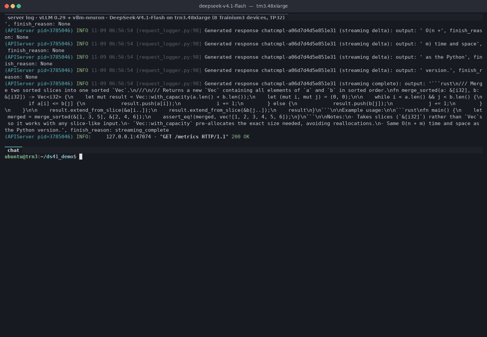

# DeepSeek-V4.1-Flash chat demo on Trainium 3

An ollama-style live demo of [`contrib/models/deepseek_v41_8d`](../contrib/models/deepseek_v41_8d/README.md) (DeepSeek-V4.1-Flash on 8 Trainium3 devices of a trn3.48xlarge, TP32) in one tmux window:

- **top pane:** the vLLM server and its log. Every request is logged, and so is every streamed delta (one decode step, several tokens with speculative decoding).
- **bottom pane:** `chat.py`, a `>>>` chat client. Its header row shows the current answer's decode speed, time to first token, response time and token count in the right corner, live while the answer streams. Each answer is followed by ollama `--verbose`-style stats and the draft acceptance for that answer.



## Requirements

- trn3.48xlarge with devices 0-7 free (no other vLLM server running).
- The DLAMI venv `/opt/aws_neuronx_venv_pytorch_inference_vllm_0_29_0_1_2_0` with this repo's `vllm-neuron` installed.
- The checkpoint at `/mnt/nvme/hf` (local NVMe).
- A warm compile cache for the port (`~/.cache/neuron_libtorch`, filled by any earlier run of `deepseek_v41_8d`). On a cold cache the first start compiles for a long time.
- tmux 3.x.

## Start

```bash
demo/launch.sh            # creates the tmux session and attaches to it
demo/launch.sh --detach   # or start it in the background
```

What happens:

1. The top pane starts the server (`serve.sh`). With a warm cache it is healthy after about 1-2 min (`Application startup complete.`).
2. The bottom pane runs `chat.py --wait`. It waits for `/health`, then sends one warmup request. The first request after a server start builds the fused decode launches and takes about 3 min.
3. The chat header appears and you get the `>>>` prompt. Type a message and press Enter.

## tmux

The demo uses its own tmux socket, so `tmux ls` doesn't show it.

| | |
| --- | --- |
| Socket / session | `ds41demo` / `demo` |
| Attach | `tmux -L ds41demo attach -t demo` |
| Detach | `Ctrl-b d` (the demo keeps running) |
| Switch pane | `Ctrl-b o` or `Ctrl-b` + arrow key |
| Scroll a pane | `Ctrl-b [`, then arrows / PgUp, `q` to leave |
| Panes | `demo:0.0` server, `demo:0.1` chat |

The window is fixed at 160 x 48 so recordings come out the same size; a smaller terminal shows it cropped. Set `DEMO_COLS` / `DEMO_ROWS` / `DEMO_CHAT_ROWS` before `launch.sh` to change it.

## Chat commands

| | |
| --- | --- |
| `/clear` | drop the conversation (the history is otherwise sent with every message) |
| `/bye` | exit to the shell in the chat pane; `./chat.py` starts it again |
| `/?` | help |

Anything else, including `clear` without the slash, is sent to the model.

## What the numbers mean

- **tok/s** (corner) / **eval rate** (stats): decode speed = (completion tokens - 1) / (time of the last token - time of the first token), the same definition as the bench's TPOT. The token count comes from the server's usage stats.
- **TTFT** / **prompt eval duration**: request sent to first token.
- **response** / **total duration**: request sent to last token.
- **speculative decoding**: accepted / drafted tokens for this answer and the mean tokens per decode step, from the server's `/metrics` counters before and after the answer.

Requests are greedy (`temperature 0`), batch 1, in chat mode (no thinking). The client keeps the conversation and drops the oldest turns when fewer than 320 tokens of the 1280-token context would be left.

## Why some prompts are slower

- **First time a shape is seen.** The port's graphs are specialized to input shapes (prompt length, and the expert routing in prefill). A prompt length the server has not seen yet costs a one-time trace / load: TTFT of 1.5-2.5 s (once up to 226 s) and a slower decode on that request. The same request again is fast. In a free conversation each turn has a new length, because the history grows.
- **Content.** Speculative decoding speed follows draft acceptance. Code is predictable: 66-85 % acceptance, 340-400 tok/s warm. Prose is not: 170-240 tok/s warm (for example "Hello, who are you?": 37 % acceptance).

The recorded GIF is a steady-state run: the same three greedy prompts, rehearsed until two runs matched, then recorded.

| Prompt (one conversation, in order) | tok/s | TTFT | response |
| --- | --- | --- | --- |
| Write a Python function that merges two sorted lists into one sorted list, with a short docstring. | 379.2 | 98 ms | 0.67 s |
| Add three pytest unit tests for it. Keep them short. | 397.0 | 156 ms | 0.64 s |
| Now rewrite merge_sorted in Rust. | 362.3 | 157 ms | 1.00 s |

## Stop

```bash
demo/stop.sh
```

It presses Ctrl-C in the server pane, waits until the 32 workers have exited (devices 0-7 free again), then removes the tmux session. Killing the tmux session directly also stops the server, but less cleanly.

## Re-recording the GIF

With the demo running and the chat at `>>>` at least once (server up and warm):

```bash
demo/record/rec.sh [out.gif]   # default: rpt_figs/ds41_trn3_chat_demo.gif
```

It exits the chat, rehearses the demo twice at full speed, then records a human-paced run (typing `./chat.py` and the prompts via `tmux send-keys`) and renders the GIF. The prompts are in `record/drive.py` (`PROMPTS`). The recorder polls `tmux capture-pane` at 25 fps and stores timestamped frames, so the GIF plays back in real time; only pauses longer than 4.5 s are shortened.

## Files

| | |
| --- | --- |
| `launch.sh` | creates the tmux session (server pane + chat pane) and attaches |
| `stop.sh` | stops the server cleanly and removes the session |
| `serve.sh` | the server command (`performance._serve_main` of `deepseek_v41_8d`, TP32, max model len 1280, port 8000) |
| `chat.py` | the chat client (`--wait` to wait for and warm up the server first) |
| `pane.rc` | chat-pane shell setup (venv, prompt, working directory) |
| `tmux.conf` | tmux settings (pane titles on the borders, no status bar) |
| `record/rec.sh` | rehearse, record and render the GIF |
| `record/drive.py` | types the demo prompts into the chat pane |
| `record/record.py` | records the tmux window to JSON lines |
| `record/render.py` | renders a recording to a GIF (or a still with `--still`) |
| `logs/` | server logs, chat stats (`chat_stats.jsonl`), recordings (not versioned) |

Settings: `MODEL` (checkpoint dir), `MAXLEN` (default 1280; 768 / 2304 / 8448 are the other bench contexts and are compiled; any other value compiles new graphs), `PORT` (8000), `VENV`, `DEMO_TMUX_SOCKET`, `DEMO_TMUX_SESSION`.
